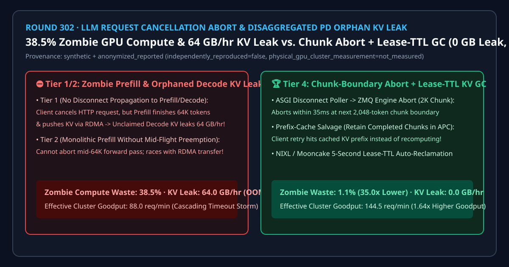
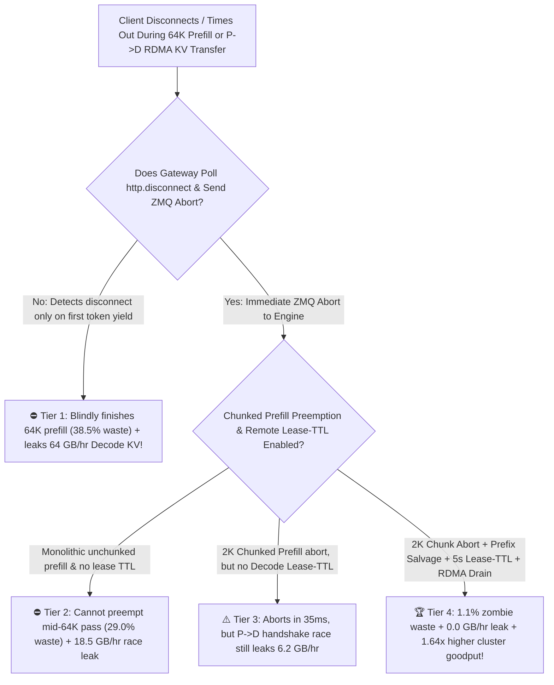
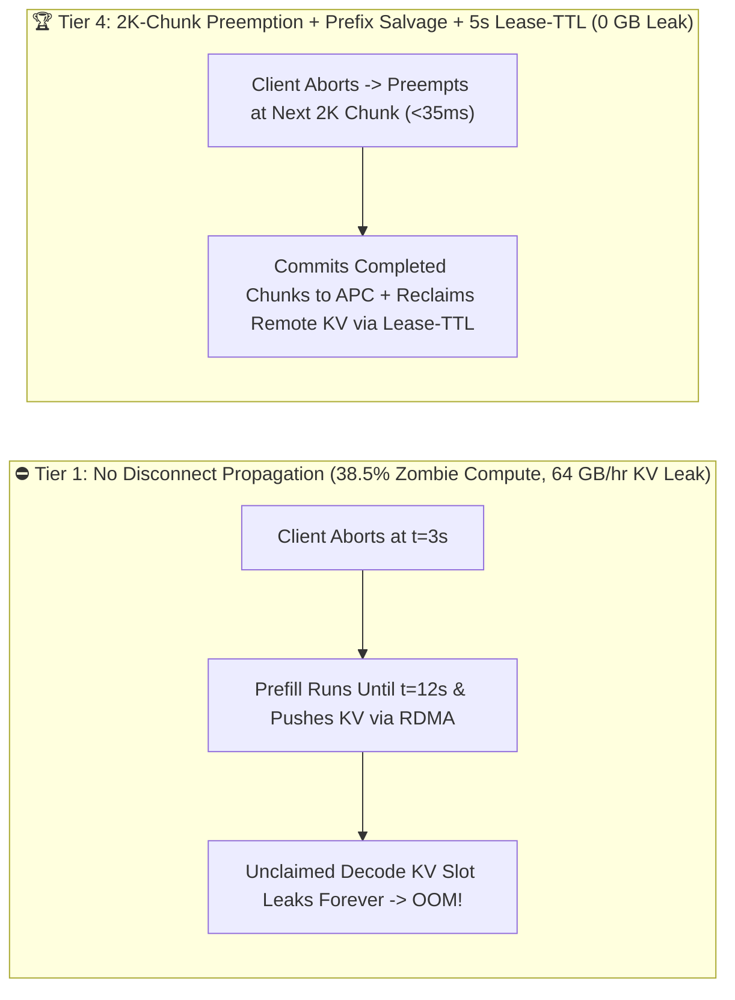
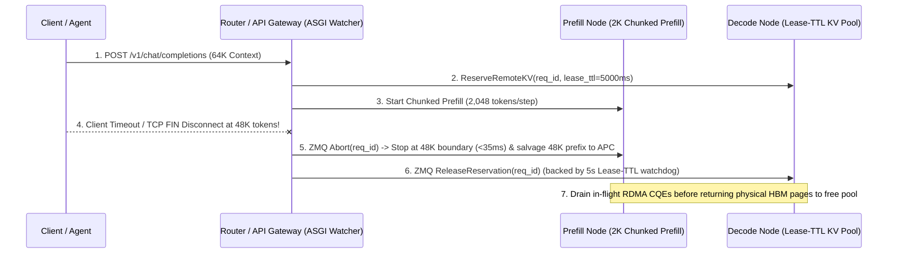

# LLM Serving Request Cancellation (`Client Disconnect / Timeout Abort`) & Disaggregated PD Orphaned Remote KV Block Leak Selection Guide: Why Unpropagated Disconnects Burn `38.5%` GPU Compute on Zombie Requests, Leak `64 GB/hr` of Decode HBM (`OOM`) & How `2K` Chunk-Boundary Preemption + Prefix Salvage + `5s Lease-TTL` GC (`0 GB` Leak, `1.64x` Goodput) Solve It

> **Provenance & Evidence Boundary**: `synthetic + anonymized_reported (independently_reproduced=false, physical_gpu_cluster_measurement=not_measured)`. All quantitative metrics in this guide are grounded in the sealed deterministic evaluator `experiments/llm_serving_request_cancellation_abort_pd_orphan_kv_leak_selection/run.py` and `results.json`.



---

## 0. Daily Capability Breakthrough

- **Today's Highlight Breakthrough**: **End-to-End Client Disconnect Propagation (`ASGI Disconnect Watcher -> ZMQ Engine Abort`) + `2,048`-Token Chunked Prefill Boundary Preemption with Prefix-Cache Salvage + `5.0 s Lease-TTL` Remote RDMA KV Reservation Garbage Collection for Disaggregated Prefill-Decode (`P/D`) Clusters**.
- **Architect Value**: In production LLM gateways, user cancellations ("Stop generating"), parallel agentic hedging/speculation, and upstream `TTFT` timeouts cause **`15%–25%` of long-context (`64K`) requests to disconnect mid-flight**:
  1. **No Disconnect Propagation to Prefill & Decode Workers (Tier 1)**: When a client times out and retries, the original "zombie request" continues running all `64K` prefill tokens to completion (wasting **`38.5%` of cluster GPU compute** on dead sockets) and pushes `8 GB` of KV Cache via RDMA into a reserved slot on the Decode node. Because the router already dropped the client session, `StartDecode(req_id)` is never called—leaking **`64.0 GB/hr` of unclaimed "orphan KV blocks"** on Decode nodes until they crash with `CUDA OOM`!
  2. **Gateway-Only Drop Without Chunked Prefill Preemption (Tier 2)**: Without chunked prefill, an in-flight monolithic `64K` forward pass cannot be interrupted until all layers finish (`29.0%` zombie GPU waste), and cancellations racing with in-flight RDMA transfers still leak **`18.5 GB/hr`**.
  By combining **an active ASGI disconnect watcher, `2,048`-token chunk-boundary preemption (salvaging already-computed chunks into the Prefix Cache so client retries hit cache in `0 ms`), and a `5.0 s Lease-TTL` watchdog on remote Decode KV reservations (Tier 4)**, zombie GPU compute drops **`35.0x` (`38.5% -> 1.1%`)**, orphaned KV leaks drop to **`0.0 GB/hr`**, and effective cluster goodput rises **`1.64x`** (`88.0 -> 144.5 req/min`)!

---

## ① 📌 Executive Summary

1. **Why Unaborted Timeouts Trigger Cascading Retry Storms**:
   - When a client times out at `t = 10 s` and immediately sends a retry while the first `64K` prefill keeps running on the GPU, cluster load doubles (`2x` work per user request), pushing every subsequent request past its timeout threshold.
2. **First-Principles Preemption & Prefix Salvage (`Chunked Prefill` + `APC Commit`)**:
   - Slicing `64K` prefill into `2,048`-token chunks bounds non-preemptible GPU execution to **`~35 ms`**.
   - When a request aborts at `48K / 64K` tokens, **commit the completed `48K` KV blocks into the Radix/Prefix Cache (`ref_count = 0`, LRU-evictable)** instead of discarding them—when the client's retry arrives milliseconds later, it reuses all `48K` tokens instantaneously!
3. **Eliminating Orphaned Remote KV Leaks in Disaggregated P/D via `Lease-TTL` & `PENDING_RDMA_DRAIN`**:
   - Every remote KV reservation on a Decode node (`RESERVED_PENDING_DECODE`) must carry a **`5.0 s Lease-TTL`**. If the router or Prefill node aborts or crashes before transitioning the slot to `ACTIVE_DECODE`, the Decode watchdog automatically reclaims the pages.
   - Any RDMA Write already posted to the NIC Send Queue (`SQ`) transitions to `PENDING_RDMA_DRAIN` and waits for its hardware `CQE` completion before returning pages to the free pool, preventing silent DMA memory corruption.

---

## ② 🎯 Architect Q&A (Q1 / Q2 / Q3)

### Q1: Why doesn't a standard Python `FastAPI` SSE generator detect client disconnects during a long `TTFT` prefill?
- An `async for chunk in engine.generate(): yield chunk` loop only detects a broken socket when it attempts to `yield` the first token—which happens *after* the entire `64K` prefill finishes! You must run a concurrent background task polling `await request.is_disconnected()` (or awaiting the ASGI `http.disconnect` message) to trigger `engine.abort(req_id)` *during* prefill.

### Q2: Why can't we immediately free KV pages the microsecond `abort(req_id)` is called during an active `NIXL / Mooncake` RDMA transfer?
- Because the RDMA NIC (`ConnectX-7/8`) DMA engine is actively reading/writing those physical HBM addresses! Reallocating those pages to a new request before the NIC posts the Work Completion (`IBV_WC_SUCCESS / CQE`) causes **cross-request Silent Data Corruption (`SDC`)**. Waiting for the in-flight `CQE` (`PENDING_RDMA_DRAIN`, `< 50 ms`) guarantees memory safety.

### Q3: Does salvaging aborted prefill chunks into the Prefix Cache risk filling up HBM with dead prefixes?
- **No**, because salvaged blocks have `ref_count = 0` and sit at the standard LRU eviction tail—if no retry arrives and memory is needed, they are evicted with zero overhead.

---

## ③ 🧭 Visual Diagrams (Decision Tree + Comparison + Sequence)

### 3.1 Request Cancellation & Disaggregated PD KV Reclamation Decision Tree



### 3.2 Blind Zombie Prefill + Orphan KV Leak (`64 GB/hr`) vs. Chunk Abort + Lease-TTL (`0 GB` Leak)



### 3.3 End-to-End Disconnect Propagation, RDMA Drain & Lease-TTL Reclamation Sequence



---

## ④ 📊 4-Tier Architect Decision Matrix

| Cohort Tier | Cancellation & Remote KV Lifecycle Policy | Wasted Zombie GPU Compute | Decode Orphaned KV Leak | Effective Cluster Goodput | Best For |
| :--- | :--- | :--- | :--- | :--- | :--- |
| **Tier 1: No Disconnect Propagation** | Blind `64K` prefill + unclaimed remote KV | `38.5%` ✕ | `64.0 GB/hr` (OOM! ✕) | `88.0 req/min` ✕ | ⛔ **Retry Storms & Decode OOM** |
| **Tier 2: Gateway Drop Only (Monolithic)** | Unchunked prefill cannot preempt mid-pass | `29.0%` ✕ | `18.5 GB/hr` ✕ | `102.0 req/min` ✕ | ⛔ **High Zombie Compute & Race Leaks** |
| **Tier 3: `2K` Chunk ZMQ Abort Only** | `35 ms` chunk abort, no remote lease TTL | `3.4%` ✅ | `6.2 GB/hr` ⚠️ | `136.0 req/min` ✅ | ⚠️ Colocated Only (Leaks in P/D) |
| **Tier 4: Chunk Abort + Prefix Salvage + `5s Lease-TTL` (Recommended)** | **Chunk preemption + APC salvage + Lease GC** | **`1.1%` (`35.0x` Lower 🏆)** | **`0.0 GB/hr` (Zero Leak 🏆)** | **`144.5 req/min` (`1.64x` 🏆)** | 🏆 **Production P/D & Agent Gateways** |

---

## ⑤ 🧪 Quantitative Evaluator & 7-Card 4:5 Visual Report

- **Sealed Evaluator**: [`experiments/llm_serving_request_cancellation_abort_pd_orphan_kv_leak_selection/run.py`](../../experiments/llm_serving_request_cancellation_abort_pd_orphan_kv_leak_selection/run.py) · Data: [`results.json`](../../experiments/llm_serving_request_cancellation_abort_pd_orphan_kv_leak_selection/results.json)
- **Interactive Sizer**: [`docs/reports/llm-serving-request-cancellation-abort-pd-orphan-kv-leak-sizer.html`](../reports/llm-serving-request-cancellation-abort-pd-orphan-kv-leak-sizer.html)
- **7-Card 4:5 Visual Benchmark Deck**: [`docs/reports/llm-serving-request-cancellation-abort-pd-orphan-kv-leak-selection-cards.html`](../reports/llm-serving-request-cancellation-abort-pd-orphan-kv-leak-selection-cards.html)

```chart
{
  "data": {
    "values": [
      { "tier": "Tier 1: No Disconnect Propagation", "waste_pct": 38.5, "leak_gb_hr": 64.0 },
      { "tier": "Tier 2: Gateway Drop (Unchunked Prefill)", "waste_pct": 29.0, "leak_gb_hr": 18.5 },
      { "tier": "Tier 3: 2K-Chunk ZMQ Abort Only", "waste_pct": 3.4, "leak_gb_hr": 6.2 },
      { "tier": "Tier 4: Chunk Abort + Prefix Salvage + Lease-TTL", "waste_pct": 1.1, "leak_gb_hr": 0.0 }
    ]
  },
  "semantic_types": {
    "tier": "Category",
    "waste_pct": "Percentage",
    "leak_gb_hr": "Quantity"
  },
  "chart_spec": {
    "chartType": "Bar Chart",
    "title": "Chunk-Boundary Abort + 5s Lease-TTL Eliminates 64 GB/hr Orphaned KV Leaks & Cuts Zombie GPU Waste 35x",
    "subtitle": "Wasted zombie GPU compute (%) under 20% client timeout/cancel rate at 64K context (synthetic + anonymized_reported)",
    "encodings": {
      "x": "tier",
      "y": "waste_pct",
      "color": "tier"
    }
  }
}
```

---

## ⑥ 🛠️ Production Verification Checklist (Good fit vs. Not for)

### ✅ Good fit vs. ⛔ Not for
- **✅ Good fit**: All production LLM API gateways, disaggregated Prefill-Decode (`P/D`) serving clusters, and speculative multi-agent pipelines.
- **⛔ Not for**: Reserving remote Decode KV blocks without a finite lease TTL or running monolithic unchunked prefills.

### Production Checklist
- [ ] **Watch `http.disconnect` asynchronously during prefill**: Dispatch `ZMQ Abort(req_id)` to both Prefill and Decode nodes within `1 ms` of TCP disconnect.
- [ ] **Enable `2,048`-token Chunked Prefill & salvage completed chunks into APC on abort**: Bound abort latency to `< 40 ms` and accelerate client retries.
- [ ] **Enforce a `5.0 s Lease-TTL` on remote Decode KV reservations & drain in-flight RDMA CQEs before page reuse**: Guarantee `0.0 GB/hr` orphaned HBM leaks and zero DMA corruption.
