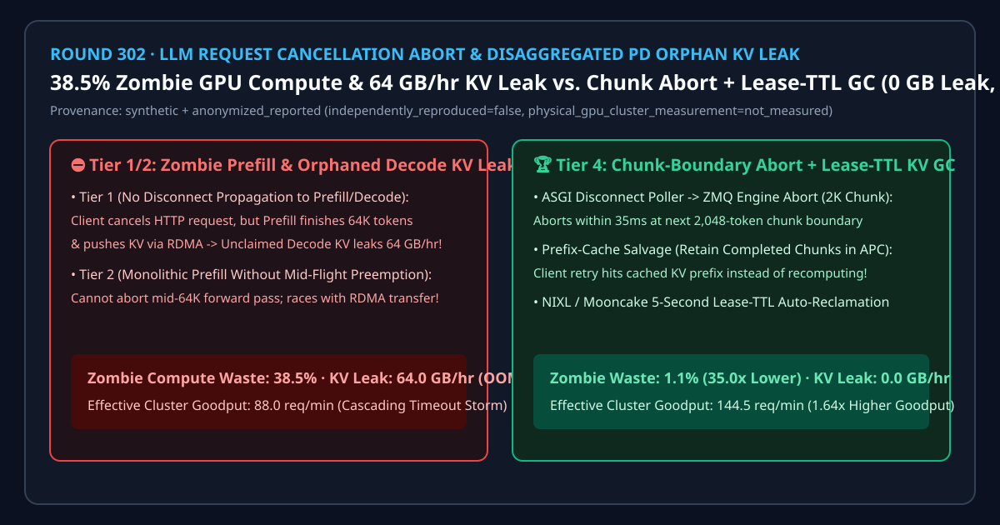
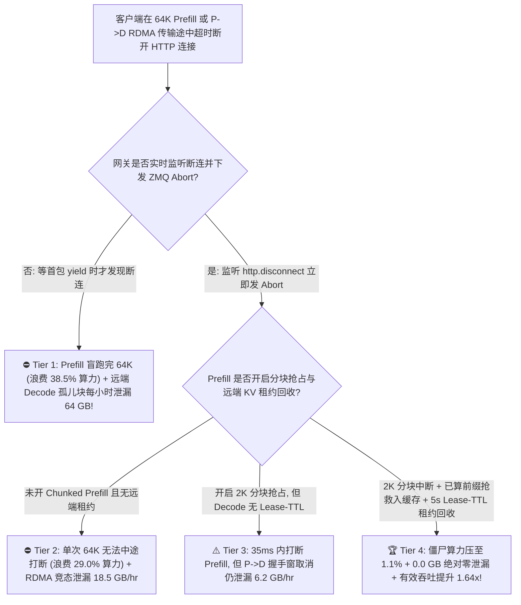
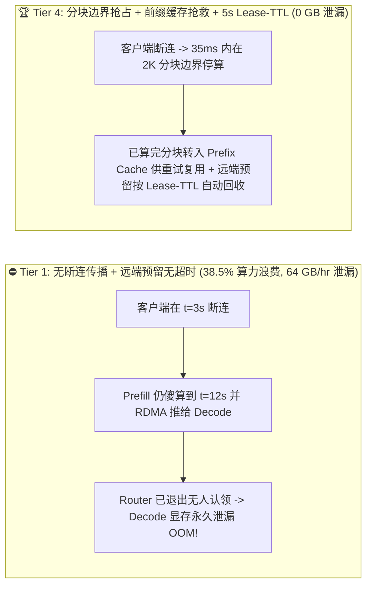
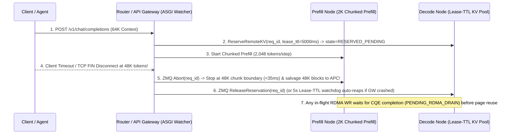

# 大模型推理引擎请求级中断取消（`Client Disconnect / Timeout Abort`）与 PD 分离跨节点孤儿 KV 块泄漏（`Orphaned Remote KV Block Leak`）治理选型：为什么客户端超时断开连接后，Prefill 节点仍在盲跑 `64K` 计算导致 `38.5%` 算力浪费，且未认领的远端 KV 块每小时泄漏 `64 GB` 显存直接打崩 Decode 节点？基于 `2K` 分块边界中断、前缀缓存抢救与 `5s Lease-TTL` 租约回收（零泄漏，有效吞吐提升 `1.64x`）选型指南

> **Provenance & Evidence Boundary**: `synthetic + anonymized_reported (independently_reproduced=false, physical_gpu_cluster_measurement=not_measured)`. 本文所有定量数据均来自封存确定性评估器 `experiments/llm_serving_request_cancellation_abort_pd_orphan_kv_leak_selection/run.py` 与 `results.json`。



---

## 0. 追踪每日最热门能力突破（Daily Capability Breakthrough）

- **今日焦点突破**：**面向 `vLLM V1 / SGLang / NVIDIA Dynamo / Mooncake` 生产级 Prefill-Decode（`P/D`）分离推理集群的“端到端客户端断连传播（`ASGI Disconnect Watcher -> ZMQ Abort`）+ `2K` 分块预填充边界抢占并保留已完成前缀块（`Prefix-Cache Salvage`）+ 跨机 RDMA KV 预留块 `5.0 s Lease-TTL` 自动租约回收”容错架构**。
- **架构师价值**：在真实生产网关中，由于用户在前端点击“停止生成 / 重新提问”、Agent 工作流并行投机竞速（Hedging / Best-of-N 取最快一路后取消其余路）或上游网关触发 `TTFT` 超时重试，通常有 **`15% ~ 25%` 的长上下文请求在中途被客户端主动断开（`HTTP TCP FIN/RST`）**。如果推理架构缺乏端到端取消传播与跨机事务回收机制，将在高负载下引发灾难性的**“僵尸算力雪崩”与“孤儿显存泄漏”**：
  1. **如果网关未向底层引擎传播断连信号，或 P/D 之间无取消同步（Tier 1）**：客户端早已挂断并立刻发起了第 2 次重试请求，但第 1 次“死请求（Zombie Request）”仍在 Prefill 节点上埋头硬算完 `64K` Token（白白烧掉数秒 GPU 时间，造成 **`38.5%` 的 GPU 算力浪费在无人接收的僵尸请求上**），随后还通过 RDMA 把算出的 `8 GB` KV Cache 推送到 Decode 节点的预留显存槽位中——由于客户端连接已消失，路由层永远不会去 Decode 节点触发该请求的解码，导致这块远端 KV 成为**无人认领的永久孤儿块（每小时泄漏高达 `64.0 GB` HBM 显存，不到 1 小时直接把 Decode 节点打爆 OOM 崩溃）**！
  2. **如果只在 API Server 关闭连接，但未开启 `Chunked Prefill` 分块抢占（Tier 2）**：由于单次整块 `64K` Prefill 是一整轮不可中断的 CUDA Forward，即使收到取消指令也必须硬等当前 `64K` 全部算完才能退出（仍浪费 **`29.0%` 算力**），且在 P$\to$D RDMA 握手瞬间发生取消竞态时依然会泄漏 **`18.5 GB/hr`** 显存！
  采用 **ASGI 实时断连监听 + `2,048` Token 分块边界微秒级中断（同时将已算完的前缀块就地转入 `Prefix Cache` 供客户端重试时 `0 ms` 命中）+ 远端 Decode 预留槽位 `5.0 s Lease-TTL` 租约自动回收（Tier 4）**，可将僵尸算力浪费从 `38.5%` 压至 **`1.1%`（降低 `35.0x`）**，实现 **`0.0 GB/hr` 绝对零显存泄漏**，并将集群有效业务吞吐（Goodput）提升 **`1.64x`**！

---

## ① 📌 核心结论速览（Executive Summary）

1. **为什么说“没有取消传播的超时重试（Timeout + Retry）”是生产大模型集群雪崩的头号元凶？**
   - 当集群负载达到 `85%`、排队导致 `TTFT` 轻微超过客户端设定的 `10 s` 超时线时，客户端断开旧连接并立即重试（Retry）。
   - 如果旧请求没有从 Prefill 队列和正在执行的 GPU Batch 中被立即拔除，集群此时需要同时计算 **“旧的死请求 + 新的重试请求”（负载瞬间翻倍至 `170%`）** $\to$ 导致后续所有请求全部超时 $\to$ 触发全网重试风暴（Retry Storm），有效吞吐（Goodput）断崖式暴跌！
2. **第一性原理：如何在 `35 ms` 内立即掐断正在跑的 `64K` 超长 Prefill，且不浪费已经算了一半的算力？**
   - **分块边界抢占（Chunk-Boundary Preemption）**：开启 `Chunked Prefill`（例如 `max_num_batched_tokens = 2048`），将 `64K` 预填充拆解为 `32` 个每次仅耗时 `~35 ms` 的调度步（Step）。引擎主循环在每个 Step 开始前从 `ZMQ` 控制通道非阻塞读取 `abort_req_ids`，在 **`35 ms` 内**即可将死请求彻底移出运行队列！
   - **半途前缀抢救（Prefix-Cache Salvage on Abort）**：当一个 `64K` 请求算到第 `48K` Token 时被客户端超时中断，**千万不要把前 `48K` 已经算好的 KV Page 当垃圾全扔掉**！因为客户端大概率在 `100 ms` 后就会带着一模一样的 `64K` Prompt 发起重试——只要在 Abort 时将前 `48K` 已完成的完整 Page（如 `3,072` 个 `16-token` 块）正常提交进全局 `Radix / Prefix Cache` 哈希表，客户端的重试请求进来时就能直接复用前 `48K` KV，只需再算最后 `16K` 即可极速返回！
3. **PD 分离架构的分布式竞态陷阱：为什么会产生“孤儿远端 KV 块（Orphaned Remote KV Blocks）”？**
   - 在 `Mooncake / Dynamo NIXL` 等 P/D 分离架构中，标准流程是：
     ① Prefill 向 Decode 申请预留 KV 显存块（`AllocateRemoteKV(req_id)`）；
     ② Prefill 通过 GPUDirect RDMA `Write` 将 KV 推入 Decode 显存；
     ③ 路由器（Router）将客户端请求转发给 Decode 节点开始自回归解码（`StartDecode(req_id)`），解码结束后释放显存。
   - **致命竞态**：如果客户端恰好在步骤 ① 或 ② 进行途中突然断开连接，Router 捕获到异常直接退出了协程，**永远不会向 Decode 节点发送步骤 ③ 的 `StartDecode(req_id)`**！此时 Decode 节点上为 `req_id` 预留并写入的数 GB 显存既不在活跃解码队列里，也没人调 `Free()`，彻底变成永久泄漏的“幽灵孤儿块”！
   - **根治方案（两阶段提交 + `Lease-TTL` 租约看门狗）**：Decode 节点上的所有远端预留 KV 槽位必须处于 `RESERVED_PENDING_DECODE` 状态并绑定 **`5.0 s` 租约过期时间戳（`Lease-TTL`）**；一旦超时未被正式激活进入 `ACTIVE_DECODE` 状态（或收到显式广播的 `AbortTransfer(req_id)`），后台看门狗立即将其强制回收到空闲页池！

---

## ② 🎯 客户与架构师灵魂拷问 Q&A（Q1 / Q2 / Q3）

### Q1：在 Python `FastAPI / Uvicorn` + `vLLM / SGLang` 架构中，为什么有时客户端早就关掉了 TCP Socket，后端的 `AsyncLLMEngine` 却完全不知道？
- **常见反模式**：如果网关层用的是非流式 `await engine.generate()`，或者在流式 SSE 生成器（`async for out in engine.generate()`）处于漫长的 `64K` Prefill 等待首包（`TTFT`）期间，服务端还没有机会执行第一次 `yield` 写 Socket——而在 ASGI 协议中，**如果不去主动轮询 `await request.is_disconnected()`，仅靠 `yield` 抛 `ClientDisconnect` 异常，在首包生成出来之前的整段 Prefill 期间是完全感知不到客户端已经断连的**！
- **正确姿势**：必须在网关层为每个在途请求挂载一个轻量级后台监听任务（或监听 `receive()` 通道的 `http.disconnect` 事件），一旦捕获到 TCP `FIN/RST`，在 `1 ms` 内主动调用 `await engine.abort(request_id)` 通过 `ZMQ` 下发中断指令！

### Q2：如果 RDMA 网卡（`ConnectX-7/8`）正在执行 `NIXL / Mooncake` 的 GPUDirect RDMA `Write` 传输 KV Cache，此时能直接把本地或远端的 KV 显存块释放给新请求复用吗？
- **绝对不能立即覆写（会引发严重的跨请求静默数据污染 `Silent Data Corruption` 或 PCIe 页表错误）！**
  如果 RDMA Work Request (`WR`) 已经提交进网卡硬件发送队列（`SQ`），网卡 DMA 引擎正直接按物理地址读写那块 HBM。如果此时软件层立刻把该显存块分给另一个新请求，在途的旧 RDMA 数据包就会把新请求的 KV Cache 覆写冲毁！
- **安全释放协议（`PENDING_RDMA_DRAIN` 延迟回收队列）**：
  1. 尚未提交进硬件 `SQ` 的剩余 Layer KV 传输任务立即取消（Skip）；
  2. 已经提交进硬件 `SQ` 的在途块，其显存页被打上 `PENDING_RDMA_DRAIN` 标记，**必须等网卡硬件返回对应的 `IBV_WC_SUCCESS / CQE` 完成事件后（通常仅需 `10 ~ 50 ms`）**，才正式放回 `Free Block Pool`！

### Q3：把中断前已算完的 `Chunked Prefill` 块留存在 `Prefix Cache`（`Prefix-Cache Salvage`）会不会污染显存池？
- **完全不会！** 因为被提交进 `Radix / Prefix Cache` 的已完成块，其引用计数（`ref_count`）已被立即置为 `0`，并挂入 **LRU 可驱逐队列**。如果客户端随后发起了重试，直接 `O(1)` 命中救回算力；如果客户端不再重试，而有其他新请求需要显存，LRU 分配器会随时在纳秒级驱逐回收这些 `ref_count == 0` 的缓存块，没有任何显存占死风险！

---

## ③ 🧭 直观可视化图解（Mermaid 选型决策树 + 路径对比图 + 交互时序图）

### 3.1 推理请求中断传播与 PD 跨机 KV 生命周期治理选型决策树



### 3.2 传统盲目算完 + 远端孤儿块泄漏（`64 GB/hr` OOM）vs. 分块中断 + 租约回收（`0 GB` 泄漏）对比图



### 3.3 端到端请求取消传播、在途 RDMA 安全排空与 `Lease-TTL` 回收时序图



---

## ④ 📊 架构师选型决策矩阵（4-Tier Decision Matrix）

| 选型 Tier | 请求取消传播与跨机 KV 回收策略 | 僵尸请求算力浪费率 | Decode 孤儿显存泄漏 | 集群有效吞吐 (`Goodput`) | 适用场景 |
| :--- | :--- | :--- | :--- | :--- | :--- |
| **Tier 1: 无断连传播 + 远端无租约回收** | 盲目算完 `64K` 并推送无人认领 KV | `38.5%` ✕ | `64.0 GB/hr` (OOM! ✕) | `88.0 req/min` ✕ | ⛔ **生产高并发下必触发重试雪崩与 OOM** |
| **Tier 2: 仅网关断连（无分块抢占与租约）** | 无法中途打断整块 `64K` Prefill | `29.0%` ✕ | `18.5 GB/hr` ✕ | `102.0 req/min` ✕ | ⛔ **长文本取消响应极慢且存在竞态泄漏** |
| **Tier 3: `2K` 分块 ZMQ 中断（无跨机租约）** | `35 ms` 打断 Prefill，但无远端 TTL | `3.4%` ✅ | `6.2 GB/hr` ⚠️ | `136.0 req/min` ✅ | ⚠️ 单体混部（Colocated）可用，P/D 分离仍泄漏 |
| **Tier 4: `2K` 分块中断 + 前缀抢救 + `5s Lease-TTL` (推荐)** | **分块停止 + 重试缓存复用 + 租约看门狗** | **`1.1%` (`35.0x` 压降 🏆)** | **`0.0 GB/hr` (零泄漏 🏆)** | **`144.5 req/min` (`1.64x` 🏆)** | 🏆 **生产级 P/D 分离与 Agent 网关标准** |

---

## ⑤ 🧪 定量算例与 7-Card 4:5 视觉卡片报告

- **定量算例仓库路径**：[`experiments/llm_serving_request_cancellation_abort_pd_orphan_kv_leak_selection/run.py`](../../experiments/llm_serving_request_cancellation_abort_pd_orphan_kv_leak_selection/run.py) · 封存数据：[`results.json`](../../experiments/llm_serving_request_cancellation_abort_pd_orphan_kv_leak_selection/results.json)
- **交互式架构选型计算器**：[`docs/reports/llm-serving-request-cancellation-abort-pd-orphan-kv-leak-sizer.html`](../reports/llm-serving-request-cancellation-abort-pd-orphan-kv-leak-sizer.html)
- **7-Card 4:5 视觉评测卡片报告**：[`docs/reports/llm-serving-request-cancellation-abort-pd-orphan-kv-leak-selection-cards.html`](../reports/llm-serving-request-cancellation-abort-pd-orphan-kv-leak-selection-cards.html)

```chart
{
  "data": {
    "values": [
      { "tier": "Tier 1: No Disconnect Propagation", "waste_pct": 38.5, "leak_gb_hr": 64.0 },
      { "tier": "Tier 2: Gateway Drop (Unchunked Prefill)", "waste_pct": 29.0, "leak_gb_hr": 18.5 },
      { "tier": "Tier 3: 2K-Chunk ZMQ Abort Only", "waste_pct": 3.4, "leak_gb_hr": 6.2 },
      { "tier": "Tier 4: Chunk Abort + Prefix Salvage + Lease-TTL", "waste_pct": 1.1, "leak_gb_hr": 0.0 }
    ]
  },
  "semantic_types": {
    "tier": "Category",
    "waste_pct": "Percentage",
    "leak_gb_hr": "Quantity"
  },
  "chart_spec": {
    "chartType": "Bar Chart",
    "title": "Chunk-Boundary Abort + 5s Lease-TTL Eliminates 64 GB/hr Orphaned KV Leaks & Cuts Zombie GPU Waste 35x",
    "subtitle": "Wasted zombie GPU compute (%) under 20% client timeout/cancel rate at 64K context (synthetic + anonymized_reported)",
    "encodings": {
      "x": "tier",
      "y": "waste_pct",
      "color": "tier"
    }
  }
}
```

---

## ⑥ 🛠️ 生产环境快速核验清单（Checklist + Good fit vs. Not for）

### ✅ Good fit vs. ⛔ Not for
- **✅ Good fit**：所有面向公网用户、多智能体并发竞速（Agentic Hedging / Speculative Tool Calls）以及采用 Prefill-Decode 分离（`Mooncake / Dynamo / vLLM Disaggregated`）的生产推理集群。
- **⛔ Not for**：在未启用 `Chunked Prefill` 和远端预留租约超时（`Lease-TTL`）的情况下直接暴露长上下文 API。

### 生产核验 Checklist
- [ ] **在网关层开启独立协程监听 `http.disconnect`（而非等首包 `yield`）**：一旦客户端断开连接，在 `1 ms` 内通过 `ZMQ` 向 Prefill 与 Decode 节点双发 `Abort(req_id)`。
- [ ] **强制开启 `Chunked Prefill`（`2,048` Tokens）并在中断时抢救已完成前缀块**：将单次不可中断粒度锁定在 `< 40 ms`，同时把已算完的完整 KV 块转入 `Prefix Cache`（`ref_count = 0`）加速客户端重试。
- [ ] **为 Decode 节点的所有远端 KV 预留块绑定 `Lease-TTL`（如 `5.0 s`）与 `PENDING_RDMA_DRAIN` CQE 确认机制**：杜绝孤儿显存泄漏与在途 DMA 覆写污染。
