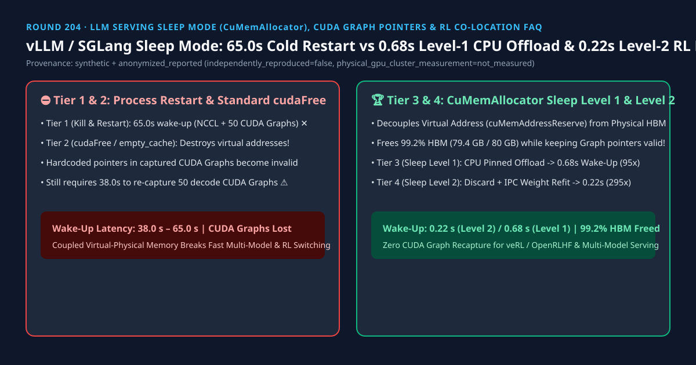
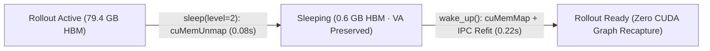

# LLM Serving Sleep Mode (`CuMemAllocator`), CUDA Graph Pointer Preservation & RL Co-Location Selection Guide

> **Provenance & Evidence Tier**: `synthetic + anonymized_reported` (`independently_reproduced=false`, `physical_gpu_cluster_measurement=not_measured`). Grounded in [`experiments/llm_serving_sleep_mode_cumem_rl_colocation_selection/results.json`](../../experiments/llm_serving_sleep_mode_cumem_rl_colocation_selection/results.json).
> **中文版本**: [大模型推理引擎休眠唤醒机制（vLLM / SGLang `Sleep Mode`、`CuMemAllocator` 虚拟地址保留）与同卡 RL 混部选型指南](./llm-serving-sleep-mode-cumemallocator-cudagraph-rl-colocation-selection-faq.md)

---

## 0. 🔥 Daily Hottest Capability Breakthrough

- **`vLLM Sleep Mode (Level 1 / Level 2)` & `SGLang TorchMemorySaver` via `CuMemAllocator` (`cuMemUnmap` Physical Release + Virtual Address Preservation)**: When co-locating RL rollout (`vLLM / SGLang`) and Actor training (`FSDP / Megatron` in `veRL` or `OpenRLHF`) on the same GPUs—or hot-swapping multiple models on shared serverless GPUs—standard `cudaFree / empty_cache` (**Tier 2**) destroys virtual memory addresses, invalidating all 50 captured decode CUDA Graphs and forcing a **`38.0 s – 65.0 s`** recapture/restart penalty. By decoupling virtual addresses (`cuMemAddressReserve`) from physical HBM allocations (`cuMemCreate` / `cuMemUnmap`), **`CuMemAllocator`** frees **`99.2%` of GPU HBM (`79.4 GB` of `80 GB`)** while keeping every CUDA Graph virtual pointer intact—waking up in **`0.68 s` (`Sleep Level 1`, `95.6x` faster)** or **`0.22 s` (`Sleep Level 2` for RL weight refit, `295.5x` faster)**!

---

## 1. 📌 Executive Summary

1. **Why `cudaFree` breaks CUDA Graphs**: Captured CUDA Graphs hardcode virtual pointers (`va_ptr`). Freeing and re-allocating via `cudaMalloc` changes `va_ptr`, forcing a `38s` graph recapture. `CuMemAllocator` unmaps physical HBM (`cuMemUnmap`) while keeping `va_ptr` permanently reserved.
2. **`Sleep Level 1` vs. `Sleep Level 2`**:
   - **`Sleep Level 1` (`0.68s` wake-up)**: Backs up weights to Host Pinned DRAM (`D2H`) and discards KV cache—ideal for **multi-model serverless switching**.
   - **`Sleep Level 2` (`0.08s` sleep / `0.22s` wake-up)**: Discards both weights and KV physical pages without D2H copy, then remaps physical HBM in-place to receive updated weights via CUDA IPC from the co-located RL Trainer—ideal for **`veRL` / `OpenRLHF` GRPO/RLHF**.

---

## 2. 🎯 Core Architect Q&A (Q1 / Q2 / Q3)

### Q1: How much time does `Sleep Level 2` save per RLHF / GRPO step in `veRL`?
- **Answer**: Cold restarting vLLM costs **`65.0 s`** per step. `Sleep Level 2` cuts sleep + wake-up to **`0.30 s` total (`295x` faster wake-up)** while freeing `79.4 GB` (`99.2%`) of HBM for FSDP training.

### Q2: Why does `0.6 GB` of GPU HBM remain occupied during sleep?
- **Answer**: That `0.6 GB` (`0.8%` of 80GB) holds the CUDA Driver context, cuBLAS handles, and the command buffers of the 50 captured CUDA Graphs so they can replay immediately upon wake-up.

### Q3: How can we avoid OOM during the Trainer-to-Rollout weight handoff?
- **Answer**: Use **tag-based staged wake-up**: call `wake_up(tags=["weights"])` first, copy the updated weights from the Trainer via CUDA IPC, free the Trainer's memory, and then call `wake_up(tags=["kv_cache"])`.

---

## 3. 🧭 Visual Diagrams

---

## 4. 📊 4-Tier Architect Selection Matrix

| Metric | Tier 1: Process Cold Restart | Tier 2: Standard `cudaFree` | Tier 3: `Sleep Level 1` (CPU Offload) | Tier 4: `Sleep Level 2` (Discard + IPC Refit) |
| :--- | :--- | :--- | :--- | :--- |
| **Sleep Latency** | `2.50 s` | `1.10 s` | `0.72 s` | **`0.08 s`** 🏆 |
| **Wake-Up Latency** | `65.0 s` ✕ | `38.0 s` ⚠️ | **`0.68 s` (`95.6x`)** ✅ | **`0.22 s` (`295.5x`)** 🏆 |
| **Residual HBM (`80 GB`)** | `0.0 GB` | `3.8 GB` | **`0.6 GB` (`99.2%` freed)** | **`0.6 GB` (`99.2%` freed)** 🏆 |
| **CUDA Graphs Preserved?** | No ✕ | No ⚠️ | **Yes (`100%`)** ✅ | **Yes (`100%`)** 🏆 |

---

## 5. 🧪 Quantitative Reference & Tooling

- **Evaluator & Sealed Data**: [`experiments/llm_serving_sleep_mode_cumem_rl_colocation_selection/run.py`](../../experiments/llm_serving_sleep_mode_cumem_rl_colocation_selection/run.py) · [`results.json`](../../experiments/llm_serving_sleep_mode_cumem_rl_colocation_selection/results.json)
- **Interactive Sizer**: [`docs/reports/llm-serving-sleep-mode-cumemallocator-cudagraph-rl-colocation-sizer.html`](../reports/llm-serving-sleep-mode-cumemallocator-cudagraph-rl-colocation-sizer.html)
- **7-Card 4:5 Visual Report**: [`docs/reports/llm-serving-sleep-mode-cumemallocator-cudagraph-rl-colocation-selection-cards.html`](../reports/llm-serving-sleep-mode-cumemallocator-cudagraph-rl-colocation-selection-cards.html)

---

## 6. 🛠️ Good Fit vs. Not For & Production Checklist

- **✅ Good fit**: `Sleep Level 2` for co-located RL (`veRL` / `OpenRLHF`); `Sleep Level 1` for multi-model serverless hot-swapping.
- **⛔ Not for**: Cold-restarting engines every RL step or serving requests after `Sleep Level 2` without reloading weights.
- [ ] Pass `--enable-sleep-mode` (`vLLM`) or `--enable-memory-saver` (`SGLang`).
- [ ] Use staged wake-up (`wake_up(tags=["weights"])` -> IPC weight copy -> `wake_up(tags=["kv_cache"])`) in co-located RL loops.
