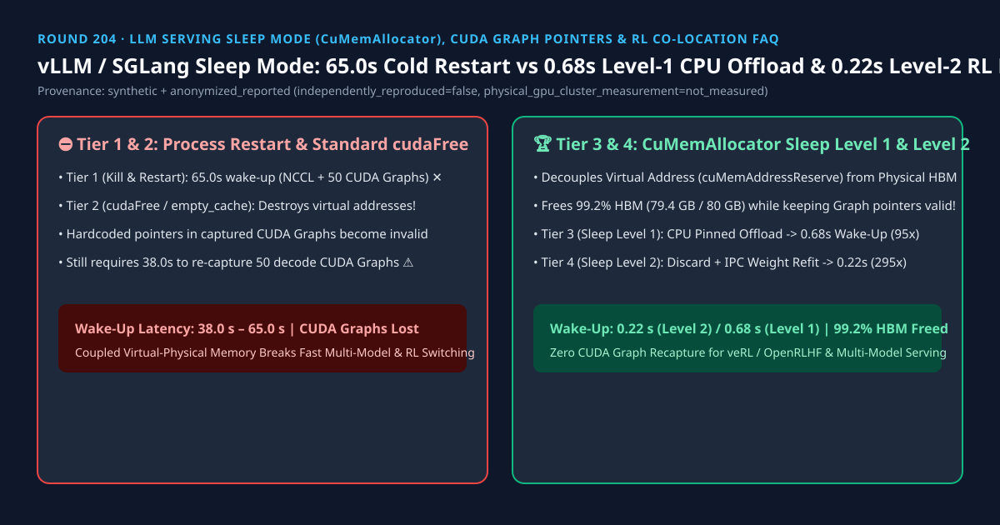
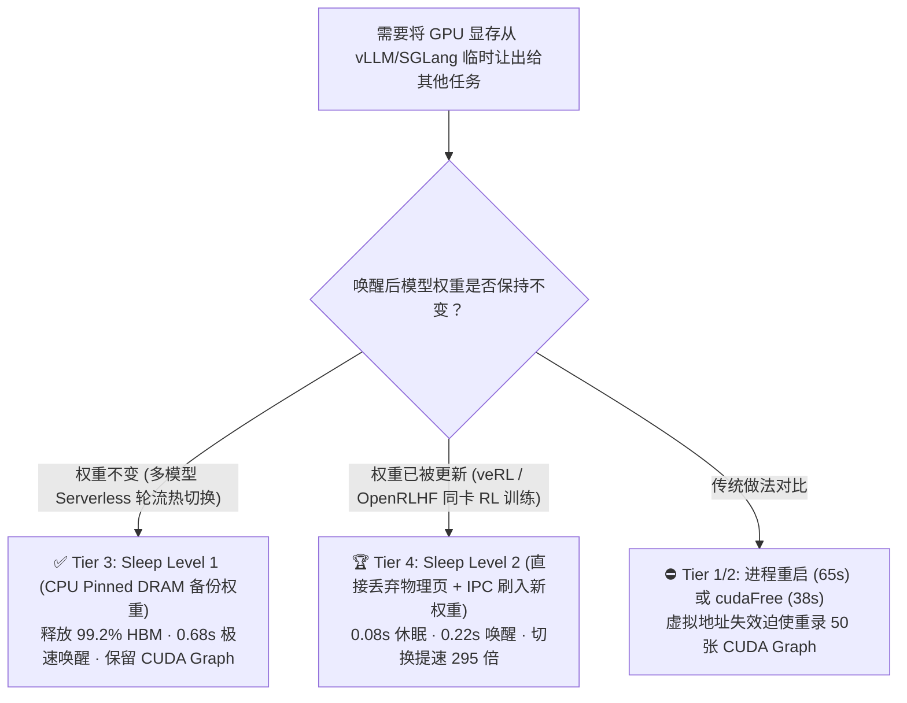
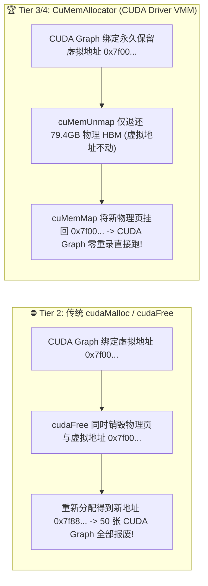
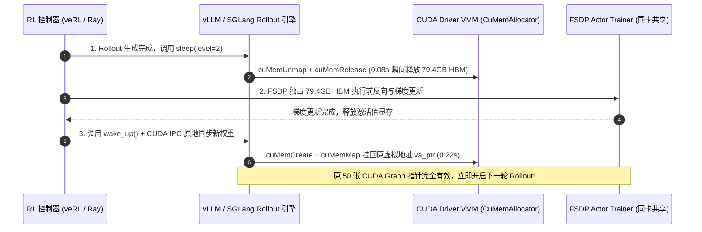

# 大模型推理引擎休眠唤醒机制（vLLM / SGLang `Sleep Mode`、`CuMemAllocator` 虚拟地址保留）与同卡 RL 混部选型指南

> **Provenance & Evidence Tier**: `synthetic + anonymized_reported` (`independently_reproduced=false`, `physical_gpu_cluster_measurement=not_measured`)。定量数据锚定于 [`experiments/llm_serving_sleep_mode_cumem_rl_colocation_selection/results.json`](../../experiments/llm_serving_sleep_mode_cumem_rl_colocation_selection/results.json)。
> **English Version**: [LLM Serving Sleep Mode (`CuMemAllocator`), CUDA Graph Pointer Preservation & RL Co-Location Selection Guide](./llm-serving-sleep-mode-cumemallocator-cudagraph-rl-colocation-selection-faq.en.md)

---

## 0. 🔥 今日领域最热门能力突破追踪（Daily Hottest Breakthrough）

- **`vLLM Sleep Mode (Level 1 / Level 2)` 与 `SGLang TorchMemorySaver` 基于 `CuMemAllocator` 的“虚拟地址锁定 + 物理显存卸载（`cuMemUnmap`）”秒级休眠唤醒架构**：在强化学习后训练（`RLHF / DeepSeek-R1 GRPO`，如 `veRL`、`OpenRLHF`、`AReaL`）同卡混部（Rollout 采样与 FSDP 训练共用同一批 GPU）以及多模型 Serverless 极速热切换场景中，最大的性能黑洞是**“如何在释放 `99.2%` GPU 显存的同时，不破坏已捕获的 50 张 CUDA Graph？”**。如果采用传统 `cudaFree / empty_cache`（Tier 2）或销毁重启进程（Tier 1），释放显存会连同**虚拟内存地址（Virtual Address Pointers）**一起销毁，导致 CUDA Graph 中硬编码的算子指针全部作废，每次唤醒必须耗费 **`38.0 ~ 65.0 秒`** 重新捕获计算图！`vLLM` 与 `SGLang` 引入基于 CUDA Driver VMM API 的 **`CuMemAllocator`**：休眠时通过 `cuMemUnmap` + `cuMemRelease` 释放 **`99.2%` 物理 HBM 显存（80GB H100 释放 `79.4 GB`，仅留 `0.6 GB` 上下文）**，但**永久保留原虚拟地址空间（`cuMemAddressReserve`）**；唤醒时将新申请的物理显存页重新映射回**完全相同的虚拟地址（`cuMemMap`）**，使得全部 50 张 CUDA Graph **零重录直接复用**，将唤醒耗时压缩至 **`0.68 秒`（Level 1，快 `95.6` 倍）**与 **`0.22 秒`（Level 2，快 `295.5` 倍）**！

---

## 1. 📌 核心结论速览（Executive Summary — 3 分钟看懂）

1. **为什么传统 `del model; torch.cuda.empty_cache()` 无法实现推理引擎秒级休眠唤醒？**
   - **通俗大白话 + 第一性原理**：把 CUDA Graph 比作一张已经印好的“特快专递路线图”，上面写死了每个权重张量和 KV Cache 的**门牌号（虚拟内存地址 `va_ptr`）**。传统的 `cudaMalloc / cudaFree` 是“门牌号与实体库房绑定”的——你一旦退租库房（释放物理显存），门牌号就被市政局注销了！下次再租库房时分到了新门牌号，原先印好的 50 张 CUDA Graph 路线图全部报废，必须花 **`38 秒`** 重新踩点印图（Recapture CUDA Graphs）。而 **`CuMemAllocator`（CUDA VMM 虚拟内存管理）** 把“门牌号（`cuMemAddressReserve`）”和“实体库房（`cuMemCreate` 物理显存页）”彻底解耦：休眠时只退掉实体库房（`cuMemUnmap`），**门牌号永久保留**；唤醒时租下新库房并挂回原来的门牌号（`cuMemMap`），原来的 50 张 CUDA Graph 路线图分秒不差直接开跑！
2. **`Sleep Level 1`（Tier 3）与 `Sleep Level 2`（Tier 4）到底有什么区别？**
   - **`Sleep Level 1`（多模型 Serverless 切换首选）**：休眠前先把模型权重经 PCIe Gen5 备份到 Host Pinned DRAM（耗时 `0.72 s`），丢弃 KV Cache；唤醒时在 **`0.68 s`** 内把权重从 CPU 内存拷回原虚拟地址，**无需重读磁盘、无需重录 CUDA Graph**。
   - **`Sleep Level 2`（同卡 RLHF / GRPO 训练混部首选）**：因为 RL 训练步结束后模型权重已经变了（旧权重本来就要被丢弃），`Sleep Level 2` **连拷贝到 CPU 都省了**，直接在 **`0.08 s`** 内解除映射丢弃全部权重与 KV 物理页；等 FSDP Trainer 训练完，在 **`0.22 s`** 内原地重映射物理页，并通过 **CUDA IPC / 共享显存**直接原地写入 Trainer 的新权重！

---

## 2. 🎯 客户与架构师灵魂拷问 Q&A（Q1 / Q2 / Q3）

### Q1：在 `veRL` 或 `OpenRLHF` 中做 70B 模型 GRPO 强化学习，如果不开 `Sleep Mode` 会浪费多少算力？
- **答**：在同卡混部（Co-located Rollout + Actor Training）模式下，每个 RL Step 都要经历“vLLM 采样生成 -> 释放 vLLM 显存 -> FSDP 反向传播更新 -> 唤醒 vLLM 同步新权重”。若采用销毁重启（Tier 1），每个 Step 光引擎重启和 CUDA Graph 捕获就要白白卡死 **`65.0 秒`**！开启 **`Sleep Level 2`（Tier 4）** 后，休眠仅需 **`0.08 秒`**、唤醒仅需 **`0.22 秒`**，单步切换开销降低 **`99.5%`（提速 `295` 倍）**。

### Q2：休眠期间那残留的 `0.6 GB` 显存是什么？能不能彻底清零？
- **答**：残留的 `~0.6 GB`（占 80GB H100 的 `0.8%`）是 CUDA Driver Context、cuBLAS/cuDNN 句柄以及已捕获的 50 张 CUDA Graph 命令缓冲区本身。正是因为保留了这 `0.6 GB` 的“骨架”，才能换来唤醒时省去 `38~65 秒` 的初始化与捕获时间，性价比极高。

### Q3：如果在 `Sleep Level 2` 唤醒后忘记调用权重更新（`collective_rpc("reload_weights")`）直接推理会发生什么？
- **答**：因为 `Sleep Level 2` 唤醒时只重新映射了未经初始化的新物理显存页，并未恢复旧权重数据，直接推理会读出全零或未定义噪声并输出乱码！因此生产规程铁律：**凡是 `sleep(level=2)`，唤醒后必须紧跟一步 `update_weights / reload_weights` 才能对外接收请求**。

---

## 3. 🧭 直观可视化图解（Mermaid 决策树 + VMM 映射图 + RL 混部时序图）

### 3.1 架构师显存休眠与热切换选型决策树

### 3.2 传统 `cudaMalloc` vs. `CuMemAllocator`（虚拟地址与物理显存解耦）对比

### 3.3 同卡 RLHF / GRPO（`veRL`）中 `Sleep Level 2` 极速切换时序图

---

## 4. 📊 架构师选型决策矩阵（4-Tier Selection Matrix）

| 评估维度 | Tier 1: 销毁进程冷重启 | Tier 2: 传统 `cudaFree / empty_cache` | Tier 3: `Sleep Level 1` (CPU Pinned 备份) | Tier 4: `Sleep Level 2` (丢弃 + IPC 权重刷入) |
| :--- | :--- | :--- | :--- | :--- |
| **休眠释放耗时 (`Sleep Time`)** | `2.50 s` | `1.10 s` | `0.72 s` (D2H 备份权重) | **`0.08 s` (仅解映射)** 🏆 |
| **唤醒恢复耗时 (`Wake-Up Time`)** | `65.0 s` ✕ | `38.0 s` ⚠️ | **`0.68 s` (快 95.6 倍)** ✅ | **`0.22 s` (快 295.5 倍)** 🏆 |
| **休眠期残留 GPU 显存** | `0.0 GB` | `3.8 GB` (分配器碎片) | **`0.6 GB` (释放 99.2%)** | **`0.6 GB` (释放 99.2%)** 🏆 |
| **已捕获 CUDA Graph 是否保留** | 否（全部重录） ✕ | 否（虚拟指针失效） ⚠️ | **是（100% 原地复用）** ✅ | **是（100% 原地复用）** 🏆 |
| **最佳适用场景** | 节点硬件故障彻底重置 | 无 CUDA Graph 的简易脚本 | **多模型 Serverless 秒级轮换** | **同卡 RLHF/GRPO (`veRL`/`OpenRLHF`) 黄金标准** |

---

## 5. 🧪 定量算例与工具链（Interactive Sizer & 7-Card Visual Report）

- **实验脚本与密封数据**：[`experiments/llm_serving_sleep_mode_cumem_rl_colocation_selection/run.py`](../../experiments/llm_serving_sleep_mode_cumem_rl_colocation_selection/run.py) · [`results.json`](../../experiments/llm_serving_sleep_mode_cumem_rl_colocation_selection/results.json)
- **交互式休眠唤醒计算器**：[`docs/reports/llm-serving-sleep-mode-cumemallocator-cudagraph-rl-colocation-sizer.html`](../reports/llm-serving-sleep-mode-cumemallocator-cudagraph-rl-colocation-sizer.html)
- **7-Card 4:5 视觉评测卡片报告**：[`docs/reports/llm-serving-sleep-mode-cumemallocator-cudagraph-rl-colocation-selection-cards.html`](../reports/llm-serving-sleep-mode-cumemallocator-cudagraph-rl-colocation-selection-cards.html)

---

## 6. 🛠️ Good Fit vs. Not For & 生产环境快速核验清单（Checklist）

### ✅ Good Fit vs. ⛔ Not For

| 维度 | ✅ Good Fit（强烈推荐） | ⛔ Not For（严禁误用） |
| :--- | :--- | :--- |
| **同卡 RL 训练与采样混部 (`veRL / OpenRLHF`)** | 启用 `--enable-sleep-mode`，在采样结束调用 `sleep(level=2)`，训练更新后调用 `wake_up()` + CUDA IPC 刷入新权重 | 每个 RL Step 销毁重建 vLLM 进程（白白浪费 65s）或使用 `Sleep Level 1` 把即将废弃的旧权重白拷一遍到 CPU |
| **多模型 Serverless 按需热切换** | 使用 `Sleep Level 1` 将低频模型权重暂存至 Host Pinned DRAM（`0.68s` 秒级唤醒复用 CUDA Graph） | 宿主机 Host Pinned DRAM 容量不足时强开过多模型的 `Sleep Level 1` 导致宿主机 OOM |

### 生产环境上线核验清单（Pre-Flight Checklist）

- [ ] **核验启动参数已开启 `CuMemAllocator`**：在 `vLLM` 中传入 `--enable-sleep-mode`（或在 `SGLang` 中开启 `--enable-memory-saver`），确认权重与 KV Cache 均由 `CuMemAllocator` 分配。
- [ ] **核验 `Sleep Level 1` 宿主机 Pinned Memory 余量**：若使用 `level=1`，确认宿主机锁页内存（`MEMLOCK=unlimited` 及空闲 Host DRAM）大于休眠模型的权重总大小。
- [ ] **核验 `Sleep Level 2` 唤醒后强制权重重装闭环**：在自动化编排脚本中，为 `wake_up(tags=["weights"])` 绑定强制的 `update_weights_from_ipc` 校验，严禁在权重重装完成前放行推理流量。
- [ ] **核验分段唤醒（Tag-based Wake-up）降低峰值显存**：在同卡 RL 权重同步阶段，先调用 `wake_up(tags=["weights"])` 仅映射权重显存接收 Trainer IPC 拷贝，待 Trainer 彻底释放后再调用 `wake_up(tags=["kv_cache"])`，彻底规避交接瞬间的 OOM。
