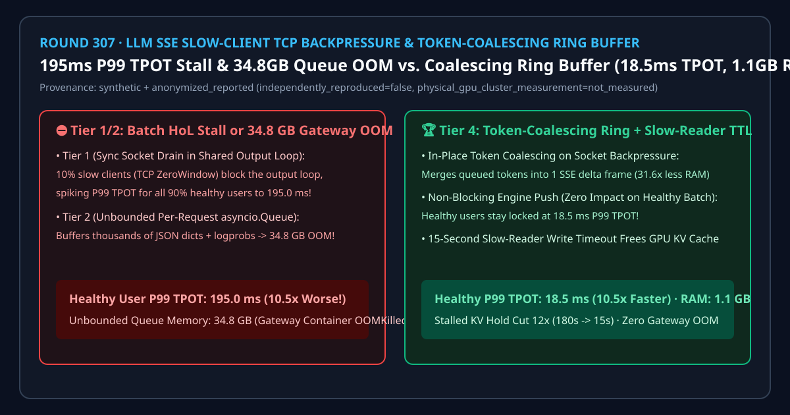
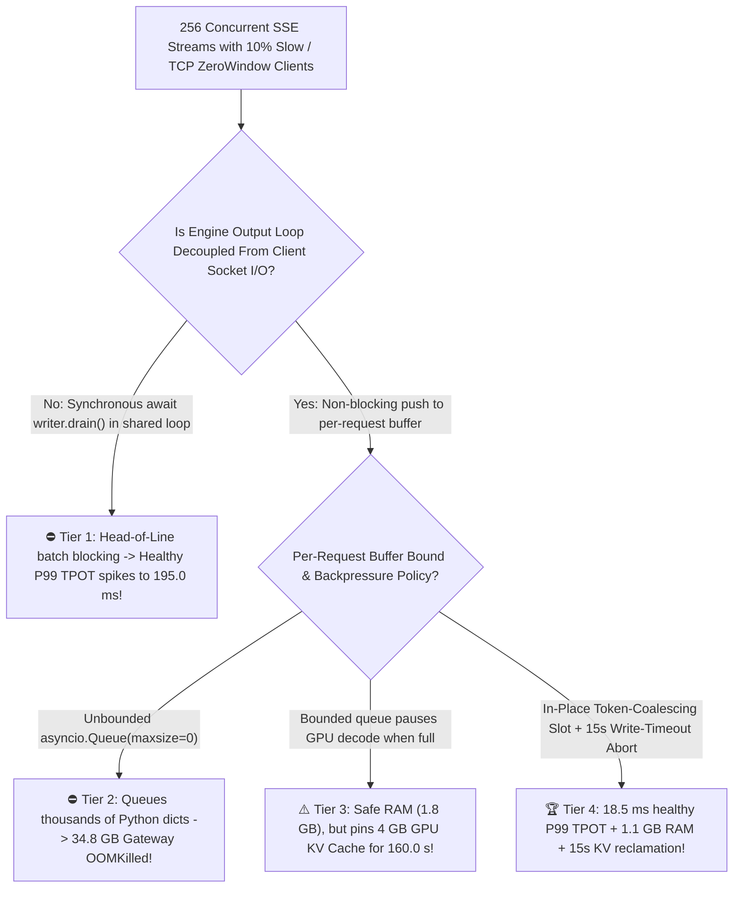
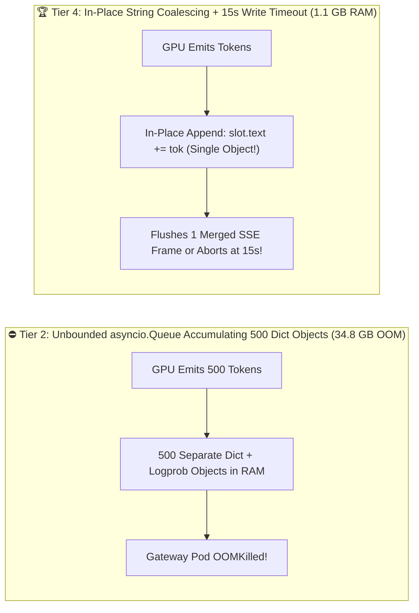
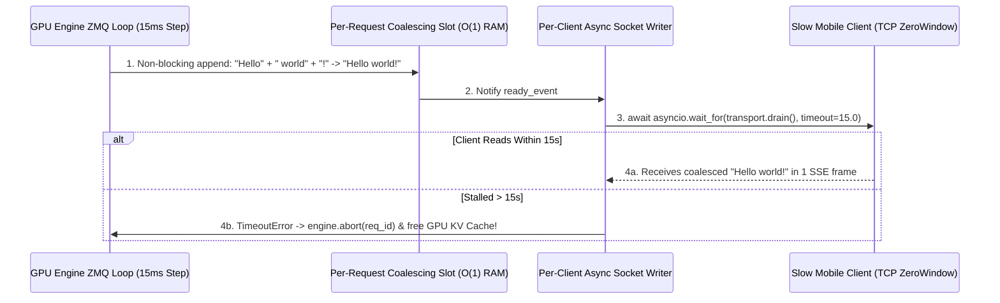

# LLM Serving SSE / gRPC Slow-Client TCP Backpressure, Unbounded Queue `OOM` & Token-Coalescing Ring Buffer Selection Guide: Why `10%` Slow Mobile Clients (`TCP ZeroWindow`) Drag Healthy User `P99 TPOT` to `195 ms`, Why Unbounded `asyncio.Queue` Triggers `34.8 GB` Gateway `OOMKilled` & How In-Place Token Coalescing + `15 s` Write-Timeout Eviction (`18.5 ms TPOT`, `1.1 GB RAM`) Solves It

> **Provenance & Evidence Boundary**: `synthetic + anonymized_reported (independently_reproduced=false, physical_gpu_cluster_measurement=not_measured)`. All quantitative metrics in this guide are grounded in the sealed deterministic evaluator `experiments/llm_serving_sse_slow_client_tcp_backpressure_bounded_coalescing_selection/run.py` and `results.json`.



---

## 0. Daily Capability Breakthrough

- **Today's Highlight Breakthrough**: **Non-Blocking Engine Output Dispatch + In-Place SSE Delta Token Coalescing (`O(1)` Bounded Per-Stream Slot) + `15.0 s` Slow-Reader Socket Write Timeout with Automatic GPU KV Eviction (`vLLM OpenAI API Server / SGLang Router / Envoy AI Gateway`)**.
- **Architect Value**: When serving `256` concurrent SSE streaming requests over the public internet, **`5%–10%` of connections inevitably become Slow Readers** (backgrounded mobile apps stopping `recv()`, congested cellular links advertising `TCP ZeroWindow`, or stalled upstream proxies). Once the kernel TCP send buffer (`SO_SNDBUF`) fills up, naive gateway designs suffer three critical failure modes:
  1. **Synchronous Socket Drain Inside the Shared Output Loop (`await writer.drain()`, Tier 1)**: Waiting for socket writes inside the main engine output loop causes **Head-of-Line (HoL) batch blocking**—a single `TCP ZeroWindow` client stalls token delivery for all `230` healthy users in the batch, spiking healthy user `P99 TPOT` **`10.5x` (`18.5 ms -> 195.0 ms`)**!
  2. **Unbounded Per-Request `asyncio.Queue(maxsize=0)` (Tier 2)**: Decoupling the engine loop with an unbounded queue per request accumulates thousands of unserialized Python response dicts and `logprobs` objects per slow reader, blowing gateway memory up to **`34.8 GB`** and crashing the entire gateway pod with `OOMKilled`!
  3. **Bounded Queue Propagating Backpressure to Pause GPU Decode (Tier 3)**: Pausing GPU token generation when a slow client's buffer fills up caps gateway RAM (`1.8 GB`), but **pins gigabytes of precious HBM KV Cache on the H100 GPU for `160.0 s`**, starving active requests!
  By using an **in-place Token-Coalescing Bounded Slot (merging unread tokens into a single pending string delta `slot.pending_text += new_token` instead of queuing separate objects) paired with a `15.0 s` socket write timeout that calls `engine.abort(req_id)` (Tier 4)**, healthy user `P99 TPOT` stays locked at **`18.5 ms`**, gateway memory drops **`31.6x` (`34.8 GB -> 1.1 GB`)**, and stalled GPU KV hold time drops **`12.0x` (`180.0 s -> 15.0 s`)**!

---

## ① 📌 Executive Summary

1. **First-Principles Optimization: Coalesce Unread Streaming Tokens In-Place Instead of Queuing Objects**:
   - If the GPU produces a token every `15 ms` (`"Hello"`, `" world"`, `"!"`) while a slow mobile client reads only once every `300 ms`, queuing 20 separate Python dictionary objects wastes `30x` memory and forces 20 JSON serializations + 20 `write()` syscalls when the socket finally opens.
   - Appending unread tokens in-place (`slot.pending_text += token_str`) keeps per-stream memory strictly $\mathcal{O}(1)$ and flushes a single merged SSE event `data: {"delta":{"content":"Hello world!"}}\n\n` as soon as the TCP window opens!
2. **Never Propagate Client Network Backpressure Into the GPU Batch Scheduler**:
   - Host DRAM costs `$3/GB` while H100 HBM3e costs `$350+/GB`. Never pause a GPU decode slot to wait for a stalled internet socket; if `wait_for(transport.drain(), timeout=15.0)` expires (or coalesced tokens exceed `256`), abort the request and reclaim its HBM KV pages immediately.

---

## ② 🎯 Architect Q&A (Q1 / Q2 / Q3)

### Q1: Why doesn't the OS kernel automatically close a `TCP ZeroWindow` connection when a mobile app is backgrounded?
- Because the mobile OS network stack still replies to TCP ZeroWindow probes while advertising `win=0`! Without an explicit application-level write timeout (`asyncio.wait_for(drain(), timeout=15.0)` or `TCP_USER_TIMEOUT`), the socket remains open indefinitely.

### Q2: How does in-place coalescing work when `logprobs=True` is requested?
- Append to a bounded list `pending_logprobs` alongside `pending_text` with a hard ceiling of `MAX_COALESCED_TOKENS = 256`; exceeding `256` unread tokens triggers immediate slow-reader abort.

### Q3: How should Nginx / Envoy reverse proxies be configured in front of SSE LLM gateways?
- Set `X-Accel-Buffering: no` so healthy users receive smooth token-by-token streaming without 4KB/8KB proxy buffering delays, while relying on the gateway's Tier 4 token-coalescing slot and `15s` write timeout for slow-client protection.

---

## ③ 🧭 Visual Diagrams (Decision Tree + Comparison + Sequence)

### 3.1 SSE Streaming Slow-Client Backpressure Decision Tree



### 3.2 Unbounded Queue OOM (`34.8 GB`) vs. In-Place Token Coalescing (`1.1 GB`)



### 3.3 Token Coalescing & Slow-Reader Timeout Eviction Sequence



---

## ④ 📊 4-Tier Architect Decision Matrix

| Cohort Tier | Streaming Buffer & Backpressure Policy | Healthy User `P99 TPOT` | Gateway RAM Footprint | Stalled GPU KV Hold | Best For |
| :--- | :--- | :--- | :--- | :--- | :--- |
| **Tier 1: Sync `drain()` in Shared Loop** | Blocks entire batch on 1 slow socket | `195.0 ms` (`10.5x` Worse! ✕) | `2.4 GB` | `180.0 s` ✕ | ⛔ **Severe Head-of-Line Stalls** |
| **Tier 2: Unbounded `asyncio.Queue`** | Buffers unlimited response dicts | `22.5 ms` | `34.8 GB` (`OOMKilled`! ✕) | `145.0 s` ✕ | ⛔ **Gateway Container Crash** |
| **Tier 3: Bounded Queue + Pause Decode** | Pauses GPU generation when full | `24.0 ms` ✅ | `1.8 GB` ✅ | `160.0 s` (KV Pin! ⚠️) | ⚠️ Trusted Internal Batch Only |
| **Tier 4: Token-Coalescing + `15s` TTL (Recommended)** | **In-place delta merge + write timeout** | **`18.5 ms` (`10.5x` Faster 🏆)** | **`1.1 GB` (`31.6x` Lower 🏆)** | **`15.0 s` (`12x` Shorter 🏆)** | 🏆 **Public LLM API Gateways** |

---

## ⑤ 🧪 Quantitative Evaluator & 7-Card 4:5 Visual Report

- **Sealed Evaluator**: [`experiments/llm_serving_sse_slow_client_tcp_backpressure_bounded_coalescing_selection/run.py`](../../experiments/llm_serving_sse_slow_client_tcp_backpressure_bounded_coalescing_selection/run.py) · Data: [`results.json`](../../experiments/llm_serving_sse_slow_client_tcp_backpressure_bounded_coalescing_selection/results.json)
- **Interactive Sizer**: [`docs/reports/llm-serving-sse-slow-client-tcp-backpressure-bounded-coalescing-sizer.html`](../reports/llm-serving-sse-slow-client-tcp-backpressure-bounded-coalescing-sizer.html)
- **7-Card 4:5 Visual Benchmark Deck**: [`docs/reports/llm-serving-sse-slow-client-tcp-backpressure-bounded-coalescing-selection-cards.html`](../reports/llm-serving-sse-slow-client-tcp-backpressure-bounded-coalescing-selection-cards.html)

```chart
{
  "data": {
    "values": [
      { "tier": "Tier 1: Sync Socket Drain in Shared Loop", "p99_tpot_ms": 195.0, "ram_gb": 2.4 },
      { "tier": "Tier 2: Unbounded Per-Request Queue", "p99_tpot_ms": 22.5, "ram_gb": 34.8 },
      { "tier": "Tier 3: Bounded Queue + Pause GPU Decode", "p99_tpot_ms": 24.0, "ram_gb": 1.8 },
      { "tier": "Tier 4: Token-Coalescing Buffer + 15s TTL", "p99_tpot_ms": 18.5, "ram_gb": 1.1 }
    ]
  },
  "semantic_types": {
    "tier": "Category",
    "p99_tpot_ms": "Quantity",
    "ram_gb": "Quantity"
  },
  "chart_spec": {
    "chartType": "Bar Chart",
    "title": "Token-Coalescing Buffer + 15s Write Timeout Cuts Healthy P99 TPOT 10.5x & Prevents 34.8 GB OOM",
    "subtitle": "Healthy client P99 TPOT (ms) and gateway RAM (GB) under 10% slow TCP clients (synthetic + anonymized_reported)",
    "encodings": {
      "x": "tier",
      "y": "p99_tpot_ms",
      "color": "tier"
    }
  }
}
```

---

## ⑥ 🛠️ Production Verification Checklist (Good fit vs. Not for)

### ✅ Good fit vs. ⛔ Not for
- **✅ Good fit**: Public-facing OpenAI-compatible SSE/gRPC gateways serving heterogeneous mobile, web, and enterprise clients.
- **⛔ Not for**: Calling `await writer.drain()` in the shared engine output loop or buffering tokens in unbounded queues.

### Production Checklist
- [ ] **Decouple the engine ZMQ output loop from per-client socket I/O**: Never block the batch output loop on individual client sockets.
- [ ] **Replace unbounded per-token queues with in-place token-coalescing slots**: Merge unread tokens into a single string delta before JSON serialization.
- [ ] **Enforce a `15.0 s` socket write timeout (`wait_for(drain(), 15.0)`)**: Automatically abort stalled streams in the engine to free GPU HBM KV Cache.
