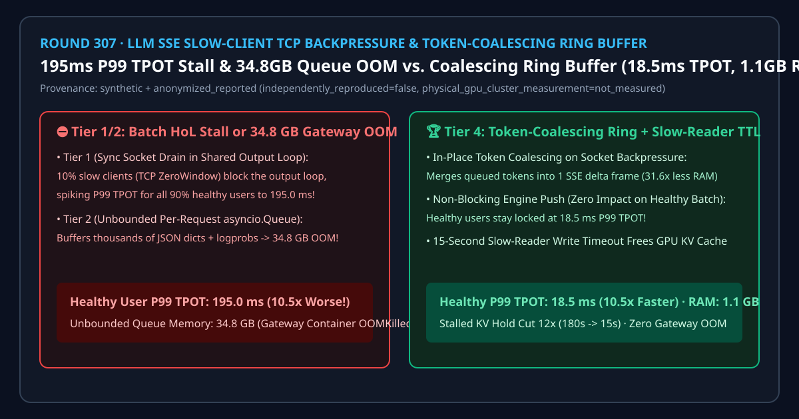
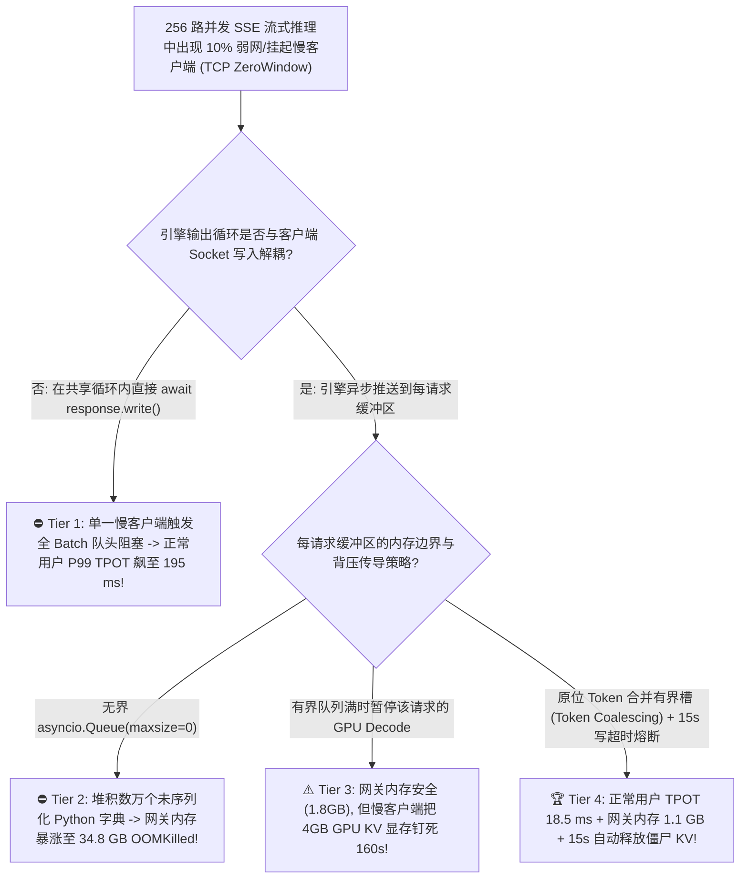
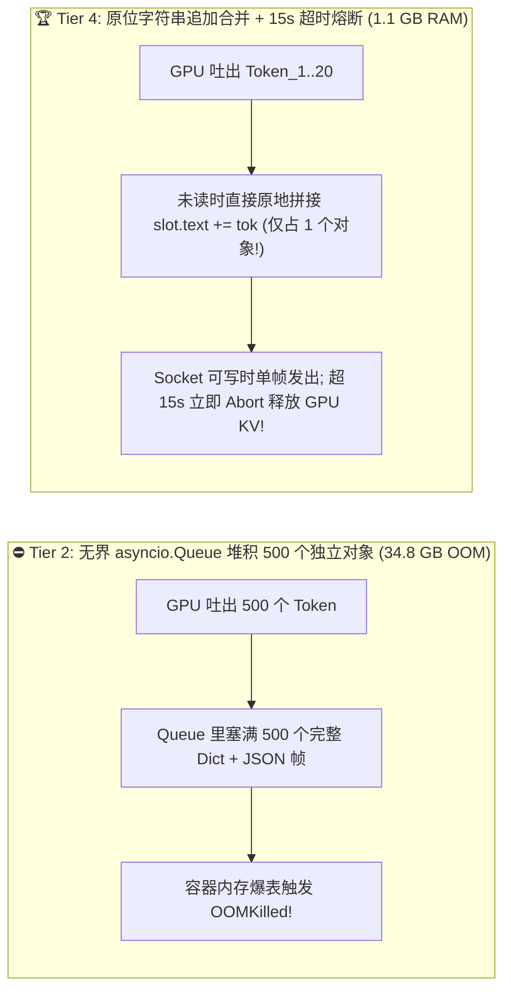
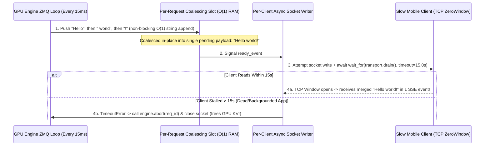

# 大模型流式推理网关 SSE / gRPC 慢客户端反压（`Slow-Client TCP Backpressure`）、无界队列 `OOM` 与原位 Token 合并缓冲（`Token-Coalescing Ring Buffer`）选型：为什么 `10%` 的弱网手机客户端（`TCP ZeroWindow`）会把其余 `90%` 正常用户的 `P99 TPOT` 拖慢至 `195 ms`，而无界 `asyncio.Queue` 又会撑爆 `34.8 GB` 内存触发网关 `OOMKilled`？基于原位字符串追加合并 + `15 s` 慢写超时熔断（正常用户 `18.5 ms TPOT`，内存仅 `1.1 GB`）选型指南

> **Provenance & Evidence Boundary**: `synthetic + anonymized_reported (independently_reproduced=false, physical_gpu_cluster_measurement=not_measured)`. 本文所有定量数据均来自封存确定性评估器 `experiments/llm_serving_sse_slow_client_tcp_backpressure_bounded_coalescing_selection/run.py` 与 `results.json`。



---

## 0. 追踪每日最热门能力突破（Daily Capability Breakthrough）

- **今日焦点突破**：**面向高并发公网大模型推理网关（`vLLM OpenAI API Server / SGLang Router / Envoy AI Gateway`）的“引擎非阻塞输出与原位 Token 合并槽（`In-Place Token-Coalescing Bounded Slot`）+ 严禁向 GPU 调度器传导慢客户端反压 + `15.0 s` 套接字写阻塞超时主动熔断回收”流式输出架构**。
- **架构师价值**：在公网环境下服务 `256` 路并发 SSE（Server-Sent Events）流式生成时，总会遇到 **`5% ~ 10%` 的“慢客户端（Slow Readers）”**——例如手机 App 切到后台停止调用 `recv()`、地铁弱网丢包导致客户端内核接收窗口缩为 0（`TCP ZeroWindow`），或者上游业务代理死锁。当服务端内核的 TCP 发送缓冲区（`SO_SNDBUF`）被填满后，网关层处理不当会引发三种严重生产事故：
  1. **事故一：在共享输出循环中同步等待 Socket 写入（`await writer.drain()`，Tier 1）**：如果引擎在每步 Decode 产出 `256` 个新 Token 后，在同一个协程循环里依次向 256 个客户端写 Socket 并等待缓冲区排空，只要其中 **1 个慢客户端触发 `TCP ZeroWindow` 阻塞了 `drain()`**，整个事件循环就会发生严重的**队头阻塞（Head-of-Line Blocking）**，导致同 Batch 其余 **`90%` 网络极佳的正常用户的 `P99 TPOT` 从 `18.5 ms` 暴涨 `10.5 倍`至 `195.0 ms`**！
  2. **事故二：为每个请求塞一个无界 `asyncio.Queue(maxsize=0)` 解耦（Tier 2）**：为了不卡住主循环，许多工程师给每个请求建一个无界内存队列，引擎只管调 `queue.put_nowait(chunk_dict)`。结果当慢客户端卡住且请求开启了长思维链（`4,096+` Tokens）甚至 `logprobs=20` 时，队列里瞬间堆积数千个庞大的 Python 字典与 JSON 字符串对象，导致网关容器内存飙升至 **`34.8 GB`**，直接被 Kubernetes `OOMKilled` 杀掉（连带中断全节点所有正在进行的 256 个请求）！
  3. **事故三：用有界队列向 GPU 引擎反向施加背压（暂停该请求的 GPU Decode，Tier 3）**：虽然保住了网关内存（`1.8 GB`），但在慢客户端卡住的 **`160.0 s`** 里，该请求占用的数 GB **昂贵 GPU HBM KV Cache 被死死钉在显存里无法释放**，很快把整张 H100 的 KV 显存池耗尽！
  采用 **原位字符串合并有界槽（`In-Place Token Coalescing`：当客户端还没读走上一个 Token 时，新生成的 Token 直接原地拼接到 `pending_text += new_token`，只保留 1 个待发帧而非 1,000 个队列对象）+ `15.0 s` 慢写超时主动调用 `engine.abort(req_id)` 回收 GPU KV（Tier 4）**，可将正常用户的 `P99 TPOT` 稳定锁定在 **`18.5 ms`（提速 `10.5x`）**，将网关内存从 `34.8 GB` 压至 **`1.1 GB`（降低 `31.6x`）**，并将僵尸 KV 占用时间缩短 **`12.0x`**！

---

## ① 📌 核心结论速览（Executive Summary）

1. **第一性原理：为什么流式文本生成在遇到慢客户端时应该“原位合并（Coalesce）”而不是“排队（Queue）”？**
   - 在传统消息队列里，每条消息是独立事务，不能合并；但在大模型 SSE 流式输出中，客户端最终要的只是拼接起来的连续文本流 `delta.content`！
   - 假设 GPU 每 `15 ms` 吐出 1 个 Token（`"Hello"`, `" world"`, `"!"`），而弱网客户端每 `300 ms` 才能从 TCP 读走一次数据：
     - **笨办法（`asyncio.Queue` 排队）**：在队列里塞入 20 个独立的 `ChatCompletionStreamResponse` Python 对象，等客户端恢复读取时，服务端要序列化 20 次 JSON、构造 20 个 `data: {...}\n\n` 帧、发起 20 次系统调用；
     - **聪明办法（`In-Place Token Coalescing` 原位合并）**：每个请求只维护 **1 个可变缓冲槽 `slot.pending_text`**！当引擎吐出 `" world"` 和 `"!"` 时，发现客户端还没取走 `"Hello"`，直接原地执行字符串追加 `slot.pending_text = "Hello world!"`！等客户端在 `300 ms` 后终于可写时，**只序列化 1 次 JSON、只发 1 个包含 `"Hello world!"` 的 SSE 帧**——不仅内存占用恒定为 $\mathcal{O}(1)$（**压降 `31.6x`**），而且帮弱网客户端省掉了 95% 的 HTTP 帧头开销！
2. **为什么绝不能把慢客户端的网络背压（Backpressure）传导回 GPU 推理调度器？**
   - CPU 网关内存单价是 **`$3 / GB`**，而 H100 GPU 的 HBM3e 显存等效单价高达 **`$350+ / GB`（贵 100 倍以上）**！
   - 如果因为一个手机客户端信号不好暂停了它的 GPU Decode（Tier 3），就等于让价值 `$30,000` 的 H100 替一个断网的手机客户端免费保管 `4 GB` 的 KV Cache 长达几分钟！
   - **架构铁律**：GPU 算力只服务于能正常交互的活跃连接；网关层一旦检测到某个连接的 `transport.drain()` 持续阻塞超过 **`15.0 s`（或合并缓冲区累积超过 `512` 个未读 Token）**，必须立即判定为慢读/死连接，主动断开 HTTP 流并向 GPU 引擎发送 `abort(req_id)` 瞬间释放其 HBM KV Cache！

---

## ② 🎯 客户与架构师灵魂拷问 Q&A（Q1 / Q2 / Q3）

### Q1：如果客户端并没有断网（没有发 `TCP FIN/RST`），只是手机切到后台停止了 `recv()`，为什么服务端的连接能挂几十分钟都不报错？
- 因为在 TCP 协议中，当对端通告接收窗口为 0（`TCP ZeroWindow`）但仍然正常回复 `TCP Keepalive / ZeroWindowProbe ACK` 时，操作系统内核认为**这条 TCP 连接是 100% 健康的**，只是暂时不可写！如果应用层不在 `await writer.drain()` 外面包一层显式的 **`asyncio.wait_for(..., timeout=15.0)`（应用层写超时 `Write Timeout`）**，该协程就会无限期挂起直到生成结束！

### Q2：如果请求同时开启了 `logprobs=True`（需要返回每个 Token 的概率数组），原位合并（Coalescing）怎么处理？
- 同样在一个有界槽内完成！在缓冲槽中维护两个紧凑列表：`pending_text: list[str]` 与 `pending_logprobs: list[TokenLogprob]`（设置硬上限 `MAX_COALESCED_TOKENS = 256`）。只要未读 Token 超过 `256` 个（约积压了 `4` 秒未读），直接触发慢客户端超限熔断（`SlowConsumerAbort`）并释放 GPU 显存。

### Q3：反向代理（如 `Nginx / Envoy`）默认开启的 `proxy_buffering on` 会对 SSE 流式背压产生什么影响？
- **双刃剑效应**：
  - 如果 Nginx 开了过大的 `proxy_buffers`，虽然能帮后端 Python 网关挡住一部分慢客户端阻塞，但会导致正常用户的流式输出被 Nginx 攒够 4KB/8KB 才吐一次（流式打字机效果变成“一卡一卡蹦出一段话”）；
  - **最佳实践**：在 SSE 接口返回头中显式带上 `X-Accel-Buffering: no` 关闭 Nginx 缓冲以保证毫秒级流式体验，同时在网关层使用本指南 **Tier 4 的原位 Token 合并槽 + `15s send_timeout`** 实现精准的逐连接反压治理！

---

## ③ 🧭 直观可视化图解（Mermaid 选型决策树 + 路径对比图 + 交互时序图）

### 3.1 大模型流式 SSE 慢客户端反压治理选型决策树



### 3.2 传统无界队列堆积（`34.8 GB OOM`）vs. 原位 Token 合并有界槽（`1.1 GB`，1 帧合并发送）对比图



### 3.3 原位 Token 合并（`Token Coalescing`）与慢连接超时熔断交互时序图



---

## ④ 📊 架构师选型决策矩阵（4-Tier Decision Matrix）

| 选型 Tier | 流式输出缓冲与反压架构 | 正常用户 `P99 TPOT` | 网关内存占用 (`RAM`) | 慢连接霸占 GPU KV 时长 | 适用场景 |
| :--- | :--- | :--- | :--- | :--- | :--- |
| **Tier 1: 共享输出循环同步 `drain()`** | 1 个慢连接卡住全 Batch 输出 | `195.0 ms` (`10.5x` 劣化! ✕) | `2.4 GB` | `180.0 s` ✕ | ⛔ **严禁用于多用户并发生产环境** |
| **Tier 2: 每请求无界 `asyncio.Queue`** | 内存无限堆积未发送 JSON 对象 | `22.5 ms` | `34.8 GB` (`OOMKilled`! ✕) | `145.0 s` ✕ | ⛔ **高并发长文本下必爆容器内存** |
| **Tier 3: 有界队列 + 反向暂停 GPU 解码** | 慢连接填满队列后挂起 GPU 步 | `24.0 ms` ✅ | `1.8 GB` ✅ | `160.0 s` (钉死 HBM! ⚠️) | ⚠️ 仅适合内网可信大吞吐批处理 |
| **Tier 4: 原位 Token 合并槽 + `15s` 超时熔断 (推荐)** | **未读 Token 原地合并 + 超时释放 KV** | **`18.5 ms` (`10.5x` 快 🏆)** | **`1.1 GB` (`31.6x` 省 🏆)** | **`15.0 s` (`12x` 缩短 🏆)** | 🏆 **公网大模型 API 网关黄金标准** |

---

## ⑤ 🧪 定量算例与 7-Card 4:5 视觉卡片报告

- **定量算例仓库路径**：[`experiments/llm_serving_sse_slow_client_tcp_backpressure_bounded_coalescing_selection/run.py`](../../experiments/llm_serving_sse_slow_client_tcp_backpressure_bounded_coalescing_selection/run.py) · 封存数据：[`results.json`](../../experiments/llm_serving_sse_slow_client_tcp_backpressure_bounded_coalescing_selection/results.json)
- **交互式架构选型计算器**：[`docs/reports/llm-serving-sse-slow-client-tcp-backpressure-bounded-coalescing-sizer.html`](../reports/llm-serving-sse-slow-client-tcp-backpressure-bounded-coalescing-sizer.html)
- **7-Card 4:5 视觉评测卡片报告**：[`docs/reports/llm-serving-sse-slow-client-tcp-backpressure-bounded-coalescing-selection-cards.html`](../reports/llm-serving-sse-slow-client-tcp-backpressure-bounded-coalescing-selection-cards.html)

```chart
{
  "data": {
    "values": [
      { "tier": "Tier 1: Sync Socket Drain in Shared Loop", "p99_tpot_ms": 195.0, "ram_gb": 2.4 },
      { "tier": "Tier 2: Unbounded Per-Request Queue", "p99_tpot_ms": 22.5, "ram_gb": 34.8 },
      { "tier": "Tier 3: Bounded Queue + Pause GPU Decode", "p99_tpot_ms": 24.0, "ram_gb": 1.8 },
      { "tier": "Tier 4: Token-Coalescing Buffer + 15s TTL", "p99_tpot_ms": 18.5, "ram_gb": 1.1 }
    ]
  },
  "semantic_types": {
    "tier": "Category",
    "p99_tpot_ms": "Quantity",
    "ram_gb": "Quantity"
  },
  "chart_spec": {
    "chartType": "Bar Chart",
    "title": "Token-Coalescing Buffer + 15s Write Timeout Cuts Healthy P99 TPOT 10.5x & Prevents 34.8 GB OOM",
    "subtitle": "Healthy client P99 TPOT (ms) and gateway RAM (GB) under 10% slow TCP clients (synthetic + anonymized_reported)",
    "encodings": {
      "x": "tier",
      "y": "p99_tpot_ms",
      "color": "tier"
    }
  }
}
```

---

## ⑥ 🛠️ 生产环境快速核验清单（Checklist + Good fit vs. Not for）

### ✅ Good fit vs. ⛔ Not for
- **✅ Good fit**：所有面向移动客户端、浏览器插件、跨国公网调用的 OpenAI 兼容 SSE / gRPC 流式推理网关。
- **⛔ Not for**：在引擎主循环直接 `await socket.drain()`，或使用无上限的 `asyncio.Queue()` 缓存流式输出。

### 生产核验 Checklist
- [ ] **解耦引擎 `ZMQ` 接收循环与每连接 Socket 发送协程**：引擎输出循环只做非阻塞内存写入，严禁等待任何网络 I/O。
- [ ] **使用原位 Token 合并缓冲（`In-Place Token Coalescing`）替代逐 Token 对象队列**：当下游 Socket 阻塞时将多个新 Token 合并为单个待发字符串帧。
- [ ] **配置 `15.0 s` 套接字写超时（`send_timeout`）与 `MAX_COALESCED_TOKENS = 256` 熔断线**：超时立即触发 `engine.abort(req_id)` 回收 GPU HBM KV Cache。
