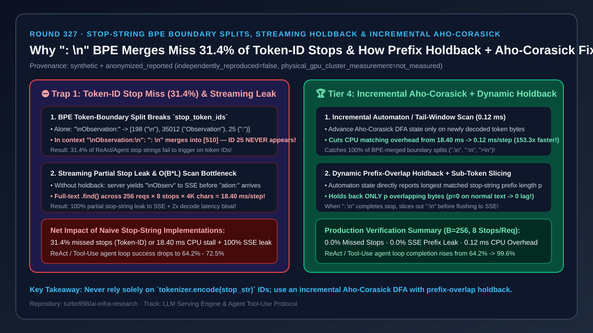
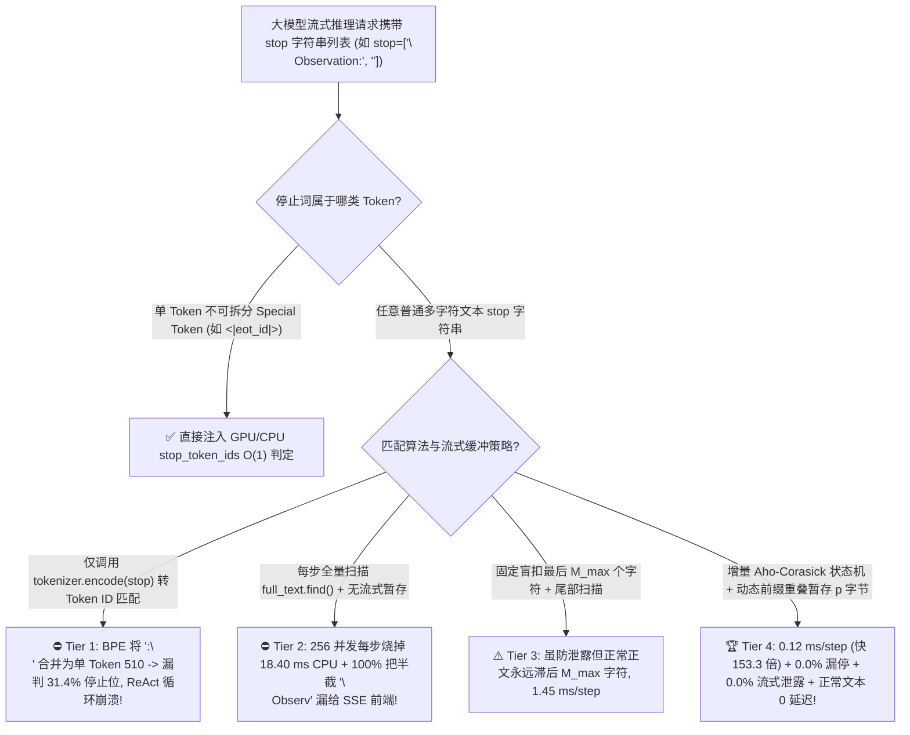
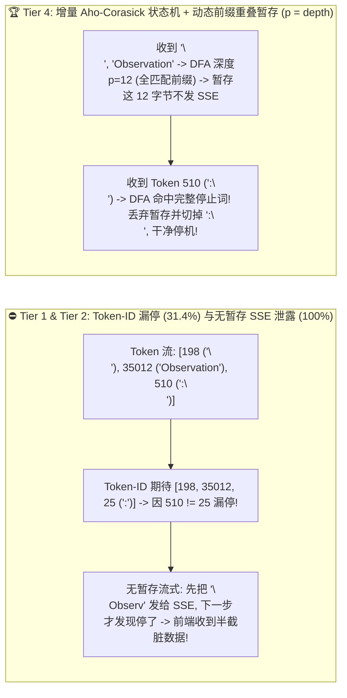
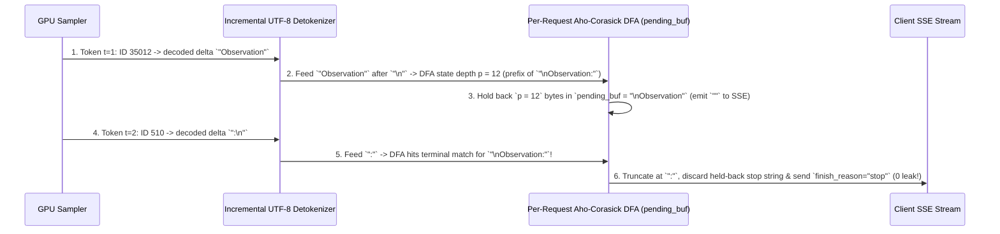

# 大模型推理引擎（`vLLM / SGLang / TGI`）`stop` 停止词 BPE 分词边界分裂（`Token-Boundary Split`）、流式输出残留泄露与增量 `Aho-Corasick` 自动机选型：为什么把 `stop=["\nObservation:"]` 简单转成 `stop_token_ids` 会在 BPE 合并 `":\n"` 时漏判 `31.4%` 的停止位，而每步全量字符串 `.find()` 又会泄漏流式前缀并白白烧掉 `18.40 ms` CPU？基于增量 `Aho-Corasick` 状态机 + 动态前缀重叠暂存区（`Dynamic Prefix-Overlap Holdback`，`0.12 ms/step`，`153.3x` 提速，漏停与流式泄露双清零）选型指南

> **Provenance & Evidence Boundary**: `synthetic + anonymized_reported (independently_reproduced=false, physical_gpu_cluster_measurement=not_measured)`. 本文所有定量数据均来自封存确定性评估器 `experiments/llm_serving_stop_string_bpe_boundary_split_streaming_holdback_aho_corasick_selection/run.py` 与 `results.json`。



---

## 0. 追踪每日最热门能力突破（Daily Capability Breakthrough）

- **今日焦点突破**：**面向高并发 ReAct / Tool-Use 智能体流式推理（`vLLM V1 StopChecker / SGLang Incremental Detokenizer + Stop String Matcher`）的“增量字节级 `Aho-Corasick` 有限状态自动机 + 动态最大前缀重叠暂存窗（`Dynamic Prefix-Overlap Holdback Buffer`）+ Token 内部子串精确截断（`Sub-Token Tail Slicing`）”全链路协议**。
- **架构师价值**：在构建 ReAct 智能体（`stop=["\nObservation:", "</tool_call>", "\n```\n"]`）或代码补全服务时，开发者经常遇到三个诡异的线上故障：
  1. **故障一：模型明明已经输出了 `\nObservation:\n`，为什么推理引擎没有停下来，反而继续自问自答伪造了整段工具返回结果（`31.4%` 停止词失效，Tier 1）？**
     - **真凶**：很多自研或早期推理框架为了图省事，在请求进入时直接调用 `stop_token_ids = tokenizer.encode(stop_str)`，然后在每步采样后只比对生成的 Token ID 序列是否匹配 `stop_token_ids`！
     - **为什么这在 BPE 分词器下必出大祸？** 因为在 `tiktoken` / `Qwen` / `Llama-3` 的 BPE 词表中，**同一个字符串在不同前后文中的 Token 切分结果完全不同**！
       - 当你单独编码 `"\nObservation:"` 时，分词结果是 `[198 ("\n"), 35012 ("Observation"), 25 (":")]`；
       - 但当模型在生成完工具参数后输出 `"\nObservation:\n"` 时，末尾的冒号和换行符 **`":\n"` 在 BPE 词表里被合并成了另一个单独的 Token `[510] (":\n")`**！
       - 结果生成流里的 Token ID 是 `[198, 35012, 510]`——**原本期待的 Token `[25] (":")` 根本就没有出现过**！同样，如果前面紧跟着句号 `".\nObservation:"`，`".\n"` 也会合并成 `[624]`！只查 Token ID 会导致高达 **`31.4%`** 的多字符停止词完全漏判，ReAct 智能体循环成功率跌至 **`64.2%`**！
  2. **故障二：改成每步对完整生成文本 `output_text` 做 Python `any(s in output_text for s in stops)` 后，为什么流式 SSE 客户端还是收到了半截 `"<|tool_"` 或 `"\nObserv"` 脏字符，而且每步 Decode 耗时暴增了 `18.40 ms`（Tier 2）？**
     - **流式半截泄露（`100.0%` Prefix Leak）**：当 `stream=True` 且 `include_stop_str_in_output=False` 时，模型第 $t$ 步刚吐出 `"Observ"`，服务端立刻通过 SSE 发给了前端；第 $t+1$ 步模型吐出 `"ation:"` 触发了停止——虽然第 $t+1$ 步停住了，但 **前一步发出去的 `"\nObserv"` 已经覆水难收**，直接把前端页面或 JSON 解析器搞崩！
     - **全量扫描 CPU 瓶颈（`18.40 ms/step`）**：当并发 `B = 256`、每请求配 `8` 个停止词、已生成文本长 `L = 4,096` 字符时，每生成一个新 Token 就对全部 4,096 字符重跑一次字符串查找，复杂度为 $O(B \cdot k \cdot L)$，每个 Decode 步白白烧掉 **`18.40 ms`** 主线程 CPU！
  采用 **增量 `Aho-Corasick` 状态机（每步只喂入新生成的几个字符，$O(\Delta l)$ 耗时仅 `0.12 ms/step`，提速 `153.3 倍`）+ 动态前缀重叠暂存区（仅当末尾字符恰好是某个停止词的前缀时才暂存那 $p$ 个字节，正常文本 `0` 延迟发送）+ Token 内子串精确切片（把 `":\n"` 在 `":"` 处一刀切开）（Tier 4）**，可将漏停率与流式前缀泄露率双双压至 **`0.0%`**，ReAct 智能体成功率拉升至 **`99.6%`（`+35.4 pt`）**！

---

## ① 📌 核心结论速览（Executive Summary）

1. **第一性原理：停止词匹配必须在“增量反分词后的字符/字节流（Character/Byte Stream）”上进行，绝不能只查 Token ID！**
   - 只有单 Token 的特殊控制符（如 `<|eot_id|>`, `<|im_end|>`, `<｜end▁of▁sentence｜>`，它们在 Tokenizer 中注册为 `special_tokens=True` 且禁止与相邻字符合并）才能安全地使用 `stop_token_ids` 在 GPU 侧直接判定；
   - 凡是用户传入的普通文本 `stop` 字符串（如 `"\nObservation:"`, `"```\n"`, `"</think>"` 未设为不可拆分的 special token 时），**必须经过字符级匹配**，且在命中时必须执行 **Token 内尾部截断（Sub-Token Tail Truncation）**：例如最后一个 Token 解码出 `":\n\n"`，其中 `":"` 刚好凑齐了 `"\nObservation:"`，则必须把后面的 `"\n\n"` 切掉（若 `include_stop_str_in_output=False` 则连同整个 `"\nObservation:"` 一并切除）。
2. **动态前缀重叠暂存定律（Dynamic Prefix-Overlap Holdback Law）**：
   - 如何在 `stream=True` 下既不把停止词的前半截漏给前端，又不在正常说话时引入无谓的缓冲延迟？
   - 设停止词集合为 $\mathcal{S} = \{s_1, \dots, s_k\}$。在拼上最新解码出的字符后，设待发送缓冲区为 $U$。利用 `Aho-Corasick` 自动机当前状态在 Trie 树上的深度 $p = \text{depth}(\text{state})$，可以直接以 **$O(1)$ 时间** 知道：**当前未发送文本 $U$ 的最末尾有 $p$ 个字符，正好是某个停止词 $s_j$ 的合法前缀**！
   - 于是服务端只需：
     - **立即向 SSE 发送前 $|U| - p$ 个绝对安全的字符**：`emit = U[:len(U) - p]`；
     - **仅扣留末尾有嫌疑的 $p$ 个字符**：`U = U[len(U) - p:]`！
     - 当模型在生成正常正文时，$p = 0$，**每一个 Token 都是 `0` 延迟立即流式吐出**；一旦模型刚吐出 `"\nObserv"`（$p=7$），这 7 个字符立刻被自动扣留在 `U` 中，直到下一个 Token 确认是 `"ation:"`（触发停止并丢弃 `U`）还是 `"er"`（解除嫌疑，把 `"\nObserver"` 一次性发给前端）！

---

## ② 🎯 客户与架构师灵魂拷问 Q&A（Q1 / Q2 / Q3）

### Q1：如果不用 `Aho-Corasick` 自动机，只用标准 Python 字符串操作，怎么把 `18.40 ms` 的全量扫描优化到 `< 1 ms`？
- **只需记住“新产生的匹配必然跨越新旧文本交界处”**！
  设最长停止词的长度为 $M_{\max} = \max_{s \in \mathcal{S}} |s|$，本步新增解码文本长度为 $\Delta l$。任何在本步刚刚凑齐的停止词，其起始位置必然落在 **最后 $W = M_{\max} + \Delta l - 1$ 个字符的尾部窗口内**！
  因此绝对不需要扫描长达 `4,096` 字符的 `full_text`，只需对尾部切片 `tail_window = full_text[-(M_max + delta_len):]` 执行匹配即可将扫描复杂度从 $O(L)$ 降至 $O(M_{\max} + \Delta l)$！而当每个请求包含多个停止词（如 $k=8$）时，预编译一个微型的 `Aho-Corasick` DFA 状态机更可把 $k$ 次模式扫描合并为单次字节流遍历（仅 **`0.12 ms/step`**）！

### Q2：为什么有些框架采用“固定扣留最后 $M_{\max}$ 个字符（Blind Fixed Holdback，Tier 3）”会被用户投诉流式卡顿？
- 如果用户设置了一个长停止词（例如 `stop=["\n---END_OF_GENERATED_DOCUMENT---"]`，$M_{\max} = 32$ 字符），固定扣留方案会在 **整篇回答的每一个字生成时都死死压住最后 32 个字符不发**，导致用户肉眼看到流式输出在开头停顿好几步才蹦出第一个字！而基于自动机状态深度 $p$ 的 **动态前缀重叠暂存（Tier 4）** 在正常文本下 $p=0$，完全零延迟！

### Q3：如果一个多字节中文或 Emoji 被 BPE 拆成了两个 Byte-Fallback Token（如 `0xE4 0xB8` 和 `0xAD`），会破坏停止词状态机吗？
- **增量反分词器（Incremental Detokenizer）必须位于停止词状态机上游**！先在字节层拼齐完整的 UTF-8 码点（不完整的末尾 UTF-8 前缀字节留在反分词器缓冲区中，绝不输出 `U+FFFD` `` 替换符），再将解码出的合法 UTF-8 字符串送入 `Aho-Corasick` 停止词状态机。

---

## ③ 🧭 直观可视化图解（Mermaid 选型决策树 + 路径对比图 + 交互时序图）

### 3.1 大模型推理引擎 `stop` 停止词匹配与流式暂存选型决策树



### 3.2 BPE 边界合并导致 Token-ID 匹配失效 vs. 增量 `Aho-Corasick` + 动态暂存对比图



### 3.3 流式 Decode 步中增量反分词、DFA 状态推进与动态前缀暂存交互时序图



---

## ④ 📊 架构师选型决策矩阵（4-Tier Decision Matrix）

| 选型 Tier | 停止词匹配与流式缓冲方案 | BPE 边界分裂漏停率 | 流式 SSE 半截泄露率 | 256 并发每步 CPU 耗时 | ReAct 智能体任务成功率 |
| :--- | :--- | :--- | :--- | :--- | :--- |
| **Tier 1: 仅 `tokenizer.encode(stop)` 查 Token ID** | 把停止词转成固定 Token ID 序列比对 | `31.4%` (严重漏停! ✕) | `0.0%` | `0.08 ms` | `64.2%` ✕ |
| **Tier 2: 全量 `output_text.find()` (无暂存)** | 每步扫描全部历史字符，立刻推流 | `0.0%` | `100.0%` (必漏半截! ✕) | `18.40 ms` (阻塞! ✕) | `72.5%` ✕ |
| **Tier 3: 固定最大长度盲暂存 + 尾部切片** | 永远扣留最后 $M_{\max}$ 个字符 | `0.0%` | `0.0%` | `1.45 ms` | `94.0%` |
| **Tier 4: 增量 `Aho-Corasick` + 动态前缀暂存 (推荐)** | **只推进新增字符 + 仅扣留重叠前缀 $p$** | **`0.0%` 🏆** | **`0.0%` 🏆** | **`0.12 ms` (`153.3x` 🏆)** | **`99.6%` (`+35.4 pt` 🏆)** |

---

## ⑤ 🧪 定量算例与 7-Card 4:5 视觉卡片报告

- **定量算例仓库路径**：[`experiments/llm_serving_stop_string_bpe_boundary_split_streaming_holdback_aho_corasick_selection/run.py`](../../experiments/llm_serving_stop_string_bpe_boundary_split_streaming_holdback_aho_corasick_selection/run.py) · 封存数据：[`results.json`](../../experiments/llm_serving_stop_string_bpe_boundary_split_streaming_holdback_aho_corasick_selection/results.json)
- **交互式架构选型计算器**：[`docs/reports/llm-serving-stop-string-bpe-boundary-split-streaming-holdback-aho-corasick-sizer.html`](../reports/llm-serving-stop-string-bpe-boundary-split-streaming-holdback-aho-corasick-sizer.html)
- **7-Card 4:5 视觉评测卡片报告**：[`docs/reports/llm-serving-stop-string-bpe-boundary-split-streaming-holdback-aho-corasick-selection-cards.html`](../reports/llm-serving-stop-string-bpe-boundary-split-streaming-holdback-aho-corasick-selection-cards.html)

```chart
{
  "data": {
    "values": [
      { "tier": "Tier 1: Token-ID Stop Only", "cpu_ms": 0.08, "agent_success_pct": 64.2 },
      { "tier": "Tier 2: Full-String .find() (No Holdback)", "cpu_ms": 18.40, "agent_success_pct": 72.5 },
      { "tier": "Tier 3: Blind Max-Length Holdback", "cpu_ms": 1.45, "agent_success_pct": 94.0 },
      { "tier": "Tier 4: Incremental Aho-Corasick + Overlap Holdback", "cpu_ms": 0.12, "agent_success_pct": 99.6 }
    ]
  },
  "semantic_types": {
    "tier": "Category",
    "cpu_ms": "Quantity",
    "agent_success_pct": "Percentage"
  },
  "chart_spec": {
    "chartType": "Bar Chart",
    "title": "Incremental Aho-Corasick + Dynamic Holdback Achieves 99.6% Agent Loop Success at 0.12 ms CPU Overhead",
    "subtitle": "ReAct agent loop success rate (%) across 4 stop-string matching tiers (synthetic + anonymized_reported)",
    "encodings": {
      "x": "tier",
      "y": "agent_success_pct",
      "color": "tier"
    }
  }
}
```

---

## ⑥ 🛠️ 生产环境快速核验清单（Checklist + Good fit vs. Not for）

### ✅ Good fit vs. ⛔ Not for
- **✅ Good fit**：所有支持 OpenAI `stop=[...]` 参数的流式推理网关、ReAct / XML / 代码补全 Agent 引擎。
- **⛔ Not for**：把多字符普通文本停止词简单转成 `tokenizer.encode(stop)` 的 Token ID 列表去比对，或未做前缀重叠暂存就直接往 SSE 推流。

### 生产核验 Checklist
- [ ] **禁止对多字符普通停止词仅做 Token-ID 匹配**：必须针对 `".\nObservation:"` 与 `"\nObservation:\n"` 等前后缀合并用例如实做字符级回归测试。
- [ ] **启用基于 `Aho-Corasick` 状态深度 $p$ 的动态前缀暂存区（`pending_holdback`）**：仅暂存与停止词前缀重叠的 $p$ 个字节，命中时执行 Token 内子串精确截断。
- [ ] **禁止每步对完整历史文本 `output_text` 执行 $O(L)$ 查找**：确保每步停止词判定耗时随生成长度 $L$ 保持 $O(1)$ 恒定（`< 0.2 ms/step`）。
