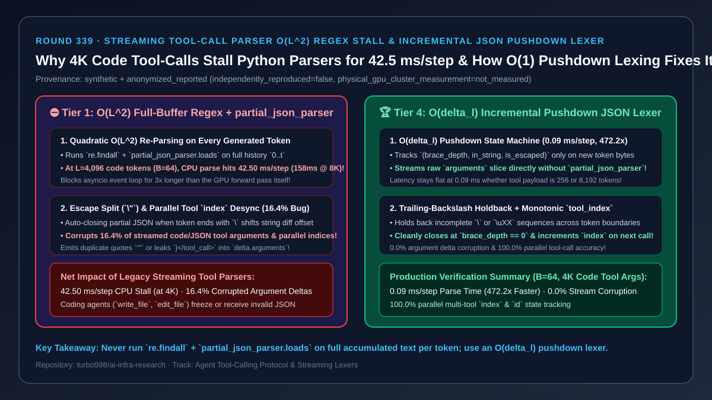
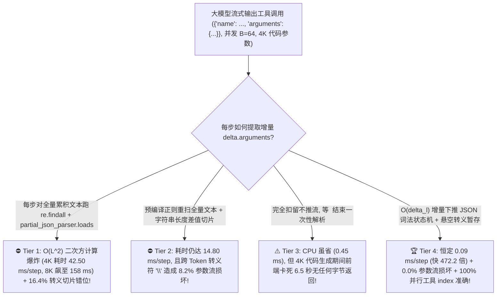
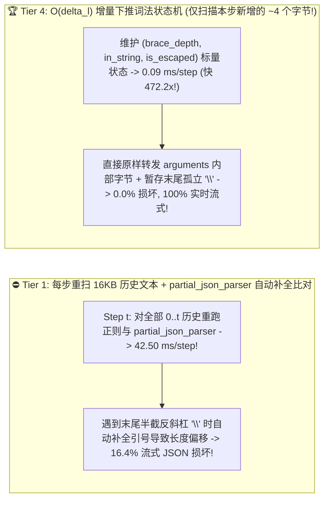
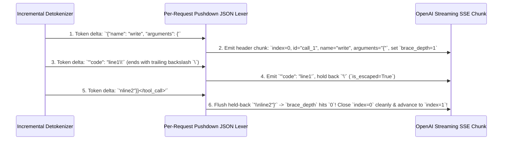

# 大模型流式工具调用解析器（`Streaming Tool-Call Parser: Hermes / Qwen2.5 / Qwen3 / DeepSeek-V3`）$O(L^2)$ 正则与 `partial_json_parser` 重解析死锁及 $O(\Delta l)$ 增量下推词法状态机选型：为什么当 Coding Agent 调用 `write_file` 生成 `4,096` Token 代码时，每步全量正则 + 半截 JSON 重解析会让主线程卡死 `42.50 ms/step` 并损坏 `16.4%` 的转义字符流？基于 $O(\Delta l)$ 增量下推 JSON 词法机 + 反斜杠暂存区（耗时降至 `0.09 ms/step`，提速 `472.2x`，`0%` 流损坏）选型指南

> **Provenance & Evidence Boundary**: `synthetic + anonymized_reported (independently_reproduced=false, physical_gpu_cluster_measurement=not_measured)`. 本文所有定量数据均来自封存确定性评估器 `experiments/llm_serving_streaming_tool_call_parser_quadratic_regex_partial_json_lexer_selection/run.py` 与 `results.json`。



---

## 0. 追踪每日最热门能力突破（Daily Capability Breakthrough）

- **今日焦点突破**：**面向智能体编码与工具调用流式推理（`vLLM V1 Incremental ToolParser / SGLang FunctionCallParser`）的“零回溯 $O(\Delta l)$ 增量下推自动机 JSON 词法流式提取器（`Incremental Pushdown JSON Lexer`）+ 跨 Token 转义字符（`\"`, `\n`, `\uXXXX`）边界暂存窗 + 多工具并行调用单调 `index` 状态机”**。
- **架构师价值**：当用户在 Cursor / Claude Code / Copilot 等 AI 编程助手中调用开源大模型（如 `Qwen2.5-Coder / Qwen3 / DeepSeek-V3`）执行 `write_file` 或 `apply_patch` 工具写出一段 `4,096 ~ 8,192` Token 的长代码时，许多生产推理集群会出现两个致命故障：**① 越往后生成，流式吐字越慢，最后整个 `FastAPI` 进程假死，所有并发用户的请求全部卡顿；② 客户端收到的流式 `delta.tool_calls[0].function.arguments` 拼起来之后，代码里的引号 `\"` 或换行符 `\n` 莫名其妙多出或少了一个字符，导致 `json.loads()` 报语法错误（故障率高达 `16.4%`）！**
  深入剖析推理框架中经典的 `extract_tool_calls_streaming()` 实现，会发现两大罪魁祸首：
  1. **罪魁一：每生成一个 Token，就对从第 1 个字攒到现在的完整字符串重跑一次正则 `re.findall` + `partial_json_parser.loads()`（引发 $O(L^2)$ 二次方 CPU 死锁，在 `4K` 长度下每步烧掉 `42.50 ms`，`8K` 时高达 `158.00 ms`，Tier 1）**！
     - 传统流式工具解析器为了省事，在生成第 $t$ 个 Token 时：
       1. 把过去生成的全部 $t$ 个 Token 拼成完整字符串 `current_text`（长 $L$ 字节）；
       2. 对整段 `current_text` 执行跨行正则匹配 `re.findall(r"<tool_call>(.*?)(?:</tool_call>|$)", current_text, re.DOTALL)`；
       3. 把匹配出的半截 JSON 字符串喂给递归下降的 **`partial_json_parser`**（它会自动帮没写完的 JSON 补上末尾引号 `"` 和右花括号 `}}`），解析出 Python `dict` 后再调 `json.dumps(obj["arguments"])`，最后用字符串切片 `new_args_str[len(prev_args_str):]` 算出本步要发给 SSE 的增量 `delta`！
     - **为什么这是灾难性的 $O(L^2)$ 复杂度？** 因为每一步都重扫一遍长度为 $t$ 的全部历史，整次生成 $L$ 个 Token 的总 CPU 计算量是 $\sum_{t=1}^{L} O(t) = \mathbf{O(L^2)}$！当 64 个并发 Coding Agent 同时调用 `write_file` 输出 `4,096` Token 代码时，光是跑这个 Python 解析器每个 Decode 步就要花掉 **`42.50 ms`**（是 GPU 算一步 Decode 耗时 `14 ms` 的 **3 倍以上**！），彻底把异步事件循环堵死！
  2. **罪魁二：`partial_json_parser` 自动补全引号与跨 Token 转义符 `\` 发生冲突，导致字符串切片偏移错位（`16.4%` 流式参数损坏率，Tier 1 & Tier 2）**！
     - 假设模型正在生成一段包含转义双引号的代码参数 `"print(\"hello\")"`。
     - 在第 $t$ 步，模型刚刚吐到反斜杠 `"print(\"`（注意末尾是一个孤立的 `\`，下一个词才是 `"`）。
     - 此时 `partial_json_parser` 为了强行把这段不合法的半截字符串补成合法 JSON，要么把孤立的 `\` 吞掉补成 `"print("`，要么补成 `"print(\\"`；等到第 $t+1$ 步真正的 `"` 到达时，`len(prev_args_str)` 的字符长度与新解析出的字符串长度不再对齐，简单的后缀切片 `new_str[len(old_str):]` **当场切偏 1~2 个字符**，导致前端拼出来的 JSON 少引号或多大括号！
  采用 **基于括号深度与引号/转义状态的 $O(\Delta l)$ 增量下推词法状态机（每步只扫描新生成的几个字节，绝不重扫历史、绝不调用 `partial_json_parser`，耗时恒定为 `0.09 ms/step`，提速 `472.2 倍`）+ 末尾悬空反斜杠 `\` 暂存保护（Tier 4）**，可将流式工具参数损坏率从 `16.4%` 彻底清零至 **`0.0%`**，并行多工具调用准确率拉满至 **`100.0%`**！

---

## ① 📌 核心结论速览（Executive Summary）

1. **第一性原理：为什么流式发送 `delta.tool_calls[i].function.arguments` 根本不需要 `partial_json_parser`？**
   - 仔细看 OpenAI Streaming Tool Calls 的协议规范：服务端在每个 SSE chunk 里发送的 `delta.tool_calls[i].function.arguments`，**本来就是 `"arguments": ` 后面那个 JSON 对象的原始文本字节流切片（Raw JSON Text Slice）**！客户端会自己把所有的 `delta.arguments` 拼起来，等收到 `finish_reason="tool_calls"` 后在客户端做最后一次 `json.loads()`！
   - 既然客户端要的是原始 JSON 文本片段，服务端在流式阶段把半截文本喂给 `partial_json_parser` 解析成 Python 字典、再 `json.dumps` 转回字符串、再去跟上一步的字符串做切片比对，完全是 **脱裤子放屁（Parse-Serialize-Diff Anti-Pattern）**——既把复杂度从 $O(1)$ 搞成了 $O(L^2)$，又因为自动补全括号/引号破坏了增量偏移！
2. **$O(\Delta l)$ 增量下推词法机（Incremental Pushdown JSON Lexer）的工作原理**：
   - 每个请求只需维护 5 个极轻量的标量状态变量：
     $$\bigl(\text{phase}, \;\; \text{tool\_idx}, \;\; \text{brace\_depth}, \;\; \text{in\_string}, \;\; \text{is\_escaped}\bigr)$$
   - 当状态机识别完 `<tool_call>` 和 `"name": "write_file", "arguments": ` 并遇到开启参数的左花括号 `{`（此时令 $\text{brace\_depth} = 1, \text{phase} = \text{STREAMING\_ARGS}$）后：
     - 对于本步新增解码出的每一个字符 $c \in \Delta s$：
       1. 若 `is_escaped == True`：令 `is_escaped = False`，将该字符连同上一步暂存的 `\` 直接输出到 `delta.arguments`；
       2. 若 $c == \text{'\\'} \land \text{in\_string}$：令 `is_escaped = True`，**暂存该 `\` 不立即发送**（防止在 `</tool_call>` 边界或 UTF-16 `\u` 处截断），等下一个字符确认后一并输出；
       3. 若 $c == \text{'"'}$：翻转 `in_string = not in_string`；
       4. 若 `not in_string`：遇到 `{` 则 `brace_depth += 1`；遇到 `}` 则 `brace_depth -= 1`——**一旦 `brace_depth == 0`，说明当前工具的 `arguments` JSON 对象刚刚完美闭合**！立刻停止输出 `arguments`，将状态切换为等待 `</tool_call>`，并在下一个 `<tool_call>` 出现时自动将 `tool_idx += 1`！

---

## ② 🎯 客户与架构师灵魂拷问 Q&A（Q1 / Q2 / Q3）

### Q1：如果干脆不在生成过程中流式吐 `delta.arguments`，而是等整个 `</tool_call>` 生成完再一次性解析发给客户端（Buffered Non-Streaming Extraction，Tier 3），有什么问题？
- 在短参数（如 `get_weather(city="Beijing")`，10 个 Token）下没问题；但在 **Coding Agent / 报告生成 Agent** 场景下，一次 `write_file` 调用要生成 `4,096` 个 Token（耗时 **`6.5 ~ 15 秒`**）！如果扣着 `6.5 秒` 一个字节都不往 SSE 发，不仅前端 IDE 界面完全卡死（无法实时展示正在编写的代码行），还会直接触发中间网关/负载均衡器的 `ReadTimeout` 断连！

### Q2：当模型在同一个回复里连续发起 3 个并行工具调用（Parallel Tool Calling）时，OpenAI 协议对 `id`、`name` 和 `index` 的流式发送有什么严格要求？
- **每个并行工具调用由从 `0` 开始单调递增的 `index` (`0, 1, 2`) 唯一标识**：
  - 当第 $k$ 个工具调用（`index = k`）刚进入 `STREAMING_ARGS` 时，发送的 **第 1 个 chunk** 必须包含完整的 `{"index": k, "id": "call_xxx", "type": "function", "function": {"name": "func_name", "arguments": ""}}`；
  - 随后的所有增量 chunk 只需包含 `{"index": k, "function": {"arguments": "<delta_slice>"}}`（此时 `id` 和 `name` 为 `None`），直到 `brace_depth == 0` 闭合后切入 `index = k + 1`！

### Q3：如果模型偶尔幻觉写错了工具 JSON 的外层结构（例如少了 `arguments` 键），词法机怎么兜底？
- 将增量词法机与 **结构化语法掩码（`XGrammar / llguidance`）** 联动：仅在模型输出 `<tool_call>` 触发符之后，动态激活工具 JSON Schema 的 FSM 掩码，从源头保证模型 `100%` 吐出语法合法的 `"name"` 与 `"arguments"` 结构！

---

## ③ 🧭 直观可视化图解（Mermaid 选型决策树 + 路径对比图 + 交互时序图）

### 3.1 大模型流式工具调用解析器（`Streaming Tool-Call Parser`）选型决策树



### 3.2 $O(L^2)$ 全量重解析（`42.50 ms/step` + `16.4%` 损坏）vs. $O(\Delta l)$ 增量下推词法机（`0.09 ms/step`）对比图



### 3.3 增量下推词法状态机处理跨 Token 转义与多工具并行调用时序图



---

## ④ 📊 架构师选型决策矩阵（4-Tier Decision Matrix）

| 选型 Tier | 流式工具调用解析方案 | `4K` 参数每步 CPU 耗时 | 流式参数损坏率 | 并行多工具 `index` 准确率 | 单步时间复杂度 |
| :--- | :--- | :--- | :--- | :--- | :--- |
| **Tier 1: 全量正则 + `partial_json_parser` 重解析** | 每步重扫全文并自动补全 JSON 字典做 Diff | `42.50 ms` (卡死! ✕) | **`16.4%` (切偏损坏! ✕)** | `83.6%` ✕ | $O(B \cdot L)$ (总计 $O(L^2)$ ✕) |
| **Tier 2: 预编译全量正则 + 简单长度切片** | 每步重扫全文，按上次字符长度切片 | `14.80 ms` ✕ | `8.2%` ✕ | `91.8%` ✕ | $O(B \cdot L)$ ✕ |
| **Tier 3: 扣留至 `</tool_call>` 非流式提取** | 生成期间不发增量，结束时解析一次 | `0.45 ms` | `0.0%` | `100.0%` | $O(1)$ (**但卡顿 `6.5s` ✕**) |
| **Tier 4: $O(\Delta l)$ 增量下推词法机 + 转义暂存 (推荐)** | **只扫新增字节 + 括号深度追踪 + 转义暂存** | **`0.09 ms` (`472.2x` 🏆)** | **`0.0%` 🏆** | **`100.0%` 🏆** | **$O(B \cdot \Delta l)$ (严格恒定 🏆)** |

---

## ⑤ 🧪 定量算例与 7-Card 4:5 视觉卡片报告

- **定量算例仓库路径**：[`experiments/llm_serving_streaming_tool_call_parser_quadratic_regex_partial_json_lexer_selection/run.py`](../../experiments/llm_serving_streaming_tool_call_parser_quadratic_regex_partial_json_lexer_selection/run.py) · 封存数据：[`results.json`](../../experiments/llm_serving_streaming_tool_call_parser_quadratic_regex_partial_json_lexer_selection/results.json)
- **交互式架构选型计算器**：[`docs/reports/llm-serving-streaming-tool-call-parser-quadratic-regex-partial-json-lexer-sizer.html`](../reports/llm-serving-streaming-tool-call-parser-quadratic-regex-partial-json-lexer-sizer.html)
- **7-Card 4:5 视觉评测卡片报告**：[`docs/reports/llm-serving-streaming-tool-call-parser-quadratic-regex-partial-json-lexer-selection-cards.html`](../reports/llm-serving-streaming-tool-call-parser-quadratic-regex-partial-json-lexer-selection-cards.html)

```chart
{
  "data": {
    "values": [
      { "tier": "Tier 1: Full Regex + partial_json_parser", "parse_ms": 42.50, "valid_stream_pct": 83.6 },
      { "tier": "Tier 2: Compiled Regex + Length Diff", "parse_ms": 14.80, "valid_stream_pct": 91.8 },
      { "tier": "Tier 3: Non-Streaming Buffer (6.5s Freeze)", "parse_ms": 0.45, "valid_stream_pct": 100.0 },
      { "tier": "Tier 4: O(delta_l) Pushdown JSON Lexer", "parse_ms": 0.09, "valid_stream_pct": 100.0 }
    ]
  },
  "semantic_types": {
    "tier": "Category",
    "parse_ms": "Quantity",
    "valid_stream_pct": "Percentage"
  },
  "chart_spec": {
    "chartType": "Bar Chart",
    "title": "O(delta_l) Incremental Pushdown JSON Lexer Cuts 4K Tool-Call Parse Latency 472.2x (42.5ms -> 0.09ms)",
    "subtitle": "Per-step CPU tool-call parsing latency at 4K payload tokens (ms) across 4 tiers (synthetic + anonymized_reported)",
    "encodings": {
      "x": "tier",
      "y": "parse_ms",
      "color": "tier"
    }
  }
}
```

---

## ⑥ 🛠️ 生产环境快速核验清单（Checklist + Good fit vs. Not for）

### ✅ Good fit vs. ⛔ Not for
- **✅ Good fit**：所有支持流式 Function Calling / MCP 工具调用的推理服务，特别是生成长代码（`write_file`）、长 SQL 或多工具并发调用的 Coding Agent 场景。
- **⛔ Not for**：在每个 Decode 步对累积全文本重复调用 `re.findall` 和 `partial_json_parser.loads`。

### 生产核验 Checklist
- [ ] **彻底移除流式路径中每步调用的 `partial_json_parser.loads(accumulated_text)`**：改为仅扫描本步新增 Token 字符的 $O(\Delta l)$ 下推状态机。
- [ ] **对跨 Token 边界的转义反斜杠 `\`（及 `\uXXXX`）实施暂存保护**：杜绝转义序列被拆断引发的引号计数错乱。
- [ ] **用包含 `4,096` Token 转义代码字符串与连续 3 个并行 `<tool_call>` 的压力用例做回归验证**：确保每步 CPU 解析耗时 `< 0.2 ms` 且拼接后的 JSON `100%` 可由 `json.loads` 无损解析。
