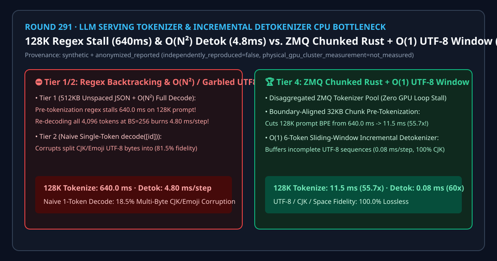
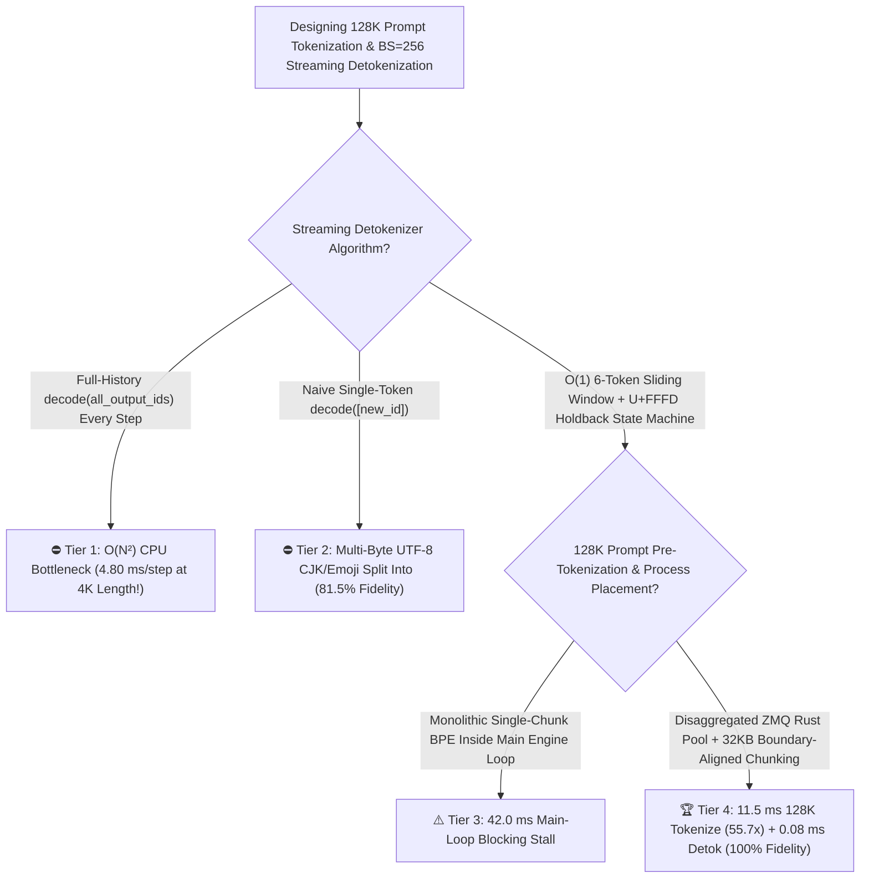
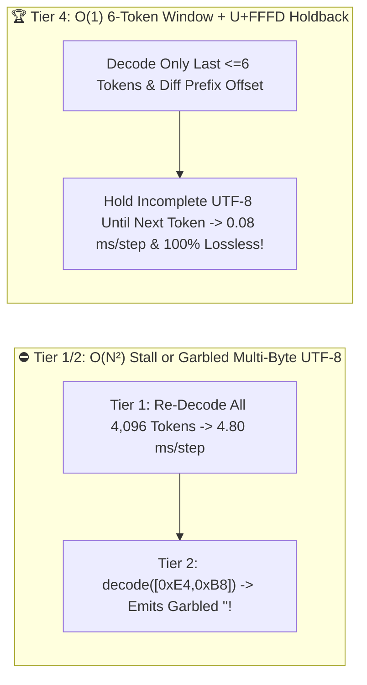
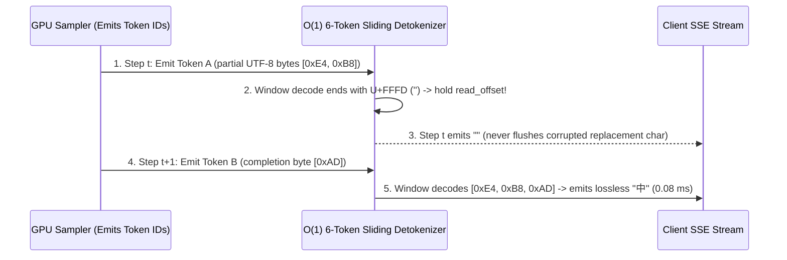

# High-Throughput LLM Serving Tokenizer & Incremental Detokenizer Selection Guide: Why `128K` Minified JSON Stalls Regex Pre-Tokenization for `640 ms`, Per-Step Full `decode()` Burns `4.8 ms/step`, Single-Token Decode Corrupts UTF-8 CJK Into `` & How ZMQ `32KB` Chunked Rust + $O(1)$ UTF-8 Sliding Window (`11.5 ms` / `0.08 ms`) Solves It

> **Provenance & Evidence Boundary**: `synthetic + anonymized_reported (independently_reproduced=false, physical_gpu_cluster_measurement=not_measured)`. All quantitative figures in this guide are generated by the deterministic evaluator `experiments/llm_tokenizer_bpe_regex_pretokenization_cpu_bottleneck_rust_selection/run.py` and sealed in `results.json`.



---

## 0. Daily Capability Breakthrough Tracking

- **Breakthrough Focus**: **`vLLM V1 / SGLang / HuggingFace Tokenizers` Disaggregated ZMQ Tokenizer Pool + Boundary-Aligned `32KB` Chunked Parallel Pre-Tokenization + $O(1)$ 6-Token Sliding-Window Incremental Detokenizer With Incomplete UTF-8 Holdback**.
- **Architect Value**: Once GPU prefill is accelerated by `Prefix Caching` (`190 ms`) and decode runs at `7.5 ms/step`, CPU tokenization and detokenization frequently become the hidden bottleneck: **(1) passing a `128,000-token` (`512 KB` unspaced JSON or log payload) prompt into a single-threaded regex pre-tokenizer stalls for `640.0 ms`**, and **(2) calling `tokenizer.decode(all_output_ids)` at every streaming step ($t=1\dots 4096$) across `BS=256` requests incurs $O(N^2)$ CPU complexity (`4.80 ms/step`)**, whereas decoding only the single new token `tokenizer.decode([new_id])` corrupts multi-byte UTF-8 CJK/Emoji characters split across two byte-level BPE tokens into replacement characters `` (`81.5%` fidelity)! Deploying a **disaggregated ZMQ Rust tokenizer pool with `32KB` boundary-aligned chunk splitting** plus an **$O(1)$ 6-token sliding-window incremental detokenizer** slashes `128K` prompt tokenization **55.7x from `640.0 ms` to `11.5 ms`** and `BS=256` per-step detokenization **60.0x from `4.80 ms` to `0.08 ms`** with **`100.0%` lossless UTF-8 and whitespace reconstruction**.

---

## ① 📌 Executive Summary

1. **Why `128K` Unspaced JSON/Code Stalls BPE Pre-Tokenization for `640.0 ms`**:
   Byte-level BPE tokenizers (`Llama-3`, `Qwen2.5/3`, `DeepSeek-V3`) first split raw text using a complex Unicode regular expression before running priority-queue BPE merges. Feeding a `512 KB` string without newlines into a single-chunk regex engine triggers severe backtracking and quadratic merge-queue overhead. **Splitting inputs $> 32\text{ KB}$ on safe newline/whitespace boundaries and encoding chunks in parallel across Rust `Rayon` threads** cuts latency **55.7x to `11.5 ms`**.
2. **Why `decode(all_ids)` Is $O(N^2)$ (`4.80 ms/step`) While `decode([new_id])` Corrupts Multi-Byte UTF-8 (`81.5%` Fidelity)**:
   - Re-decoding all $t$ generated tokens at every step $t=1\dots N$ performs $\frac{N(N+1)}{2}$ token lookups (`8.3M` operations per 4K request!).
   - Conversely, decoding 1 token at a time breaks whenever a 3-byte UTF-8 CJK character (e.g., `"中" = [0xE4, 0xB8, 0xAD]`) or 4-byte Emoji is split across two byte-level BPE tokens (`Token A = [0xE4, 0xB8]`, `Token B = [0xAD]`), emitting `` and dropping SentencePiece inter-token spaces.
3. **The $O(1)$ 6-Token Sliding-Window Incremental Detokenizer (`0.08 ms/step`, `100.0%` Fidelity)**:
   At each step, decode only the **last $\le 6$ tokens** (`prefix_tokens` + `new_token`), slice off the prefix string `new_text = full_window_text[len(prefix_text):]`, and **if `new_text.endswith("\ufffd")`, hold back the pointer until the next byte-level BPE token arrives to complete the UTF-8 codepoint**!

---

## ② 🎯 Key Architectural Q&A (Q1 / Q2 / Q3)

### Q1: Why does setting `TOKENIZERS_PARALLELISM=true` inside multi-process Python serving workers often degrade performance or deadlock?
- **Rayon Thread Oversubscription**: If 8 worker processes on a 64-core server each spawn a default 64-thread Rust `Rayon` pool (`512` threads total), OS context-switching overhead explodes. Instead, set `TOKENIZERS_PARALLELISM=false` inside the GPU scheduler process and offload tokenization over ZMQ IPC to a dedicated **Tokenizer Worker Pool** with bounded `RAYON_NUM_THREADS=4` per worker.

### Q2: How do we split a `512 KB` prompt into `32 KB` chunks for parallel tokenization without altering BPE merge boundaries?
- Scan forward from each `32,768`-byte mark to the nearest **natural pre-tokenization boundary** (a newline `\n` or whitespace preceding an alphanumeric character) where the BPE regex is guaranteed never to merge across. This guarantees **100% bitwise-identical token IDs** compared to monolithic tokenization.

### Q3: Why must detokenization run in the ZMQ frontend process rather than the GPU `ModelRunner` process?
- At `BS=256`, the GPU sampler outputs just `256 × 4 bytes = 1 KB` of integer token IDs per step. Streaming that `1 KB` array over shared memory / ZMQ to the frontend process keeps the GPU `ModelRunner` loop 100% free of Python string manipulation (`0.00 ms` GPU-loop stall).

---

## ③ 🧭 Visual Diagrams (Decision Tree, Detokenizer Comparison & Sequence Diagram)

### 3.1 High-Throughput Tokenizer & Incremental Detokenizer Decision Tree



### 3.2 $O(N^2)$ Full Decode / Garbled 1-Token (`Tier 1/2`) vs. $O(1)$ UTF-8 Sliding Window (`Tier 4`)



### 3.3 Split Multi-Byte UTF-8 Character (`[0xE4, 0xB8]` + `[0xAD]` = `"中"`) Reconstruction Sequence



---

## ④ 📊 4-Tier Architect Decision Matrix

| Selection Tier | Tokenization & Detokenization Architecture | `128K` Prompt Tokenize | `BS=256` Step Detokenize | UTF-8 / CJK Fidelity | Target Scenario |
| :--- | :--- | :--- | :--- | :--- | :--- |
| **Tier 1: Single-Thread Regex + $O(N^2)$ Full `decode`** | Re-decodes full history every step | `640.0 ms` ✕ | `4.80 ms/step` ✕ | `100.0%` | ⛔ **Severe CPU bottleneck on long I/O** |
| **Tier 2: Naive Single-Token `decode([new_id])`** | Stateless 1-token lookup | `185.0 ms` ✕ | `0.12 ms/step` | `81.5%` (``! ✕) | ⛔ **Corrupts CJK, Emoji & spaces** |
| **Tier 3: In-Loop Rust Tokenizer + Sliding Window** | Blocks main scheduler loop | `42.0 ms` ⚠️ | `0.65 ms/step` | `100.0%` ✅ | ✅ Low-QPS single-process serving |
| **Tier 4: Disaggregated ZMQ `32KB` Chunk Pool + $O(1)$ Window (Recommended)** | **Parallel chunk BPE + `U+FFFD` guard** | **`11.5 ms` (`55.7x` faster 🏆)** | **`0.08 ms/step` (`60x` faster 🏆)** | **`100.0%` lossless 🏆** | 🏆 **Production High-QPS Serving Standard** |

---

## ⑤ 🧪 Quantitative Evaluator & 7-Card 4:5 Visual Report

- **Deterministic Evaluator**: [`experiments/llm_tokenizer_bpe_regex_pretokenization_cpu_bottleneck_rust_selection/run.py`](../../experiments/llm_tokenizer_bpe_regex_pretokenization_cpu_bottleneck_rust_selection/run.py) · Sealed JSON: [`results.json`](../../experiments/llm_tokenizer_bpe_regex_pretokenization_cpu_bottleneck_rust_selection/results.json)
- **Interactive Sizer Workbench**: [`docs/reports/llm-serving-tokenizer-detokenizer-regex-bpe-cpu-overhead-rust-async-sizer.html`](../reports/llm-serving-tokenizer-detokenizer-regex-bpe-cpu-overhead-rust-async-sizer.html)
- **7-Card 4:5 Visual Benchmark Deck**: [`docs/reports/llm-serving-tokenizer-detokenizer-regex-bpe-cpu-overhead-rust-async-selection-cards.html`](../reports/llm-serving-tokenizer-detokenizer-regex-bpe-cpu-overhead-rust-async-selection-cards.html)

```chart
{
  "data": {
    "values": [
      { "tier": "Tier 1: Single-Thread + O(N^2) Detok", "tokenize_128k_ms": 640.0, "step_detok_ms": 4.80 },
      { "tier": "Tier 2: Naive 1-Token Decode (Garbled)", "tokenize_128k_ms": 185.0, "step_detok_ms": 0.12 },
      { "tier": "Tier 3: In-Loop Rust + Window Detok", "tokenize_128k_ms": 42.0, "step_detok_ms": 0.65 },
      { "tier": "Tier 4: ZMQ Chunked Pool + O(1) Window", "tokenize_128k_ms": 11.5, "step_detok_ms": 0.08 }
    ]
  },
  "semantic_types": {
    "tier": "Category",
    "tokenize_128k_ms": "Quantity",
    "step_detok_ms": "Quantity"
  },
  "chart_spec": {
    "chartType": "Bar Chart",
    "title": "ZMQ Chunked Rust Tokenizer + O(1) Window Cuts 128K Tokenization 55.7x (640 -> 11.5 ms) & Detok 60x",
    "subtitle": "128K-token prompt tokenization latency (ms) and BS=256 per-step detokenization (ms) (synthetic + anonymized_reported)",
    "encodings": {
      "x": "tier",
      "y": "tokenize_128k_ms",
      "color": "tier"
    }
  }
}
```

---

## ⑥ 🛠️ Production Verification Checklist (Good fit vs. Not for)

### ✅ Good fit vs. ⛔ Not for
- **✅ Good fit**: All `128K`-context and high-concurrency (`BS >= 64`) streaming LLM serving engines (`vLLM V1`, `SGLang`).
- **⛔ Not for**: Calling `tokenizer.decode(all_ids)` inside the per-step streaming loop or running unchunked regex BPE on `500+ KB` JSON strings inside the GPU scheduler process.

### Production Checklist
- [ ] **$O(1)$ 6-Token Sliding-Window Incremental Detokenizer**: Verify per-step detokenization slices at most the last 6 tokens and holds back incomplete UTF-8 sequences ending in `\ufffd`.
- [ ] **Boundary-Aligned `32KB` Chunk Splitting for Long Prompts**: Pre-split prompts $> 32\text{ KB}$ on newline/whitespace boundaries before invoking Rust BPE.
- [ ] **Disaggregated ZMQ Tokenizer Process Pool**: Isolate tokenization/detokenization outside the GPU `ModelRunner` process with bounded `RAYON_NUM_THREADS`.
