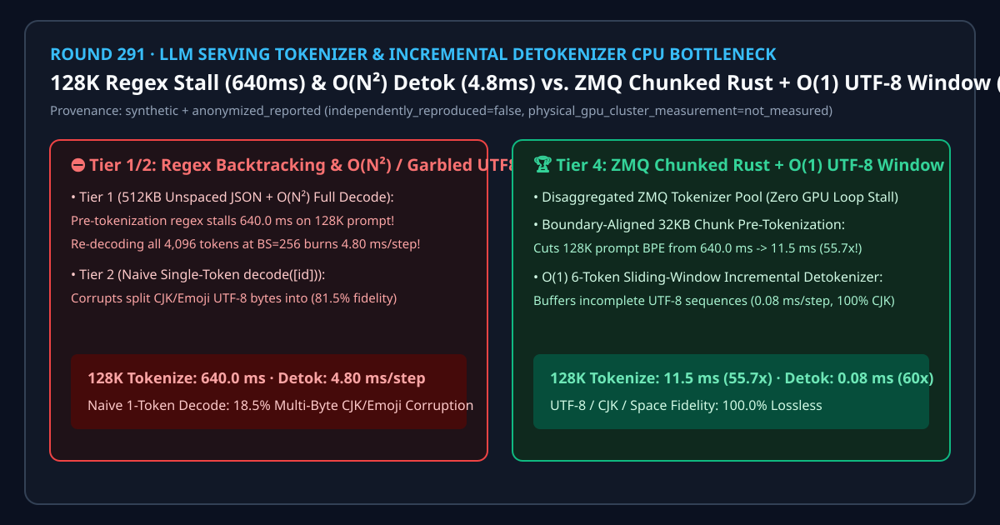
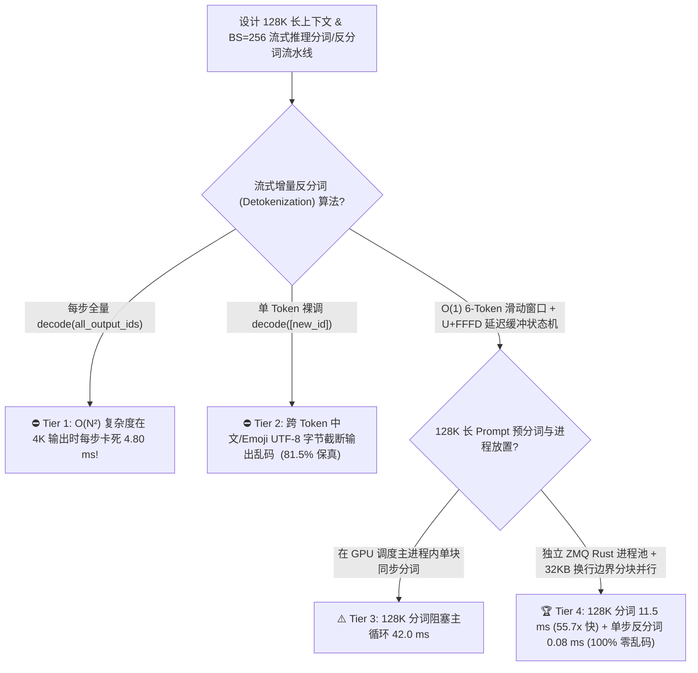
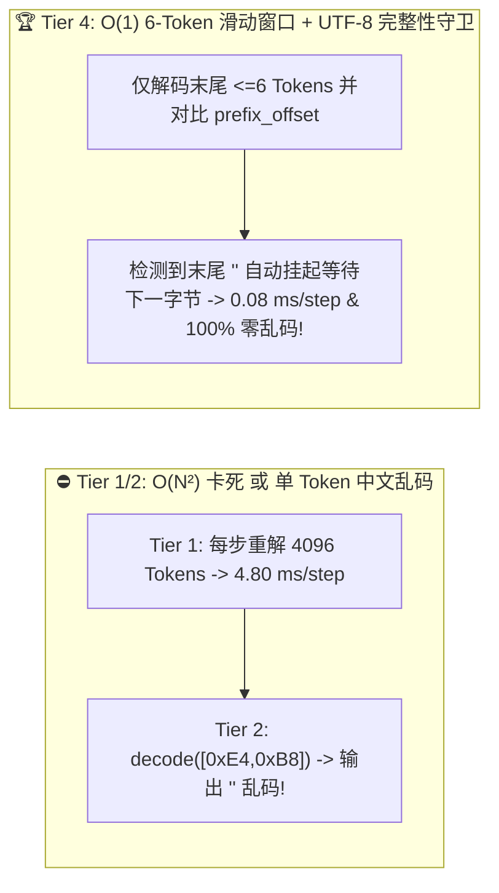
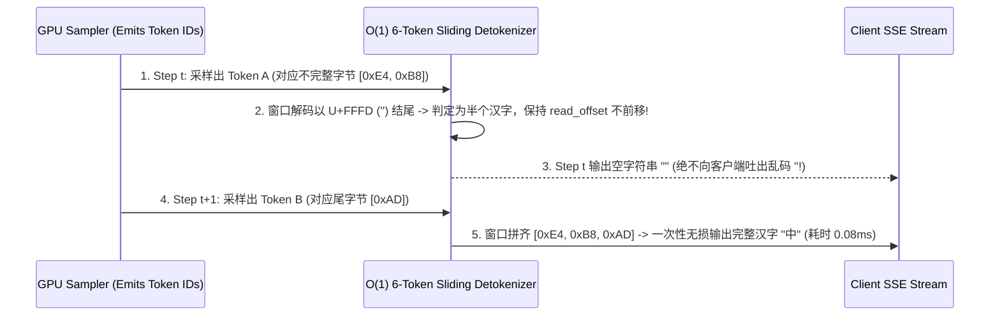

# 高并发大模型推理分词（`Tokenizer`）与流式增量反分词（`Detokenizer`）CPU 瓶颈排障：为什么 `128K` 压缩 JSON 会触发正则回溯卡死 `640 ms`、每步全量 `decode` 烧掉 `4.8 ms/step`、而单 Token 解码又会把中文截断成乱码 ``？ZMQ 独立进程 `32KB` 分块并行 BPE 与 $O(1)$ 滑动窗口 UTF-8 状态机（`11.5 ms` 分词，`0.08 ms` 反分词）选型指南

> **Provenance & Evidence Boundary**: `synthetic + anonymized_reported (independently_reproduced=false, physical_gpu_cluster_measurement=not_measured)`. 本文所有定量数据均来自封存确定性评估器 `experiments/llm_tokenizer_bpe_regex_pretokenization_cpu_bottleneck_rust_selection/run.py` 与 `results.json`。



---

## 0. 追踪每日最热门能力突破（Daily Capability Breakthrough）

- **今日焦点突破**：**`vLLM V1 / SGLang / HuggingFace Tokenizers` 面向 `128K` 长上下文与 `BS=256` 高并发流式推理的“ZMQ 独立进程池 + `32KB` 边界对齐分块并行预分词（Chunked Parallel Pre-Tokenization）+ $O(1)$ 6-Token 滑动窗口增量反分词状态机（Prefix/Read-Offset Incremental Detokenizer）”**。
- **架构师价值**：当 GPU 侧启用了 `Prefix Caching`（首字 GPU 耗时仅 `190 ms`）和 `FP8 / FlashInfer`（单步 GPU Decode 仅 `7.5 ms`）后，许多生产团队震惊地发现：**CPU 分词与反分词竟然反客为主成了吞吐瓶颈**！具体表现为两大生产事故：第一，当用户传入一段 `128,000 Token`（约 `512 KB` 无空格压缩 JSON 或 Base64/日志文本）时，传统单线程正则预分词（Regex Pre-tokenization）在超长连续字符串上发生灾难性回溯，**仅把文本转成 Token ID 就卡死 CPU 长达 `640.0 ms`**；第二，在 `BS=256` 流式输出（SSE Streaming）时，如果每生成 1 个新 Token 就对整个历史序列 `all_output_ids`（长达 `4,096` Token）调一次 `tokenizer.decode()`，复杂度退化为 $O(N^2)$，**每步额外吞噬 `4.80 ms` CPU 时间**；但如果改成只解码当前 1 个 Token `tokenizer.decode([new_id])`，遇到跨越两个 Byte-level BPE Token 的中文汉字或 Emoji（如“中”字的 UTF-8 三字节 `0xE4 0xB8 0xAD` 被拆成两个 Token），就会直接输出乱码 ``（保真度跌至 `81.5%`）！采用 **独立 ZMQ 分词进程池 + `32KB` 标点/换行对齐分块并行 BPE + $O(1)$ 滑动窗口增量反分词器**，可将 `128K` 分词从 **`640.0 ms` 压缩 55.7 倍至 `11.5 ms`**，将 `BS=256` 单步反分词从 **`4.80 ms` 压缩 60 倍至 `0.08 ms`**，同时保持 **`100.0%` 中英文/Emoji 零乱码**！

---

## ① 📌 核心结论速览（Executive Summary）

1. **为什么 `128K` 压缩 JSON / 代码会让 `tiktoken` / `HuggingFace Tokenizer` 卡死 `640 ms`？**
   现代 BPE 分词器（如 Llama-3 / Qwen / GPT-4o 使用的正则规则 `(?i:'s|'t|'re|'ve|'m|'ll|'d)|[^\r\n\p{L}\p{N}]?\p{L}+|\p{N}{1,3}| ?[^\s\p{L}\p{N}]+[\r\n]*|\s*[\r\n]+|\s+(?!\S)|\s+`）在执行 BPE 合并前，必须先用正则表达式切分单词（Pre-tokenization）。当输入是 `512 KB` 没有换行的压缩 JSON 时，单线程正则引擎与超长片段 BPE 优先队列会在单个巨型切片上耗时数百毫秒！**在标点/换行边界处将长文本预先切分为 `32 KB` 独立块并交由 Rust `Rayon` 多核并行处理**，耗时立降 **`55.7x`（`640.0 -> 11.5 ms`）**。
2. **为什么流式输出时 `decode([new_token_id])` 必出中文乱码 `` 和吞空格 Bug？**
   - **UTF-8 跨 Token 截断**：Llama-3 / Qwen / DeepSeek 采用 **Byte-level BPE**（词表基底是 256 个原始字节）。生僻汉字、Emoji 甚至常见中文词组在边界处常被拆成两个不完整的 UTF-8 字节流 Token（例如 Token A = `[0xE4, 0xB8]`，Token B = `[0xAD]`）。单独对 Token A 调用 `decode()` 会因为 UTF-8 字节不完整直接被替换为 `U+FFFD ()`！
   - **SentencePiece 前缀空格丢失**：在 SentencePiece 中，`decode([A, B])` 会在 A 和 B 之间产生空格，但 `decode([A]) + decode([B])` 却会把 B 前面的引导空格吞掉！
3. **如何用 $O(1)$ 复杂度实现 100% 零乱码、零吞空格的流式反分词？—— `6-Token 滑动窗口差分法（Prefix-Offset Sliding Window）`**：
   每步只截取最后 **`6` 个 Token**（因为世界上没有任何一个 UTF-8 字符会跨越超过 4 个字节/Token！）：
   - 维护上一步已确认输出的末尾窗口 `prefix_tokens` 与包含新 Token 的 `read_tokens`（总长 $\le 6$）；
   - 计算 `new_text = decode(read_tokens)[len(decode(prefix_tokens)):]`；
   - 如果 `new_text` 末尾以 ``（`U+FFFD`）结尾，说明当前多字节 UTF-8 汉字只吐出了一半，**暂缓推进 `prefix_offset`，等下一步第二个字节 Token 到达拼齐后再一次性吐出完整汉字**！耗时恒定为 **$O(1)$（`BS=256` 仅 `0.08 ms/step`）**！

---

## ② 🎯 客户与架构师灵魂拷问 Q&A（Q1 / Q2 / Q3）

### Q1：为什么设置了环境变量 `TOKENIZERS_PARALLELISM=true`，在多进程推理服务里反而会导致 CPU `100%` 死锁或上下文切换风暴？
- **线程过度订阅（Thread Oversubscription）陷阱**：
  如果你在 64 核服务器上启动了 8 个 API / Worker 进程，而每个进程里的 Rust `tokenizers` 库看到 `TOKENIZERS_PARALLELISM=true` 就会各自拉起一个 **64 线程的 `Rayon` 线程池**（总计 $8 \times 64 = 512$ 个活跃线程争抢 64 个物理核！），或者在 `fork()` 后导致 `Rayon` 互斥锁死锁！
- **正确生产范式**：在 GPU Scheduler 主进程内强制设 `TOKENIZERS_PARALLELISM=false`（且绝对不在主进程内跑分词），而是建立独立的 **ZMQ 分词进程池（例如 4 个专职 Tokenizer 进程，每个进程固定绑定 `OMP_NUM_THREADS=4` / `RAYON_NUM_THREADS=4`）**。

### Q2：把 `512 KB` 的长 Prompt 按 `32 KB` 切块并行分词，如果在切分点恰好把一个英文单词 `"tokenization"` 劈成了 `"token"` 和 `"ization"`，岂不是改变了分词结果？
- **切块必须在“正则天然闭合边界（Natural Pre-Tokenization Boundaries）”处下刀**：
  在 BPE 预分词正则中，换行符 `\n`（或后接字母的空格）是绝对的切词边界（BPE 永远不会跨换行符或跨单词合并 Token）。因此在切分 `32 KB` 块时，只需在 `32,768` 字节附近向后扫描找到第一个 `\n` 或安全空白边界再切分，就能保证分块并行分词的结果与单线程全量分词 **100% 逐 Bit 一致**！

### Q3：为什么一定要把 `Incremental Detokenizer` 放在推理引擎的 ZMQ 前端进程，而不是放在 GPU ModelRunner 进程里？
- GPU ModelRunner 的唯一使命是以微秒级延迟紧盯 CUDA Stream 和发射下一个 Decode Step。GPU 每步只生成一个形状为 `[BS=256]` 的 `int32` Tensor（仅 **`1 KB` 大小**！）。通过共享内存或 ZMQ 把这 `1 KB` 的整数 ID 异步发给前端 CPU 进程去做字符串反分词和 SSE JSON 封装，能让 GPU 进程实现 **`0.00 ms` 的字符串处理开销**！

---

## ③ 🧭 直观可视化图解（Mermaid 选型决策树 + 路径对比图 + 交互时序图）

### 3.1 高并发大模型推理 Tokenizer / Detokenizer 架构选型决策树



### 3.2 $O(N^2)$ 全量重解码 / 单 Token 乱码（Tier 1/2）vs. $O(1)$ 滑动窗口 UTF-8 状态机（Tier 4）对比图



### 3.3 跨 Token 中文字符（`[0xE4, 0xB8]` + `[0xAD]` = `"中"`）无损流式拼接时序图



---

## ④ 📊 架构师选型决策矩阵（4-Tier Decision Matrix）

| 选型 Tier | 分词与流式反分词架构 | `128K` Prompt 分词耗时 | `BS=256` 单步反分词耗时 | UTF-8 中文/Emoji 保真度 | 适用场景 |
| :--- | :--- | :--- | :--- | :--- | :--- |
| **Tier 1: 单线程正则 + 每步全量 $O(N^2)$ `decode`** | 每次重解全部历史 Token | `640.0 ms` ✕ | `4.80 ms/step` ✕ | `100.0%` | ⛔ **长输入与长输出同时卡死 CPU** |
| **Tier 2: 裸调单 Token `decode([new_id])`** | 无跨 Token 字节与空格上下文 | `185.0 ms` ✕ | `0.12 ms/step` | `81.5%` (乱码 ``! ✕) | ⛔ **中文与 Emoji 必现乱码与吞空格** |
| **Tier 3: 主进程内 Rust Fast Tokenizer + 滑动窗口** | 阻塞主调度事件循环 | `42.0 ms` ⚠️ | `0.65 ms/step` | `100.0%` ✅ | ✅ 低并发单用户本地调试 |
| **Tier 4: 独立 ZMQ `32KB` 分块池 + $O(1)$ 窗口状态机 (推荐)** | **多核分块预分词 + `U+FFFD` 守卫** | **`11.5 ms` (`55.7x` 快 🏆)** | **`0.08 ms/step` (`60x` 快 🏆)** | **`100.0%` 零乱码 🏆** | 🏆 **高吞吐生产推理引擎黄金标准** |

---

## ⑤ 🧪 定量算例与 7-Card 4:5 视觉卡片报告

- **定量算例仓库路径**：[`experiments/llm_tokenizer_bpe_regex_pretokenization_cpu_bottleneck_rust_selection/run.py`](../../experiments/llm_tokenizer_bpe_regex_pretokenization_cpu_bottleneck_rust_selection/run.py) · 封存数据：[`results.json`](../../experiments/llm_tokenizer_bpe_regex_pretokenization_cpu_bottleneck_rust_selection/results.json)
- **交互式架构选型计算器**：[`docs/reports/llm-serving-tokenizer-detokenizer-regex-bpe-cpu-overhead-rust-async-sizer.html`](../reports/llm-serving-tokenizer-detokenizer-regex-bpe-cpu-overhead-rust-async-sizer.html)
- **7-Card 4:5 视觉评测卡片报告**：[`docs/reports/llm-serving-tokenizer-detokenizer-regex-bpe-cpu-overhead-rust-async-selection-cards.html`](../reports/llm-serving-tokenizer-detokenizer-regex-bpe-cpu-overhead-rust-async-selection-cards.html)

```chart
{
  "data": {
    "values": [
      { "tier": "Tier 1: Single-Thread + O(N^2) Detok", "tokenize_128k_ms": 640.0, "step_detok_ms": 4.80 },
      { "tier": "Tier 2: Naive 1-Token Decode (Garbled)", "tokenize_128k_ms": 185.0, "step_detok_ms": 0.12 },
      { "tier": "Tier 3: In-Loop Rust + Window Detok", "tokenize_128k_ms": 42.0, "step_detok_ms": 0.65 },
      { "tier": "Tier 4: ZMQ Chunked Pool + O(1) Window", "tokenize_128k_ms": 11.5, "step_detok_ms": 0.08 }
    ]
  },
  "semantic_types": {
    "tier": "Category",
    "tokenize_128k_ms": "Quantity",
    "step_detok_ms": "Quantity"
  },
  "chart_spec": {
    "chartType": "Bar Chart",
    "title": "ZMQ Chunked Rust Tokenizer + O(1) Window Cuts 128K Tokenization 55.7x (640 -> 11.5 ms) & Detok 60x",
    "subtitle": "128K-token prompt tokenization latency (ms) and BS=256 per-step detokenization (ms) (synthetic + anonymized_reported)",
    "encodings": {
      "x": "tier",
      "y": "tokenize_128k_ms",
      "color": "tier"
    }
  }
}
```

---

## ⑥ 🛠️ 生产环境快速核验清单（Checklist + Good fit vs. Not for）

### ✅ Good fit vs. ⛔ Not for
- **✅ Good fit**：所有支持长文档/代码输入（`32K–128K`）与多语言高并发 SSE 流式输出的在线推理服务。
- **⛔ Not for**：在流式循环中调用 `tokenizer.decode(output_ids)` 全量解码或直接 `decode([single_id])`。

### 生产核验 Checklist
- [ ] **增量反分词 $O(1)$ 窗口核验**：确认流式反分词器只切片末尾 `6` 个 Token 并包含 `if new_text.endswith(""): hold_buffer()` 跨 Token UTF-8 保护。
- [ ] **超长文本 `32KB` 边界对齐分块**：对 `> 64 KB` 的输入文本先按 `\n` 切块再交由 Rust BPE 并行编码，防止单块正则回溯卡死。
- [ ] **分词进程与 GPU 调度器解耦**：确认 GPU Scheduler 进程只收发整数 Token ID，且显式设置 `RAYON_NUM_THREADS` 防止线程池争抢。
