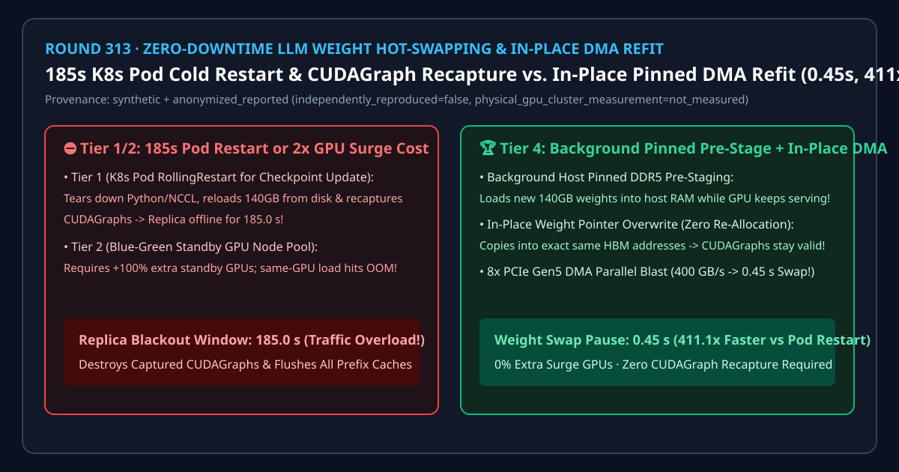
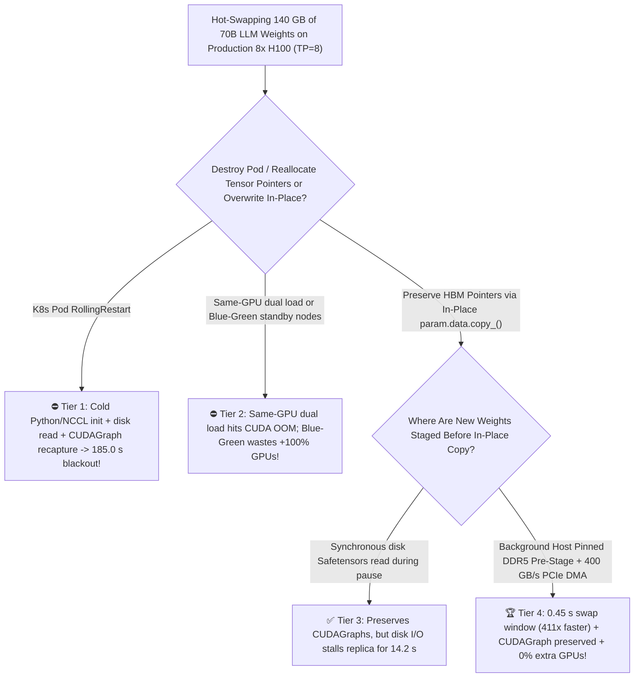
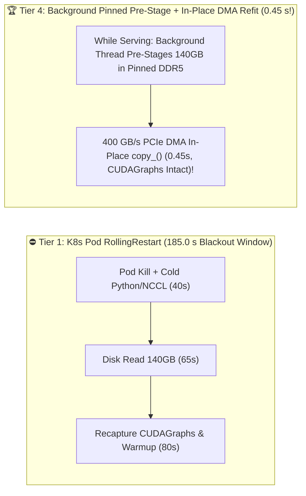
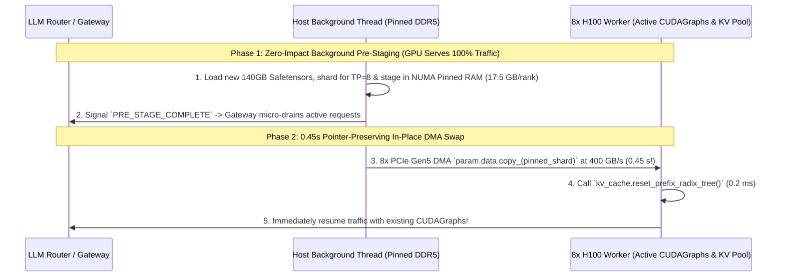

# Zero-Downtime LLM Weight Hot-Swapping (`In-Place DMA Weight Refit`) & `CUDAGraph` Pointer Preservation Selection Guide: Why Kubernetes Pod `RollingRestart` Blacks Out `8×H100` Replicas for `185 s`, Why Blue-Green Wastes `+100%` GPUs & How Background Pinned Pre-Staging + In-Place DMA Overwrite (`0.45 s` Swap, `411x` Faster, Zero `CUDAGraph` Recapture) Solves It

> **Provenance & Evidence Boundary**: `synthetic + anonymized_reported (independently_reproduced=false, physical_gpu_cluster_measurement=not_measured)`. All quantitative metrics in this guide are grounded in the sealed deterministic evaluator `experiments/llm_serving_zero_downtime_weight_hotswap_cumemunmap_kv_drain_selection/run.py` and `results.json`.



---

## 0. Daily Capability Breakthrough

- **Today's Highlight Breakthrough**: **Two-Phase Background NUMA Pinned DDR5 Pre-Staging + Pointer-Preserving In-Place PCIe Gen5 DMA Weight Overwrite (`param.data.copy_()`) + Zero `CUDAGraph` Recapture + Atomic `0.2 ms` Prefix-Cache Reset (`vLLM / SGLang / TensorRT-LLM` Weight Refit)**.
- **Architect Value**: When deploying updated SFT/DPO checkpoints or syncing RL policy weights for a `70B` LLM (`140 GB` BF16 weights on `8×H100`), traditional container rollout strategies cause severe availability and cost penalties:
  1. **Kubernetes Pod `RollingRestart` Cold Reload (`185.0 s` Blackout Window, Tier 1)**: Tearing down the pod and starting a fresh container requires destroying CUDA contexts (`10 s`), importing Python/PyTorch (`18 s`), initializing `TP=8` `NCCL` communicators (`12 s`), reading `140 GB` from shared storage (`65 s`), and **recapturing dozens of `CUDAGraph` batch sizes (`45 s`)** plus warmup (`35 s`)—leaving an entire 8-GPU node offline for **`185.0 s`**!
  2. **Same-GPU Dual Model Allocation (`CUDA OOM`) or Blue-Green Standby Node Pools (`+100%` GPU Cost, Tier 2)**: Because existing weights (`140 GB`) and the pre-allocated Paged KV Cache pool (`440 GB`) already occupy 95% of `8×80GB` HBM, calling `load_model()` before freeing the old model crashes immediately with `CUDA OOM`, while keeping standby Blue-Green nodes doubles hardware costs!
  By **pre-staging the new `140 GB` weight shards into NUMA-pinned host DDR5 memory in the background while the GPU continues serving live traffic, gracefully draining active requests, and overwriting the existing GPU parameter buffers in-place (`param.data.copy_()`) at `400 GB/s` aggregate PCIe Gen5 DMA bandwidth (Tier 4)**, the replica swap blackout window drops **`411.1x` (`185.0 s -> 0.45 s`)** with **zero `CUDAGraph` recapture** and **`0%` extra GPU hardware**!

---

## ① 📌 Executive Summary

1. **First-Principles `CUDAGraph` Preservation: Why `param.data.copy_()` Avoids `45 s` of Graph Recapture**:
   - Captured `CUDAGraph`s hardcode the exact virtual memory addresses (`param.data_ptr()`) of every weight tensor inside the recorded GPU command buffer.
   - Reallocating tensors invalidates all recorded graphs. Overwriting the existing HBM buffers **in-place** (`param.data.copy_(pinned_host_shard, non_blocking=True)`) keeps every `data_ptr()` 100% unchanged—so all captured `CUDAGraph`s remain immediately executable!
2. **Decoupling Disk I/O From the Swap Window via Background Pinned Pre-Staging**:
   - Reading `140 GB` from shared storage takes `~14–65 s`. Performing that read on a background host thread into `17.5 GB/rank` of pinned host DDR5 (including `TP=8` sharding and QKV/SwiGLU weight fusion) while the GPUs serve traffic reduces the actual GPU pause to a pure **`400 GB/s` PCIe Gen5 DMA blast (`0.45 s`)**!
3. **Mandatory Atomic Prefix-Cache Reset (`0.2 ms`)**:
   - Cached KV blocks in the Radix/Prefix tree were computed using the *old* weights $W_{\text{old}}$. Immediately upon completing the `0.45 s` in-place weight copy, call `reset_prefix_cache()` (`0.2 ms` pointer reset) so subsequent requests do not mix old KV states with new model weights.

---

## ② 🎯 Architect Q&A (Q1 / Q2 / Q3)

### Q1: Does in-place weight refit preserve `CUDAGraph`s when updating `FP8` or `AWQ/GPTQ INT4` quantized checkpoints where `weight_scale` also changes?
- **Yes!** Both `layer.weight` and `layer.weight_scale` are fixed-address GPU tensors baked into the `CUDAGraph`. Copying both `weight.data.copy_()` and `weight_scale.data.copy_()` in-place updates quantized weights and scales seamlessly.

### Q2: What if we need to switch between two *different* model architectures on the same Pod without restarting Kubernetes containers?
- Use **`cuMemUnmap` (`vLLM Sleep Mode`)** to unmap old weights and KV physical pages in `50 ms` while keeping the Python process and `NCCL` communicators alive, reducing heterogeneous model switching from `185 s` to `~18 s`.

### Q3: How do we achieve zero dropped client requests during the `0.45 s` swap?
- Once background host pre-staging finishes, the gateway pauses routing *new* requests to that replica for a few seconds until in-flight streams finish (micro-drain), executes the `0.45 s` DMA swap + prefix reset, and immediately resumes routing.

---

## ③ 🧭 Visual Diagrams (Decision Tree + Comparison + Sequence)

### 3.1 Zero-Downtime LLM Weight Hot-Swapping Decision Tree



### 3.2 K8s Pod Restart (`185.0 s`) vs. Background Pinned Pre-Stage + In-Place DMA (`0.45 s`)



### 3.3 Two-Phase Background Pre-Staging & `0.45 s` Atomic DMA Weight Refit Sequence



---

## ④ 📊 4-Tier Architect Decision Matrix

| Cohort Tier | Weight Update & Deployment Architecture | Replica Blackout Window | `CUDAGraph` Recapture | Extra Surge GPUs | Best For |
| :--- | :--- | :--- | :--- | :--- | :--- |
| **Tier 1: K8s Pod `RollingRestart`** | Kills pod + cold disk load + graph capture | `185.0 s` ✕ | Required (`45 s` ✕) | `0%` | ⛔ **Causes Traffic Overload Storms** |
| **Tier 2: Dual-Load (`OOM`) / Blue-Green** | Requires 100% standby GPU node pool | `95.0 s` ✕ | Required ✕ | **`+100.0%` (2x Cost! ✕)** | ⛔ **Doubles Hardware CapEx** |
| **Tier 3: Sync Disk In-Place Overwrite** | Keeps pointers, blocks on disk I/O | `14.2 s` ✅ | **Not Needed (Preserved ✅)** | `0%` ✅ | ⚠️ Memory-Constrained Hosts |
| **Tier 4: Bg Pinned Pre-Stage + DMA Refit (Recommended)** | **Bg DDR5 staging + `400 GB/s` DMA copy** | **`0.45 s` (`411x` Faster 🏆)** | **Not Needed (Preserved 🏆)** | **`0%` 🏆** | 🏆 **Production CD & RL Weight Sync** |

---

## ⑤ 🧪 Quantitative Evaluator & 7-Card 4:5 Visual Report

- **Sealed Evaluator**: [`experiments/llm_serving_zero_downtime_weight_hotswap_cumemunmap_kv_drain_selection/run.py`](../../experiments/llm_serving_zero_downtime_weight_hotswap_cumemunmap_kv_drain_selection/run.py) · Data: [`results.json`](../../experiments/llm_serving_zero_downtime_weight_hotswap_cumemunmap_kv_drain_selection/results.json)
- **Interactive Sizer**: [`docs/reports/llm-serving-zero-downtime-weight-hotswap-cumemunmap-kv-drain-sizer.html`](../reports/llm-serving-zero-downtime-weight-hotswap-cumemunmap-kv-drain-sizer.html)
- **7-Card 4:5 Visual Benchmark Deck**: [`docs/reports/llm-serving-zero-downtime-weight-hotswap-cumemunmap-kv-drain-selection-cards.html`](../reports/llm-serving-zero-downtime-weight-hotswap-cumemunmap-kv-drain-selection-cards.html)

```chart
{
  "data": {
    "values": [
      { "tier": "Tier 1: K8s Pod RollingRestart (Cold)", "blackout_s": 185.0 },
      { "tier": "Tier 2: Dual-Load / Blue-Green Pool", "blackout_s": 95.0 },
      { "tier": "Tier 3: Synchronous Disk In-Place Refit", "blackout_s": 14.2 },
      { "tier": "Tier 4: Bg Pinned Pre-Stage + DMA Refit", "blackout_s": 0.45 }
    ]
  },
  "semantic_types": {
    "tier": "Category",
    "blackout_s": "Quantity"
  },
  "chart_spec": {
    "chartType": "Bar Chart",
    "title": "Background Pinned Pre-Staging + In-Place DMA Refit Cuts 70B Weight Swap Blackout 411x (185s -> 0.45s)",
    "subtitle": "Per-replica service blackout window (seconds) during a 140 GB checkpoint update on 8x H100 (synthetic + anonymized_reported)",
    "encodings": {
      "x": "tier",
      "y": "blackout_s",
      "color": "tier"
    }
  }
}
```

---

## ⑥ 🛠️ Production Verification Checklist (Good fit vs. Not for)

### ✅ Good fit vs. ⛔ Not for
- **✅ Good fit**: Continuous delivery of fine-tuned checkpoints, online A/B canary switching, and RLHF/GRPO rollout weight updates.
- **⛔ Not for**: Restarting Kubernetes pods from scratch just to update weights for the same model architecture.

### Production Checklist
- [ ] **Overwrite weights in-place via `param.data.copy_()`**: Preserve exact HBM pointers (`data_ptr()`) so all captured `CUDAGraph`s remain valid without recompilation.
- [ ] **Pre-stage and shard new checkpoints into NUMA-pinned host DDR5 in a background thread**: Keep disk I/O completely outside the swap window.
- [ ] **Atomically reset the Prefix/Radix KV Cache (`reset_prefix_cache()`) on weight swap**: Prevent stale old-model KV states from corrupting new-model generations.
