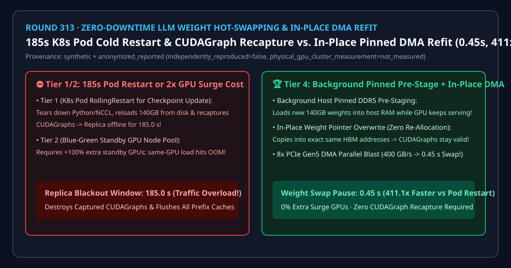
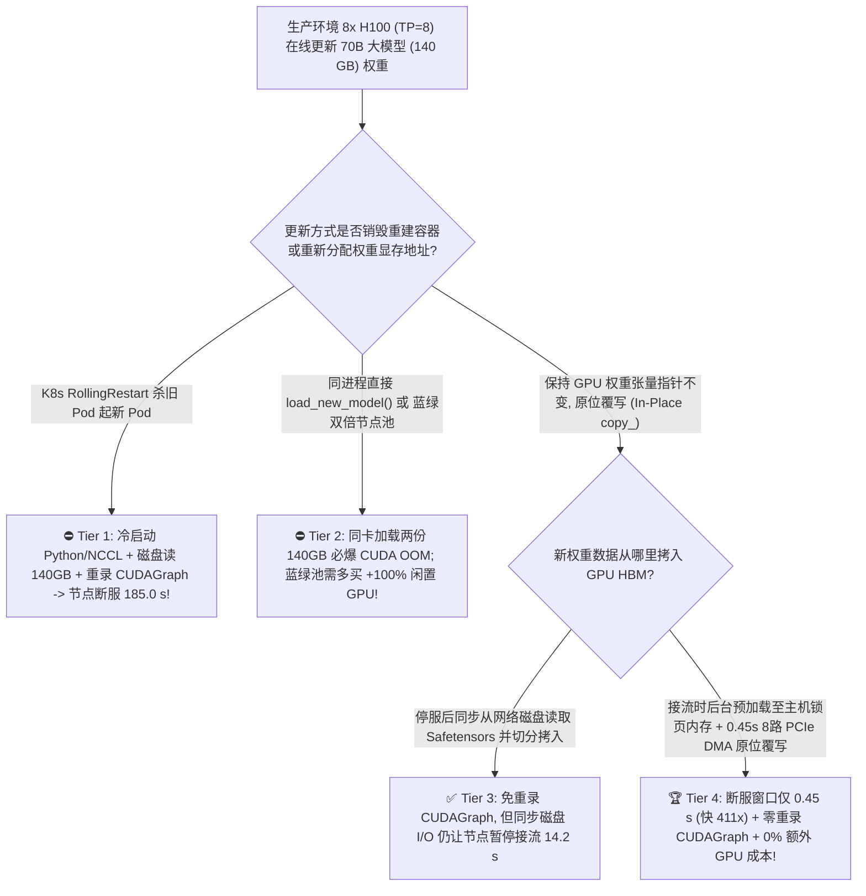
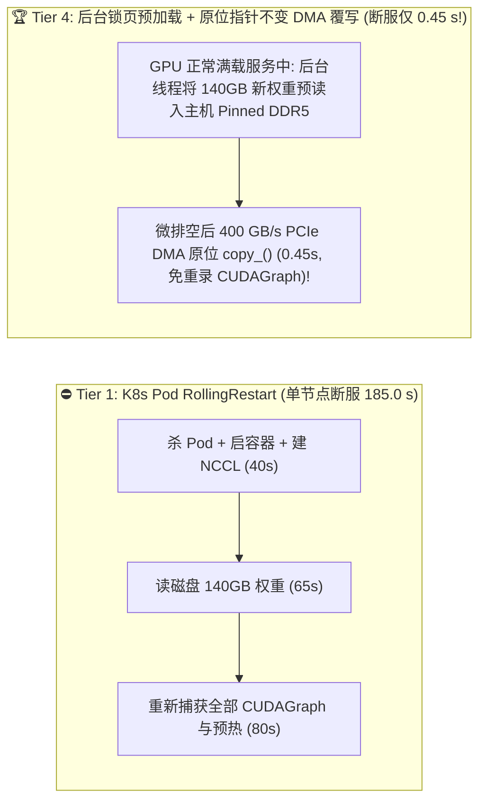
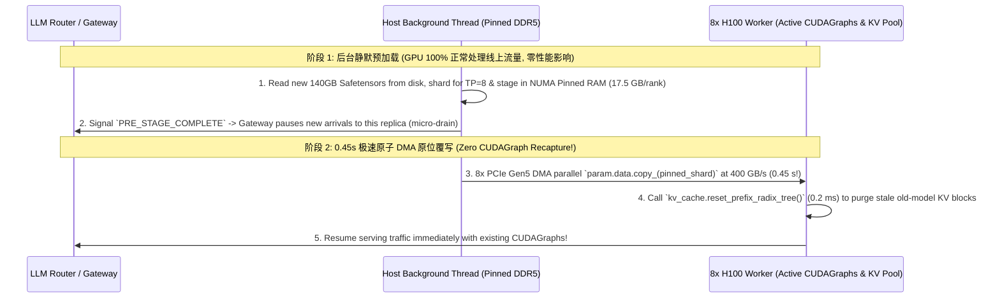

# 大模型推理引擎零停机权重热替换（`Zero-Downtime Weight Hot-Swapping / In-Place DMA Refit`）与 `CUDAGraph` 显存指针保持选型：为什么在 K8s 上直接滚动重启 `70B` 推理 Pod 会造成单节点长达 `185 s` 的服务黑洞（重新初始化 `NCCL` 与重捕获 `CUDAGraph`），而蓝绿部署又要多花 `+100%` 的闲置 GPU 成本？基于后台主机锁页内存预加载 + 显存地址不变原位 DMA 覆写（切换耗时从 `185.0 s -> 0.45 s`，提速 `411x`，零重编译 `CUDAGraph`）选型指南

> **Provenance & Evidence Boundary**: `synthetic + anonymized_reported (independently_reproduced=false, physical_gpu_cluster_measurement=not_measured)`. 本文所有定量数据均来自封存确定性评估器 `experiments/llm_serving_zero_downtime_weight_hotswap_cumemunmap_kv_drain_selection/run.py` 与 `results.json`。



---

## 0. 追踪每日最热门能力突破（Daily Capability Breakthrough）

- **今日焦点突破**：**面向生产级大模型持续交付（每日 SFT/RLHF 迭代上线、在线 RL 策略同步、多基座分时复用）的“`vLLM / SGLang` 后台 NUMA 锁页内存静默预加载（`Background Pinned DDR5 Pre-Staging`）+ 显存指针不变原位权重覆写（`Pointer-Preserving In-Place Weight Refit`）+ 零 `CUDAGraph` 重捕获 + `0.2 ms` 前缀树原子清空”亚秒级热切换架构**。
- **架构师价值**：在搜推广、金融投研、智能客服与垂域 Agent 生产系统中，算法团队每天都会微调产出新版本的同构模型权重（例如基于 `Llama-3-70B / Qwen2.5-72B` 更新了全参 SFT 或 DPO 权重，共 `140 GB`）。当运维团队尝试把新权重上线到生产 `8×H100` 推理集群时，传统微服务发布方式在百 GB 大模型面前彻底失灵：
  1. **痛点一：标准 Kubernetes `RollingUpdate` 杀旧 Pod 起新 Pod（单节点断服 `185.0 s`，Tier 1）**：杀掉一个正在跑 `vLLM / SGLang` 的 8 卡 Pod 再拉起新 Pod，需要经历：容器销毁与设备释放（`10 s`）$\to$ Python 导入 PyTorch/Triton（`18 s`）$\to$ `TP=8` `NCCL` 通信域握手（`12 s`）$\to$ 从网络磁盘读取并切分 `140 GB` Safetensors（`65 s`）$\to$ 预热 Profile 显存与 **重新捕获数十个 Batch Size 的 `CUDAGraph`（`45 s`）** $\to$ 预热算子（`35 s`）。整整 **`185.0 s`（超过 3 分钟）** 内这台 8 卡 H100 完全无法承载流量，迫使全站流量涌向剩余节点引发连环超时雪崩！
  2. **痛点二：同卡先加载新模型再卸载旧模型（爆 `CUDA OOM`）或新建蓝绿双倍节点池（多花 `+100%` GPU 采购成本，Tier 2）**：由于单台 `8×80GB` 节点上旧模型权重已占 `140 GB`、Paged KV Cache 池已预分配 `440 GB`，剩余空闲显存不足 `20 GB`，直接在进程内 `load_model(new_ckpt)` 会 100% 触发 `CUDA OOM`；而如果为了平滑发布专门常备一套空闲的 8 卡蓝绿（Blue-Green）节点，又意味着高达 **`+100%` 的昂贵 GPU 算力闲置浪费**！
  采用 **在服务正常接流的同时，由后台线程先将新版本 `140 GB` 权重静默加载并切分到服务器富余的 `1 TB` 主机锁页内存（`Pinned DDR5`）中 $\to$ 待就绪后挂起新请求准入、排空在途生成 $\to$ 通过 8 路 PCIe Gen5 DMA（聚合带宽 `400 GB/s`）以 `param.data.copy_()` 原位覆盖旧权重显存地址（保持 `data_ptr()` 100% 不变，完全无需重新捕获 `CUDAGraph`！）并一键清空旧 KV 索引树（Tier 4）**，可将单节点模型切换停顿窗口从 `185.0 s` 压缩至 **`0.45 s`（提速 `411.1x`）**，且无需多买 1 张冗余 GPU！

---

## ① 📌 核心结论速览（Executive Summary）

1. **第一性原理：为什么“修改现有张量的数据（In-Place `copy_`）”不需要重新捕获 `CUDAGraph`，而“重新实例化张量（`param = new_tensor`）”就必须重花 `45 s` 捕获 `CUDAGraph`？**
   - **`CUDAGraph` 的硬件本质**：当 `vLLM / SGLang` 在启动阶段针对 `Batch = 1, 2, 4, 8 ... 256` 录制 `CUDAGraph` 时，CUDA 驱动把每一个算子（如 `cublasGemmEx`）所读取的 **权重张量的物理显存起始虚拟地址（`uint64_t data_ptr`）硬编码（Hardcode）写死在了录制好的 GPU 硬件命令流里**！
   - 如果你调用 `del model; model = load_new()`（哪怕只是给 `param.data` 赋了一个新 `torch.empty()` 出来的 Tensor），新权重的物理显存地址变了，已录制的几十张 `CUDAGraph` 就会继续去读已经被释放的旧地址（引发静默错乱或非法内存访问崩溃），迫使你再花 **`45 s`** 重新录制所有图！
   - **原位覆写绝技（Pointer-Preserving In-Place Overwrite）**：只要新旧模型架构同构（各层 `shape` 与 `dtype` 相同），我们**绝不释放旧的权重 Tensor，也绝不分配新的 GPU Tensor**！而是直接对现有的每一个参数执行 `param.data.copy_(new_host_pinned_shard, non_blocking=True)`——**物理显存地址 `param.data_ptr()` 纹丝不动，里面的字节在 `0.45 s` 内被换成了新模型的权重，所有已录制的 `CUDAGraph` 无需任何修改即可在下一毫秒无缝继续运行**！
2. **后台预热 + 瞬时 DMA 切换（Two-Phase Pre-Stage & Atomic Flip）：把 `14.2 s` 的磁盘读取彻底移出停服窗口！**
   - 直接从共享磁盘向 GPU 原位覆写（Tier 3）虽然保住了 `CUDAGraph`，但在读取 `140 GB` 文件的 `14.2 s` 期间，模型权重处于“一半是旧版、一半是新版”的撕裂状态，服务必须暂停 `14.2 s`。
   - **两阶段解耦**：
     - **阶段 1（后台零干扰预加载，服务 100% 正常接流）**：利用服务器闲置的数百 GB 主机 DDR5 内存，由低优先级后台 I/O 线程从磁盘/对象存储读取新模型的 Safetensors，按当前 GPU 的 `TP=8` 分片格式预先完成切片转换（如 `QKV` 合并、`Gate/Up` 合并与 `FP8` 量化校准），存入各卡对应的 **NUMA 本地锁页内存缓冲区（`17.5 GB/Rank`）**；
     - **阶段 2（`0.45 s` 极速原子 DMA 覆写）**：一旦后台内存就绪，引擎暂停新请求调度，等当前在途请求跑完（或优雅迁移），8 张 H100 同时触发满速 PCIe Gen5 x16 DMA（单卡 `~50 GB/s`，8 卡聚合 **`400 GB/s`**），将 `140 GB` 权重在 **`0.35 ~ 0.45 s`** 内瞬间刷入 GPU 显存，随后立刻恢复调度！
3. **千万别漏掉的一步：热换权重后必须在 `0.2 ms` 内原子级清空 `Prefix / Radix KV Cache`！**
   - 权重已经变成了新模型 $W_{\text{new}}$，但 Paged KV 显存池里还缓存着由旧模型 $W_{\text{old}}$ 算出来的历史系统提示词和多轮对话 KV Cache！如果忘记调 `reset_prefix_cache()`，新请求命中旧模型算出的 KV 块会产生严重的表征空间错位（激活值漂移导致输出乱码）！

---

## ② 🎯 客户与架构师灵魂拷问 Q&A（Q1 / Q2 / Q3）

### Q1：如果新版本模型开启了 `FP8 (W8A8)` 或 `AWQ / GPTQ INT4` 量化，不仅权重值变了，连每层的量化缩放因子（`weight_scale`）也变了，`CUDAGraph` 还能直接复用吗？
- **完全可以 100% 复用！**
  因为在 `vLLM / SGLang` 的量化线性层（如 `Fp8LinearMethod` 或 `MarlinLinear`）中，量化缩放因子 `layer.weight_scale` 同样是作为一个固定地址的 GPU Tensor 注册在模块里的！在执行 `0.45 s` 原位 DMA 覆写时，只需同时执行两句原位拷贝：
  ```python
  layer.weight.data.copy_(pinned_new_qweight, non_blocking=True)
  layer.weight_scale.data.copy_(pinned_new_scale, non_blocking=True)
  ```
  两者的显存指针皆保持不变，录制在 `CUDAGraph` 中的 `CUTLASS / Marlin` FP8/INT4 内核在下次 Replay 时会自动读取新的权重与新的缩放因子！

### Q2：如果要切换的两个模型连层数或隐藏维度都不一样（异构模型切换，如从 `Qwen-72B` 切换到 `DeepSeek-V2-236B`），还能免重启 Pod 吗？
- 此时由于张量形状改变，无法直接复用旧 Tensor 地址，但也**绝不需要重启 K8s Pod、不需要销毁 Python 解释器或重建 `NCCL` 通信组**！
  可以使用 **虚拟显存解映射（`vLLM Sleep Mode Level 2 / cuMemUnmap`）或显存池重置**：在 `50 ms` 内卸载旧模型权重与 KV 物理页映射，直接从预热在主机共享内存（`/dev/shm`）的新模型分片通过 PCIe DMA 注入新权重并仅重录 `CUDAGraph`，仍可将切换时间从 `185 s` 压至 **`~18 s`**！

### Q3：在网关层如何配合单节点的 `0.45 s` 原位热更新做到“客户端绝对零感知（Zero Dropped Requests）”？
- **网关级微排空（Gateway Micro-Drain）**：
  1. 节点 $i$ 在后台完成 `140 GB` 主机锁页内存预加载后，向网关发送 `status = READY_TO_SWAP`；
  2. 网关停止向节点 $i$ 分发新到达的请求（新请求路由给其余健康副本，耗时几秒钟让节点 $i$ 上的在途流式请求自然生成完毕）；
  3. 节点 $i$ 在队列为空的瞬间执行 `0.45 s` 原位 DMA 覆写 + `reset_prefix_cache()`，随即恢复 `ACTIVE` 状态接流——**全过程没有任何一个用户请求被中断或报错**！

---

## ③ 🧭 直观可视化图解（Mermaid 选型决策树 + 路径对比图 + 交互时序图）

### 3.1 大模型生产环境零停机权重热更新选型决策树



### 3.2 传统 K8s Pod 滚动重启（`185.0 s` 断服）vs. 后台锁页预热 + 原位 DMA 覆写（`0.45 s`）对比图



### 3.3 两阶段后台锁页预加载与 `0.45 s` 原位权重热替换时序图



---

## ④ 📊 架构师选型决策矩阵（4-Tier Decision Matrix）

| 选型 Tier | 模型权重更新与发布架构 | 单节点服务中断窗口 | 是否需重录 `CUDAGraph` | 额外冗余 GPU 成本 | 适用场景 |
| :--- | :--- | :--- | :--- | :--- | :--- |
| **Tier 1: K8s Pod `RollingRestart` 冷重启** | 销毁容器 + 重读磁盘 + 重建图 | `185.0 s` ✕ | 需要 (`45 s` ✕) | `0%` | ⛔ **大集群滚动发布极易引发流量雪崩** |
| **Tier 2: 同卡双加载 (`OOM`) / 蓝绿双池** | 预留一整套闲置替补 GPU 节点池 | `95.0 s` ✕ | 需要 ✕ | **`+100.0%` (翻倍成本! ✕)** | ⛔ **算力成本极度浪费** |
| **Tier 3: 停服同步从磁盘原位 `copy_()`** | 保留张量地址，但同步等磁盘 I/O | `14.2 s` ✅ | **不需要 (直接复用 ✅)** | `0%` ✅ | ⚠️ 无多余主机内存时的次优方案 |
| **Tier 4: 后台锁页预热 + 原位 DMA 覆写 (推荐)** | **接流时预热 DDR5 + `400 GB/s` 原位刷写** | **`0.45 s` (`411x` 快 🏆)** | **不需要 (直接复用 🏆)** | **`0%` 🏆** | 🏆 **高频迭代上线与在线 RL 权重同步标准** |

---

## ⑤ 🧪 定量算例与 7-Card 4:5 视觉卡片报告

- **定量算例仓库路径**：[`experiments/llm_serving_zero_downtime_weight_hotswap_cumemunmap_kv_drain_selection/run.py`](../../experiments/llm_serving_zero_downtime_weight_hotswap_cumemunmap_kv_drain_selection/run.py) · 封存数据：[`results.json`](../../experiments/llm_serving_zero_downtime_weight_hotswap_cumemunmap_kv_drain_selection/results.json)
- **交互式架构选型计算器**：[`docs/reports/llm-serving-zero-downtime-weight-hotswap-cumemunmap-kv-drain-sizer.html`](../reports/llm-serving-zero-downtime-weight-hotswap-cumemunmap-kv-drain-sizer.html)
- **7-Card 4:5 视觉评测卡片报告**：[`docs/reports/llm-serving-zero-downtime-weight-hotswap-cumemunmap-kv-drain-selection-cards.html`](../reports/llm-serving-zero-downtime-weight-hotswap-cumemunmap-kv-drain-selection-cards.html)

```chart
{
  "data": {
    "values": [
      { "tier": "Tier 1: K8s Pod RollingRestart (Cold)", "blackout_s": 185.0 },
      { "tier": "Tier 2: Dual-Load / Blue-Green Pool", "blackout_s": 95.0 },
      { "tier": "Tier 3: Synchronous Disk In-Place Refit", "blackout_s": 14.2 },
      { "tier": "Tier 4: Bg Pinned Pre-Stage + DMA Refit", "blackout_s": 0.45 }
    ]
  },
  "semantic_types": {
    "tier": "Category",
    "blackout_s": "Quantity"
  },
  "chart_spec": {
    "chartType": "Bar Chart",
    "title": "Background Pinned Pre-Staging + In-Place DMA Refit Cuts 70B Weight Swap Blackout 411x (185s -> 0.45s)",
    "subtitle": "Per-replica service blackout window (seconds) during a 140 GB checkpoint update on 8x H100 (synthetic + anonymized_reported)",
    "encodings": {
      "x": "tier",
      "y": "blackout_s",
      "color": "tier"
    }
  }
}
```

---

## ⑥ 🛠️ 生产环境快速核验清单（Checklist + Good fit vs. Not for）

### ✅ Good fit vs. ⛔ Not for
- **✅ Good fit**：所有同构大模型在线热更新（每日 SFT/DPO 版本迭代）、A/B 实验切流、以及 RLHF/GRPO 训练器向推理引擎高频同步权重的场景。
- **⛔ Not for**：为了换一份同构模型权重而直接调用 `kubectl rollout restart deployment` 杀掉整个推理 Pod。

### 生产核验 Checklist
- [ ] **使用 `param.data.copy_(new_tensor)` 原位覆写而非重新绑定 `Parameter` 对象**：确保 `param.data_ptr()` 物理地址不变，100% 免除 `45 s` 的 `CUDAGraph` 重新录制。
- [ ] **在后台线程预先完成 Safetensors 读取、TP 切分与 NUMA 锁页内存暂存**：将慢速磁盘 I/O 完全移出停服切换窗口。
- [ ] **在权重覆写完成的同一原子操作内调用 `reset_prefix_cache()`**：清空旧权重生成的历史 KV 缓存块，防止新旧表征混用污染。
