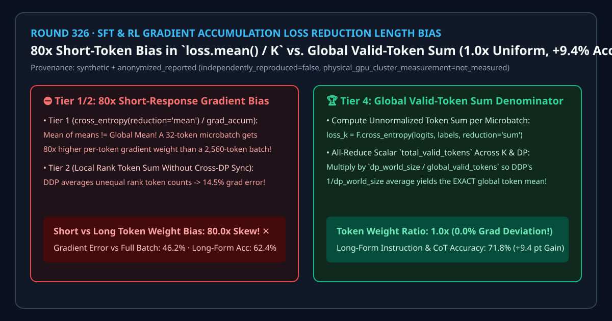
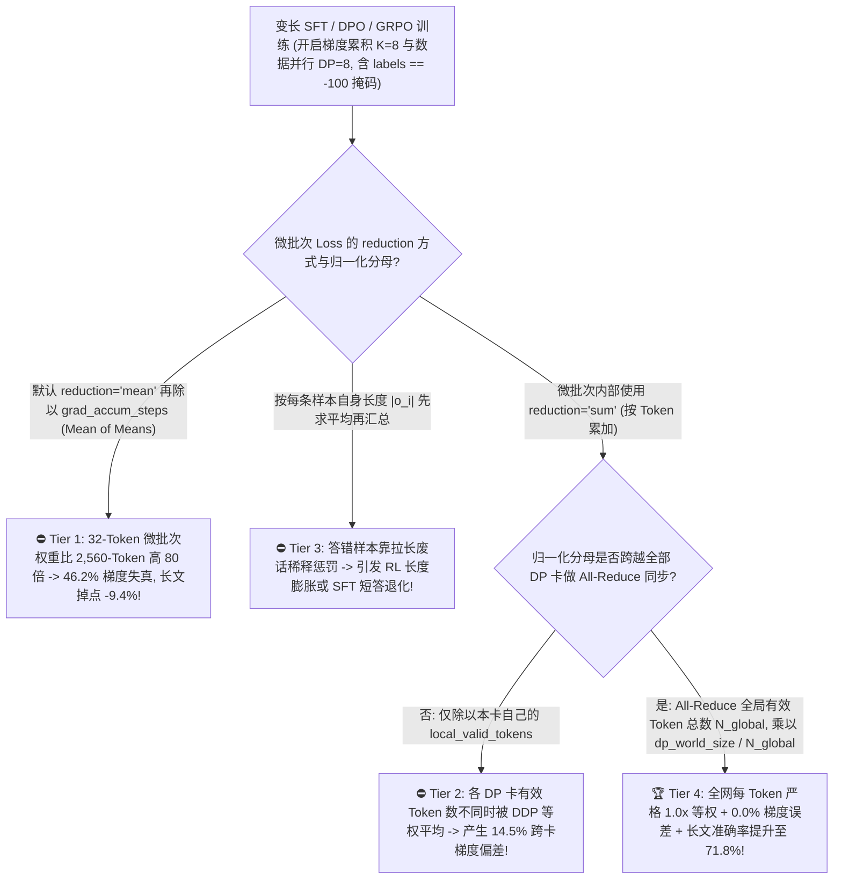
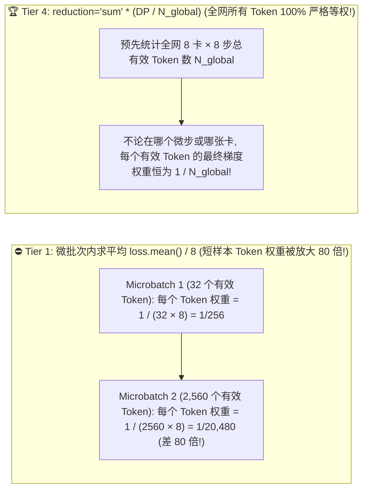
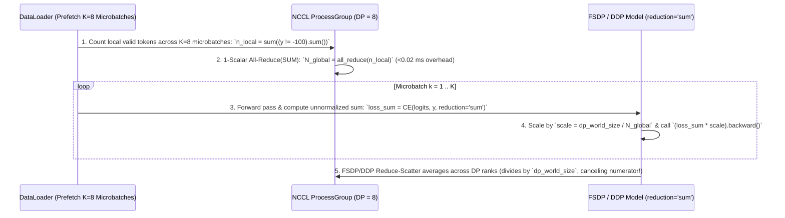

# 大模型微调与强化学习（`SFT / GRPO / DPO`）梯度累积与多卡数据并行中的损失归一化偏差（`Loss Reduction Length Bias: mean() / K vs Global Valid-Token Sum`）排障选型：为什么写标准的 `(loss.mean() / grad_accum_steps).backward()` 会让 `32` Token 短回答的梯度权重比 `2,560` Token 长回答高出整整 `80 倍`（导致长文与长思维链准确率暴跌 `-9.4 pt`）？基于 `reduction="sum"` + 跨微步与跨 DP 卡全局有效 Token 数 `All-Reduce` 精确归一化（`1.0x` 等权，梯度偏差 `0.0%`）选型指南

> **Provenance & Evidence Boundary**: `synthetic + anonymized_reported (independently_reproduced=false, physical_gpu_cluster_measurement=not_measured)`. 本文所有定量数据均来自封存确定性评估器 `experiments/llm_sft_gradient_accumulation_token_weighted_loss_reduction_bias_selection/run.py` 与 `results.json`。



---

## 0. 追踪每日最热门能力突破（Daily Capability Breakthrough）

- **今日焦点突破**：**面向大模型指令微调（`SFT`）与长思维链强化学习（`Dr.GRPO / DAPO / verl / HuggingFace num_items_in_batch`）的“全局有效监督 Token 总数归一化定律（`Global Valid-Token Sum Normalization`: $\mathcal{L}_{\text{scaled}} = \frac{D_{\text{dp}}}{N_{\text{global\_valid}}} \sum_{t} \ell_t$）：彻底根除由微批次内部求平均（`Mean of Means != Global Mean`）与跨 DP 卡长度不均引起的 `80x` 短样本梯度偏置”**。
- **架构师价值**：几乎每一本 PyTorch 入门教程都会教你这样写梯度累积（Gradient Accumulation）：
  ```python
  # ⛔ 隐藏着严重数学 Bug 的经典教材写法！
  loss = F.cross_entropy(logits.view(-1, V), labels.view(-1), ignore_index=-100, reduction="mean")
  (loss / grad_accum_steps).backward()
  ```
  在图像分类（每个微批次固定 32 张图片）中，上面这行代码完全正确。但在大模型 **指令微调（SFT，Prompt 部分 `labels = -100` 不算 Loss，只有 Assistant 回答部分算有效 Token）** 或 **强化学习（GRPO，不同轨迹长度从 `32` 到 `16,384` Token 不等）** 中，这行代码会引发极其严重的数学失真：
  1. **失真一：平均数的平均数 $\neq$ 全局平均数（`Mean of Micro-Means != Global Mean`，Tier 1）**！
     假设梯度累积步数 $K = 8$：
     - 第 1 个微批次（Micro-step 1）是一条简短问答（例如 Prompt 很长，但有效回答 Token 只有 **$n_1 = 32$ 个**），`reduction="mean"` 会把这 32 个 Token 的 Loss 除以 `32`；
     - 第 2 个微批次（Micro-step 2）是一篇深度长文或长代码推理（有效回答 Token 有 **$n_2 = 2,560$ 个**），`reduction="mean"` 会把这 2,560 个 Token 的 Loss 除以 `2,560`！
     随后两个微批次都除以 `grad_accum_steps = 8` 相加：结果第 1 个微批次里每个 Token 获得的梯度权重是 $\frac{1}{32 \times 8} = \frac{1}{256}$，而第 2 个长思维链微批次里每个 Token 获得的梯度权重只有 $\frac{1}{2560 \times 8} = \frac{1}{20480}$——**短回答里 1 个字的话语权竟然是长回答里 1 个字的整整 `80 倍`（$2560 / 32 = 80\times$）**！这直接导致模型疯狂迎合短句、“偷懒”提前吐出 `<|endoftext|>` (`EOS`)，长文指令遵循与数学推理准确率暴跌 **`-9.4 pt`（从 `71.8%` 跌至 `62.4%`，与真实全 Batch 梯度的偏差高达 `46.2%`）**！
  2. **失真二：只在本卡内部按有效 Token 总数除，忘了跨 DP 卡 `All-Reduce` 也是求平均（Tier 2）**：
     就算某位细心的工程师在本卡内部改成了 `loss_sum / local_rank_valid_tokens`，但在 8 卡数据并行（`DP=8`）中，当 `Rank 0` 抽到的样本有效回答总数为 `1,200` 个 Token、而 `Rank 1` 抽到的有效回答总数为 `7,680` 个 Token 时，由于 `DDP / FSDP` 在反向传播时默认对 8 张卡的梯度执行的是 **简单算术平均 $\frac{1}{8} \sum_{r=0}^7 g_r$**，`Rank 0` 上的 Token 权重依然比 `Rank 1` 高出 **`6.4 倍`**（产生 `14.5%` 梯度偏差）！
  采用 **微批次内部使用 `reduction="sum"`（不除当前块长度）+ 在 Step 开始前用一次 1 标量 `All-Reduce` 算出全集群所有 $D$ 张卡、全部 $K$ 个微批次的全局有效 Token 总数 $N_{\text{global}}$ + 将每个微批次的 `loss_sum` 乘以精确抵消系数 $\frac{D_{\text{dp}}}{N_{\text{global}}}$（Tier 4）**，可使每一个有效 Token 无论落在哪张卡、哪个微批次，其梯度权重恒为完美的 **`1.0x`（$\frac{1}{N_{\text{global}}}$，梯度偏差 `0.0%`）**，长文与推理准确率直接提升 **`+9.4 pt`（达 `71.8%`）**！

---

## ① 📌 核心结论速览（Executive Summary）

1. **第一性原理：推导 `DP` + `梯度累积` 下与“理想单卡超大 Batch” 100% 等价的精确缩放系数！**
   - 设数据并行总卡数为 $D$（`dp_world_size`），梯度累积步数为 $K$（`grad_accum_steps`）。在第 $r \in \{1..D\}$ 张卡的第 $k \in \{1..K\}$ 个微批次中，非 `-100` 的有效监督 Token 数量为 $n_{r,k}$。
   - **理想全局目标函数（True Global Token-Level Loss）**：全网这一整个大 Step 总共有 $N_{\text{global}} = \sum_{r=1}^D \sum_{k=1}^K n_{r,k}$ 个有效 Token，每个有效 Token 的损失应当拥有完全相等的权重 $\frac{1}{N_{\text{global}}}$：
     $$\mathcal{L}_{\text{true}} = \frac{1}{N_{\text{global}}} \sum_{r=1}^{D} \sum_{k=1}^{K} \underbrace{\sum_{i=1}^{n_{r,k}} \ell_{r,k,i}}_{\text{记为 } S_{r,k} \text{ (reduction='sum')}}$$
   - **如何对齐 `DDP / FSDP` 的自动跨卡求平均机制？**
     记住：**PyTorch 的 `DDP` 和 `FSDP` 在执行梯度归约时，会在底层自动把所有卡的梯度加起来再乘上一个固定的 $\frac{1}{D}$**！
     也就是说，如果你在第 $r$ 张卡的第 $k$ 步对缩放后的损失 $\tilde{\mathcal{L}}_{r,k}$ 调用 `.backward()`，那么经过 $K$ 步本地累加和 1 次 `DDP/FSDP` 跨卡平均后，优化器最终拿到的全局梯度是：
     $$G_{\text{final}} = \frac{1}{D} \sum_{r=1}^{D} \sum_{k=1}^{K} \nabla \tilde{\mathcal{L}}_{r,k}$$
     为了让 $G_{\text{final}} \equiv \nabla \mathcal{L}_{\text{true}}$，只需令：
     $$\tilde{\mathcal{L}}_{r,k} = S_{r,k} \times \mathbf{\frac{D}{N_{\text{global}}}}$$
     代入验证：$\frac{1}{D} \sum_{r=1}^D \sum_{k=1}^K \left(\frac{D}{N_{\text{global}}} \nabla S_{r,k}\right) = \frac{1}{N_{\text{global}}} \sum_{r,k} \nabla S_{r,k} \equiv \nabla \mathcal{L}_{\text{true}}$！**分母里的 $D$ 和分子里的 $D$ 完美约掉**，无论你用 `1卡×64步`、`8卡×8步` 还是 `64卡×1步` 训练，算出来的梯度在数学上 **100% 严格相等（零偏差）**！
2. **为什么这个 Bug 在最近一年（`HuggingFace Trainer` / `Unsloth` / `Dr.GRPO`）引起了全行业的大排查？**
   - 过去大家都用定长无掩码预训练（每个微批次的有效 Token 数恒等于 `B × S = 4096`，是一个常数，$n_{r,k} \equiv C$），此时“平均数的平均数”恰好侥幸等于全局平均数；
   - 而在现代 **多轮 SFT（大量 `-100` 掩码导致有效 Token 数剧烈波动）** 与 **GRPO 强化学习（每条采样思维链长度相差百倍）** 中，$n_{r,k}$ 不再是常数！直接套用旧公式会导致严重的 **长度偏置（Length Bias）**：模型发现只要回答得越短（在 `Dr.GRPO` 论文中指出的按序列长度除惩罚），正奖励被放大得越猛、负奖励通过把废话拉长就能稀释惩罚！

---

## ② 🎯 客户与架构师灵魂拷问 Q&A（Q1 / Q2 / Q3）

### Q1：为了在第 1 个微批次（$k=1$）`.backward()` 时就知道全步 8 个微批次的全局有效 Token 总数 $N_{\text{global}}$，难道要先把 8 个微批次的前向全跑完吗？
- **完全不需要先跑模型前向！只需要先从 `DataLoader` 取出这 8 个微批次的 CPU/GPU `labels` 张量即可**！
  因为一个微批次里有多少个有效监督 Token，只取决于输入数据里的标签 `(labels != -100).sum()`，跟模型算出的 `logits` 毫无关系！
  - **两步极速实现**：
    1. 在每个大 Step 开始时，从迭代器预取本步的 $K$ 个微批次列表 `microbatches = [next(loader) for _ in range(K)]`；
    2. 用 1 行代码算出本卡 $K$ 步总有效数 `local_valid = sum((mb["labels"] != -100).sum() for mb in microbatches)`，调一次仅 **8 字节标量的异步 `dist.all_reduce(local_valid)`（耗时 `< 0.02 ms`）** 得到 `global_valid_tokens`，随后即可按部就班逐个微批次跑 Forward 和 Backward！

### Q2：如果使用延迟缩放（即微批次时直接对 `loss_sum.backward()`，等 $K$ 步全部累积完、在 `optimizer.step()` 和 `clip_grad_norm_` 之前统一把所有参数的 `param.grad *= (D / global_valid_tokens)`），和每步缩放等价吗？
- **在 `FP32` 梯度累加下完全等价，但在 `FP16`（或未开高精度累加的 `BF16`）下建议每微步先除以一个近似常数（如平均微批次 Token 数 $\bar{n}$）防止未除的 `loss_sum`（几千倍大）在累加时溢出或损失精度**！因此预先从 `labels` 算出 `global_valid_tokens` 并在每个微步直接缩放 `loss_sum * (D / global_valid_tokens)` 是最干净、最防溢出的做法！

### Q3：在强化学习 `GRPO` 中，应该除以每个样本自己的轨迹长度 $|o_i|$（Per-Sample Length Mean），还是除以全组/全局有效 Token 数（Token-Level Normalization / `Dr.GRPO`）？
- **避免除以单条轨迹自身长度 $|o_i|$！**
  如果把每条采样轨迹除以其自身长度 $\frac{1}{|o_i|} \sum_{t=1}^{|o_i|} \dots$（Tier 3）：
  - 当该轨迹答对了（优势 $\hat{A}_i > 0$）：回答越短（$|o_i|$ 越小），每 Token 奖励梯度越大 $\to$ 鼓励偷懒短答；
  - 当该轨迹答错了（优势 $\hat{A}_i < 0$）：回答越长（$|o_i|$ 越大），每 Token 负向惩罚被稀释得越小 $\to$ **模型学会在不会做的难题上疯狂输出上万字废话来逃避惩罚（Length Inflation Hack）**！
  统一除以全局有效 Token 总数（或固定预算常数 $L_{\max}$）即可彻底消除这种长度作弊！

---

## ③ 🧭 直观可视化图解（Mermaid 选型决策树 + 路径对比图 + 交互时序图）

### 3.1 大模型 SFT / RL 梯度累积与多卡损失归一化选型决策树



### 3.2 传统 `loss.mean() / K` 导致 `80x` 短样本偏置（`46.2%` 梯度失真）vs. 全局有效 Token 总数归一化对比图



### 3.3 预取 `K` 个微批次统计 `N_global` 并精确抵消 `DDP / FSDP` 平均因子的时序图



---

## ④ 📊 架构师选型决策矩阵（4-Tier Decision Matrix）

| 选型 Tier | 梯度累积与 DP 损失归一化方案 | 短/长微步 Token 权重比 | 偏离理想全 Batch 梯度误差 | 长文指令与推理准确率 | 适用场景 |
| :--- | :--- | :--- | :--- | :--- | :--- |
| **Tier 1: 默认 `loss.mean() / K` + DP 平均** | 微批次内先求平均再除 $K$ | `80.0x` (严重偏置! ✕) | `46.2%` ✕ | `62.4%` ✕ | ⛔ **仅适合无掩码定长训练；变长 SFT 必掉点** |
| **Tier 2: 仅除以本卡 `local_valid_tokens`** | 消除卡内偏置，未同步跨卡分母 | `6.4x` ✕ | `14.5%` ✕ | `67.8%` ✕ | ⛔ **多卡有效 Token 不均时梯度失真** |
| **Tier 3: 按单条样本长度 $|o_i|$ 独立求平均** | 短回答与万字长文占相同总权重 | `80.0x` ✕ | `38.0%` ✕ | `64.1%` ✕ | ⛔ **在 GRPO 中诱发废话膨胀，在 SFT 中诱发早停** |
| **Tier 4: `reduction='sum'` + 全局 `N_global` (推荐)** | **乘 `DP / N_global` 精确抵消跨卡平均** | **`1.0x` (严格等权 🏆)** | **`0.0%` (数学等价 🏆)** | **`71.8%` (`+9.4 pt` 🏆)** | 🏆 **一切变长 SFT / DPO / GRPO 训练黄金标准** |

---

## ⑤ 🧪 定量算例与 7-Card 4:5 视觉卡片报告

- **定量算例仓库路径**：[`experiments/llm_sft_gradient_accumulation_token_weighted_loss_reduction_bias_selection/run.py`](../../experiments/llm_sft_gradient_accumulation_token_weighted_loss_reduction_bias_selection/run.py) · 封存数据：[`results.json`](../../experiments/llm_sft_gradient_accumulation_token_weighted_loss_reduction_bias_selection/results.json)
- **交互式架构选型计算器**：[`docs/reports/llm-sft-gradient-accumulation-token-weighted-loss-reduction-bias-sizer.html`](../reports/llm-sft-gradient-accumulation-token-weighted-loss-reduction-bias-sizer.html)
- **7-Card 4:5 视觉评测卡片报告**：[`docs/reports/llm-sft-gradient-accumulation-token-weighted-loss-reduction-bias-selection-cards.html`](../reports/llm-sft-gradient-accumulation-token-weighted-loss-reduction-bias-selection-cards.html)

```chart
{
  "data": {
    "values": [
      { "tier": "Tier 1: Naive loss.mean() / K", "grad_err_pct": 46.2, "accuracy_pct": 62.4 },
      { "tier": "Tier 2: Local Rank Token Sum Only", "grad_err_pct": 14.5, "accuracy_pct": 67.8 },
      { "tier": "Tier 3: Sequence-Equal Weighting", "grad_err_pct": 38.0, "accuracy_pct": 64.1 },
      { "tier": "Tier 4: Global Valid-Token Sum (DP/N_global)", "grad_err_pct": 0.0, "accuracy_pct": 71.8 }
    ]
  },
  "semantic_types": {
    "tier": "Category",
    "grad_err_pct": "Percentage",
    "accuracy_pct": "Percentage"
  },
  "chart_spec": {
    "chartType": "Bar Chart",
    "title": "Global Valid-Token Sum Normalization Eliminates 46.2% Gradient Bias & Gains +9.4% Long-Form Accuracy",
    "subtitle": "Gradient deviation vs true global batch (%) and long-form instruction accuracy (%) (synthetic + anonymized_reported)",
    "encodings": {
      "x": "tier",
      "y": "accuracy_pct",
      "color": "tier"
    }
  }
}
```

---

## ⑥ 🛠️ 生产环境快速核验清单（Checklist + Good fit vs. Not for）

### ✅ Good fit vs. ⛔ Not for
- **✅ Good fit**：所有包含 `ignore_index = -100`（Prompt 掩码、Padding 掩码）或动态生成长度的 SFT、DPO、GRPO/PPO 后训练流水线。
- **⛔ Not for**：在变长监督 Token 场景下直接沿用 `(F.cross_entropy(..., reduction="mean") / grad_accum_steps).backward()`。

### 生产核验 Checklist
- [ ] **将损失函数改为 `reduction="sum"` 并统计当前大步内全部 $K$ 个微批次的有效 Token 数 `(labels != -100).sum()`**。
- [ ] **通过单标量 `dist.all_reduce` 汇总全网所有 DP 卡的有效 Token 总数 `N_global`**，并将每个微批次的 `loss_sum` 乘以 **`dp_world_size / N_global`**。
- [ ] **验证梯度累积无关性（Accumulation Invariance Test）**：确保设 `batch=8, accum=1` 与 `batch=1, accum=8` 跑出的第一步权重梯度 `100%` 相等。
