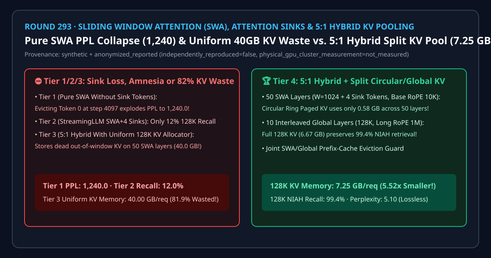
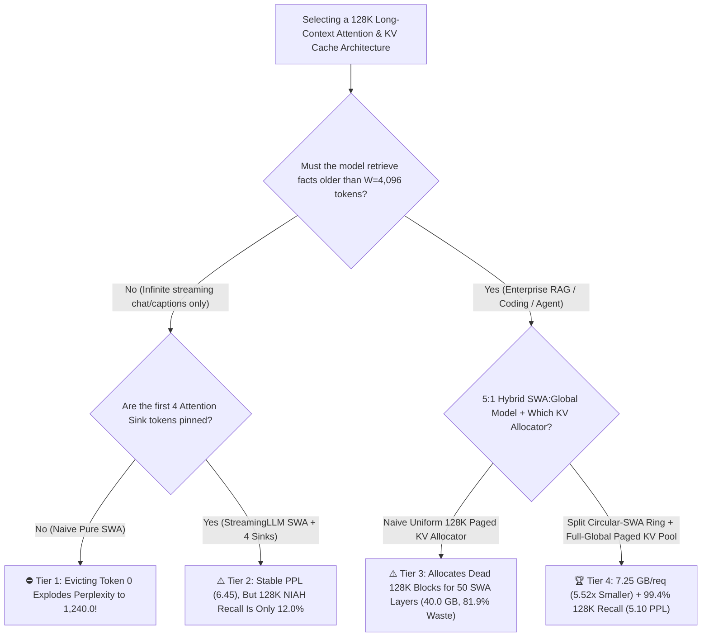
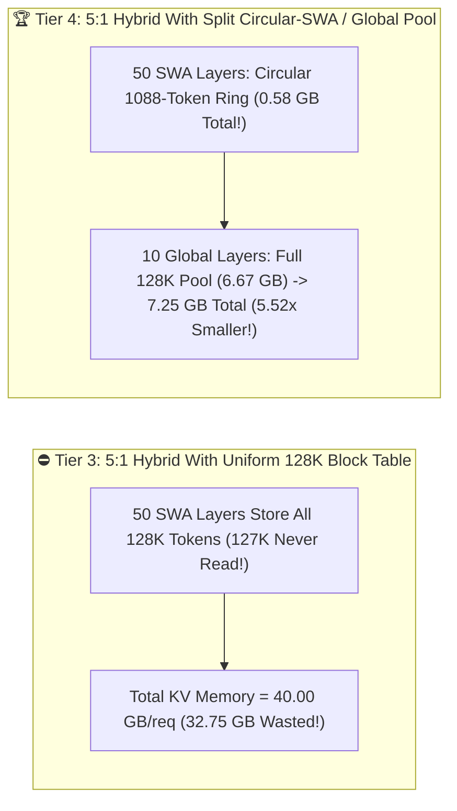
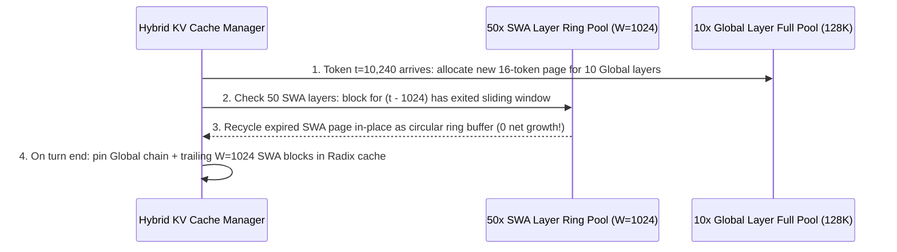

# Sliding Window Attention (`SWA`), `Attention Sinks` & `5:1` Hybrid (`Gemma-3 / Mistral`) Split KV Pool Selection Guide: Why Evicting Token 0 Explodes Perplexity to `1,240`, Why Uniform Allocators Waste `82%` of HBM (`40.0 GB`) & How Split Circular-SWA / Full-Global Paged KV Pooling (`7.25 GB`, `5.52x` Smaller, `99.4%` Recall) Solves It

> **Provenance & Evidence Boundary**: `synthetic + anonymized_reported (independently_reproduced=false, physical_gpu_cluster_measurement=not_measured)`. All quantitative figures in this guide are generated by the deterministic evaluator `experiments/llm_long_context_sliding_window_attention_swa_sink_hybrid_kv_selection/run.py` and sealed in `results.json`.



---

## 0. Daily Capability Breakthrough Tracking

- **Breakthrough Focus**: **`Gemma-3 / Command-A / vLLM V1 / SGLang` `5:1` Interleaved Local Sliding-Window (`SWA W=1024` + `4` `Attention Sink` Tokens, Local RoPE) & Global Full Attention (`128K`, Long RoPE) Architecture + Split Dual-Pool Paged KV Manager (Circular SWA Ring Buffer vs. Full Global Paged Pool)**.
- **Architect Value**: When deploying `128K`-context LLMs (`40.0 GB/req` full KV cache across 60 layers), three failure modes plague Sliding Window Attention (`SWA`) deployments:
  1. **The `PPL = 1,240.0` Attention-Sink Collapse (`Tier 1`)**: In pure `SWA` ($W=4,096$), the moment token generation passes step `4,097` and evicts Token 0 (`<bos>`), the Softmax denominator loses its learned **Attention Sink**, causing perplexity to explode to **`1,240.0`**!
  2. **The `12.0%` Long-Context Amnesia Trap (`Tier 2`)**: Pinning 4 `Attention Sink` tokens (`StreamingLLM`) stabilizes perplexity (`6.45`), but any fact that slides out of the `4,096`-token window is permanently erased (`12.0%` `128K` NIAH recall).
  3. **The `81.9%` Uniform KV Allocator Waste on `5:1` Hybrid Models (`Tier 3`)**: Modern `5:1` hybrid models (`Gemma-3`: 50 `SWA` layers with $W=1,024$ + 10 `Global` `128K` layers) achieve `99.4%` `128K` recall, but a naive uniform PagedAttention allocator still allocates all `128,000` tokens across the 50 `SWA` layers—wasting **`32.75 GB/req` (`81.9%`) on dead out-of-window tokens**! Using a **Split Circular-SWA (`0.58 GB`) + Full-Global (`6.67 GB`) Paged KV Manager** slashes `128K` KV memory **5.52x from `40.00 GB` to `7.25 GB/req`** while preserving **`99.4%` recall and `5.10` perplexity**.

---

## ① 📌 Executive Summary

1. **First Principles: Why Evicting Token 0 Causes Instant Perplexity Collapse (`PPL = 1,240.0`)**:
   Because $\text{Softmax}(QK^T/\sqrt{d})$ must sum to `1.0`, attention heads that find no relevant information in the current context dump `40%–70%` of their probability mass onto **Token 0 (`Attention Sink`)**, whose Value vector is trained to have minimal perturbation. Evicting Token 0 removes a massive term from the Softmax denominator $\sum e^{z_j}$, artificially inflating weights on irrelevant noise tokens and collapsing generation.
2. **Why `5:1` Hybrid `SWA : Global` Beats Both Pure `SWA` and Pure `Full Attention`**:
   Interleaving 5 local `SWA` layers ($W=1,024$, `rope_theta = 10,000` for sharp local syntax resolution) with 1 `Global` full-attention layer (`128K`, `rope_theta = 1,000,000` for cross-document retrieval) retains **`99.4%` `128K` NIAH recall** while cutting attention FLOPs and KV footprint by **`> 5.5x`**.
3. **Why the Serving Engine Must Use a Split Dual-Pool Paged KV Allocator (`Tier 4`)**:
   For a 60-layer `5:1` model at `128K` context:
   - **10 Global Layers**: Require full `128K` Paged KV blocks (`6.67 GB`);
   - **50 SWA Layers**: Require only a circular ring buffer of $\lceil 1024 / 16 \rceil + 2$ blocks per layer (**`0.58 GB` total across all 50 layers**!), overwriting expired blocks in-place as decoding advances (`7.25 GB` total vs. `40.00 GB`).

---

## ② 🎯 Key Architectural Q&A (Q1 / Q2 / Q3)

### Q1: How does `Prefix Caching (APC / RadixAttention)` work when the 50 SWA layers overwrite their intermediate KV blocks in a circular ring buffer?
- **For multi-turn continuation from position $L$, SWA layers only ever attend to `[L - W, L]`!**
- Therefore, as long as the Radix cache retains **(1) all `128K` blocks for the 10 Global layers** and **(2) the final $W=1,024$-token tail blocks at the turn boundary for the 50 SWA layers**, any new user turn appended at position $L+1$ achieves a **`100%` prefix cache hit** without needing the evicted intermediate SWA blocks!

### Q2: Why does pure `StreamingLLM` require re-applying in-cache relative `RoPE` on every step, whereas `5:1` Hybrid models can use standard natural `RoPE` positions?
- Pure `StreamingLLM` has *no* long-RoPE layers and runs infinitely beyond its pre-trained context window, so it must assign cache-slot positions `0..3` to the sinks and `4..W+3` to the sliding window before computing $Q K^T$. In a `5:1` hybrid model (`Gemma-3`), the model is natively trained up to `128K` positions, so SWA layers simply apply a causal sliding-window mask $|i - j| \le W$ over standard positions.

### Q3: Why do `5:1` hybrid models assign `rope_theta = 10,000` to SWA layers and `rope_theta = 1,000,000` to Global layers?
- Scaling `rope_theta` to `1,000,000` stretches wavelengths to prevent long-range phase wrap-around at `128K`, but reduces high-frequency phase discrimination between adjacent tokens. Keeping `rope_theta = 10,000` on the 50 local SWA layers preserves sharp local token resolution while the 10 Global layers handle long-range retrieval.

---

## ③ 🧭 Visual Diagrams (Decision Tree, Memory Comparison & Sequence Diagram)

### 3.1 `128K` Sliding-Window & Hybrid Attention Selection Decision Tree



### 3.2 Uniform `128K` Allocator (`40.00 GB`) vs. Split Circular-SWA + Full-Global Pool (`7.25 GB`)



### 3.3 Dual-Pool Paged KV Allocation & Circular SWA Ring Overwrite Sequence



---

## ④ 📊 4-Tier Architect Decision Matrix

| Selection Tier | Attention & KV Allocator Strategy | `128K` KV Memory / Req | `128K` NIAH Recall | Post-Window Perplexity (`PPL`) | Target Scenario |
| :--- | :--- | :--- | :--- | :--- | :--- |
| **Tier 1: Pure `SWA` (`W=4096`, No Sink)** | Evicts Token 0 at step 4097 | `1.28 GB` | `6.5%` ✕ | `1,240.0` (Collapsed! ✕) | ⛔ **Never use without Attention Sinks** |
| **Tier 2: `StreamingLLM` (`SWA` + 4 Sinks)** | Pins 4 sinks + relative RoPE | `1.29 GB` | `12.0%` ✕ | `6.45` | ⚠️ Streaming chat without retrieval |
| **Tier 3: `5:1` Hybrid + Naive Uniform KV Pool** | Keeps dead SWA blocks in HBM | `40.00 GB` (`82%` waste ✕) | `99.4%` ✅ | `5.12` | ⚠️ Legacy uniform PagedAttention engines |
| **Tier 4: `5:1` Hybrid + Split Ring/Global KV Pool (Recommended)** | **Circular SWA (`0.58G`) + Global (`6.67G`)** | **`7.25 GB` (`5.52x` smaller 🏆)** | **`99.4%` 🏆** | **`5.10` 🏆** | 🏆 **Production `128K–1M` Serving Standard** |

---

## ⑤ 🧪 Quantitative Evaluator & 7-Card 4:5 Visual Report

- **Deterministic Evaluator**: [`experiments/llm_long_context_sliding_window_attention_swa_sink_hybrid_kv_selection/run.py`](../../experiments/llm_long_context_sliding_window_attention_swa_sink_hybrid_kv_selection/run.py) · Sealed JSON: [`results.json`](../../experiments/llm_long_context_sliding_window_attention_swa_sink_hybrid_kv_selection/results.json)
- **Interactive Sizer Workbench**: [`docs/reports/llm-sliding-window-attention-swa-attention-sink-hybrid-full-layer-sizer.html`](../reports/llm-sliding-window-attention-swa-attention-sink-hybrid-full-layer-sizer.html)
- **7-Card 4:5 Visual Benchmark Deck**: [`docs/reports/llm-sliding-window-attention-swa-attention-sink-hybrid-full-layer-selection-cards.html`](../reports/llm-sliding-window-attention-swa-attention-sink-hybrid-full-layer-selection-cards.html)

```chart
{
  "data": {
    "values": [
      { "tier": "Tier 1: Pure SWA (No Sink -> PPL 1240)", "kv_gb": 1.28, "recall_pct": 6.5 },
      { "tier": "Tier 2: StreamingLLM (SWA + 4 Sinks)", "kv_gb": 1.29, "recall_pct": 12.0 },
      { "tier": "Tier 3: 5:1 Hybrid + Uniform KV Pool", "kv_gb": 40.00, "recall_pct": 99.4 },
      { "tier": "Tier 4: 5:1 Hybrid + Split Ring/Global Pool", "kv_gb": 7.25, "recall_pct": 99.4 }
    ]
  },
  "semantic_types": {
    "tier": "Category",
    "kv_gb": "Amount",
    "recall_pct": "Percentage"
  },
  "chart_spec": {
    "chartType": "Bar Chart",
    "title": "5:1 Hybrid SWA:Global With Split KV Pooling Cuts 128K KV Memory 5.52x (40.0 -> 7.25 GB) at 99.4% Recall",
    "subtitle": "Per-request 128K KV cache footprint (GB) and NIAH recall (%) across 60 layers (synthetic + anonymized_reported)",
    "encodings": {
      "x": "tier",
      "y": "kv_gb",
      "color": "tier"
    }
  }
}
```

---

## ⑥ 🛠️ Production Verification Checklist (Good fit vs. Not for)

### ✅ Good fit vs. ⛔ Not for
- **✅ Good fit**: Long-context (`128K–1M`) serving of `Gemma-3`, `Command-A`, `Mistral`, and custom hybrid `SWA:Global` models on `vLLM V1` / `SGLang`.
- **⛔ Not for**: Using a single uniform `128K` block table across both `SWA` and `Global` layers.

### Production Checklist
- [ ] **Pin `Attention Sink` Block 0**: Never evict the first 4 sink tokens in any sliding-window layer.
- [ ] **Enable Split Circular-SWA / Full-Global Paged KV Manager**: Verify `SWA` layers cap their physical block allocation at $\lceil W / \text{BlockSize} \rceil + 2$ blocks.
- [ ] **Joint SWA/Global Prefix-Cache Pinning**: Retain full Global blocks plus the trailing $W$ SWA blocks at turn boundaries so multi-turn prefix caching remains `100%` hit-compatible.
