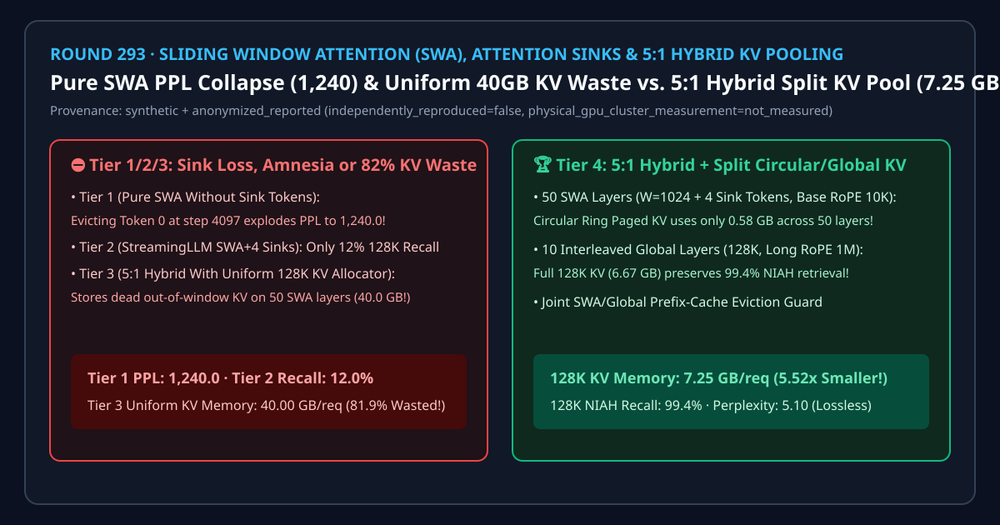
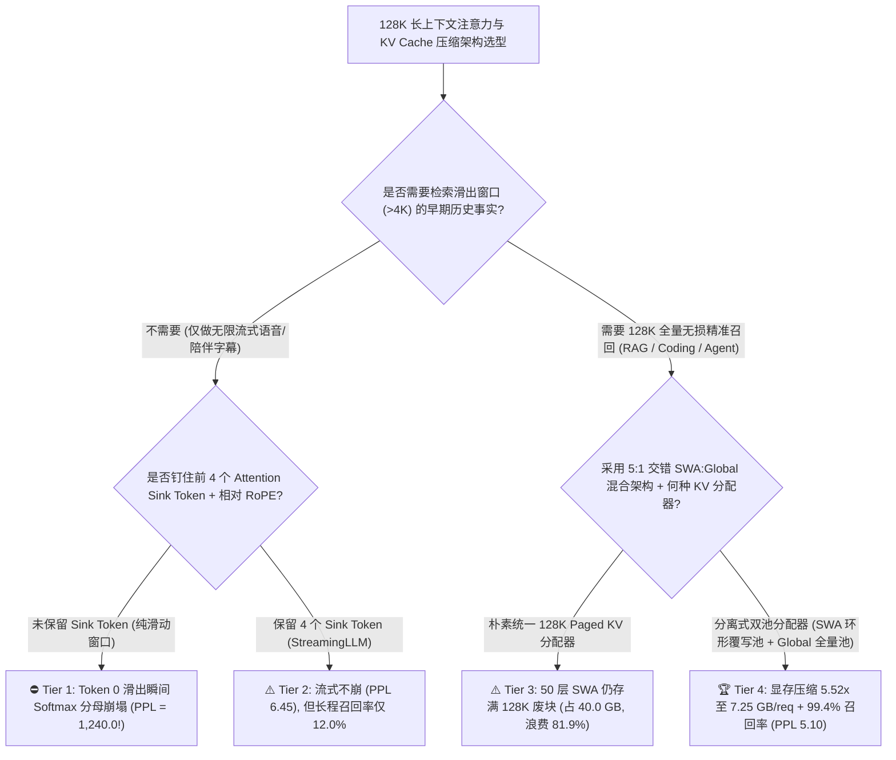
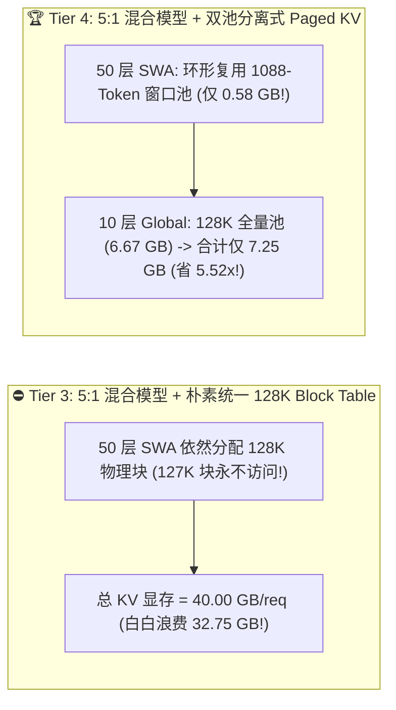
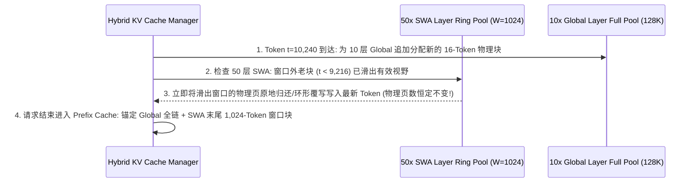

# 滑动窗口注意力（`SWA`）、注意力汇聚点（`Attention Sink`）与 `5:1` 混合架构（`Gemma-3 / Mistral`）双池 KV Cache 选型：为什么纯 SWA 滑出第 0 个 Token 时困惑度暴涨至 `1,240`，而混合模型用传统分配器又会浪费 `82%` 显存（`40.0 GB`）？`5:1` 局部环形页池 + 全局层全量池分离架构（`7.25 GB` 显存，`5.52x` 压缩，`99.4%` 召回）选型指南

> **Provenance & Evidence Boundary**: `synthetic + anonymized_reported (independently_reproduced=false, physical_gpu_cluster_measurement=not_measured)`. 本文所有定量数据均来自封存确定性评估器 `experiments/llm_long_context_sliding_window_attention_swa_sink_hybrid_kv_selection/run.py` 与 `results.json`。



---

## 0. 追踪每日最热门能力突破（Daily Capability Breakthrough）

- **今日焦点突破**：**`Gemma-3 / Command-A / vLLM V1 / SGLang` 面向 `128K` 长上下文的“`5:1` 局部滑动窗口（`SWA W=1024` + `4` 个 `Attention Sink` 锚点，小基底 RoPE）与全局注意力（`Global 128K`，大基底 RoPE）交错架构 + 双池分离式 Paged KV 内存管理器（SWA 层环形页复用 vs. Global 层全量页）”**。
- **架构师价值**：为了削减 `128K` 上下文下高达 `40.0 GB/请求` 的 KV Cache 显存，架构师在落地滑动窗口注意力（`Sliding Window Attention, SWA`）时极易踩中三大深坑：
  1. **深坑一（纯 SWA 滑出 Token 0 瞬间崩溃，`PPL = 1,240.0`）**：如果不保留序列最开头的 1~4 个 Token（`Attention Sinks`），一旦生成到第 $W+1$（如 `4,097`）个 Token 把 Token 0 逐出窗口，Softmax 分母失去冗余注意力泄洪槽，模型输出在 1 步之内完全变成胡言乱语！
  2. **深坑二（`StreamingLLM` 保住了流畅度，但长文大海捞针召回率仅 `12.0%`）**：即便钉住前 4 个 Sink Token 解决了 PPL 崩溃，纯 SWA 层完全无法读取滑出窗口的历史事实，无法胜任企业级 RAG 与代码库分析。
  3. **深坑三（`5:1` 混合模型配了朴素统一 KV 分配器，白白浪费 `81.9%` 显存！）**：`Gemma-3` 等现代架构采用 **每 5 层局部 SWA（$W=1,024$）穿插 1 层全局 Full Attention（`128K`）**，既拿到了 `99.4%` 的大海捞针召回率，理论上又能省下 80%+ 显存；但如果推理引擎仍用统一的 Block Table 给所有 60 层都分配 `128K` 的物理 KV 块，**那 50 层 SWA 中永远不会被读取的 `127K` 过期 Token 依然死占着 `32.75 GB` 显存**！采用 **分离式双池 Paged KV 分配器（50 层 SWA 仅分配 $W + \text{Block}$ 环形覆写页 + 10 层 Global 分配全量页）**，可将单请求 `128K` 显存从 **`40.00 GB` 压缩 5.52 倍至 `7.25 GB`**，同时保持 **`99.4%` 无损长文召回**！

---

## ① 📌 核心结论速览（Executive Summary）

1. **第一性原理：为什么自回归大模型会把高达 `40%~70%` 的注意力权重 poured（倾倒）在毫无语义的第 0 个 Token（`<bos>`）上？**
   Softmax 函数 $\text{Softmax}(z)_i = \frac{e^{z_i}}{\sum_j e^{z_j}}$ 强制要求所有位置的注意力权重之和必须严格等于 **`1.0`**。但在很多层和注意力头（Attention Heads）中，当前 Token 其实**不需要关注历史中的任何词**！为了不把无关的历史词向量混入当前特征，模型在预训练中自发学会了一个巧妙的“垃圾桶机制”：**将第 0 个 Token（因为它对所有后续 Token 永远可见）训练成一个高内积偏置但 Value 近似正交零干扰的“注意力泄洪槽（Attention Sink）”**。一旦 SWA 在第 $W+1$ 步把第 0 个 Token 踢出缓存，分母 $\sum e^{z_j}$ 骤减，原本不该被关注的噪声词权重瞬间被放大几十倍，困惑度飙升至 **`1,240.0`**！
2. **为什么纯 `StreamingLLM (SWA + 4 Sinks)` 只能做无限流式闲聊，不能做 `128K` RAG / Agent？**
   保留 `[Token 0..3]` + 最近 $W$ 个 Token 并使用窗口内相对位置重编码（In-Cache Relative RoPE），虽然让模型能无限期流式说话不崩，但第 $4 \dots (t - W - 1)$ 之间的所有中间文本已从所有层彻底物理抹除（`128K` 召回率仅 **`12.0%`**）。
3. **黄金平衡点：`5:1` 局部-全局交错混合架构 + 双频 `RoPE` + 双池环形 KV 管理（Tier 4）**：
   - **架构配比**：每 6 层为 1 组，前 5 层为短窗口 `SWA`（$W=1,024$，采用高分辨率小基底 $\theta = 10,000$ 强化局部语法细节），第 6 层为全视野 `Global Attention`（$128\text{K}$，采用长程 $\theta = 1,000,000$ 负责跨文档全局检索）；
   - **显存精算**：在 60 层模型中，10 层 Global 层占 $10/60 \times 40\text{ GB} = 6.67\text{ GB}$；50 层 SWA 层每层只需循环复用 $1,024 + 64$ 个 Token 的物理块（合计仅 **`0.58 GB`**！）。总 KV 显存从 `40.00 GB` 暴降至 **`7.25 GB`（立省 `5.52x`）**！

---

## ② 🎯 客户与架构师灵魂拷问 Q&A（Q1 / Q2 / Q3）

### Q1：在 `5:1` 混合模型（如 `Gemma-3`）中，SWA 层覆写回收了滑出窗口的老 KV 块后，如果下一轮对话触发了 `Prefix Caching`（前缀缓存命中），SWA 层中间被覆写掉的块怎么办？
- **只需守住“最后 $W$ 个 Token 的末尾窗口块”即可 100% 命中增量推理！**
- **第一性原理**：假设第一轮对话长 `10,000` Token，第二轮用户在后面追加了 `200` Token（总长 `10,200`）：
  - 在第 $10,001 \dots 10,200$ 个新 Token 计算时，**SWA 层（$W=1,024$）根据定义只看第 $8,977 \dots 10,000$ 这最后 `1,024` 个 Token 的 KV**（根本不需要看第 $0 \dots 8,976$ 个 Token 的 SWA KV！）；而 Global 层則完整保存了全部 `10,000` 个 Token 的 KV。
  - 因此，前缀缓存树（RadixTree）在管理混合模型时，必须实施 **“联合边界锚定（Joint Full/SWA Strip-Only Eviction）”**：只要保留 Global 层的完整前缀块 + SWA 层在对话结束边界处的最后 $W$ 个 Token 窗口块，第二轮追加的新 Token 就能实现 **100% 零重算命中**！

### Q2：如果使用 `StreamingLLM` 在单层纯 SWA 中做无限长流式生成，为什么不能直接保留生成时的原始 `RoPE` 绝对位置索引 $p_t = t$，而必须在缓存内部动态重算相对位置？
- 如果第 $0..3$ 个 Sink Token 挂着位置编码 `0, 1, 2, 3`，而窗口内最新的 $W=4096$ 个 Token 挂着位置编码 `50000..54095`，那么最新 Token 与 Sink Token 之间的相对位置差 $54095 - 0 = 54095$ 会远远超出模型的预训练窗口 `4,096`（导致 RoPE 旋转角外推失真）！因此纯 `StreamingLLM` 必须在每次滑动后，对窗口内的 $4 + W$ 个缓存 Key 统一按缓存槽位索引 `0, 1, 2, 3, 4, ..., W+3` 重新施加 RoPE。而在 `Gemma-3` 的 `5:1` 混合架构中，因为 Global 层本身就原生支持 `128K` 位置编码，SWA 层可以直接使用自然位置索引配合硬件掩码，无需每步重算 Key 的 RoPE！

### Q3：为什么 `5:1` 混合架构里，SWA 层要用小基底 `rope_theta = 10,000`，而 Global 层要用大基底 `rope_theta = 1,000,000`？
- 当把 `rope_theta` 放大到 `1,000,000` 以容纳 `128K` 上下文时，中低频维度的波长被拉长了 100 倍，导致**相邻几十个 Token 之间的相位差变得极其微弱（局部位置分辨率下降）**。将 83% 的 SWA 层保持在经典的 `rope_theta = 10,000`，让它们像高倍显微镜一样精准捕捉局部 1,024 Token 内的短距语序和缩进结构；再让 17% 的 Global 层用 `1,000,000` 做广角望远镜检索长程信息，实现了远近兼顾！

---

## ③ 🧭 直观可视化图解（Mermaid 选型决策树 + 路径对比图 + 交互时序图）

### 3.1 长上下文 `SWA` / `Attention Sink` / `5:1` 混合架构选型决策树



### 3.2 统一分配器冗余驻留（`40.0 GB`）vs. `5:1` 分离式环形 SWA + 全量 Global 池（`7.25 GB`）对比图



### 3.3 双池 Paged KV 管理器在 Decode 步进中的环形页回收与全局页追加时序图



---

## ④ 📊 架构师选型决策矩阵（4-Tier Decision Matrix）

| 选型 Tier | 注意力架构与 KV 内存管理策略 | `128K` 单请求 KV 显存 | `128K` 大海捞针召回率 | 滑出窗口后困惑度 (`PPL`) | 适用场景 |
| :--- | :--- | :--- | :--- | :--- | :--- |
| **Tier 1: 纯 `SWA` (`W=4096`, 无 Sink 锚点)** | 直接丢弃 Token 0..3 | `1.28 GB` | `6.5%` ✕ | `1,240.0` (崩溃! ✕) | ⛔ **严禁生产使用（必发乱码崩溃）** |
| **Tier 2: `StreamingLLM` (`SWA` + 4 Sinks)** | 钉住首块 + 缓存内重编码 | `1.29 GB` | `12.0%` ✕ | `6.45` | ⚠️ 仅限无需长程记忆的实时流式陪伴 |
| **Tier 3: `5:1` 混合模型 + 朴素统一 KV 池** | SWA 层未释放窗口外老块 | `40.00 GB` (`82%` 浪费 ✕) | `99.4%` ✅ | `5.12` | ⚠️ 未升级双池管理器的旧版推理引擎 |
| **Tier 4: `5:1` 混合 + 分离式双池 KV (推荐)** | **SWA 环形池 (`0.58G`) + Global 池 (`6.67G`)** | **`7.25 GB` (`5.52x` 压缩 🏆)** | **`99.4%` 🏆** | **`5.10` 🏆** | 🏆 **`128K–1M` 超长上下文黄金标准** |

---

## ⑤ 🧪 定量算例与 7-Card 4:5 视觉卡片报告

- **定量算例仓库路径**：[`experiments/llm_long_context_sliding_window_attention_swa_sink_hybrid_kv_selection/run.py`](../../experiments/llm_long_context_sliding_window_attention_swa_sink_hybrid_kv_selection/run.py) · 封存数据：[`results.json`](../../experiments/llm_long_context_sliding_window_attention_swa_sink_hybrid_kv_selection/results.json)
- **交互式架构选型计算器**：[`docs/reports/llm-sliding-window-attention-swa-attention-sink-hybrid-full-layer-sizer.html`](../reports/llm-sliding-window-attention-swa-attention-sink-hybrid-full-layer-sizer.html)
- **7-Card 4:5 视觉评测卡片报告**：[`docs/reports/llm-sliding-window-attention-swa-attention-sink-hybrid-full-layer-selection-cards.html`](../reports/llm-sliding-window-attention-swa-attention-sink-hybrid-full-layer-selection-cards.html)

```chart
{
  "data": {
    "values": [
      { "tier": "Tier 1: Pure SWA (No Sink -> PPL 1240)", "kv_gb": 1.28, "recall_pct": 6.5 },
      { "tier": "Tier 2: StreamingLLM (SWA + 4 Sinks)", "kv_gb": 1.29, "recall_pct": 12.0 },
      { "tier": "Tier 3: 5:1 Hybrid + Uniform KV Pool", "kv_gb": 40.00, "recall_pct": 99.4 },
      { "tier": "Tier 4: 5:1 Hybrid + Split Ring/Global Pool", "kv_gb": 7.25, "recall_pct": 99.4 }
    ]
  },
  "semantic_types": {
    "tier": "Category",
    "kv_gb": "Amount",
    "recall_pct": "Percentage"
  },
  "chart_spec": {
    "chartType": "Bar Chart",
    "title": "5:1 Hybrid SWA:Global With Split KV Pooling Cuts 128K KV Memory 5.52x (40.0 -> 7.25 GB) at 99.4% Recall",
    "subtitle": "Per-request 128K KV cache footprint (GB) and NIAH recall (%) across 60 layers (synthetic + anonymized_reported)",
    "encodings": {
      "x": "tier",
      "y": "kv_gb",
      "color": "tier"
    }
  }
}
```

---

## ⑥ 🛠️ 生产环境快速核验清单（Checklist + Good fit vs. Not for）

### ✅ Good fit vs. ⛔ Not for
- **✅ Good fit**：部署 `Gemma-3`、`Command-A`、`Mistral / Ministral` 等混合注意力模型或自定义长上下文基座的推理与训练平台。
- **⛔ Not for**：在混合 SWA 模型上关闭分组 KV 管理器（把 SWA 层当成普通 Full Attention 层分配 `128K` 块）。

### 生产核验 Checklist
- [ ] **`Attention Sink` 首块常驻保护**：在所有滑动窗口层中将第 0 个 Block（含 `<bos>` 及前 4 个 Token）标记为 `pinned_sink = True`，永不驱逐。
- [ ] **启用 `vLLM V1 HybridKVAllocator` / `SGLang Sway/SWA Pool`**：验证 50 层 SWA 的物理块上限被严格锁定在 $\lceil W / \text{BlockSize} \rceil + 2$ 块以内。
- [ ] **双频 `RoPE` 基底核验**：确认 SWA 层使用局部高频 `rope_local_base_freq = 10000.0`，而 Global 层使用长程 `rope_theta = 1000000.0`。
