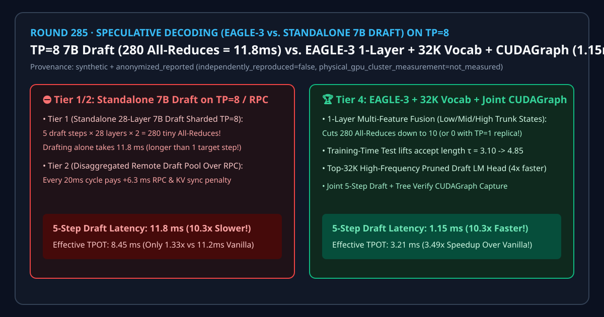
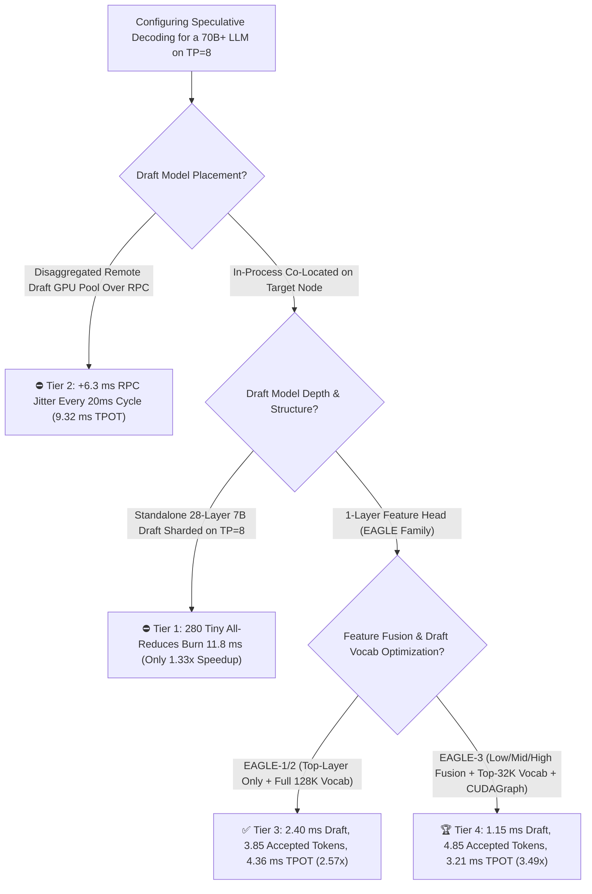
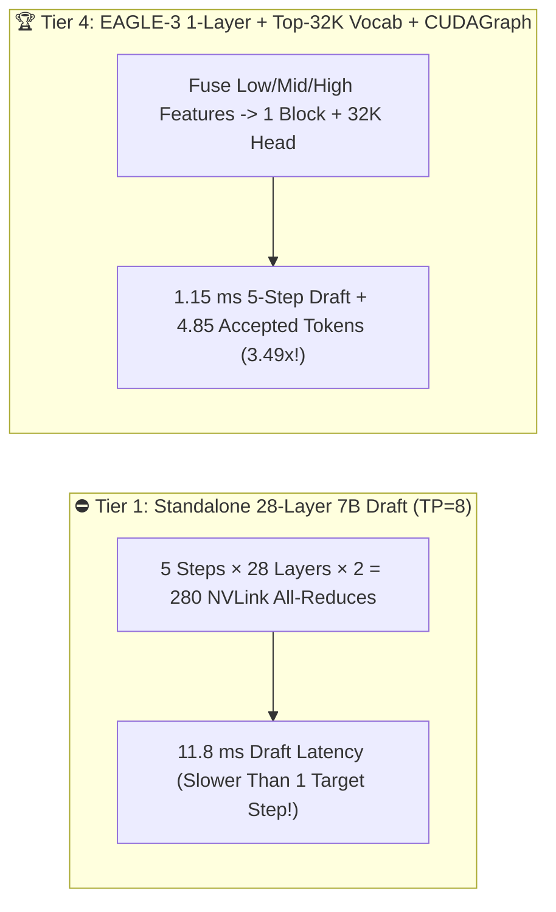
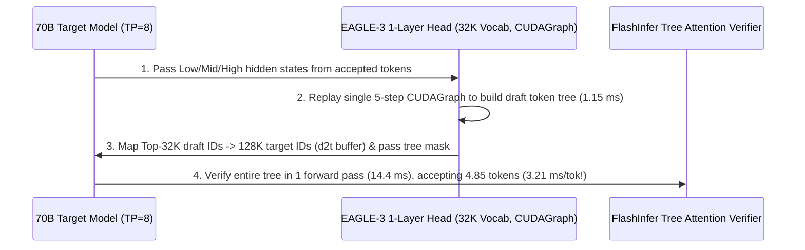

# Speculative Decoding (`EAGLE-3` vs. Standalone `7B` Draft Model) Placement & Parallelism Topology on `TP=8` Selection Guide: Why a `28`-Layer `7B` Draft Model Sharded Across `TP=8` Triggers `280` Tiny `All-Reduces` (`11.8 ms`) & How `EAGLE-3` Multi-Layer Feature Fusion + `Top-32K` Vocab Pruning + Joint `CUDAGraph` (`1.15 ms` Draft, `3.49x` Speedup) Solves It

> **Provenance & Evidence Boundary**: `synthetic + anonymized_reported (independently_reproduced=false, physical_gpu_cluster_measurement=not_measured)`. All quantitative figures in this guide are generated by the deterministic evaluator `experiments/llm_cross_node_speculative_decoding_eagle3_draft_placement_selection/run.py` and sealed in `results.json`.



---

## 0. Daily Capability Breakthrough Tracking

- **Breakthrough Focus**: **`EAGLE-3` Multi-Layer Feature Fusion (`Low / Mid / High` Trunk States + `Training-Time Test`) + High-Frequency Draft Vocabulary Pruning (`128K -> Top-32K`) + Joint Multi-Step `CUDAGraph` Capture (`SGLang / vLLM V1`)**.
- **Architect Value**: When serving a `70B` Target LLM across `TP=8` (`8x H100`, vanilla `TPOT = 11.2 ms`), pairing it with a standalone `28`-layer `7B` Draft Model sharded across the same `TP=8` group triggers **$5\text{ steps} \times 28\text{ layers} \times 2 = 280$ tiny latency-bound NVLink `All-Reduces` per drafting cycle**, burning **`11.8 ms` just to propose 5 draft tokens** and limiting end-to-end speedup to a disappointing `1.33x` (`8.45 ms/tok`). Disaggregating the Draft model onto a remote GPU pool over RPC is even worse (`14.5 ms` draft latency due to 20ms-cadence network jitter). By switching to an **in-process co-located `1`-layer `EAGLE-3` head (fusing low/mid/high target features)** with a **pruned `Top-32K` draft vocabulary LM Head** and **joint 5-step `CUDAGraph` capture**, 5-step drafting latency plummets **10.3x from `11.8 ms` to `1.15 ms`**, mean accepted tokens rise from `3.10` to **`4.85`**, and effective `TPOT` drops to **`3.21 ms` (`3.49x` end-to-end speedup)**.

---

## ① 📌 Executive Summary

1. **Why Multi-Layer Standalone Draft Models (`7B / 1.5B`) Fail on `TP=8`**:
   On `TP=8`, per-step latency is dominated by $2L$ NVLink `All-Reduce` barriers (`~2.5 μs` each) plus kernel launch overhead. A `28`-layer `7B` draft model running $\gamma=5$ serial steps executes **`280` `All-Reduces` per cycle**—more than the `80`-layer `70B` target model's single `160`-All-Reduce verification pass!
2. **Why Draft and Target Models Must Never Be Disaggregated Across Network RPC**:
   Unlike Prefill-Decode (`PD`) disaggregation (which transfers KV once per request), speculative decoding requires bidirectional token-tree and state synchronization **every `15–20 ms`**. Network serialization and RPC jitter (`+6.3 ms`) erase the speculative speedup (`9.32 ms` effective TPOT).
3. **How `EAGLE-3` + `Top-32K` Vocab Pruning + `CUDAGraph` Achieves `1.15 ms` Drafting & `3.49x` Speedup**:
   - **1-Layer Architecture**: Cuts per-cycle communication barriers by `96%` (`280 -> 10` or `0` in replicated mode);
   - **Multi-Layer Feature Fusion + Training-Time Test**: Fuses shallow, middle, and deep target hidden states without rigid L1 feature regression loss, raising mean accepted tokens $\tau$ from `3.85` to **`4.85`**;
   - **Lossless `Top-32K` Draft Vocabulary Pruning**: Shrinks the `128,256` draft `LM Head` GEMM by `4.0x` while preserving **100% lossless `128,256`-vocab target verification**.

---

## ② 🎯 Key Architectural Q&A (Q1 / Q2 / Q3)

### Q1: Does pruning the `EAGLE-3` draft LM head from `128,256` tokens down to the `32,000` most frequent tokens prevent the model from generating rare tokens or degrade accuracy?
- **No—it is 100% mathematically lossless! The target model can still generate all `128,256` tokens with identical probability.**
- **First Principles**: In speculative sampling, the draft head only *proposes* candidate tokens; the target model still evaluates its full **`128,256`-vocabulary distribution $p_{\text{target}}(x)$** during verification. For the `98.5%` of positions where the output is a top-32K token, the `4x`-faster pruned draft head proposes it directly; whenever a rare token outside the top-32K is needed, rejection sampling rejects the draft token and samples the rare token directly from the residual target distribution $\text{norm}(\max(0, p_{\text{target}} - p_{\text{draft}}))$.

### Q2: Why does `EAGLE-3` achieve a much higher acceptance rate (`4.85` vs. `3.85` tokens) than `EAGLE-1 / EAGLE-2`?
- `EAGLE-1/2` forced the single-layer draft head to predict the exact next top-layer hidden state via a Smooth-L1 regression loss, which over-constrained the small head. **`EAGLE-3` removes the feature regression loss**, feeds a fused projection of low-, mid-, and high-layer target hidden states into the draft layer, and trains with multi-step autoregressive rollouts (`Training-Time Test`).

### Q3: Why is capturing all 5 draft steps inside a single `CUDAGraph` critical for `EAGLE-3`?
- Because a single 1-layer `EAGLE-3` step takes only **`~220 μs` on GPU**, running a 5-step Python `for` loop incurs `~150 μs/step` of CPU kernel-launch overhead (`~750 μs` wasted!). Capturing the entire 5-step draft loop and `d2t` token-tree construction inside a single `CUDAGraph` replay locks 5-step drafting at **`1.15 ms`**.

---

## ③ 🧭 Visual Diagrams (Decision Tree, Latency Comparison & Sequence Diagram)

### 3.1 `TP=8` Speculative Decoding Architecture Decision Tree



### 3.2 Standalone `7B` `TP=8` (`280` All-Reduces = `11.8 ms`) vs. `EAGLE-3` (`1.15 ms`)



### 3.3 `EAGLE-3` Single-Cycle Execution Sequence



---

## ④ 📊 4-Tier Architect Decision Matrix

| Selection Tier | Draft Architecture & Placement | 5-Step Draft Latency | Mean Accepted Tokens ($\tau$) | Effective `TPOT` | Speedup vs. Vanilla (`11.2 ms`) | Target Scenario |
| :--- | :--- | :--- | :--- | :--- | :--- | :--- |
| **Tier 1: Standalone `7B` (`28` Layers) on `TP=8`** | 280 tiny `All-Reduces` | `11.80 ms` ✕ | `3.10 tok` | `8.45 ms` | `1.33x` ✕ | ⛔ **Communication-latency bound** |
| **Tier 2: Disaggregated Remote Draft Pool (RPC)** | Cross-node RPC & KV sync | `14.50 ms` ✕ | `3.10 tok` | `9.32 ms` | `1.20x` ✕ | ⛔ **Never disaggregate draft over RPC** |
| **Tier 3: `EAGLE-1/2` (`128K` Full Vocab)** | 1-Layer top-state head | `2.40 ms` ✅ | `3.85 tok` | `4.36 ms` | `2.57x` ✅ | ✅ Standard EAGLE-2 deployment |
| **Tier 4: `EAGLE-3` + `Top-32K` Vocab + `CUDAGraph` (Recommended)** | **Multi-layer fusion + 32K head** | **`1.15 ms` (`10.3x` faster 🏆)** | **`4.85 tok` 🏆** | **`3.21 ms` 🏆** | **`3.49x` 🏆** | 🏆 **Production `TP=8` Low-Latency Standard** |

---

## ⑤ 🧪 Quantitative Evaluator & 7-Card 4:5 Visual Report

- **Deterministic Evaluator**: [`experiments/llm_cross_node_speculative_decoding_eagle3_draft_placement_selection/run.py`](../../experiments/llm_cross_node_speculative_decoding_eagle3_draft_placement_selection/run.py) · Sealed JSON: [`results.json`](../../experiments/llm_cross_node_speculative_decoding_eagle3_draft_placement_selection/results.json)
- **Interactive Sizer Workbench**: [`docs/reports/llm-speculative-decoding-eagle3-draft-model-colocation-vs-disaggregation-sizer.html`](../reports/llm-speculative-decoding-eagle3-draft-model-colocation-vs-disaggregation-sizer.html)
- **7-Card 4:5 Visual Benchmark Deck**: [`docs/reports/llm-speculative-decoding-eagle3-draft-model-colocation-vs-disaggregation-selection-cards.html`](../reports/llm-speculative-decoding-eagle3-draft-model-colocation-vs-disaggregation-selection-cards.html)

```chart
{
  "data": {
    "values": [
      { "tier": "Tier 1: Standalone 7B Draft TP=8", "draft_ms": 11.8, "effective_tpot_ms": 8.45 },
      { "tier": "Tier 2: Remote Disaggregated Draft RPC", "draft_ms": 14.5, "effective_tpot_ms": 9.32 },
      { "tier": "Tier 3: EAGLE-1/2 (128K Vocab)", "draft_ms": 2.4, "effective_tpot_ms": 4.36 },
      { "tier": "Tier 4: EAGLE-3 + 32K Vocab + CUDAGraph", "draft_ms": 1.15, "effective_tpot_ms": 3.21 }
    ]
  },
  "semantic_types": {
    "tier": "Category",
    "draft_ms": "Quantity",
    "effective_tpot_ms": "Quantity"
  },
  "chart_spec": {
    "chartType": "Bar Chart",
    "title": "EAGLE-3 + Top-32K Vocab + CUDAGraph Cuts Effective TPOT to 3.21 ms (3.49x Faster Than 11.2 ms Vanilla)",
    "subtitle": "Effective per-token decode latency (ms) and 5-step draft latency on 70B TP=8 (synthetic + anonymized_reported)",
    "encodings": {
      "x": "tier",
      "y": "effective_tpot_ms",
      "color": "tier"
    }
  }
}
```

---

## ⑥ 🛠️ Production Verification Checklist (Good fit vs. Not for)

### ✅ Good fit vs. ⛔ Not for
- **✅ Good fit**: Interactive `TP=4 / TP=8` LLM serving (`SGLang` / `vLLM V1`) requiring `< 4 ms` effective `TPOT`.
- **⛔ Not for**: Sharding a deep (`24–32` layer) standalone draft model across `TP=8` or disaggregating the draft model over network RPC.

### Production Checklist
- [ ] **Replace Deep Standalone Draft Models with 1-Layer `EAGLE-3` / `MTP`**: Eliminate the `280`-All-Reduce latency wall on `TP=8`.
- [ ] **Enable `Top-32K` Pruned Draft Vocabulary (`d2t` Mapping)**: Verify the `EAGLE-3` checkpoint uses a trimmed `32,000` draft LM Head with lossless `d2t` target vocabulary remapping.
- [ ] **Multi-Step Draft `CUDAGraph` Capture**: Confirm all $\gamma=5$ draft steps execute inside a captured `CUDAGraph` without per-step Python overhead.
