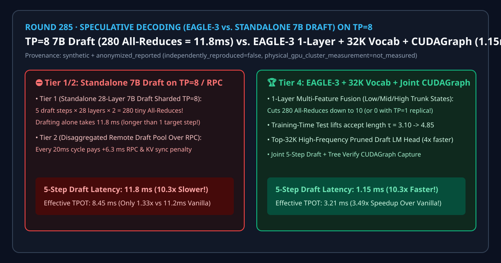
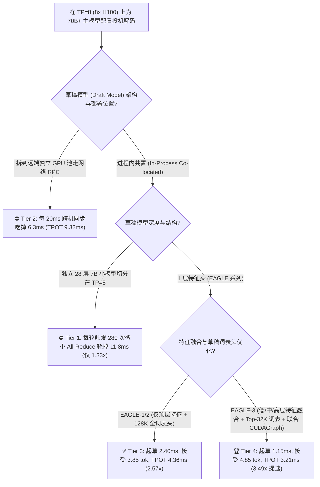
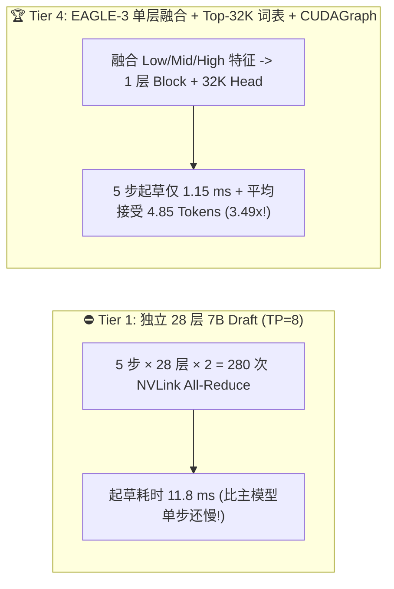
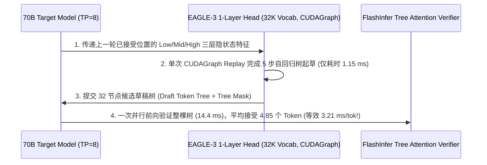

# 大模型投机解码（`EAGLE-3` vs. 独立 `7B` Draft 小模型）在 `TP=8` 下的拓扑放置与算子融合选型：为什么把 `28` 层独立 Draft 模型切到 `TP=8` 会触发每轮 `280` 次微小 `All-Reduce`（耗时 `11.8 ms` 反比主模型更慢）？`EAGLE-3` 多层特征融合单层头、高频 `32K` 词表剪枝与联合 `CUDAGraph`（`1.15 ms` 起草，`3.49x` 端到端提速）选型指南

> **Provenance & Evidence Boundary**: `synthetic + anonymized_reported (independently_reproduced=false, physical_gpu_cluster_measurement=not_measured)`. 本文所有定量数据均来自封存确定性评估器 `experiments/llm_cross_node_speculative_decoding_eagle3_draft_placement_selection/run.py` 与 `results.json`。



---

## 0. 追踪每日最热门能力突破（Daily Capability Breakthrough）

- **今日焦点突破**：**`EAGLE-3` 多层隐状态特征融合（`Low / Mid / High` 三层特征拼接 + 训练时多步自回归模拟 `Training-Time Test`）+ 草稿头高频词表裁剪（`128K -> Top-32K` Vocab Pruning）+ 5 步草稿树与主模型验证联合 `CUDAGraph` 静态捕获（`SGLang / vLLM V1`）**。
- **架构师价值**：很多团队在 `8x H100 (TP=8)` 上部署 `70B` 主模型时，习惯拿一个同家族的独立 `7B`（`28` 层）小模型做投机解码（Standalone Draft Model）。然而上线后惊讶地发现：**开启投机解码后端到端延迟只快了微不足道的 `1.33x`，甚至在 `Batch >= 8` 时比不开启还要慢**！第一性原理算账揭示：**独立 `7B` 模型有 `28` 层 Transformer，如果在 `TP=8` 上切分运行并向前猜 $\gamma = 5$ 步，每生成 1 轮草稿就要在 NVLink 上触发 $5 \times 28 \times 2 = 280$ 次极小 Payload（`< 64 KB`）的 `All-Reduce` 同步屏障**！仅这 280 次通信延迟和内核启动开销就耗掉 **`11.8 ms`**（比 `70B` 主模型跑 1 步的 `11.2 ms` 还要慢！）；而如果把 Draft 模型拆到独立节点走网络 RPC，每 `20 ms` 一次的跨机通信与 KV 同步更是白白增加 `6.3 ms`。采用 **`EAGLE-3` 单层特征自回归头（仅 `1` 层 Transformer，融合主干低/中/高层特征）+ 高频 `32K` 剪枝词表头 + 联合 `CUDAGraph`**，可将 5 步起草耗时从 **`11.8 ms` 压缩 10.3 倍至 `1.15 ms`**，平均接受长度推升至 **`4.85 tokens/step`**，实现 **`3.49x` 端到端解码提速（`11.2 ms -> 3.21 ms/tok`）**。

---

## ① 📌 核心结论速览（Executive Summary）

1. **为什么在 `TP=8` 上不能用“多层独立小模型（如 7B / 1.5B）”做投机解码草稿模型？**
   在多卡张量并行（`TP=8`）下，单步 Decode 的耗时由两部分组成：`HBM 权重读取时间` + `2L 次 NVLink All-Reduce 固有延迟（约 2.5 μs/次）`。`7B` 模型虽然权重比 `70B` 小 10 倍，但它的**层数 $L=28$ 却只比 `70B`（$L=80$）少了不到 3 倍**！当它串行猜 $\gamma=5$ 步时，累计执行的 `All-Reduce` 次数高达 **`280 次`**（远超主模型单次验证的 `160 次`），彻底沦为通信延迟受限（Latency-Bound）的木桶短板！
2. **为什么更不能把 Draft 模型与 Target 主模型拆到不同机器（Disaggregated Draft-Target）？**
   与“Prefill-Decode（PD）分离”（每个请求生命周期只传 1 次 KV Cache）截然不同，投机解码每生成 `4~5` 个 Token（即**每 `15~20 ms`**）就需要在 Draft 与 Target 之间交互一次 Token 树与 KV 状态！跨节点 RPC 序列化与网络往返抖动会瞬间吃光投机解码省下的算力红利（`effective TPOT = 9.32 ms`）。**Draft 与 Target 必须严格进程内共置（Co-located In-Process）**！
3. **`EAGLE-3` 如何将 5 步起草耗时压到 `1.15 ms` 并把接受长度拉高到 `4.85`？**
   - **单层架构消灭 96% 通信**：`EAGLE-3` 只有 **`1` 层 Transformer Block**，猜 5 步仅需 10 次通信（或在单卡复制 `TP=1` 模式下 **0 次通信**）；
   - **抛弃 EAGLE-1/2 的特征回归损失，改用多层特征融合 + `Training-Time Test`**：直接融合主模型浅层、中层、深层三级隐状态特征，并在训练时模拟多步自回归草稿生成，使接受长度从 `3.85` 跃升至 **`4.85 tokens`**；
   - **草稿头高频词表裁剪（`128K -> Top-32K` Vocab Pruning）**：在 `1` 层草稿模型中，原本占耗时 `45%` 的居然是最后一层 `128,256` 词表的 `LM Head` 矩阵乘！将草稿头的输出词表裁剪为高频 `32,000` 个 Token（并在验证阶段映射回 `128K` 全词表，**100% 不影响主模型无损输出分布**），直接把草稿头计算再提速 **`4.0x`**！

---

## ② 🎯 客户与架构师灵魂拷问 Q&A（Q1 / Q2 / Q3）

### Q1：把 `EAGLE-3` 草稿模型的词表从 `128,256` 裁剪到高频 `32,000`（`Top-32K Vocab Pruning`），会不会导致主模型永远生成不出那 `96,256` 个低频词？会不会有损精度？
- **100% 数学无损（Zero-Loss Exact Target Distribution）！主模型依然能正常生成任何低频词！**
- **第一性原理**：在投机解码（Speculative Sampling）的拒绝采样公式中，草稿模型只负责“提议（Propose）”，主模型在验证阶段计算的依然是完整的 **`128,256` 全词表概率分布 $p_{\text{target}}(x)$**！
  - 在 `98.5%` 的日常高频词位置，`Top-32K` 草稿头精准命中，享受 4 倍加速；
  - 哪怕极少数位置需要输出生僻词（不在 `Top-32K` 内），主模型验证时会拒绝草稿提议，并**直接从主模型自己的 `128,256` 全词表修正分布 $p'(x) = \text{norm}(\max(0, p_{\text{target}}(x) - p_{\text{draft}}(x)))$ 中无损采样出该生僻词**！因此精度与不开启投机解码 **100% 等价**。

### Q2：`EAGLE-3` 相比 `EAGLE-1 / EAGLE-2` 最核心的架构升级是什么？为什么在推理代码上反而更简单了？
- `EAGLE-1/2` 强迫单层草稿头同时预测“下一时刻的顶层隐状态特征 $\hat{f}_{t+1}$（使用 Smooth L1 回归损失）”和“下一个 Token”，这种刚性特征回归约束限制了草稿头的表达空间，导致训练数据增加时接受率很快饱和。
- **`EAGLE-3` 彻底删除了 Smooth L1 特征回归损失**，改为从主模型提取第 $\frac{L}{4}, \frac{L}{2}, \frac{3L}{4}$ 三层的多粒度隐状态拼接投影作为初始输入，并在训练阶段直接展开多步自回归与主模型分布做交叉熵蒸馏（`Training-Time Test`），不仅消除了训练与推理的特征分布失配，还让平均接受 Token 数从 `3.85` 大幅提升至 **`4.85`**！

### Q3：为什么必须把“5 步 `EAGLE-3` 起草 + 主模型 `Tree Attention` 验证”放进同一个联合 `CUDAGraph`（或双图流水）里捕获？
- 因为 `EAGLE-3` 跑 1 步 GPU 内核只需要 **`~220 μs`**！如果在 Python 主循环里用 `for step in range(5): draft_model.forward()` 裸跑，Python 解释器发射内核的 CPU 开销（`~150 μs/步`）就会占掉将近一半的时间！将 5 步草稿循环连同 `Top-K` 树构建算子打包进一张静态 `CUDAGraph` 中一次发射，可将 5 步总起草时间死死锁在 **`1.15 ms`**。

---

## ③ 🧭 直观可视化图解（Mermaid 选型决策树 + 路径对比图 + 交互时序图）

### 3.1 `TP=8` 大模型投机解码架构选型决策树



### 3.2 独立 `7B` `TP=8`（`280` 次通信 = `11.8 ms`）vs. `EAGLE-3` 单层 + `32K` 词表（`1.15 ms`）对比图



### 3.3 `EAGLE-3` 单轮“主干多层特征提取 -> 5 步 CUDAGraph 树起草 -> 单次 Tree Verify”时序图



---

## ④ 📊 架构师选型决策矩阵（4-Tier Decision Matrix）

| 选型 Tier | 草稿模型结构与放置 | 5 步起草耗时 | 平均接受长度 ($\tau$) | 等效单 Token 延迟 (`TPOT`) | 相对基线 (`11.2 ms`) 加速比 | 适用场景 |
| :--- | :--- | :--- | :--- | :--- | :--- | :--- |
| **Tier 1: 独立 `7B` (`28` 层) 切分在 `TP=8`** | 280 次微小 `All-Reduce` | `11.80 ms` ✕ | `3.10 tok` | `8.45 ms` | `1.33x` ✕ | ⛔ **被层间通信延迟彻底拖垮** |
| **Tier 2: 独立节点远端 Draft RPC 解耦** | 跨机序列化与状态同步 | `14.50 ms` ✕ | `3.10 tok` | `9.32 ms` | `1.20x` ✕ | ⛔ **严禁将投机草稿拆出主进程** |
| **Tier 3: `EAGLE-1/2` 单层顶层特征 (`128K` 词表)** | 1 层 Block + 全词表 Head | `2.40 ms` ✅ | `3.85 tok` | `4.36 ms` | `2.57x` ✅ | ✅ 通用开源 EAGLE 权重的标准表现 |
| **Tier 4: `EAGLE-3` + `Top-32K` 词表 + `CUDAGraph` (推荐)** | **三层特征融合 + 32K 剪枝头** | **`1.15 ms` (`10.3x` 快 🏆)** | **`4.85 tok` 🏆** | **`3.21 ms` 🏆** | **`3.49x` 🏆** | 🏆 **`70B–671B` 低延迟解码黄金标准** |

---

## ⑤ 🧪 定量算例与 7-Card 4:5 视觉卡片报告

- **定量算例仓库路径**：[`experiments/llm_cross_node_speculative_decoding_eagle3_draft_placement_selection/run.py`](../../experiments/llm_cross_node_speculative_decoding_eagle3_draft_placement_selection/run.py) · 封存数据：[`results.json`](../../experiments/llm_cross_node_speculative_decoding_eagle3_draft_placement_selection/results.json)
- **交互式架构选型计算器**：[`docs/reports/llm-speculative-decoding-eagle3-draft-model-colocation-vs-disaggregation-sizer.html`](../reports/llm-speculative-decoding-eagle3-draft-model-colocation-vs-disaggregation-sizer.html)
- **7-Card 4:5 视觉评测卡片报告**：[`docs/reports/llm-speculative-decoding-eagle3-draft-model-colocation-vs-disaggregation-selection-cards.html`](../reports/llm-speculative-decoding-eagle3-draft-model-colocation-vs-disaggregation-selection-cards.html)

```chart
{
  "data": {
    "values": [
      { "tier": "Tier 1: Standalone 7B Draft TP=8", "draft_ms": 11.8, "effective_tpot_ms": 8.45 },
      { "tier": "Tier 2: Remote Disaggregated Draft RPC", "draft_ms": 14.5, "effective_tpot_ms": 9.32 },
      { "tier": "Tier 3: EAGLE-1/2 (128K Vocab)", "draft_ms": 2.4, "effective_tpot_ms": 4.36 },
      { "tier": "Tier 4: EAGLE-3 + 32K Vocab + CUDAGraph", "draft_ms": 1.15, "effective_tpot_ms": 3.21 }
    ]
  },
  "semantic_types": {
    "tier": "Category",
    "draft_ms": "Quantity",
    "effective_tpot_ms": "Quantity"
  },
  "chart_spec": {
    "chartType": "Bar Chart",
    "title": "EAGLE-3 + Top-32K Vocab + CUDAGraph Cuts Effective TPOT to 3.21 ms (3.49x Faster Than 11.2 ms Vanilla)",
    "subtitle": "Effective per-token decode latency (ms) and 5-step draft latency on 70B TP=8 (synthetic + anonymized_reported)",
    "encodings": {
      "x": "tier",
      "y": "effective_tpot_ms",
      "color": "tier"
    }
  }
}
```

---

## ⑥ 🛠️ 生产环境快速核验清单（Checklist + Good fit vs. Not for）

### ✅ Good fit vs. ⛔ Not for
- **✅ Good fit**：所有部署在 `TP=4 / TP=8` 上的 `32B ~ 671B` 大模型低延迟交互与 Agent 编码推理场景。
- **⛔ Not for**：在 `TP=8` 上拿 24~32 层的独立小模型（`1.5B / 7B`）做草稿，或将草稿模型跨网卡拆分部署。

### 生产核验 Checklist
- [ ] **淘汰多层独立 Draft 小模型，切换至 `1` 层 `EAGLE-3` / `MTP` 头**：确保每步草稿最多只跨越 1 层 Transformer Block。
- [ ] **开启草稿头 `Top-32K` 高频词表映射表（`d2t` / `t2d` Index Buffer）**：裁剪草稿 LM Head 计算量 `4x`，同时保持主模型 `128K+` 全词表无损验证。
- [ ] **确认多步起草已納入 `CUDAGraph` 捕获**：核验 `--speculative-num-steps 5` 循环在单次 `cudaGraphLaunch` 内完成，消除 Python 步进发射气泡。
