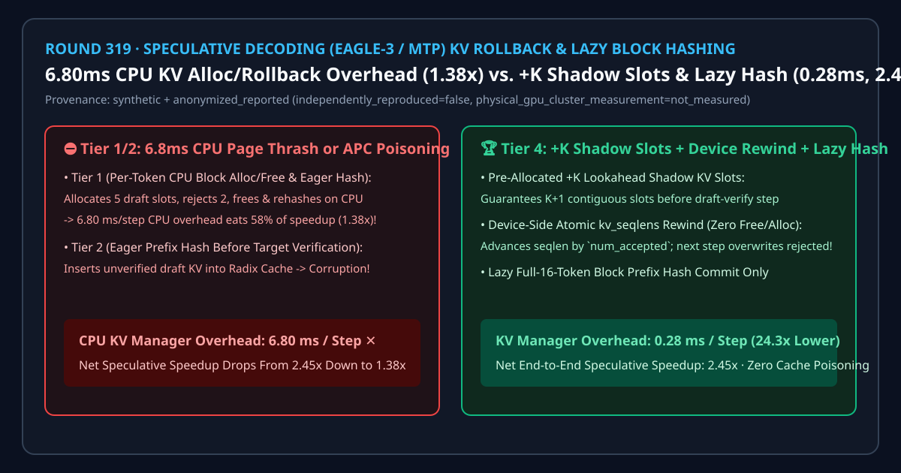
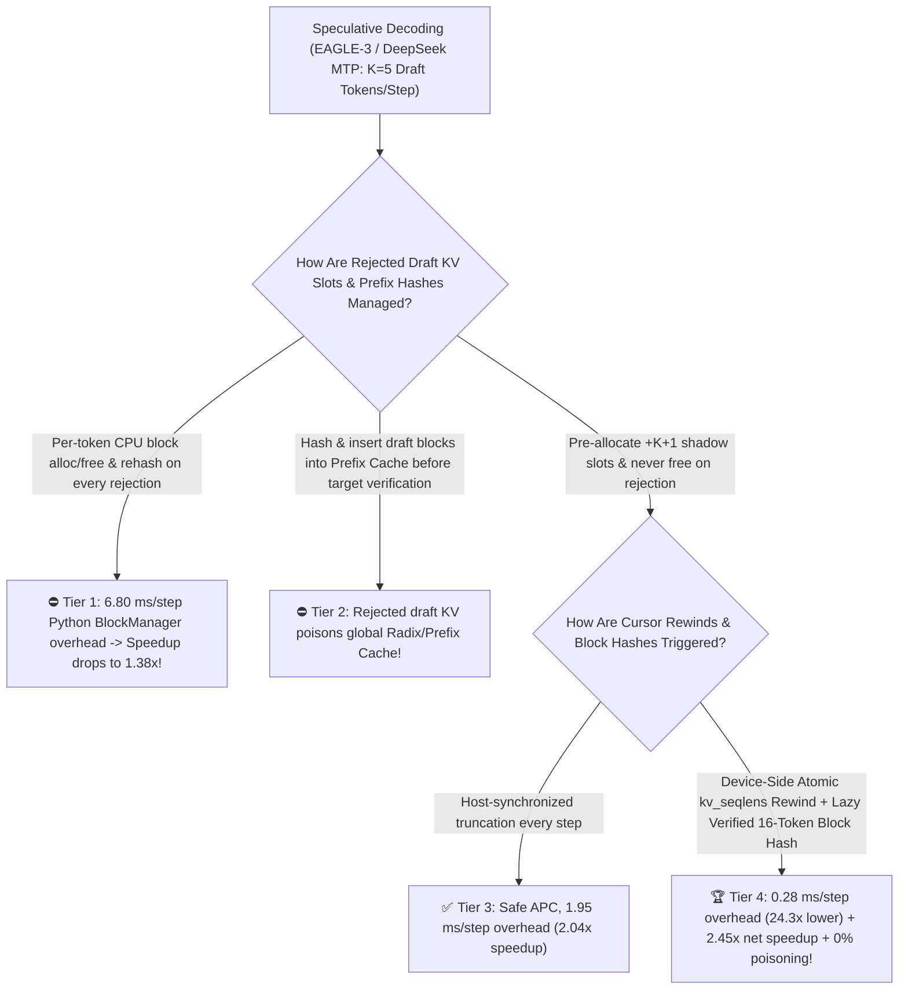
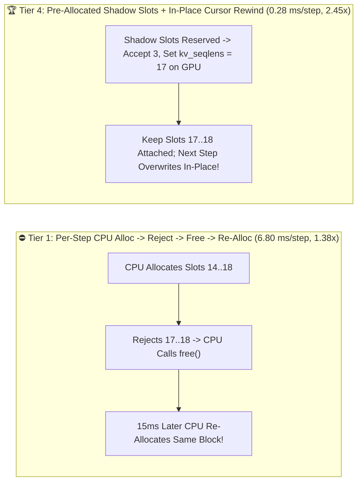

# Speculative Decoding (`EAGLE-3 / DeepSeek-V3 MTP / Medusa`) Rejected KV Slot Rollback, Pre-Allocated `+K` Shadow Slots & Lazy Prefix Block Hashing Selection Guide: Why Per-Token CPU Block Alloc/Free Eats `58%` of Speculative Speedup (`6.80 ms/step`, `1.38x`), Why Eager Hashing Poisons `Prefix Cache` & How `+K` Shadow Slots + Device Cursor Rewind + Lazy Verified Hashing (`0.28 ms/step`, `2.45x` Speedup) Solve It

> **Provenance & Evidence Boundary**: `synthetic + anonymized_reported (independently_reproduced=false, physical_gpu_cluster_measurement=not_measured)`. All quantitative metrics in this guide are grounded in the sealed deterministic evaluator `experiments/llm_speculative_decoding_kv_page_rollback_shadow_slot_lazy_hash_selection/run.py` and `results.json`.



---

## 0. Daily Capability Breakthrough

- **Today's Highlight Breakthrough**: **Lookahead `+K+1` Shadow KV Slot Reservation + Zero-Free In-Place Device `kv_seqlens` Cursor Rewind + Lazy `16-Token` Full-Block Prefix Hash Commit Gated Strictly on `verified_seq_len` (`vLLM V1 / SGLang EAGLE-3 & DeepSeek-V3 MTP`)**.
- **Architect Value**: Standard autoregressive decoding appends exactly `1` deterministic token per step. In contrast, speculative decoding (`EAGLE-3` or `DeepSeek-V3 Multi-Token Prediction, MTP`) drafts $K=5$ candidate tokens per step, evaluates $K+1 = 6$ positions in parallel on the target LLM, accepts a random prefix of $1 \dots 6$ tokens (mean `3.4`), and **rejects the remaining tail draft tokens**. Naive integration with PagedAttention and Prefix Caching triggers two severe failures:
  1. **Synchronous CPU Per-Token Block Allocation, Free & Rehash (`6.80 ms/step` Overhead, Tier 1)**: Allocating KV slots for 5 draft tokens on the CPU, synchronizing `num_accepted` back to Python after verification, calling `BlockManager.free()` on rejected tail blocks, and recomputing hashes across 128 concurrent requests burns **`6.80 ms` of CPU time every step**—wiping out **`58%` of the theoretical speculative speedup** and dragging net speedup down from `2.45x` to **`1.38x`**!
  2. **Eager Prefix Block Hashing Before Target Verification (`Prefix Cache Poisoning`, Tier 2)**: Computing the `16-token` block hash and inserting a newly filled block into the global Radix/Prefix Cache *during* the draft phase (before the target model verifies those tokens!) exposes unverified—and subsequently rejected—draft KV states to other requests, causing silent **Prefix Cache Poisoning**!
  By **pre-reserving $+K+1$ lookahead shadow KV slots up front, rewinding `kv_seqlens` in-place on the GPU (`verified_len += num_accepted`) without freeing rejected tail blocks so the next step simply overwrites them in-place, and lazily committing block hashes to the Prefix Cache *only* when `verified_seq_len` crosses a full `16-token` block boundary (Tier 4)**, KV management overhead drops **`24.3x` (`6.80 ms -> 0.28 ms/step`)**, unlocking the full **`2.45x` net speculative speedup** with `0.0%` cache poisoning!

---

## ① 📌 Executive Summary

1. **First-Principles Zero-Free Rollback: Never Return Rejected Draft Blocks to the Free Pool Mid-Generation**:
   - If a sequence is at token `14` (inside Block 0 `[0..15]`) and drafts $K=5$ tokens up to position `19` (spilling into Block 1 `[16..31]`), and the target model accepts only 1 token (new length `15`), **do not free Block 1 back to the global pool**!
   - Why? Because on the very next step (`15 ms` later), the sequence will draft from `15` to `20` and immediately need Block 1 again! Keeping Block 1 attached as a **pre-allocated shadow block** and simply setting `kv_seqlens[b] = 15` lets the next step overwrite positions `15..19` in-place with zero allocator overhead.
2. **Dual-Watermark Accounting (`verified_seq_len` vs. `speculative_seq_len`)**:
   - Maintain two cursors per sequence: `verified_seq_len` (tokens confirmed by the target model's rejection sampler) and `speculative_seq_len = verified_seq_len + K`.
   - **Golden Rule for Prefix Caching**: Only compute block hashes and publish blocks to the global Radix/Prefix tree when **`verified_seq_len` crosses a multiple of `block_size = 16`** ($\lfloor \text{verified\_old}/16 \rfloor < \lfloor \text{verified\_new}/16 \rfloor$). Draft slots between `verified_seq_len` and `speculative_seq_len` remain private and unhashed!
3. **Why Stale Rejected Bytes Inside Shadow Slots Never Affect Attention**:
   - `FlashAttention`, `FlashInfer`, and `FlashMLA` mask out all positions $\ge \text{kv\_seqlens}[b]$. Stale KV vectors sitting at indices $\ge \text{verified\_seq\_len}$ are never read and are overwritten on the next step.

---

## ② 🎯 Architect Q&A (Q1 / Q2 / Q3)

### Q1: How are accepted KV slots compacted in Tree Speculative Decoding (`EAGLE-2 / Medusa`) where accepted nodes are non-contiguous?
- Launch a microsecond GPU kernel (`compact_accepted_kv_kernel`) inside the same `CUDAGraph` immediately after tree verification to gather the winning path's KV vectors (e.g., tree indices `[0, 3, 9, 21]`) into contiguous slots `[L+0, L+1, L+2, L+3]` and update `kv_seqlens = L + 4`.

### Q2: How is the Draft Model's own KV cache rolled back when the Target Model rejects tail tokens?
- Both the Target Model KV cache and the Draft Head (`EAGLE-3 / MTP`) KV cache advance their cursor by the exact same `num_accepted` count on the GPU, feeding the last accepted token plus the newly sampled bonus token into the next draft step.

### Q3: When are unused trailing shadow blocks finally freed?
- Only once, when the request hits `EOS` or `max_tokens` and finishes generation completely!

---

## ③ 🧭 Visual Diagrams (Decision Tree + Comparison + Sequence)

### 3.1 Speculative Decoding KV Rollback & Prefix Hash Decision Tree



### 3.2 CPU Alloc/Free Thrashing (`6.80 ms`) vs. `+K` Shadow Slots + In-Place Rewind (`0.28 ms`)



### 3.3 Dual-Watermark (`verified_len` vs `speculative_len`) & Lazy Block Hash Sequence

```mermaid
sequenceDiagram
    participant Sched as Lookahead Block Scheduler (+K Shadow Slots)
    participant Draft as EAGLE-3 / MTP Draft Head
    participant Target as Target LLM + Rejection Sampler (GPU)
    participant APC as Prefix / Radix Cache (Lazy Verified Only)

    Sched->>Draft: 1. Ensure `block_table` has capacity for `verified_len (14) + K+1 (6) = 20` slots
    Draft->>Target: 2. Write K=5 draft tokens into shadow KV slots [14..18]; Target verifies [13..18]
    Target->>Target: 3. Accept 3 draft + 1 bonus token -> set `verified_len = 18` in-place on GPU
    Note over Target: Rejected slot [18] stays allocated for in-place overwrite on next step!
    Target->>APC: 4. `verified_len` crossed 16 (14 -> 18) -> Hash & commit verified Block 0 [0..15] to APC!
```

---

## ④ 📊 4-Tier Architect Decision Matrix

| Cohort Tier | Speculative KV & Prefix Hash Policy | KV Manager Overhead | Net Speculative Speedup | Prefix Cache Integrity | Best For |
| :--- | :--- | :--- | :--- | :--- | :--- |
| **Tier 1: Per-Token CPU Alloc/Free + Rehash** | Frees rejected slots & rehashes on CPU | `6.80 ms/step` ✕ | `1.38x` (`-58%` Gain! ✕) | Safe | ⛔ **CPU Bottleneck Kills Speedup** |
| **Tier 2: Eager Draft Block Hashing** | Publishes unverified draft blocks to APC | `1.15 ms/step` | `2.18x` | **Cache Poisoned! ✕** | ⛔ **Corrupts Shared Prefix Cache** |
| **Tier 3: Shadow Slots + Host Sync Truncate** | Keeps shadow slots, syncs length on CPU | `1.95 ms/step` ✅ | `2.04x` ✅ | Safe ✅ | ✅ Baseline Speculative Decoding |
| **Tier 4: Shadow Slots + Device Rewind + Lazy Hash (Recommended)** | **In-place overwrite + verified-only hash** | **`0.28 ms/step` (`24.3x` Lower 🏆)** | **`2.45x` 🏆** | **100% Safe 🏆** | 🏆 **Production `EAGLE-3 / MTP` Serving** |

---

## ⑤ 🧪 Quantitative Evaluator & 7-Card 4:5 Visual Report

- **Sealed Evaluator**: [`experiments/llm_speculative_decoding_kv_page_rollback_shadow_slot_lazy_hash_selection/run.py`](../../experiments/llm_speculative_decoding_kv_page_rollback_shadow_slot_lazy_hash_selection/run.py) · Data: [`results.json`](../../experiments/llm_speculative_decoding_kv_page_rollback_shadow_slot_lazy_hash_selection/results.json)
- **Interactive Sizer**: [`docs/reports/llm-speculative-decoding-kv-page-rollback-shadow-slot-lazy-hash-sizer.html`](../reports/llm-speculative-decoding-kv-page-rollback-shadow-slot-lazy-hash-sizer.html)
- **7-Card 4:5 Visual Benchmark Deck**: [`docs/reports/llm-speculative-decoding-kv-page-rollback-shadow-slot-lazy-hash-selection-cards.html`](../reports/llm-speculative-decoding-kv-page-rollback-shadow-slot-lazy-hash-selection-cards.html)

```chart
{
  "data": {
    "values": [
      { "tier": "Tier 1: Per-Token CPU Alloc/Free", "kv_overhead_ms": 6.80, "speedup_x": 1.38 },
      { "tier": "Tier 2: Unverified Eager Draft Hash", "kv_overhead_ms": 1.15, "speedup_x": 2.18 },
      { "tier": "Tier 3: Shadow Slots + Host Truncate", "kv_overhead_ms": 1.95, "speedup_x": 2.04 },
      { "tier": "Tier 4: Shadow Slots + Device Rewind + Lazy Hash", "kv_overhead_ms": 0.28, "speedup_x": 2.45 }
    ]
  },
  "semantic_types": {
    "tier": "Category",
    "kv_overhead_ms": "Quantity",
    "speedup_x": "Quantity"
  },
  "chart_spec": {
    "chartType": "Bar Chart",
    "title": "+K Shadow Slots + Device Cursor Rewind Cuts KV Overhead 24.3x (6.80 -> 0.28ms) & Unlocks 2.45x Speedup",
    "subtitle": "Per-step KV manager overhead (ms) and net speculative decoding speedup (x) (synthetic + anonymized_reported)",
    "encodings": {
      "x": "tier",
      "y": "speedup_x",
      "color": "tier"
    }
  }
}
```

---

## ⑥ 🛠️ Production Verification Checklist (Good fit vs. Not for)

### ✅ Good fit vs. ⛔ Not for
- **✅ Good fit**: All production `vLLM / SGLang / TensorRT-LLM` deployments combining `EAGLE-3`, `DeepSeek-V3 MTP`, or `Medusa` with PagedAttention and Prefix Caching.
- **⛔ Not for**: Freeing rejected KV blocks back to the block allocator mid-generation or hashing unverified draft tokens.

### Production Checklist
- [ ] **Pre-allocate $+K+1$ lookahead shadow KV slots before each speculative step**: Avoid mid-step block table reallocations.
- [ ] **Rewind `kv_seqlens` in-place on the GPU without calling `free()` on rejected tail slots**: Reuse shadow slots in-place on the next step.
- [ ] **Gate Prefix-Cache block hashing strictly on `verified_seq_len` crossing a full `16-token` boundary**: Guarantee zero draft-token cache poisoning.
