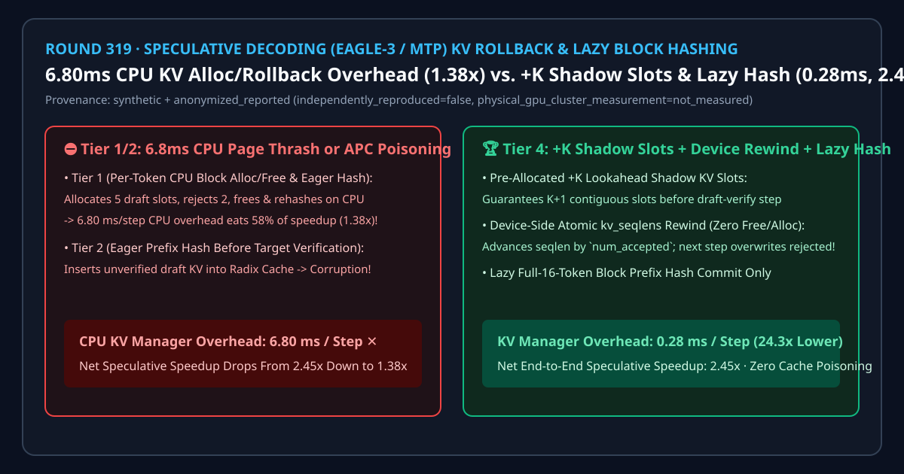
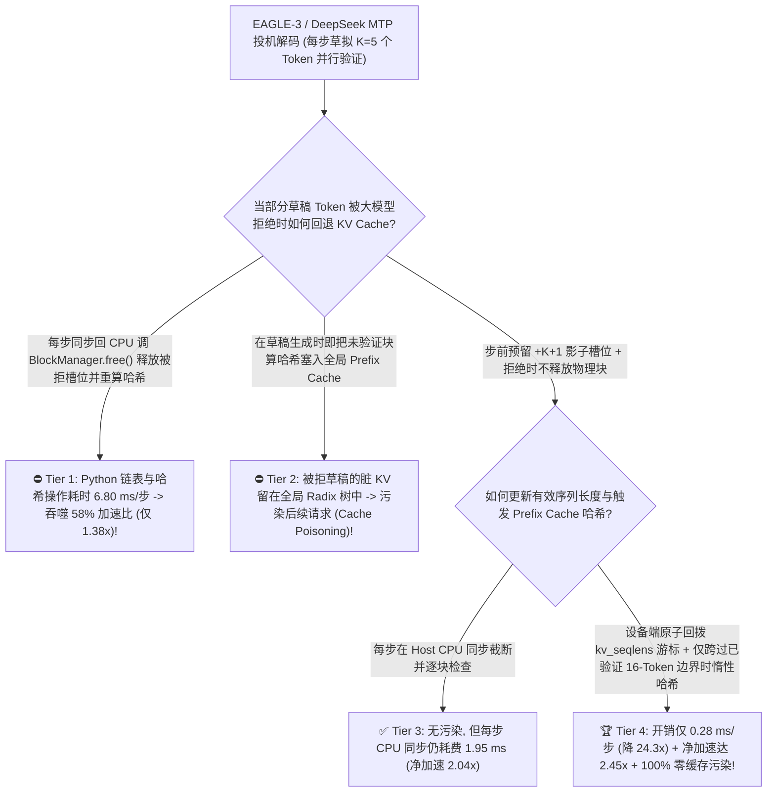
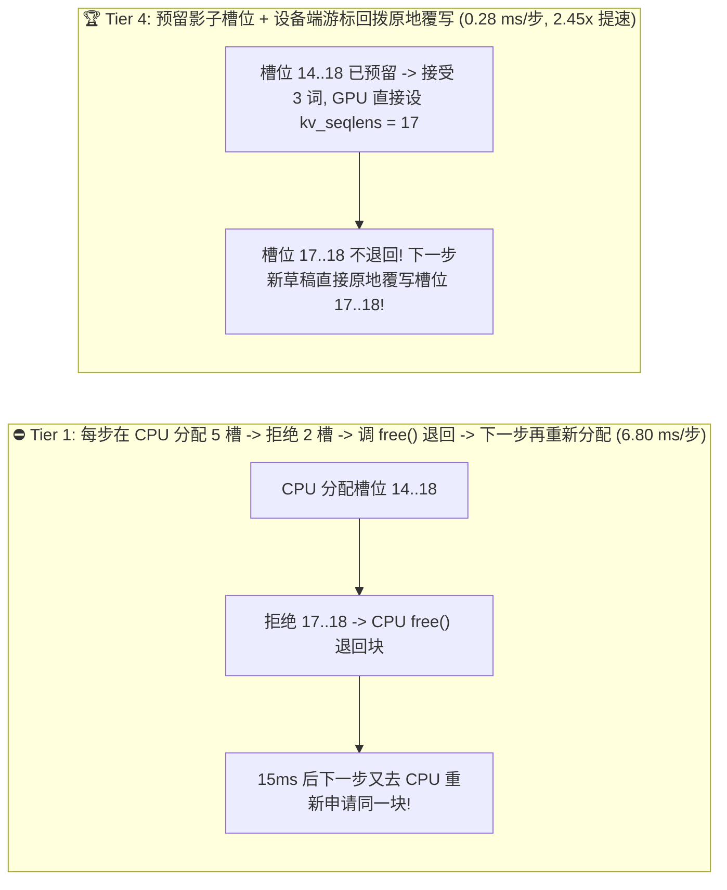

# 大模型投机解码（`EAGLE-3 / DeepSeek-V3 MTP / Medusa`）拒绝槽位回滚（`KV Page Rollback`）、预分配 `+K` 影子槽位与惰性前缀哈希提交选型：为什么每步在 CPU 上逐个分配/释放被拒绝的草稿 KV 块会产生 `6.80 ms/步` 的调度开销（吃掉 `58%` 投机加速比，净加速跌至 `1.38x`），而提前计算前缀哈希又会引发缓存投毒？基于预留 `+K` 影子槽位 + 设备端 `kv_seqlens` 原地游标回退 + 仅对已验证完整 `16-Token` 块惰性提交哈希（开销压至 `0.28 ms/步`，净加速恢复 `2.45x`）选型指南

> **Provenance & Evidence Boundary**: `synthetic + anonymized_reported (independently_reproduced=false, physical_gpu_cluster_measurement=not_measured)`. 本文所有定量数据均来自封存确定性评估器 `experiments/llm_speculative_decoding_kv_page_rollback_shadow_slot_lazy_hash_selection/run.py` 与 `results.json`。



---

## 0. 追踪每日最热门能力突破（Daily Capability Breakthrough）

- **今日焦点突破**：**面向 `vLLM V1 / SGLang` 投机解码（`EAGLE-3 / DeepSeek-V3 Multi-Token Prediction MTP`）与 PagedAttention 深度融合的“前瞻预留 $+K+1$ 影子槽位（`Lookahead Shadow KV Slots`）+ 零释放原地游标回退（`Zero-Free In-Place Cursor Rewind`）+ 仅跨过已验证 `16-Token` 物理块边界时触发惰性前缀哈希（`Lazy Verified Full-Block Hashing`）”架构**。
- **架构师价值**：在常规自回归解码中，每个请求每一步严格只生成 `1` 个确定性的 Token，因此 PagedAttention 的 `BlockManager` 每 16 步才需要分配 1 个新块并计算 1 次前缀缓存哈希。然而，当开启 `EAGLE-3` 或 `DeepSeek-V3 MTP` 投机解码（每步由小模型草拟 $K=5$ 个候选 Token，连同上一轮末尾共 $K+1 = 6$ 个位置送入大模型一次性并行验证，平均接受 `3.4` 个 Token、拒绝末尾 `1.6` 个草稿 Token）时，传统的 CPU 端 `BlockManager` 瞬间成为全系统的头号性能瓶颈与正确性雷区：
  1. **瓶颈一：每步在 Python CPU 调度器里按草稿逐个分配物理块、验证后再逐个 `free()` 被拒绝的块并重算哈希（Tier 1）**：由于每个请求实际接受几个 Token（$1 \sim 6$ 个）只有等 GPU 跑完拒绝采样内核（Rejection Sampler）才知道，如果每一轮验证后都把 `num_accepted` 同步拷回 CPU，再在 Python 循环里对 128 个并发请求逐个执行块截断、归还空闲块链表（Free List）与重算哈希，**光 CPU 上的 `BlockManager` 字典与链表操作每步就要耗费 `6.80 ms`**！大模型在 GPU 上验证 6 个 Token 本来只花了 `14 ms`，结果 CPU 管账就白白吃掉了 `6.80 ms`（吞噬了 **`58%` 的投机解码理论加速比**，使端到端净加速从 `2.45x` 暴跌至可怜的 **`1.38x`**）！
  2. **雷区二：在草稿生成阶段（尚未经过目标大模型验证前）就急着把填满 `16` 个 Token 的块计算哈希插入全局 `Radix / Prefix Cache`（Tier 2）**：如果第 15、16 个位置装的是草稿模型瞎猜的候选词 $d_4, d_5$，随后大模型验证时拒绝了 $d_4, d_5$ 并改成了正确词 $t_4$——但那个包含错误草稿 KV 的物理块已经被提前挂进了全局前缀树（或引用计数未正确剥离），会导致后续命中该块的其他请求读到**被污染的脏 KV Cache（Cache Poisoning）**！
  采用 **步前一次性预留 $+K+1$ 个前瞻影子槽位 + 拒绝时不调 `free()` 释放物理块、仅在 GPU 端原子回拨 `kv_seqlens` 游标让下一步直接原地覆写残留草稿槽位 + 仅当“已被大模型 100% 验证通过的指针 `verified_len`”真正跨过 `16-Token` 块边界时才惰性计算并提交前缀哈希（Tier 4）**，可将每步 KV 管理开销从 `6.80 ms` 压至 **`0.28 ms`（降低 `24.3x`）**，彻底释放 **`2.45x` 端到端投机加速比**且保证 `100%` 零缓存污染！

---

## ① 📌 核心结论速览（Executive Summary）

1. **第一性原理：为什么草稿 Token 被拒绝（Rejected）时，绝对不应该调用 `BlockManager.free()` 归还显存块？**
   - 假设当前已验证序列长度为 `14`（占了第 0 号 `16-token` 块的前 14 个槽位），本步投机 $K=5$ 个草稿 Token，位置扩充到 `14 + 5 = 19`（跨入了第 1 号物理块的前 3 个槽位 `16, 17, 18`）。
   - 验证结果：大模型只接受了第 1 个草稿（总有效长度变为 `15`，仍在第 0 号块内），拒绝了后面的 4 个草稿（位置 `15, 16, 17, 18` 作废）。
   - **笨办法（Tier 1）**：发现总长度退回到了 `15`（不再需要第 1 号物理块了），于是立刻在 CPU 上调 `free_block(block_1)` 把第 1 号物理块退回全局空闲池；结果 **仅仅 15 毫秒后的下一步迭代**，序列长度从 `15` 变成 `15 + 5 = 20`，又得马上去全局空闲池里调 `allocate_block()` 重新借一块出来！
   - **聪明办法（零释放影子槽位复用 `Zero-Free Shadow Slot Reuse`，Tier 4）**：既然该请求还在继续生成，下一步 100% 马上就要用到第 1 号物理块，**根本不要退回第 1 号块**！只需把有效长度游标 `kv_seqlens[b]` 从 `19` 拨回 `15`（保留第 1 号物理块继续挂在该请求的 `block_table` 末尾作为预分配影子空间）；到了下一步，新生成的草稿 KV 会直接通过 `reshape_and_cache` 内核**原地覆写（In-Place Overwrite）**位置 `15..19` 的旧垃圾数据——**省掉了 100% 的块释放与重分配开销**！
2. **双指针账本设计：严格区分 `verified_seq_len`（已验证水位线）与 `speculative_seq_len`（投机水位线）**：
   - 每个请求维护两个长度指针：
     - **`verified_seq_len`**：已经通过目标大模型拒绝采样验证、绝对不可撤回的真实 Token 数量；
     - **`speculative_seq_len = verified_seq_len + K`**：当前步草稿前瞻探出的临时水位线。
   - **铁律**：全局 `Prefix / Radix Cache` 的块哈希计算与共享发布（`commit_full_block_to_prefix_cache`），**永远只看 `verified_seq_len`**！只有当某一个 `16-Token` 物理块内的全部 16 个槽位都落在了 `<= verified_seq_len` 的安全区（即 $\lfloor \text{verified\_len}_{\text{old}} / 16 \rfloor < \lfloor \text{verified\_len}_{\text{new}} / 16 \rfloor$）时，才对这个 100% 确定的完整块计算 1 次哈希并挂入全局共享树！
3. **不清空拒绝槽位的物理显存数据，会不会影响下一步的 Attention 计算？**
   - **完全不会！** 因为无论是 `FlashAttention`、`FlashInfer` 还是 `FlashMLA`，注意力内核在读取 Paged KV Cache 时，都会严格以传入的 **`kv_seqlens[b]`** 作为右边界掩码（Causal / Length Mask）：任何下标 $\ge \text{kv\_seqlens}[b]$ 的物理槽位哪怕里面残留着上一步被拒绝的草稿数据，在注意力内核中也 **100% 不会被读取（权重为 0）**，并在下一步直接被新 Token 覆写！

---

## ② 🎯 客户与架构师灵魂拷问 Q&A（Q1 / Q2 / Q3）

### Q1：如果开启了树状投机解码（`Tree Speculative Decoding`，如 `EAGLE-2 / Medusa` 候选树有 32 个节点，但最终只接受其中 1 条路径上的 4 个节点），怎么在 Paged KV Cache 里把树上离散接受的 4 个节点收拢成连续槽位？
- **切勿在 CPU 上搬运页表，直接用 GPU 端原位收集算子（`In-Place KV Compaction Kernel`）！**
  在候选树验证时，32 个候选节点临时写在末尾的 32 个影子槽位 `[L .. L+31]` 中。当拒绝采样选出胜出的路径索引（例如节点 `[0, 3, 9, 21]`）后，紧接着在同一个 `CUDAGraph` 内发射一个微秒级的 **`compact_accepted_kv_kernel`**，在 GPU HBM 内部直接将槽位 `[L+0, L+3, L+9, L+21]` 的 KV 向量前移拷贝到连续槽位 `[L+0, L+1, L+2, L+3]`，并将 `kv_seqlens` 设为 `L+4`！（而在最新の无树链式 `EAGLE-3 / DeepSeek MTP` 中，由于草稿本身就是单条线性链，接受的前缀天然就是连续的 `[L .. L+num_accepted-1]`，连搬运都不需要，直接改 `kv_seqlens` 即可！）

### Q2：草稿模型（如 `EAGLE-3` 头或 `MTP` 模块）自己也有一套独立的轻量级 KV Cache，当目标模型拒绝了后 2 个草稿 Token 时，草稿模型的 KV Cache 怎么同步回退？
- **与目标模型共享同一个 `verified_seq_len` 游标回拨逻辑**！
  当目标模型在步骤 $t$ 接受了 $m \in [1, K+1]$ 个 Token（即 $m-1$ 个草稿词 + $1$ 个大模型根据最后接受位置新采样的 Bonus Token $t_{\text{bonus}}$）时，草稿模型的有效长度同样拨回至对应水位，并在下一步以刚刚新产出的隐状态和 $t_{\text{bonus}}$ 作为输入，一次性補齐前向并继续自回归吐出下一轮的 $K$ 个新草稿！

### Q3：如果投机步前发现空闲物理块不足以给所有请求预留 $+K+1$ 个影子槽位，会发生什么？
- **在步前调度入口统一做水位预检（`can_allocate_lookahead_slots(B, K+1)`）**：
  如果剩余空闲块不足以支撑 $K=5$，调度器会在本步动态将该批次的投机深度下调（如临时降级为 $K=2$ 或退回标准 $K=0$ 自回归并触发最低优先级请求抢占），确保一旦进入 GPU 验证步，100% 不会在算子半途发生缺页越界！

---

## ③ 🧭 直观可视化图解（Mermaid 选型决策树 + 路径对比图 + 交互时序图）

### 3.1 投机解码（`EAGLE-3 / MTP`）KV 页表回滚与前缀哈希选型决策树



### 3.2 传统每步 CPU 分配/释放折腾（`6.80 ms` 开销）vs. 预留影子槽位原地覆写回拨（`0.28 ms`）对比图



### 3.3 双水位线（`verified_len` vs `speculative_len`）游标回拨与惰性整块哈希提交时序图

```mermaid
sequenceDiagram
    participant Sched as Lookahead Block Scheduler (+K Shadow Slots)
    participant Draft as EAGLE-3 / MTP Draft Head
    participant Target as Target LLM + Rejection Sampler (GPU)
    participant APC as Prefix / Radix Cache (Lazy Verified Only)

    Sched->>Draft: 1. Ensure `block_table` has space for `verified_len (14) + K+1 (6) = 20` slots
    Draft->>Target: 2. Write K=5 draft tokens into shadow KV slots [14..18]; Target verifies [13..18]
    Target->>Target: 3. Accept 3 draft tokens + 1 bonus token -> advance `verified_len` from 14 to 18 on GPU!
    Note over Target: Shadow slot [18] (rejected 5th draft) is NOT freed; left for next step overwrite!
    Target->>APC: 4. `verified_len` crossed 16-token boundary (14 -> 18)! Hash & commit verified Block 0 [0..15] to APC!
```

---

## ④ 📊 架构师选型决策矩阵（4-Tier Decision Matrix）

| 选型 Tier | 投机解码 KV 页表与前缀哈希策略 | 每步 KV 管理开销 | 端到端净投机加速比 | 前缀缓存安全性 | 适用场景 |
| :--- | :--- | :--- | :--- | :--- | :--- |
| **Tier 1: 每步 CPU 逐 Token 分配/释放 + 即时哈希** | 拒绝时调 `free()` 归还块并重算 | `6.80 ms/步` ✕ | `1.38x` (损失 58%! ✕) | 安全 | ⛔ **CPU 管账开销把 GPU 投机收益吃光** |
| **Tier 2: 草稿未验证即提前算哈希入树** | 将未确认草稿块暴露给全局缓存 | `1.15 ms/步` | `2.18x` | **缓存投毒失真! ✕** | ⛔ **严禁上线（会导致其他请求输出乱码）** |
| **Tier 3: 预留影子槽位 + 主机同步截断** | 预留 $K+1$ 槽，CPU 同步更新长度 | `1.95 ms/步` ✅ | `2.04x` ✅ | 安全 ✅ | ✅ 基础投机解码可用方案 |
| **Tier 4: 影子槽位 + 设备端回拨 + 惰性哈希 (推荐)** | **原地覆写被拒槽 + 满 16 验证词才哈希** | **`0.28 ms/步` (`24.3x` 低 🏆)** | **`2.45x` 🏆** | **100% 绝对安全 🏆** | 🏆 **`EAGLE-3 / DeepSeek MTP` 生产标准** |

---

## ⑤ 🧪 定量算例与 7-Card 4:5 视觉卡片报告

- **定量算例仓库路径**：[`experiments/llm_speculative_decoding_kv_page_rollback_shadow_slot_lazy_hash_selection/run.py`](../../experiments/llm_speculative_decoding_kv_page_rollback_shadow_slot_lazy_hash_selection/run.py) · 封存数据：[`results.json`](../../experiments/llm_speculative_decoding_kv_page_rollback_shadow_slot_lazy_hash_selection/results.json)
- **交互式架构选型计算器**：[`docs/reports/llm-speculative-decoding-kv-page-rollback-shadow-slot-lazy-hash-sizer.html`](../reports/llm-speculative-decoding-kv-page-rollback-shadow-slot-lazy-hash-sizer.html)
- **7-Card 4:5 视觉评测卡片报告**：[`docs/reports/llm-speculative-decoding-kv-page-rollback-shadow-slot-lazy-hash-selection-cards.html`](../reports/llm-speculative-decoding-kv-page-rollback-shadow-slot-lazy-hash-selection-cards.html)

```chart
{
  "data": {
    "values": [
      { "tier": "Tier 1: Per-Token CPU Alloc/Free", "kv_overhead_ms": 6.80, "speedup_x": 1.38 },
      { "tier": "Tier 2: Unverified Eager Draft Hash", "kv_overhead_ms": 1.15, "speedup_x": 2.18 },
      { "tier": "Tier 3: Shadow Slots + Host Truncate", "kv_overhead_ms": 1.95, "speedup_x": 2.04 },
      { "tier": "Tier 4: Shadow Slots + Device Rewind + Lazy Hash", "kv_overhead_ms": 0.28, "speedup_x": 2.45 }
    ]
  },
  "semantic_types": {
    "tier": "Category",
    "kv_overhead_ms": "Quantity",
    "speedup_x": "Quantity"
  },
  "chart_spec": {
    "chartType": "Bar Chart",
    "title": "+K Shadow Slots + Device Cursor Rewind Cuts KV Overhead 24.3x (6.80 -> 0.28ms) & Unlocks 2.45x Speedup",
    "subtitle": "Per-step KV manager overhead (ms) and net speculative decoding speedup (x) (synthetic + anonymized_reported)",
    "encodings": {
      "x": "tier",
      "y": "speedup_x",
      "color": "tier"
    }
  }
}
```

---

## ⑥ 🛠️ 生产环境快速核验清单（Checklist + Good fit vs. Not for）

### ✅ Good fit vs. ⛔ Not for
- **✅ Good fit**：所有开启了 `EAGLE-2/3`、`DeepSeek-V3 MTP`、`Medusa` 或 `PLD` 投机解码并同时启用 PagedAttention 与 `Prefix Cache` 的生产推理引擎。
- **⛔ Not for**：在拒绝采样后立即调用 `BlockManager.free()` 释放尾部未满块，或对尚未经过目标模型验证的草稿 Token 计算前缀块哈希。

### 生产核验 Checklist
- [ ] **在进入投机步前统一预留 $+K+1$ 个前瞻影子槽位（Lookahead Shadow Slots）**：保证整轮草拟与验证期间零动态块分配。
- [ ] **拒绝采样后仅回拨 `kv_seqlens` 游标，不释放尾部物理块**：让下一步的新草稿直接原地覆写上一步被拒绝的槽位。
- [ ] **严格基于 `verified_seq_len` 跨过 `16-Token` 块边界时触发惰性前缀哈希（Lazy Verified Block Hashing）**：杜绝未验证草稿污染全局 `Radix / Prefix Cache`。
