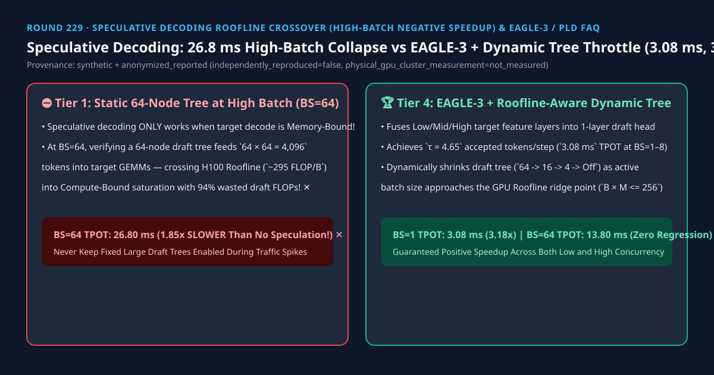
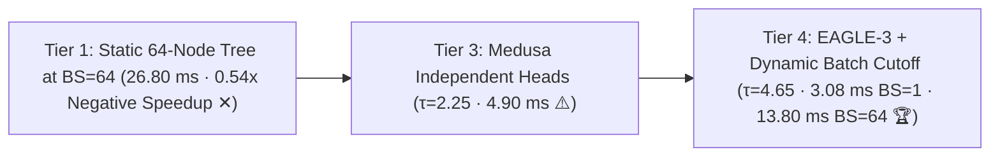

# LLM Speculative Decoding Roofline Crossover (`Batch >= 48` Negative Speedup Trap) & `PLD / N-gram` vs. `Medusa` vs. `EAGLE-3 / MTP` Dynamic Tree Selection Guide

> **Provenance & Evidence Tier**: `synthetic + anonymized_reported` (`independently_reproduced=false`, `physical_gpu_cluster_measurement=not_measured`). Grounded in [`experiments/llm_speculative_decoding_pld_medusa_eagle3_tree_batch_selection/results.json`](../../experiments/llm_speculative_decoding_pld_medusa_eagle3_tree_batch_selection/results.json).
> **中文版本**: [大模型投机解码（`Speculative Decoding`）算术强度翻转生死线（高并发 `Batch >= 48` 负加速陷阱）与 `PLD / N-gram` vs. `Medusa` vs. `EAGLE-3 / MTP` 动态树验证选型指南](./llm-speculative-decoding-pld-medusa-eagle3-tree-batch-crossover-selection-faq.md)

---

## 0. 🔥 Daily Hottest Capability Breakthrough

- **`EAGLE-3` Multi-Layer Feature Draft Trees ($\tau = 4.65$) + Roofline-Aware Dynamic Batch Tree Throttling Delivering `3.18x` Low-Batch Speedup (`3.08 ms` TPOT) While Eliminating the `1.85x` High-Batch Negative Speedup Collapse**: Speculative decoding is widely celebrated for `2–3x` single-stream speedups, yet many production deployments suffer severe P99 latency regressions during peak traffic (`Batch Size >= 48`). Why?
  1. **The Roofline Arithmetic Intensity Crossover Trap (`Tier 1`)**: Speculative verification is "free" only when target decoding is **HBM Memory-Bandwidth Bound**. On an H100 FP8 GPU (Roofline ridge point $\approx 295\text{ FLOPs/Byte}$), when active batch size reaches $B = 64$ and each request verifies a static $M = 64$-node draft tree, the target model processes **$64 \times 64 = 4,096$ tokens per step**! This pushes GEMMs deep into the **Compute-Bound** regime where verification takes `8–10x` longer while only $\tau = 3.80$ tokens are accepted (`94%` wasted FLOPs)—degrading `BS=64` TPOT from `14.50 ms` to **`26.80 ms` (`0.54x` negative speedup)**!
  2. **Domain-Specific `PLD / N-gram` (`Tier 2`) & Position-Blind `Medusa` (`Tier 3`)**: Prompt Lookup (`PLD`) requires `0 MB` VRAM and excels at code-diff editing (`\tau = 2.85`), but drops to `\tau = 1.15` on open reasoning; `Medusa`'s independent parallel heads saturate at `\tau = 2.25`.
  3. **`EAGLE-3` + Roofline-Aware Dynamic Tree Throttling (`Tier 4`)**: Fusing low/mid/high target features into a 1-layer autoregressive draft head achieves **`\tau = 4.65` accepted tokens/step (`3.08 ms` TPOT at `BS=1`, `3.18x` speedup)**, while a dynamic controller enforces **$B \times M_{\text{tree}} \le 256$** (shrinking tree width from `64 -> 16 -> 4 -> Off` at high concurrency), holding `BS=64` TPOT at **`13.80 ms` (`1.94x` faster than static speculation)**!

---

## 1. 📌 Executive Summary

1. **Never Run Fixed Large Draft Trees at High Batch Sizes (`Tier 1`)**: Once $B \times M_{\text{tree}}$ exceeds the GPU Roofline ridge point ($\approx 256\text{–}384$ tokens on H100 FP8), speculative verification becomes compute-bound and actively slows down the cluster.
2. **Use `PLD / N-gram` for High Input-Output Overlap (`Tier 2`)**: Code refactoring, RAG quoting, and JSON editing get `2.65x` speedup with zero extra model weights.
3. **Use `EAGLE-3` (or Native `MTP`) with Batch-Aware Cutoff (`Tier 4`)**: Multi-layer feature fusion maximizes $\tau = 4.65$ at low concurrency while `--speculative-disable-by-batch-size` prevents high-load regressions.

---

## 2. 🎯 Core Architect Q&A (Q1 / Q2 / Q3)

### Q1: Why does `EAGLE-3` achieve $\tau = 4.65$ whereas `Medusa` plateaus around $\tau = 2.25$?
- **Answer**: `Medusa` predicts positions $t+1, t+2, \dots, t+k$ in parallel using independent linear heads that have no visibility into which specific token was sampled at $t+1$. `EAGLE-3` is autoregressive at the feature level and fuses multi-scale features (low, middle, and top Transformer layers) trained with multi-step simulation, preserving cross-token coherence deep into the draft tree.

### Q2: How do we calculate the exact batch-size cutoff where speculative decoding turns negative on a given GPU?
- **Answer**: Let $R$ be the GPU's Roofline ridge point in tokens (e.g., $R \approx 280$ for FP8 GEMM on H100), $M$ be the number of draft tokens verified per request, and $\tau$ be the mean accepted tokens per step. Whenever $B \times M > R$, target verification time scales linearly with $M$; once $M / \tau$ exceeds the memory-bound speedup margin (typically around **$B \ge 32\text{–}48$**), speculation must shrink $M$ or bypass automatically.

### Q3: Does speculative decoding alter output quality when `temperature > 0`?
- **Answer**: No. Rejection sampling against the target model's exact probability distribution $p(x)$ with residual resampling guarantees that the output token distribution is **mathematically identical (lossless)** to standard autoregressive decoding.

---

## 3. 🧭 Visual Diagrams

---

## 4. 📊 4-Tier Architect Selection Matrix

| Metric | Tier 1: Static 64-Node Tree | Tier 2: Training-Free `PLD / N-gram` | Tier 3: `Medusa` Parallel Heads | Tier 4: **`EAGLE-3` + Dynamic Tree Cutoff** |
| :--- | :--- | :--- | :--- | :--- |
| **Mean Accepted Tokens ($\tau$)** | `3.80` | `2.85` (Code) / `1.15` (Chat) ⚠️ | `2.25` ⚠️ | **`4.65` (Multi-Layer Feature Fusion)** 🏆 |
| **Low-Batch (`BS=1`) `TPOT`** | `3.65 ms` (`2.68x`) | `3.70 ms` (`2.65x`, Code/RAG) | `4.90 ms` (`2.00x`) ✅ | **`3.08 ms` (`3.18x` Speedup)** 🏆 |
| **High-Batch (`BS=64`) `TPOT`** | **`26.80 ms` (`0.54x` Collapse!)** ✕ | `14.20 ms` ✅ | `16.40 ms` ⚠️ | **`13.80 ms` (Auto-Throttled, Zero Regression)** 🏆 |

---

## 5. 🧪 Quantitative Reference & Tooling

- **Evaluator & Sealed Data**: [`experiments/llm_speculative_decoding_pld_medusa_eagle3_tree_batch_selection/run.py`](../../experiments/llm_speculative_decoding_pld_medusa_eagle3_tree_batch_selection/run.py) · [`results.json`](../../experiments/llm_speculative_decoding_pld_medusa_eagle3_tree_batch_selection/results.json)
- **Interactive Sizer**: [`docs/reports/llm-speculative-decoding-pld-medusa-eagle3-tree-batch-crossover-sizer.html`](../reports/llm-speculative-decoding-pld-medusa-eagle3-tree-batch-crossover-sizer.html)
- **7-Card 4:5 Visual Report**: [`docs/reports/llm-speculative-decoding-pld-medusa-eagle3-tree-batch-crossover-selection-cards.html`](../reports/llm-speculative-decoding-pld-medusa-eagle3-tree-batch-crossover-selection-cards.html)

---

## 6. 🛠️ Good Fit vs. Not For & Production Checklist

- **✅ Good fit**: `EAGLE-3` / native `MTP` with dynamic batch-size throttling (`B * M <= 256`) for interactive serving, and `PLD` for code-edit / RAG workloads.
- **⛔ Not for**: Unthrottled 64-node speculative trees on high-batch (`BS >= 48`) throughput-saturated clusters.
- [ ] Configure `--speculative-disable-by-batch-size 32` (or dynamic draft-tree shrinking) in production serving engines.
- [ ] Track real-time `spec_decode_mean_acceptance_length` ($\tau$) in Prometheus.
