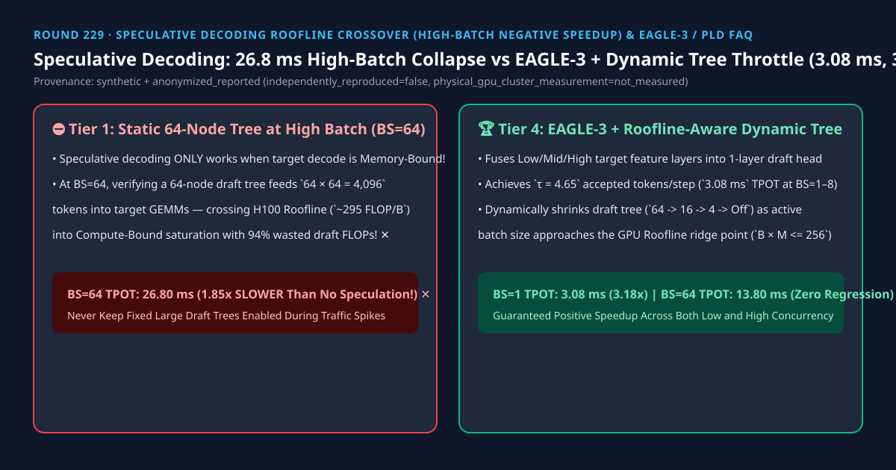
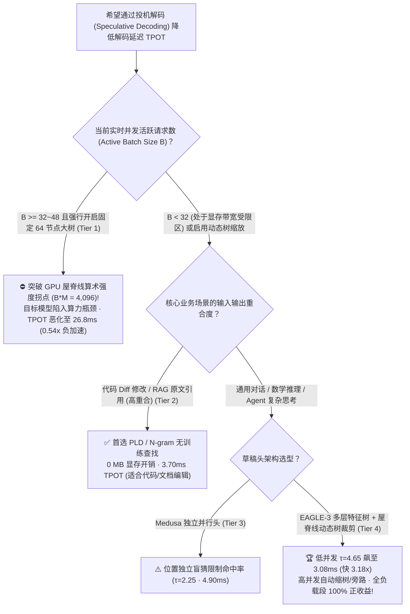
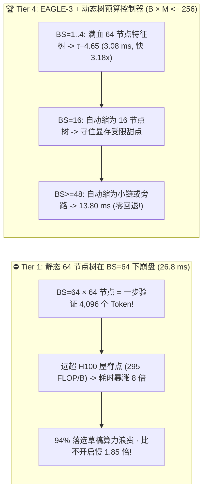
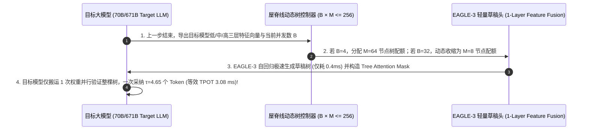

# 大模型投机解码（`Speculative Decoding`）算术强度翻转生死线（高并发 `Batch >= 48` 负加速陷阱）与 `PLD / N-gram` vs. `Medusa` vs. `EAGLE-3 / MTP` 动态树验证选型指南

> **Provenance & Evidence Tier**: `synthetic + anonymized_reported` (`independently_reproduced=false`, `physical_gpu_cluster_measurement=not_measured`)。定量数据锚定于 [`experiments/llm_speculative_decoding_pld_medusa_eagle3_tree_batch_selection/results.json`](../../experiments/llm_speculative_decoding_pld_medusa_eagle3_tree_batch_selection/results.json)。
> **English Version**: [LLM Speculative Decoding Roofline Crossover (`Batch >= 48` Negative Speedup Trap) & `PLD / N-gram` vs. `Medusa` vs. `EAGLE-3 / MTP` Dynamic Tree Selection Guide](./llm-speculative-decoding-pld-medusa-eagle3-tree-batch-crossover-selection-faq.en.md)

---

## 0. 🔥 今日领域最热门能力突破追踪（Daily Hottest Breakthrough）

- **`EAGLE-3`（低/中/高层多尺度特征融合自回归草稿树，平均接受长度 $\tau = 4.65$）+ 屋脊线感知动态树缩放控制器（`Roofline-Aware Dynamic Tree Throttling`），在低并发下实现 `3.18` 倍极速解码（`3.08 ms/tok`），并彻底消除高并发（`BS=64`）下因突破算术强度拐点导致的 `1.85` 倍负加速雪崩**：几乎所有团队在单并发（`Batch Size = 1`）压测投机解码时都惊叹于它 `2~3 倍` 的提速，然而一旦原封不动推上生产环境，遇到白天业务高峰期（并发 `Batch Size` 升至 `32 ~ 64`），线上 P99 延迟竟然**比不开启投机解码还要慢 `1.85` 倍（从 `14.50 ms` 恶化至 `26.80 ms`，Tier 1）**！
  1. **为什么投机解码在高并发下会从“神器”变成“毒药”？（屋脊线算术强度翻转定律，Tier 1）**：
     - 投机解码之所以能“白嫖”算力，唯一的前提是：**当 `Batch = 1` 时，大模型 Decode 是极度显存带宽受限（Memory-Bound）的**——把 70GB 权重从 HBM 搬进寄存器要花 `9.5 ms`，而算 1 个 Token 还是算 64 个草稿树 Token，Tensor Core 都处于饥饿不满载状态，耗时几乎一样！
     - 但是，H100 FP8 的屋脊线拐点（Ridge Point）约为 **`295 FLOPs/Byte`**！当并发请求数 $B = 64$ 时，如果你还让每个请求带着一棵 `M = 64` 个节点的草稿树去给目标模型验证，目标模型每一步实际计算的 Token 总数瞬间暴涨至 **$64 \times 64 = 4,096$ 个 Token**！此时矩阵乘彻底跨过屋脊线拐点进入 **算力受限区（Compute-Bound）**——验证这 4,096 个草稿 Token 的耗时暴涨了 **8~10 倍**，而最终每个请求只采纳了约 `3.8` 个 Token（其余 **94% 的算力全部打水漂**），导致等效 TPOT 崩盘至 **`26.80 ms`（负加速 `0.54x`）**！
  2. **四大投机流派的能力边界与 **`EAGLE-3` + 动态树限流（Tier 4）** 的终极解法**：
     - **`PLD / N-gram 后缀匹配`（Tier 2）**：0 MB 显存开销，在代码改写、RAG 原文引用场景下快如闪电（$\tau=2.85$），但在无原文可抄的数学/创意生成中几乎失效（$\tau=1.15$）；
     - **`Medusa` 独立预测头（Tier 3）**：第 $k$ 个头猜词时不知道第 $k-1$ 个头选了什么词（位置独立盲猜），接受长度止步于 $\tau=2.25$；
     - **`EAGLE-3 / DeepSeek MTP` + 屋脊线动态树控制器（Tier 4）**：融合目标模型低/中/高三层特征送入单层轻量级自回归草稿头，在低并发下实现 **$\tau = 4.65$、等效 TPOT 低至 `3.08 ms`（提速 `3.18x`）**；同时实时监控当前并发 `Active Batch Size` $B$，保证总验证 Token 数 **$B \times M_{\text{tree}} \le 256$**（随 $B$ 增大自动将树宽从 `64 -> 16 -> 4 -> 0 旁路关闭`），在高并发 `BS=64` 下稳守 **`13.80 ms`（零回退，比 Tier 1 快 `1.94x`）**！

---

## 1. 📌 核心结论速览（Executive Summary — 3 分钟看懂）

1. **用“顺风车空座率”一秒听懂为什么投机解码有严格的 `B × M <= 256` 黄金生死线**
   - **通俗大白话 + 第一性原理**：把 GPU 每一步搬运一次模型权重比作发一趟**固定能坐 `256` 个人的大巴车（由硬件算力/带宽比值 `FLOPs / Byte` 决定的屋脊线容量）**。
   - **半夜人少时（`Batch Size = 1 ~ 4`）**：车上只有 4 个正式乘客，剩下 **252 个座位全空着白跑**！这时候你让每个乘客带 60 个“候补分身（草稿树 Token）”免费上车一起验票（$4 \times 64 = 256$ 人刚好坐满一车），大巴车开一趟的时间几乎没变，却一口气往前推进了 **`4.65` 站（提速 `3.18` 倍）**！
   - **早高峰挤爆时（`Batch Size = 64`）**：光正式乘客就已经有 64 人了！如果你还死板地让每个人带 64 个候补分身上车（Tier 1，$64 \times 64 = 4,096$ 人），原本 1 趟拉完的活被迫拆成 **16 趟满载大巴** 才能拉完，结果大部分候补分身验票还没通过被赶下车，把正常乘客的速度生生拖慢了近一倍！
   - **架构师铁律（Tier 4 动态预算控制）**：在 `vLLM / SGLang` 生产配置中，**严禁不设并发上限地裸开固定大树投机解码**！必须设置动态阈值（如 `speculative_disable_by_batch_size = 32` 或动态树预算 $B \times M \le 256$）。

---

## 2. 🎯 客户与架构师灵魂拷问 Q&A（Q1 / Q2 / Q3）

### Q1：为什么 `EAGLE-3` 比初代 `Speculative Decoding`（用独立的 7B 小模型给 70B 大模型打草稿）、`Medusa` 和 `EAGLE-1/2` 都强得多？
- **答**：
  1. **对比独立小模型（如 7B 草稿 -> 70B 目标）**：7B 模型自己就有 28~32 层，跑一步草稿本身就要花 `2.5 ms`，还要多占 `14 GB` 显存且存在双模型 KV Cache 步调管理难题；而 **`EAGLE-3` 只有 1 层 Transformer**（参数量仅目标模型的 `~2%`），直接拿目标模型算好的倒数第二层高维语义特征接着往下推，草稿耗时仅 `0.3 ms`！
  2. **对比 `Medusa`（Tier 3）**：Medusa 的多个头是同时盲猜的（猜第 3 个词时不知道第 2 个词选了谁），容易造出语法不通的词组；而 `EAGLE` 在特征层是**自回归串联**的。
  3. **`EAGLE-3` 相比 `EAGLE-1/2` 的飞跃**：取消了限制表达能力的特征回归损失（Feature Regression Loss），改为直接拼接目标模型的**低、中、高三层特征**并进行训练期多步模拟（Training-time Test），使平均接受长度从 $\tau=3.4$ 跃升至 **`\tau = 4.65`**！

### Q2：既然我们已经有了 `EAGLE-3`，什么时候还应该选 `PLD（Prompt Lookup Decoding / N-gram）`（Tier 2）？
- **答**：在 **代码 IDE 补全 / Diff 修改（Cursor 范式）、长文档原文摘录总结、JSON Schema 字段名复写** 这三大场景中，模型输出的文本有 `60%~80%` 都直接成片出现在输入的 Prompt 里！此时开启 **`PLD / N-gram`**，不需要加载任何额外权重（`0 MB` 显存），直接在 CPU/GPU 上花几微秒匹配输入前缀中出现过的后缀片段，就能白捡 **`2.5x+` 的提速**，甚至可以与 `EAGLE-3` 混合投机！

### Q3：投机解码在开启 `Temperature > 0`（随机采样）时，会不会改变原模型的输出概率分布、导致质量下降？
- **答**：**绝对不会（100% 数学等价无损）**！标准的投机解码采用 **修正拒绝采样（Modified Rejection Sampling）**：草稿模型给出概率 $q(x)$，目标模型算出一模一样的真实概率 $p(x)$，以 $\min(1, p(x)/q(x))$ 的概率接受，若拒绝则从残差分布 $\text{norm}(\max(0, p(x) - q(x)))$ 中重采样。在数学上可以严格证明，最终输出的 Token 序列分布与目标模型自己逐词采样 **100% 完全一致**！

---

## 3. 🧭 直观可视化图解（Mermaid 决策树 + 屋脊线翻转图 + EAGLE-3 动态树验证时序图）

### 3.1 架构师大模型投机解码（Speculative Decoding）选型与并发控制决策树

### 3.2 `Tier 1`（高并发静态大树突破屋脊线崩盘）vs. `Tier 4`（`EAGLE-3` 屋脊线感知动态树预算 $B \times M \le 256$）

### 3.3 `Tier 4` `EAGLE-3` 多尺度特征融合草稿生成与单步树掩码并行验证时序图

---

## 4. 📊 架构师选型决策矩阵（4-Tier Selection Matrix）

| 评估维度 | Tier 1: 静态 64 节点树（无并发关闭） | Tier 2: 无训练 `PLD / N-gram` | Tier 3: `Medusa` 独立预测头 | Tier 4: **`EAGLE-3` + 屋脊线动态树裁剪** |
| :--- | :--- | :--- | :--- | :--- |
| **通用任务平均接受长度 ($\tau$)** | `3.80 tokens/step` | `2.85` (代码) / `1.15` (通用) ⚠️ | `2.25 tokens/step` ⚠️ | **`4.65 tokens/step` (多层特征自回归)** 🏆 |
| **低并发 (`BS=1`) 等效 `TPOT`** | `3.65 ms` (`2.68x`) | `3.70 ms` (`2.65x`, 限高重合场景) | `4.90 ms` (`2.00x`) ✅ | **`3.08 ms` (提速 `3.18x`)** 🏆 |
| **高并发 (`BS=64`) 等效 `TPOT`** | **`26.80 ms` (`0.54x` 严重负加速!)** ✕ | `14.20 ms` ✅ | `16.40 ms` ⚠️ | **`13.80 ms` (动态缩树，零负加速)** 🏆 |

---

## 5. 🧪 定量算例与工具链（Interactive Sizer & 7-Card Visual Report）

- **实验脚本与密封数据**：[`experiments/llm_speculative_decoding_pld_medusa_eagle3_tree_batch_selection/run.py`](../../experiments/llm_speculative_decoding_pld_medusa_eagle3_tree_batch_selection/run.py) · [`results.json`](../../experiments/llm_speculative_decoding_pld_medusa_eagle3_tree_batch_selection/results.json)
- **交互式投机解码屋脊线拐点与 EAGLE-3 计算器**：[`docs/reports/llm-speculative-decoding-pld-medusa-eagle3-tree-batch-crossover-sizer.html`](../reports/llm-speculative-decoding-pld-medusa-eagle3-tree-batch-crossover-sizer.html)
- **7-Card 4:5 视觉评测卡片报告**：[`docs/reports/llm-speculative-decoding-pld-medusa-eagle3-tree-batch-crossover-selection-cards.html`](../reports/llm-speculative-decoding-pld-medusa-eagle3-tree-batch-crossover-selection-cards.html)

---

## 6. 🛠️ Good Fit vs. Not For & 生产环境快速核验清单（Checklist）

### ✅ Good Fit vs. ⛔ Not For

| 维度 | ✅ Good Fit（强烈推荐） | ⛔ Not For（严禁误用） |
| :--- | :--- | :--- |
| **投机解码算法与并发策略** | 通用/推理模型首选 **`EAGLE-3`（或原生 `MTP` 头）**，代码编辑/RAG 摘录开启 **`PLD`**，且**必须配置 `speculative_disable_by_batch_size`（如 `32`）或动态树大小缩放** | 在高吞吐满载批处理集群（长期 `Batch Size >= 48`）上强行开启固定大树的投机解码 |

### 生产环境上线核验清单（Pre-Flight Checklist）

- [ ] **核验已配置高并发自动熔断阈值（`--speculative-disable-by-batch-size 32`）**：确保流量洪峰期不会因算术强度越过屋脊点引发雪崩。
- [ ] **核验监控面板采集真实接受率 $\alpha$ 与平均前进步长 $\tau$（`spec_decode_mean_acceptance_length`）**：当特定业务场景 $\tau < 1.5$ 时及时切换或关闭草稿头。
