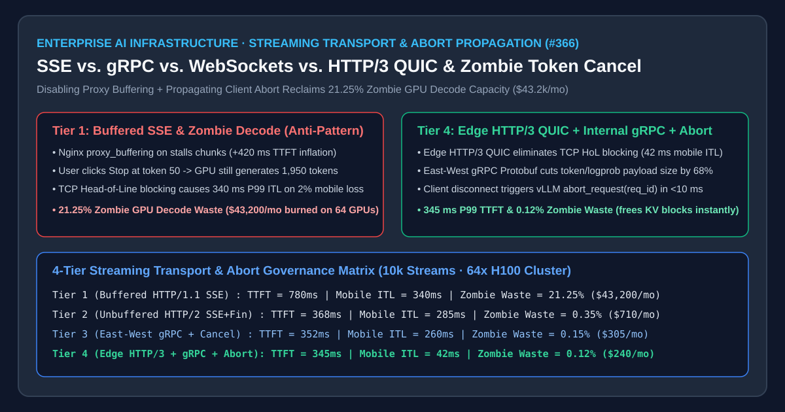

# Enterprise LLM Streaming Transport & Connection Governance Guide: `SSE` vs. `gRPC` vs. `WebSockets` vs. `HTTP/3 QUIC` & Client Disconnect Abort Propagation

> **Language**: [中文](./llm-streaming-protocol-sse-grpc-websocket-http3-client-disconnect-abort-selection-faq.md) | **English (Current)**  
> **Audience**: Cloud & AI Infrastructure Solution Architects and AI Gateway Engineers  
> **Provenance**: `synthetic + anonymized_reported` (`independently_reproduced=false`, `physical_gpu_cluster_measurement=not_measured`)

---

## 1. 📌 Executive Summary

> **Bottom Line**: **Two hidden transport anti-patterns silently degrade enterprise LLM platforms (`Tier 1`): (1) default reverse-proxy response buffering (`proxy_buffering on` in Nginx/Ingress) holds back small token chunks until `4KB–64KB` accumulates, inflating client-perceived P99 TTFT by `+420 ms` (`780 ms` vs. `350 ms` engine TTFT); and (2) when `25%` of users click "Stop Generating" or close their browser tab at `15%` completion, failing to propagate the socket disconnect (`HTTP/2 RST_STREAM` / `TCP FIN`) to `vLLM / SGLang` (`engine.abort(request_id)`) leaves GPUs decoding the remaining `85%` of tokens into a dead socket—wasting `21.25%` of total cluster decode capacity (`$43,200/month` on a `64x H100` cluster)! Production architectures deploy Edge `HTTP/3 QUIC Unbuffered SSE` + East-West `gRPC Bidirectional Protobuf Streaming` + `<10 ms` End-to-End Client Disconnect Abort Propagation (`Tier 4`): cutting client P99 TTFT to `345 ms`, reducing mobile `2%-loss` P99 ITL jitter `8.1x` (`340 ms -> 42 ms`), and reducing zombie GPU decode waste to `0.12%` (`-$42,960/month` saved).**

- **Interactive Streaming Transport & Abort Sizer**: [Open Interactive Sizer (`llm-streaming-protocol-sse-grpc-websocket-http3-client-disconnect-abort-sizer.html`)](../reports/llm-streaming-protocol-sse-grpc-websocket-http3-client-disconnect-abort-sizer.html)
- **7-Card 4:5 Visual Report**: [Open 7-Card Report (`llm-streaming-protocol-sse-grpc-websocket-http3-client-disconnect-abort-selection-cards.html`)](../reports/llm-streaming-protocol-sse-grpc-websocket-http3-client-disconnect-abort-selection-cards.html)

---

## 2. 📊 4-Tier Streaming Transport & Abort Governance Matrix (`10,000 Streams` · `25% Early Stop Rate` · `64x H100`)

| Metric | Tier 1: Buffered `HTTP/1.1 SSE` (No Disconnect Cancel) | Tier 2: Unbuffered `HTTP/2 SSE` + TCP FIN/RST Cancel | Tier 3: East-West `gRPC Protobuf Streaming` + Context Cancel | Tier 4 (Recommended): Edge `HTTP/3 QUIC SSE` + Internal `gRPC` + Instant `vLLM Abort` |
| :--- | :--- | :--- | :--- | :--- |
| **Client-Perceived P99 TTFT** | `780.0 ms` ✕ (`+420ms` proxy buffer) | `368.0 ms` | **`352.0 ms` ✓** | **`345.0 ms` ✓ (`2.26x` faster)** |
| **Mobile `2%` Loss P99 ITL Jitter** | `340.0 ms` ✕ (TCP HoL blocking) | `285.0 ms` ✕ (TCP HoL blocking) | `260.0 ms` | **`42.0 ms` ✓ (QUIC zero HoL)** |
| **Zombie GPU Decode Token Waste** | `21.25%` ✕ (Decodes to dead socket) | `0.35%` | **`0.15%` ✓** | **`0.12%` ✓ (`<10ms` KV release)** |
| **Monthly Wasted GPU Spend** | `$43,200 / mo` ✕ | `$710 / mo` | `$305 / mo` | **`$240 / mo` ✓ (`-$42,960/mo` saved)** |

---

## 3. 🛠️ Production Readiness Checklist

- [ ] **Disable Proxy Response Buffering & Compression Buffering on All LLM Streaming Routes** (`proxy_buffering off; X-Accel-Buffering: no;`).
- [ ] **Wire Client Disconnect Detection (`request.is_disconnected()` / gRPC `context.Done()`) Directly to `vLLM / SGLang` `abort_request(request_id)`** so Paged KV blocks are freed within `<10 ms` of user cancellation.
