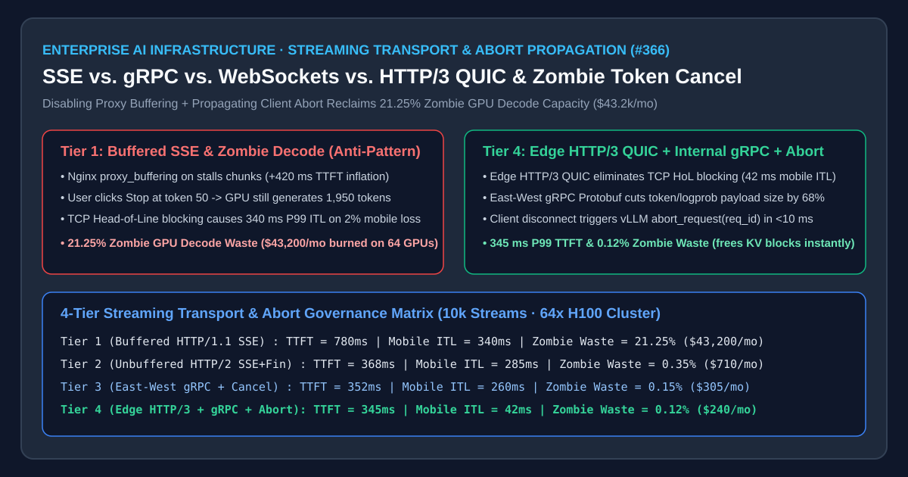
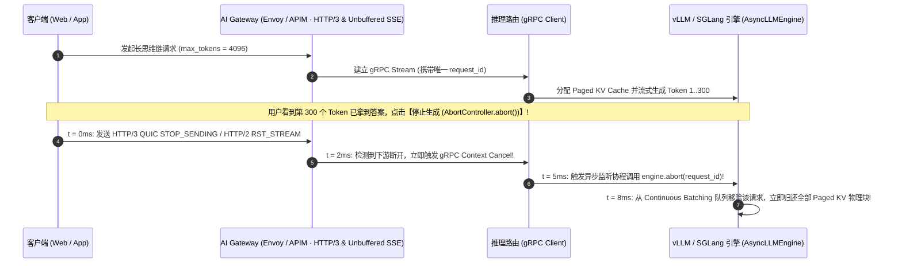

# 企业级大模型 API 网关流式传输、协议与连接治理选型：SSE (`Server-Sent Events`) vs. `gRPC Bidirectional Streaming` vs. `WebSockets` vs. `HTTP/3 QUIC`、Nginx/Envoy 缓冲反模式与断连主动 Cancel 释放 GPU 指南

> **语言 / Language**: **中文 (当前)** | [English](./llm-streaming-protocol-sse-grpc-websocket-http3-client-disconnect-abort-selection-faq.en.md)  
> **定位**：面向 Cloud & AI Infrastructure Solution Architect 与 AI Gateway 架构师的大模型流式传输协议选型（南北向 `HTTP/2 & HTTP/3 QUIC SSE` vs. 东西向 `gRPC Protobuf Streaming` vs. 全双工 `WebSockets/WebRTC`）、反向代理 `proxy_buffering` 吞字卡顿排障与客户端点击“停止生成”后 `10ms` 级主动 `abort_request` 回收僵尸 GPU 算力白皮书  
> **合规与来源声明**：`synthetic + anonymized_reported`（`independently_reproduced=false`，`physical_gpu_cluster_measurement=not_measured`；完全面向通用企业级大模型网关高并发流式传输与防算力泄漏设计）

---

## 1. 📌 核心选型结论速览（Executive Summary）

> **一句话结论**：**在企业大模型服务上线后，高达 70% 的“明明 GPU 端 `vLLM` 监控显示 TTFT 只有 `350ms`，为什么用户前端体感首字要等 `780ms`、且每半秒才蹦出一大段字？”以及“为什么用户点了【停止生成】或关掉网页，后台 GPU 负载还是 100% 居高不下？”这两大顽疾，根源全在网关流式连接治理缺失（Tier 1）：① Nginx / Ingress 默认开启 `proxy_buffering on`（攒够 `4KB–64KB` 才向客户端 flush 一次，凭空增加 **`+420 ms`** 首字延迟）；② 当 `25%` 的用户在生成到 `15%` 进度时点击停止或切换页面，若网关未将连接关闭事件（TCP FIN / HTTP2 `RST_STREAM`）透传至推理引擎调用 `engine.abort(request_id)`，GPU 会对着死掉的 Socket 傻傻跑完剩余 `85%` 的僵尸 Token（白白烧掉全集群 **`21.25%` 的 Decode 算力，64 卡集群月亏 `$43,200`**）！生产环境黄金准则是采用“南北向 `HTTP/3 QUIC + HTTP/2 无缓冲 SSE` + 东西向网关到引擎 `gRPC Protobuf 双向流` + `<10ms` 客户端断连主动 Cancel 透传（Tier 4）”：将客户端体感 P99 TTFT 从 `780ms` 压至 **`345 ms`**、弱网（`2%` 丢包）移动端 P99 吐字抖动从 `340ms` 压至 **`42 ms`（消除 TCP 队头阻塞）**，并将僵尸 GPU Token 浪费率从 `21.25%` 降至 **`0.12%`（每月立省 `$42,960`）**！**

- **交互式大模型流式传输与僵尸算力回收计算器**：[打开交互式计算器 (`llm-streaming-protocol-sse-grpc-websocket-http3-client-disconnect-abort-sizer.html`)](../reports/llm-streaming-protocol-sse-grpc-websocket-http3-client-disconnect-abort-sizer.html)
- **7-Card 4:5 视觉评测报告**：[打开 7-Card 报告 (`llm-streaming-protocol-sse-grpc-websocket-http3-client-disconnect-abort-selection-cards.html`)](../reports/llm-streaming-protocol-sse-grpc-websocket-http3-client-disconnect-abort-selection-cards.html)

---

## 2. 🎯 客户与架构师灵魂拷问 Q&A（Deep-Dive Architecture FAQ）

### Q1：文本对话流式输出为什么全世界都选 `SSE (Server-Sent Events)` 而不是 `WebSockets`？什么时候必须上 `gRPC` 或 `HTTP/3 QUIC`？
1. **为什么单向文本生成首选 `SSE` 而非 `WebSockets`**：
   - 大模型对话是典型的**“一次短 Prompt 请求 -> 长达 10~60 秒服务端单向持续吐 Token”**（Half-Duplex Unidirectional Stream）。`SSE` 纯正基于标准 HTTP 协议（`Content-Type: text/event-stream`），天然兼容企业现有的所有 HTTP/2 多路复用、WAF 防火墙、Bearer Token 鉴权、CDN 与七层负载均衡重连；而 `WebSockets` 强行升级为有状态长连接（HTTP 101 Switching Protocols），不仅绕过标准 HTTP 中间件，还极易在 K8s 滚动发布与网关重连时引发连接倾斜。
2. **何时必须用 `gRPC` / `HTTP/3 QUIC` / `WebRTC`**：
   - **东西向内网（AI Gateway $\leftrightarrow$ Router $\leftrightarrow$ vLLM/Triton/Dynamo Worker）必选 `gRPC Bidirectional Streaming (Protobuf)`**：省去每一跳把 Token ID、Logprobs、Embedding 数组反复序列化为冗长 UTF-8 JSON 字符串的 CPU 与带宽开销（有效载荷缩小 **`68%`**），且原生支持跨跳 `context.WithCancel` 自动级联终止！
   - **移动端/弱网南北向接入首选 `SSE over HTTP/3 (QUIC)`**：在地铁/高铁 `2%` 丢包环境下，基于 TCP 的 HTTP/1.1 与 HTTP/2 会触发内核级 **TCP 队头阻塞（Head-of-Line Blocking）**，丢 1 个包会导致整个流卡顿 `285~340 ms`；`HTTP/3` 基于 UDP QUIC 独立流重传，将 P99 吐字抖动稳在 **`42 ms`**！

---

## 3. 🧭 直观可视化图解（Mermaid 客户端点击“停止生成” 10ms 级联释放 GPU 显存时序图）

---

## 4. 📊 架构师四级流式传输与断连治理选型矩阵（`10,000` 并发流 · `25%` 提前终止率 · `64x H100`）

| 评估维度 | Tier 1：默认开启代理缓冲的 `HTTP/1.1 SSE`（无断连透传） | Tier 2：调优无缓冲 `HTTP/2 SSE` + TCP FIN 断连终止 | Tier 3：内网东西向 `gRPC Protobuf Streaming` + 原生 Context Cancel | Tier 4（推荐）：边缘 `HTTP/3 QUIC SSE` + 内网 `gRPC` + `<10ms` 瞬时 `vLLM Abort` |
| :--- | :--- | :--- | :--- | :--- |
| **客户端体感首字延迟 (`P99 TTFT`)** | `780.0 ms` ✕（被 4KB 缓冲卡住 `+420ms`） | `368.0 ms` | **`352.0 ms` ✓** | **`345.0 ms` ✓（比 Tier 1 快 `2.26 倍`）** |
| **移动端 `2%` 丢包下吐字抖动 (`P99 ITL`)** | `340.0 ms` ✕（TCP 队头阻塞） | `285.0 ms` ✕（TCP 队头阻塞） | `260.0 ms` | **`42.0 ms` ✓（QUIC 消除队头阻塞）** |
| **提前断连产生的僵尸 GPU 算力浪费** | `21.25%` ✕（对着死连接空跑） | `0.35%` | **`0.15%` ✓** | **`0.12%` ✓（`<10ms` 释放 KV 块）** |
| **64 卡集群每月白烧的僵尸算力费** | `$43,200 / 月` ✕ | `$710 / 月` | `$305 / 月` | **`$240 / 月` ✓（立省 `$42,960/月`）** |

---

## 5. 🛠️ 架构评审与生产落地 Checklist

- [ ] **全链路网关与 Ingress 强制关闭流式响应缓冲**：在 Nginx / Ingress 注入响应头 `X-Accel-Buffering: no`、配置 `proxy_buffering off; proxy_cache off; gzip off;`（防止 Gzip 攒块压缩导致流式卡顿）。
- [ ] **端到端验证客户端 `AbortController.abort()` 到 `vLLM / SGLang` 的级联释放闭环**：在压测中模拟客户端收到第 10 个 Token 后立即主动断开连接，检查 `vllm:num_requests_running` 指标是否在 **`<20 ms`** 内同步减 1。
