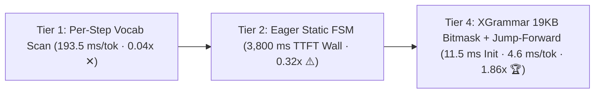

# LLM Structured Output & Grammar-Constrained Decoding: Naive Per-Token Vocabulary Scan (`185 ms/tok`) vs. Static `FSM` (`3.8s` TTFT Compilation Wall) vs. `XGrammar / llguidance` Adaptive Bitmask & Jump-Forward Decoding Selection Guide

> **Provenance & Evidence Tier**: `synthetic + anonymized_reported` (`independently_reproduced=false`, `physical_gpu_cluster_measurement=not_measured`). Grounded in [`experiments/llm_structured_output_xgrammar_outlines_fsm_mask_cache_selection/results.json`](../../experiments/llm_structured_output_xgrammar_outlines_fsm_mask_cache_selection/results.json).
> **中文版本**: [大模型结构化输出与语法受限解码（`Structured Outputs / JSON Schema`）选型：逐步全词表正则匹配（`185 ms/tok` CPU 卡死）vs. 传统静态 `FSM`（`Outlines` 动态 Schema 首包编译 `3.8s` 延迟墙）vs. `XGrammar / llguidance` 上下文无关自适应位掩码（`19 KB Bitmask` `< 40 us`）与确定性跳步（`Jump-Forward Decoding`）选型指南](./llm-structured-output-xgrammar-llguidance-fsm-bitmask-jump-forward-selection-faq.md)

---

## 0. 🔥 今日领域最热门能力突破追踪（Daily Hottest Breakthrough）

- **Eliminating the `3,800 ms` Dynamic JSON Schema Compilation Wall (`330x` Faster Init at `11.5 ms`) and Making Constrained JSON Generation `1.86x` FASTER Than Unconstrained Free-Text Decoding (`8.5 ms/tok -> 4.6 ms/tok` Effective ITL) via `XGrammar / llguidance` Context-Independent `19 KB` Bitmasks + `Jump-Forward Decoding`**: In production Agentic AI systems (`Function Calling` and `response_format={"type": "json_schema"}`), enforcing `100.0%` schema compliance via grammar-constrained logit masking has evolved across four generations:
  1. **Tier 1 — Naive Per-Step Python Vocabulary Regex Scan (`193.5 ms/tok` ITL, `0.04x` Speedup)**:
     - Evaluates all $V = 152,064$ vocabulary tokens on the CPU at every decode step (`185.0 ms` CPU overhead vs `8.5 ms` GPU forward pass), leaving the GPU `95.6%` idle!
  2. **Tier 2 — Eager Full-Vocabulary `FSM` Compilation (Legacy `Outlines v0`, `3,800 ms` Dynamic Schema TTFT Wall)**:
     - Intersects the entire JSON Schema automaton with all `152,064` vocabulary tokens upfront. While per-token lookup is fast (`8.9 ms/tok`), compiling a newly supplied per-request Agent JSON Schema blocks `TTFT` for **`3,800 ms` (`3.8 seconds`)**!
  3. **Tier 3 — `XGrammar / llguidance` Byte-Level Pushdown Automaton + `99%` Context-Independent `19 KB` Adaptive Token Bitmask (`11.5 ms` Init, `8.5 ms/tok` ITL)**:
     - Partitions tokens into **`99%` Context-Independent Tokens** (whose validity depends solely on local character transitions, pre-cached in a compact `19 KB` `int32` bitmask) and `< 1%` Context-Dependent Tokens resolved on the fly in C++ (`40 us/step`, overlapped asynchronously with GPU execution). Dynamic schema init drops `330x` to **`11.5 ms`**!
  4. **Tier 4 — `XGrammar` Bitmask + `Jump-Forward Decoding` (`Deterministic Boilerplate Fast-Forward` — `4.6 ms/tok` Effective ITL, `1.86x` Faster Than Unconstrained!)**:
     - Whenever the grammar automaton enters a state with a uniquely determined character continuation (such as fixed JSON keys `", "arguments": {"query": "` that make up `45%` of structured output tokens), the engine **skips autoregressive token-by-token sampling entirely**, appends the deterministic tokens in one shot, and processes them in a single forward pass—achieving a **`1.86x` end-to-end speedup over unconstrained generation**!

---

## 1. 📌 Executive Summary

1. **Why `19 KB` Packed `int32` Bitmasks + Context-Independent Token Splitting Solved Dynamic Schemas (`Tier 3`)**: Compressing `152,064` boolean token masks into `4,752` `int32` words (`19.0 KB` vs `608 KB` `float32`) allows CPU-to-GPU mask transfer in `< 2 us` and bitwise GPU logit masking in `< 10 us`.
2. **Why `Jump-Forward Decoding` (`Tier 4`) Beats Free-Text Speed**: Structured JSON contains `40%–55%` deterministic schema boilerplate (field names, quotes, colons, braces). Fast-forwarding those tokens turns sequential memory-bound decode steps into a single parallel prefill chunk!

---

## 2. 🎯 Core Architect Q&A (Q1 / Q2 / Q3)

### Q1: How do multi-byte UTF-8 characters (e.g., Chinese/Emoji split across BPE tokens) interact with JSON Schema engines?
- **Answer**: Legacy token-level regex engines often fail or mis-mask partial UTF-8 byte sequences in BPE vocabularies (`byte-level BPE`). **`XGrammar` and `llguidance`** operate as **byte-level pushdown automata (PDA)** that walk the UTF-8 byte trie of all `152,064` tokens, handling multi-byte CJK/Emoji tokens and escape sequences (`\"`, `\n`) without state explosion.

### Q2: How does `Jump-Forward Decoding` handle BPE tokenization boundaries when fast-forwarding a deterministic string like `", "status": "`?
- **Answer**: Because BPE tokenization is context-sensitive at boundaries (a token might merge the closing quote of the previous value with `, "`), the engine re-tokenizes the prefix + deterministic string boundary and splices the exact canonical token IDs into the KV cache sequence.

---

## 3. 🧭 Visual Diagrams

---

## 4. 📊 4-Tier Architect Selection Matrix

| Metric | Tier 1: Per-Step Vocab Scan | Tier 2: Eager Full-Vocab `FSM` | Tier 3: **`XGrammar / llguidance` Bitmask** | Tier 4: **`XGrammar` + `Jump-Forward` Decoding** |
| :--- | :--- | :--- | :--- | :--- |
| **Dynamic Schema Compile (`TTFT`)** | `15.0 ms` | **`3,800.0 ms` (`3.8s` Stall)** ✕ | **`11.5 ms` (`330x` Faster)** ✅ | **`11.5 ms` (`330x` Faster)** 🏆 |
| **Effective Decode `ITL` (`ms/tok`)** | **`193.5 ms/tok` (CPU Bound)** ✕ | `8.9 ms/tok` | `8.5 ms/tok` (Zero Overhead) ✅ | **`4.6 ms/tok` (Skips Fixed JSON Keys)** 🏆 |
| **Speedup vs Unconstrained Decode** | `0.04x` (`22x` Slower) ✕ | `0.32x` ⚠️ | `1.00x` (Parity) ✅ | **`1.86x` (`86%` Faster Than Free Text!)** 🏆 |

---

## 5. 🧪 Quantitative Reference & Tooling

- **Evaluator & Sealed Data**: [`experiments/llm_structured_output_xgrammar_outlines_fsm_mask_cache_selection/run.py`](../../experiments/llm_structured_output_xgrammar_outlines_fsm_mask_cache_selection/run.py) · [`results.json`](../../experiments/llm_structured_output_xgrammar_outlines_fsm_mask_cache_selection/results.json)
- **Interactive Sizer**: [`docs/reports/llm-structured-output-xgrammar-llguidance-fsm-bitmask-jump-forward-sizer.html`](../reports/llm-structured-output-xgrammar-llguidance-fsm-bitmask-jump-forward-sizer.html)
- **7-Card 4:5 Visual Report**: [`docs/reports/llm-structured-output-xgrammar-llguidance-fsm-bitmask-jump-forward-selection-cards.html`](../reports/llm-structured-output-xgrammar-llguidance-fsm-bitmask-jump-forward-selection-cards.html)

---

## 6. 🛠️ Good Fit vs. Not For & Production Checklist

- **✅ Good fit**: All Agent tool-calling, structured extraction, and JSON Schema endpoints running `XGrammar` or `llguidance` with `Jump-Forward` fast-forwarding.
- **⛔ Not for**: Per-step Python `LogitsProcessor` vocabulary scans or eager full-vocabulary `FSM` compilation on dynamic user schemas.
- [ ] Configure `--guided-decoding-backend xgrammar` (or `llguidance`) in `vLLM` / `SGLang`.
- [ ] Enable deterministic `Jump-Forward` fast-forwarding for structured JSON tool-calling workloads.
