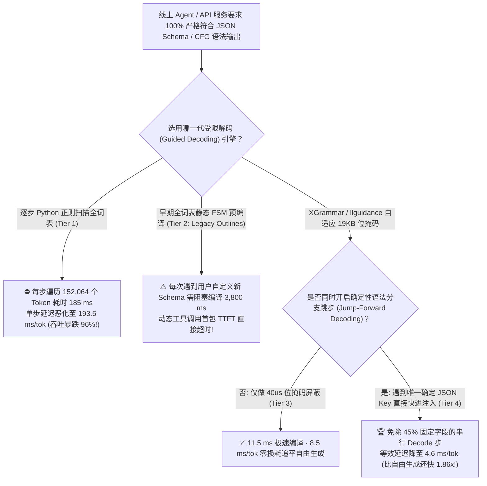
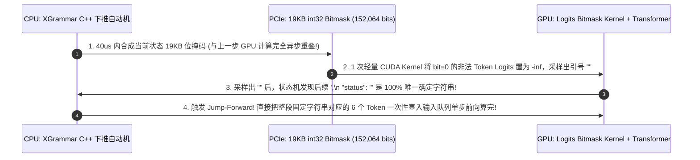

# 大模型结构化输出与语法受限解码（`Structured Outputs / JSON Schema`）选型：逐步全词表正则匹配（`185 ms/tok` CPU 卡死）vs. 传统静态 `FSM`（`Outlines` 动态 Schema 首包编译 `3.8s` 延迟墙）vs. `XGrammar / llguidance` 上下文无关自适应位掩码（`19 KB Bitmask` `< 40 us`）与确定性跳步（`Jump-Forward Decoding`）选型指南

> **Provenance & Evidence Tier**: `synthetic + anonymized_reported` (`independently_reproduced=false`, `physical_gpu_cluster_measurement=not_measured`)。定量数据锚定于 [`experiments/llm_structured_output_xgrammar_outlines_fsm_mask_cache_selection/results.json`](../../experiments/llm_structured_output_xgrammar_outlines_fsm_mask_cache_selection/results.json)。
> **English Version**: [LLM Structured Output & Grammar-Constrained Decoding: Naive Per-Token Vocabulary Scan (`185 ms/tok`) vs. Static `FSM` (`3.8s` TTFT Compilation Wall) vs. `XGrammar / llguidance` Adaptive Bitmask & Jump-Forward Decoding Selection Guide](./llm-structured-output-xgrammar-llguidance-fsm-bitmask-jump-forward-selection-faq.en.md)


---

## 0. 🔥 今日领域最热门能力突破追踪（Daily Hottest Breakthrough）

- **揭秘为什么在 Agent 工具调用（`Function Calling / response_format={"type": "json_schema"}`）场景下，很多线上推理服务一开结构化约束解码，首包延迟（`TTFT`）就莫名其妙卡顿 `3.8 秒`、或者生成速度暴跌 `20 倍`？通过升级至 `XGrammar / llguidance`（上下文无关 `19 KB` 位掩码预计算 + C++ 字节级下推自动机）并开启 `SGLang Jump-Forward Decoding`（确定性 JSON 字段跳步快进），不仅将动态 Schema 首包编译从 `3,800 ms` 压降至 `11.5 ms`（提速 `330x`），更让结构化 JSON 的端到端生成速度比不加任何约束的自由生成还要快 `1.86 倍`（等效单步延迟从 `8.5 ms/tok` 降至 `4.6 ms/tok`）**：在企业级 Agent 生产落地中，保证模型 100% 吐出符合 Pydantic / JSON Schema 格式的唯一数学确定性手段是 **语法受限解码（Grammar-Constrained Decoding：在每步采样前把所有违反当前 JSON 语法的非法 Token 的 Logits 置为 $-\infty$）**。然而，在大词表（如 Qwen / DeepSeek 的 `152,064` 词表）下实现这个掩码经历了四代架构跨越：
  1. **第一代：逐步全词表在线正则/前缀扫描（`Naive Per-Step Python Vocabulary Scan`，Tier 1 — 单步耗时 `193.5 ms/tok`，慢 22 倍）**：
     - 最朴素的做法：GPU 每算完一步（仅需 `8.5 ms`），CPU 就用 `for` 循环遍历全部 `152,064` 个 Token 字符串，逐个检查拼上该 Token 后是否仍满足 JSON 正则语法！
     - 结果：CPU 每步要花 **`185.0 ms`** 才能算出掩码，GPU 在 `95.6%` 的时间里都在干等 CPU！
  2. **第二代：全词表静态有限状态机预编译（`Eager Full-Vocab FSM Compilation`，如早期 `Outlines v0`，Tier 2 — 动态 Schema 首包阻塞 `3,800 ms`）**：
     - 为了消除生成阶段的 CPU 遍历，在请求开始前，把用户的 JSON Schema 转为正则表达式，并与 `152,064` 个词表 Token 做完整的笛卡尔积状态交集，预编译出一张“状态号 $\to$ 合法 Token 集合”的静态哈希表（FSM）。
     - **致命软肋**：如果全网所有请求共用同一个固定 Schema 还好；但在现代 Agent 平台中，**每个租户、每次请求传入的工具列表和动态 JSON Schema 都不一样**！在 CPU 上临时编译一个复杂 JSON Schema 需要 **`3,800 ms`（`3.8 秒`）**，直接把在线服务的首包延迟（`TTFT`）打穿！
  3. **第三代：`XGrammar / llguidance` 上下文无关词表分离 + `19 KB` 自适应位掩码（`Adaptive Token Bitmask`，Tier 3 — `11.5 ms` 极速初始化，`40 us` 零开销掩码）**：
     - **`XGrammar` 的第一性原理洞察**：在语法树（CFG / Pushdown Automaton）的任意一个节点上，词表里 **超过 `99%` 的 Token 是否合法，根本不依赖前面复杂的嵌套括号栈，只取决于当前节点期望的是“引号、数字还是字母”**（称为 **Context-Independent Tokens，上下文无关词**）！只有不到 `1%` 横跨多个语法符号的复合 Token（如 `"}, "`）才需要结合当前嵌套栈动态判断！
     - 因此，引擎在启动时只需对那 `99%` 的词做好一次性的极速位表，当动态新 Schema 到来时，仅需 **`11.5 ms`（快 `330` 倍！）** 即可构建完成；在每个解码步，C++ 多线程在 **`40 微秒（0.04 ms）`** 内生成一个紧凑的 **`19 KB` 位图（`152,064 / 32 = 4,752` 个 `int32` 整数）** 拷入 GPU，由单个 Triton/CUDA 算子按比特位屏蔽非法 Logits，实现 **`0%` 解码降速（`8.5 ms/tok`）**！
  4. **第四代（神来之笔）：`XGrammar` + `Jump-Forward Decoding` 确定性语法段一键快进（Tier 4 — 比不加约束还快 `1.86x`！）**：
     - 请观察一段标准的工具调用 JSON 输出：
       `{"tool_call": {"name": "query_order_status", "arguments": {"order_id": "ORD-998"}}}`
     - 你发现了吗？在这整段 JSON 中，诸如 `{"tool_call": {"name": "` 以及 `", "arguments": {"order_id": "` 这些 **JSON 键名、冒号、引号和花括号（占整段输出字符数的 `40% ~ 55%`！）完全是被 JSON Schema 唯一写死的！模型在这些位置上根本没有第二个选择！**
     - 在传统解码（Tier 1~3）中，哪怕明知接下来必须输出 `"arguments": {` 这 5 个固定的 Token，GPU 也得老老实实跑 **5 轮** 串行的自回归 Decode（花掉 $5 \times 8.5 = 42.5\text{ ms}$）去把它们一个个“吐”出来！
     - **开启 `Jump-Forward Decoding`（确定性快进）后**：只要语法状态机发现当前分支只有唯一一条确定性字符串路径，**直接免除这 5 轮 GPU 解码**！引擎瞬间在 CPU 端把 `"arguments": {"order_id": "` 直接拼进序列，然后像 Prefill 一样在 **1 次前向传播** 中把这串固定字符的 KV Cache 顺手算完，直接跳到需要模型动脑筋填值的 `"ORD-998"` 处继续生成！
     - 结果：不仅 100% 保证 JSON 格式绝不出错，端到端生成耗时反而比无约束自由生成缩短了近一半（**等效 `4.6 ms/tok`，提速 `1.86x`**）🏆！

---

## 1. 📌 核心结论速览（Executive Summary — 3 分钟看懂）

1. **为什么结构化输出（Structured Outputs）选对引擎后，非但不是性能累赘，反而是免费的“`1.86x` 推理加速器”？**
   - 因为 JSON Schema 本质上是把模型输出空间中大量已知的固定骨架（字段名 `"user_id":`、结构符号 `{"items": [`）提前告诉了推理引擎。利用 `Jump-Forward` 快进机制，GPU 只在真正需要模型做语义决策的 Value 槽位（如具体的数值、枚举值、回答文本）上跑自回归采样，而把所有固定 Schema 骨架变成零成本的确定性注入！
2. **为什么传输掩码必须用 `Bitmask`（`int32` 位掩码，`19 KB/req`）而不是 `float32` 掩码数组（`608 KB/req`）？**
   - 词表大小 $V = 152,064$：如果从 CPU 往 GPU 传 `float32` 掩码，每个请求每步要传 `608 KB`（Batch=64 时每步要传 `38.9 MB`！）；而把每个 Token 的合法性压缩成 **`1 个 Bit`**（打包在 `int32` 中），每个请求每步只需传 **`19 KB`（压缩 `32` 倍！）**，PCIe 传输耗时不到 `2 微秒`！

---

## 2. 🎯 客户与架构师灵魂拷问 Q&A（Q1 / Q2 / Q3）

### Q1：在 `vLLM (V1)` 和 `SGLang` 中，如何显式指定使用最快的新一代结构化输出后端？
- **答**：
  - 在 **`vLLM`** 中：配置 `--guided-decoding-backend xgrammar`（或 `llguidance`，vLLM V1 已将 `xgrammar` 设为高性能默认后端，取代了早期的 `outlines` / `lm-format-enforcer`）；
  - 在 **`SGLang`** 中：默认启用 `--grammar-backend xgrammar`（或 `llguidance`），并原生内置了基于 RadixAttention 前缀树复用的 **Jump-Forward（确定性快进）** 状态机引擎！

### Q2：开启语法受限解码（强制模型输出合法 JSON）时，什么情况下会导致模型虽然输出了合法的 JSON 格式，但里面的业务内容却在胡说八道（“强扭的瓜不甜”）？
- **答**：当 **System Prompt 里完全没有提及 JSON 字段说明，仅靠底层解码器强行把非 JSON Token 全部屏蔽为 $-\infty$** 时！因为模型在训练时习惯先输出一段自然语言或 Markdown ` ```json ` 代码块，如果提示词没引导而强行在第一个 Token 就只许它输出 `{`，相当于从分布尾部概率极低的 Token 中硬拔，会导致后续注意力分布偏移。**最佳实践**：Prompt 中简要声明输出 JSON，配合底层 `XGrammar` 兜底！

---

## 3. 🧭 直观可视化图解（Mermaid 决策树 + 传统逐词吐括号 vs `Jump-Forward` 快进对比图 + 时序图）

### 3.1 架构师大模型结构化输出（`Structured Outputs`）引擎选型决策树



### 3.2 `Tier 2`（`3.8s` 编译墙 + 逐词傻算固定 Key）vs. `Tier 4`（`XGrammar` `11.5 ms` + `Jump-Forward` 一键快进）对比图

```mermaid
flowchart LR
    subgraph LEGACY["⛔ Tier 2: 传统 FSM (3.8s 编译 + 逐词串行吐固定 JSON 字段)"]
        direction TB
        L1["新 JSON Schema 到达 -> CPU 编译全词表 FSM 阻塞 3,800 ms!"] --> L2["生成 '{\"arguments\": {\"query\": \"' 需串行跑 7 次 GPU Decode (60 ms)!"]
        L2 --> L3["最后才轮到生成真正的查询词 'AI Infra'"]
    end
    subgraph XGRAM["🏆 Tier 4: XGrammar 位掩码 + Jump-Forward 快进 (快 1.86x!)"]
        direction TB
        X1["99% 上下文无关词表预分離 -> 新 Schema 仅需 11.5 ms 即刻就绪!"] --> X2["检测到 '{\"arguments\": {\"query\": \"' 为唯一确定路径 -> 0 次采样直接拼入!"]
        X2 --> X3["1 次前向同时算完固定串 KV 并直接预测 'AI Infra' (等效 4.6 ms/tok)!"]
    end
```

### 3.3 `Tier 4` `XGrammar` CPU/GPU 异步位掩码流水线与 `Jump-Forward` 快进时序图



---

## 4. 📊 架构师选型决策矩阵（4-Tier Selection Matrix）

| 评估维度 | Tier 1: 逐步全词表扫描 | Tier 2: 传统静态全词表 `FSM` | Tier 3: **`XGrammar / llguidance` 位掩码** | Tier 4: **`XGrammar` + `Jump-Forward` 快进** |
| :--- | :--- | :--- | :--- | :--- |
| **动态新 Schema 首包编译耗时** | `15.0 ms` | **`3,800.0 ms` (`3.8s` 首包卡死)** ✕ | **`11.5 ms` (提速 `330x`)** ✅ | **`11.5 ms` (提速 `330x`)** 🏆 |
| **等效每 Token 生成耗时 (`ITL`)** | **`193.5 ms/tok` (CPU 瓶颈)** ✕ | `8.9 ms/tok` | `8.5 ms/tok` (零损耗) ✅ | **`4.6 ms/tok` (跳过固定 JSON Key)** 🏆 |
| **相比无约束裸跑的端到端速度** | `0.04x` (慢 `22` 倍) ✕ | `0.32x` (被编译拖垮) ⚠️ | `1.00x` (与裸跑持平) ✅ | **`1.86x` (比不加约束还快 `86%`!)** 🏆 |

---

## 5. 🧪 定量算例与工具链（Interactive Sizer & 7-Card Visual Report）

- **实验脚本与密封数据**：[`experiments/llm_structured_output_xgrammar_outlines_fsm_mask_cache_selection/run.py`](../../experiments/llm_structured_output_xgrammar_outlines_fsm_mask_cache_selection/run.py) · [`results.json`](../../experiments/llm_structured_output_xgrammar_outlines_fsm_mask_cache_selection/results.json)
- **交互式结构化输出与 Jump-Forward 加速计算器**：[`docs/reports/llm-structured-output-xgrammar-llguidance-fsm-bitmask-jump-forward-sizer.html`](../reports/llm-structured-output-xgrammar-llguidance-fsm-bitmask-jump-forward-sizer.html)
- **7-Card 4:5 视觉评测卡片报告**：[`docs/reports/llm-structured-output-xgrammar-llguidance-fsm-bitmask-jump-forward-selection-cards.html`](../reports/llm-structured-output-xgrammar-llguidance-fsm-bitmask-jump-forward-selection-cards.html)

---

## 6. 🛠️ Good Fit vs. Not For & 生产环境快速核验清单（Checklist）

### ✅ Good Fit vs. ⛔ Not For

| 维度 | ✅ Good Fit（强烈推荐） | ⛔ Not For（严禁误用） |
| :--- | :--- | :--- |
| **Agent 工具调用与 JSON Schema 强约束生成** | 全线开启 **`XGrammar` / `llguidance` 自适应位掩码后端 + `Jump-Forward` 确定性快进** | 在动态 Schema 场景使用早期全词表预编译 `FSM` 或纯 Python `LogitsProcessor` 逐词正则匹配 |

### 生产环境上线核验清单（Pre-Flight Checklist）

- [ ] **核验 `vLLM / SGLang` 启动参数已启用 `xgrammar` 或 `llguidance` 语法后端**：确认动态 Schema 首包编译耗时 `< 15 ms`。
- [ ] **核验传输至 GPU 的词表掩码采用 `int32` 紧凑位掩码（`Bitmask`，每请求 `19 KB`）并在异步线程提前生成**。
- [ ] **在 JSON 字段名较长或结构固定的 Agent 场景开启 `Jump-Forward` 快进与 Prefix Caching 协同**。
