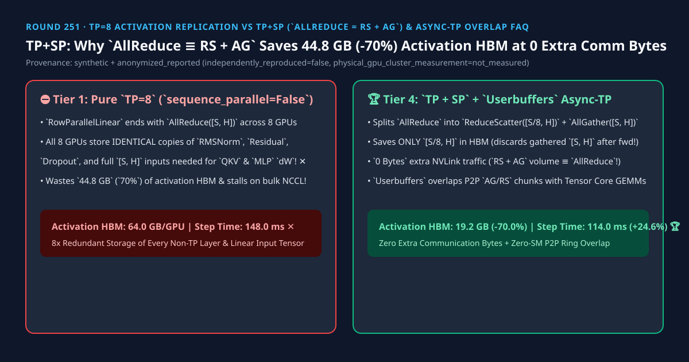
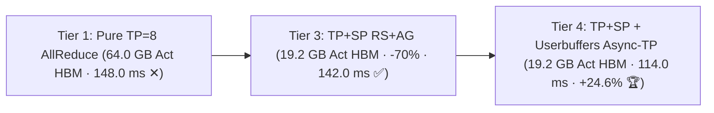

# Tensor Parallelism (`TP = 8`) Activation Memory Paradox: Why Pure `TP` Replicates `LayerNorm / Residual` Activations `8x`, Zero-Extra-Comm `TP + Sequence Parallelism (SP)` (`AllReduce = RS + AG`) & `Userbuffers` Overlap Selection Guide

> **Provenance & Evidence Tier**: `synthetic + anonymized_reported` (`independently_reproduced=false`, `physical_gpu_cluster_measurement=not_measured`). Grounded in [`experiments/llm_tensor_parallel_allreduce_vs_sequence_parallel_ag_rs_selection/results.json`](../../experiments/llm_tensor_parallel_allreduce_vs_sequence_parallel_ag_rs_selection/results.json).
> **中文版本**: [张量并行（`Tensor Parallelism, TP = 8`）激活值显存悖论：为什么单开 `TP` 仍会复制 `8` 份 `LayerNorm / Residual` 激活引发 OOM？`AllReduce = ReduceScatter + AllGather` 等价拆分与 `TP + Sequence Parallelism (SP)` 结合 `Userbuffers` 流水线重叠选型指南](./llm-tensor-parallel-allreduce-vs-sequence-parallel-ag-rs-activation-memory-selection-faq.md)

---

## 0. 🔥 今日领域最热门能力突破追踪（Daily Hottest Breakthrough）

- **Slashing Per-GPU Activation Memory by `-70.0%` (`64.0 GB -> 19.2 GB`, Saving `44.8 GB/GPU`) at `0 Bytes` Extra Forward Network Traffic and Boosting Step Speed by `+24.6%` (`148.0 ms -> 114.0 ms`) via `TP + Sequence Parallelism (SP)` (`AllReduce ≡ ReduceScatter + AllGather`) + `TransformerEngine Userbuffers` (`Async-TP`)**: When scaling LLM training with 8-way Tensor Parallelism (`TP = 8`), teams often assume all activations shrink by `8x`. In reality:
  1. **Pure `TP = 8` (`sequence_parallel = False`, `Tier 1` — `64.0 GB` Activation Bloat)**:
     - Because `RowParallelLinear` (`O_proj` and `Down_proj`) terminates with an **`AllReduce([B, S, H])`**, all 8 GPUs receive and store **8 identical full copies** of every `RMSNorm`, `Residual` connection, `Dropout` mask, and the full `[B, S, H]` input activation tensor saved for `ColumnParallelLinear` (`QKV` and `Gate/Up`) backward weight gradients ($\nabla W = X^T \nabla Y$)!
  2. **Splitting `AllReduce` into `ReduceScatter` + `AllGather` (`TP + SP`, `Tier 3` — `19.2 GB` Activation HBM, `0%` Extra Forward Comm)**:
     - Mathematically and physically on ring/tree topologies, **`AllReduce(X) ≡ AllGather(ReduceScatter(X))`** with identical byte volume ($2 \times \frac{N-1}{N} M$).
     - By replacing `RowParallelLinear`'s trailing `AllReduce` with **`ReduceScatter` along the sequence dimension (`[B, S/8, H]`)**, all `RMSNorm`, `Dropout`, and `Residual` operations execute on **`1/8` of the sequence**!
     - At the entrance of the next `ColumnParallelLinear`, we execute **`AllGather([B, S/8, H] -> [B, S, H])`**, immediately **discard the gathered `[B, S, H]` buffer after the forward GEMM**, and save only the local `[B, S/8, H]` shard (`X_shard`) for backward—cutting activation HBM from `64.0 GB` to **`19.2 GB` (`-70.0%`)**!
  3. **`TP + SP` + `TransformerEngine Userbuffers` / `Async-TP` Pipelined Overlap (`Tier 4`)**:
     - Replaces bulk NCCL `AllGather / ReduceScatter` with zero-SM P2P `Userbuffers` chunked ring transfers overlapped tile-by-tile with Tensor Core GEMMs—cutting step time from `148.0 ms` to **`114.0 ms` (`+24.6%` speedup)**!

---

## 1. 📌 Executive Summary

1. **Golden Rule**: Never run `TP > 1` without `--sequence-parallel` (`SP`). `SP` is strictly free in forward communication volume (`RS + AG ≡ AllReduce`) while saving **`44.8 GB` (`70%`) of activation HBM per GPU**.
2. **Critical Implementation Detail (`save_for_backward(X_shard)`)**: In `ColumnParallelLinear` with `SP`, do **not** let PyTorch Autograd save the `AllGather`ed `[B, S, H]` tensor (`Tier 2: 41.6 GB`); save only the pre-gather `[B, S/8, H]` shard (`Tier 3/4: 19.2 GB`) and re-run `AllGather` asynchronously during backward!

---

## 2. 🎯 Core Architect Q&A (Q1 / Q2 / Q3)

### Q1: How does Megatron `Sequence Parallelism (SP)` differ from `Context Parallelism (CP)`?
- **Answer**:
  - **Megatron `SP`** shares the intra-node `TP` group (`TP = 8`), sharding `RMSNorm / Dropout / Residual` and saved linear input activations to `[B, S/TP, H]`, while temporarily gathering `[B, S, H]` inside `ColumnParallelLinear` and Attention (`QKV` heads are already sharded `H/TP` by `TP`).
  - **`Context Parallelism (CP)`** (`Ring Attention` / `Ulysses`) adds a separate inter-node/intra-node dimension that keeps `Q, K, V` and `KV Cache` sharded along the sequence dimension `[B, S/(TP*CP), H]` even *inside* Attention and MLP!

### Q2: How does `Async-TP` (`Userbuffers`) overlap `AllGather` when `GEMM` depends on the gathered input `X`?
- **Answer**: Because `X` is sharded along the sequence/token dimension $S$ (`X = [X_0, X_1, ..., X_7]`), matrix multiplication $Y = X W$ decomposes into 8 independent row-block GEMMs $[X_0 W, X_1 W, \dots, X_7 W]$! GPU $r$ already owns $X_r$ locally at $t=0$, so it immediately launches $\text{GEMM}(X_r, W)$ on Tensor Cores while simultaneously fetching $X_{(r+1)\bmod 8}$ over NVLink P2P!

### Q3: What about `ReduceScatter` overlap after `RowParallelLinear`?
- **Answer**: In `RowParallelLinear`, each GPU computes a partial sum $\tilde{Y}^{(r)} = X^{(r)} W^{(r)}$ of shape `[B, S, H]`. By computing the output row-block $\tilde{Y}_k$ (`[B, S/8, H]`) one sequence chunk at a time, GPU $r$ immediately streams chunk $k$ into the NVLink `ReduceScatter` ring while Tensor Cores compute chunk $k+1$!

---

## 3. 🧭 Visual Diagrams

---

## 4. 📊 4-Tier Architect Selection Matrix

| Metric | Tier 1: Pure `TP=8` (`AllReduce`) | Tier 2: `TP+SP` (Keep `X_full`) | Tier 3: Standard `TP+SP` | Tier 4: **`TP+SP` + `Userbuffers Async-TP`** |
| :--- | :--- | :--- | :--- | :--- |
| **Activation HBM / GPU (`32K`)** | **`64.0 GB` (8x Replicated)** ✕ | `41.6 GB` ⚠️ | **`19.2 GB` (`-70.0%` Saved)** ✅ | **`19.2 GB` (`-70.0%` Saved)** 🏆 |
| **Extra Forward Comm Bytes** | `0.0%` (Baseline `AllReduce`) | `0.0%` | **`0.0%` (`RS + AG ≡ AllReduce`)** ✅ | **`0.0%` (`RS + AG ≡ AllReduce`)** 🏆 |
| **Step Latency (`ms`)** | `148.0 ms` ✕ | `142.0 ms` | `142.0 ms` (Bulk NCCL) ✅ | **`114.0 ms` (`+24.6%` Faster)** 🏆 |

---

## 5. 🧪 Quantitative Reference & Tooling

- **Evaluator & Sealed Data**: [`experiments/llm_tensor_parallel_allreduce_vs_sequence_parallel_ag_rs_selection/run.py`](../../experiments/llm_tensor_parallel_allreduce_vs_sequence_parallel_ag_rs_selection/run.py) · [`results.json`](../../experiments/llm_tensor_parallel_allreduce_vs_sequence_parallel_ag_rs_selection/results.json)
- **Interactive Sizer**: [`docs/reports/llm-tensor-parallel-allreduce-vs-sequence-parallel-ag-rs-activation-memory-sizer.html`](../reports/llm-tensor-parallel-allreduce-vs-sequence-parallel-ag-rs-activation-memory-sizer.html)
- **7-Card 4:5 Visual Report**: [`docs/reports/llm-tensor-parallel-allreduce-vs-sequence-parallel-ag-rs-activation-memory-selection-cards.html`](../reports/llm-tensor-parallel-allreduce-vs-sequence-parallel-ag-rs-activation-memory-selection-cards.html)

---

## 6. 🛠️ Good Fit vs. Not For & Production Checklist

- **✅ Good fit**: All `TP >= 2` training pipelines (always pair `TP` with `--sequence-parallel` and `--tp-comm-overlap`).
- **⛔ Not for**: Running `TP > 1` with `sequence_parallel=False` or saving gathered `[B, S, H]` activations across forward/backward.
- [ ] Enable `--sequence-parallel` whenever `tensor_model_parallel_size > 1`.
- [ ] Enable `--tp-comm-overlap` (`TransformerEngine Userbuffers`) to overlap chunked `AllGather / ReduceScatter` with GEMMs.
