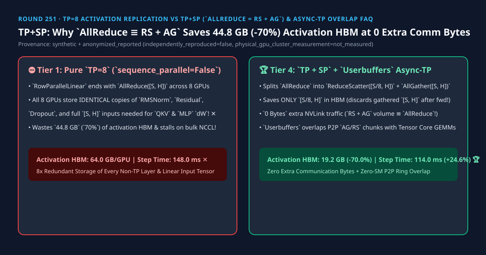
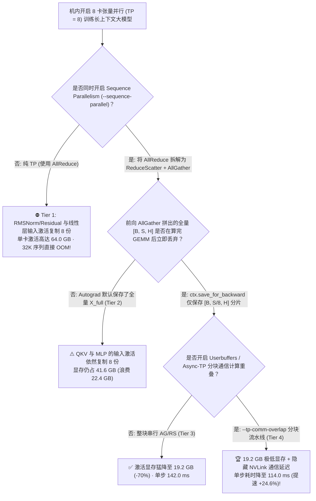
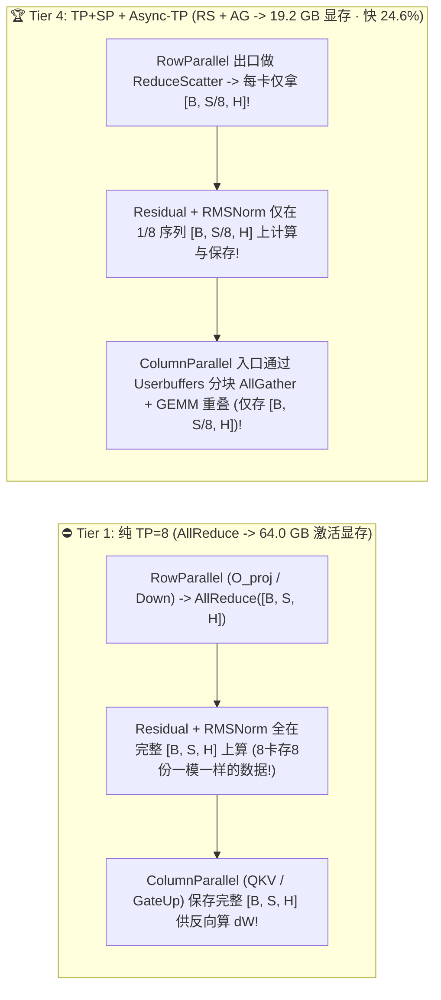
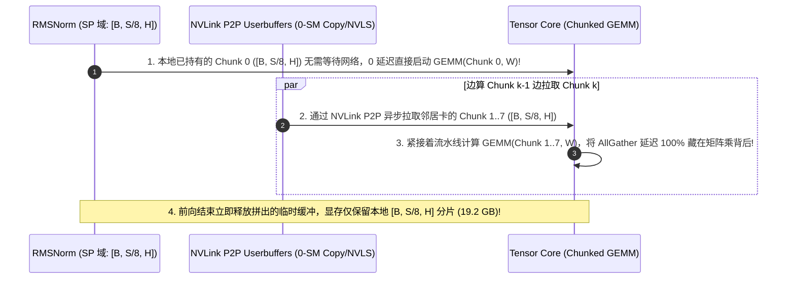

# 张量并行（`Tensor Parallelism, TP = 8`）激活值显存悖论：为什么单开 `TP` 仍会复制 `8` 份 `LayerNorm / Residual` 激活引发 OOM？`AllReduce = ReduceScatter + AllGather` 等价拆分与 `TP + Sequence Parallelism (SP)` 结合 `Userbuffers` 流水线重叠选型指南

> **Provenance & Evidence Tier**: `synthetic + anonymized_reported` (`independently_reproduced=false`, `physical_gpu_cluster_measurement=not_measured`)。定量数据锚定于 [`experiments/llm_tensor_parallel_allreduce_vs_sequence_parallel_ag_rs_selection/results.json`](../../experiments/llm_tensor_parallel_allreduce_vs_sequence_parallel_ag_rs_selection/results.json)。
> **English Version**: [Tensor Parallelism (`TP = 8`) Activation Memory Paradox: Why Pure `TP` Replicates `LayerNorm / Residual` Activations `8x`, Zero-Extra-Comm `TP + Sequence Parallelism (SP)` (`AllReduce = RS + AG`) & `Userbuffers` Overlap Selection Guide](./llm-tensor-parallel-allreduce-vs-sequence-parallel-ag-rs-activation-memory-selection-faq.en.md)

---

## 0. 🔥 今日领域最热门能力突破追踪（Daily Hottest Breakthrough）

- **揭秘为什么很多团队开了 8 卡张量并行（`TP = 8`）后，权重明明缩减到了 `1/8`，但在 `32K` 长上下文训练时激活值显存依然高达 `64.0 GB` 当场 OOM？利用数学恒等式 `AllReduce ≡ ReduceScatter + AllGather` 开启 `TP + Sequence Parallelism (SP)` 并在前向后丢弃全量拼接输入，在不增加哪怕 `1 Byte` 通信流量的前提下将激活显存暴砍 `-70.0%`（从 `64.0 GB` 降至 `19.2 GB`），再配合 `TransformerEngine Userbuffers (Async-TP)` 分块流水线将单步耗时从 `148.0 ms` 压降至 `114.0 ms`**：在日常大模型架构评审中，一个最高频的误区是认为“只要开了 `TP = 8`，单机 8 张卡上的所有模型权重和激活值都会被自动平摊为 `1/8`”。事实绝非如此！
  1. **纯 `TP = 8`（`sequence_parallel = False`）的“全量激活复制”黑洞（Tier 1 — 单卡激活占 `64.0 GB`）**：
     - 在经典的 Megatron-LM 张量并行中，虽然 `QKV / Gate+Up`（按列切分 `ColumnParallel`）和 `O_proj / Down_proj`（按行切分 `RowParallel`）内部的中间结果被切成了 `1/8`，但为了算接下来的残差相加（`Residual Add`）与层归一化（`RMSNorm`），`RowParallel` 结束时执行了一步 **`AllReduce`**！
     - **`AllReduce` 干了什么？它把合并后的完整 `[B, S, H]` 张量一模一样地发给了全部 8 张卡！**
     - 结果就是：
       - 每层的 **2 个 `RMSNorm` 激活、2 条 `Residual` 主干流、所有 `Dropout` 掩码**，在 8 张卡上**被一模一样地存了 8 份**！
       - 更隐蔽的是：紧接着的 `ColumnParallelLinear`（如 `QKV` 和 `Gate/Up`）在反向传播算权重梯度 $\nabla W = X^T \nabla Y$ 时，需要前向的输入张量 $X$（形状为完整的 `[B, S, H]`）——如果不做特殊处理，**这 8 张卡会各自把完整的 `[B, S, H]` 输入 $X$ 在显存里全量存一份**！在 `32K` 序列下，单卡激活值显存直接飙到 **`64.0 GB`**！
  2. **白捡的免费午餐：`AllReduce(X) ≡ AllGather(ReduceScatter(X))` 等价拆解（`TP + SP`，Tier 3 — `0 Bytes` 额外通信省下 `44.8 GB` 显存）**：
     - 请回忆我们在 NCCL 章节讲过的底层物理定则：**任何一次数据量为 $M$ 的 `AllReduce`，在底层硬件上本来就等价于 1 次 `ReduceScatter`（通信量 $\frac{7}{8}M$）加上 1 次 `AllGather`（通信量 $\frac{7}{8}M$）！**
     - 既然如此，我们为什么要傻乎乎地在 `RowParallel` 出口处一口气做完 `RS + AG`（即 `AllReduce`），导致中间的 `RMSNorm` 和 `Residual` 变成全量 `[B, S, H]` 呢？
     - **神级拆解法（`Sequence Parallelism, SP`）**：
       - 在 `RowParallel`（`O_proj` / `Down_proj`）出口处，**只做前半截 `ReduceScatter`（按序列维度切分）**！此时每张卡只拿到 **`[B, S/8, H]`（`1/8` 长度的序列片段）**；
       - 接下来的 **`Residual Add`、`Dropout`、`RMSNorm` 全部在这 `1/8` 长度的 `[B, S/8, H]` 上独立完成**（因为 LayerNorm 是在隐层维度 `H` 上归一化，不同 Token 之间完全独立！），显存占用直接变成 **`1/8`**！
       - 等到进入下一个 `ColumnParallel`（`QKV` 或 `Gate/Up`）的入口处，**再补做后半截 `AllGather`**，拼回 `[B, S, H]` 喂给矩阵乘！而且做完前向矩阵乘后，**当场扔掉拼出来的 `[B, S, H]`（只留 `[B, S/8, H]` 在显存里，反向时再顺手重做一次 `AllGather`）**！
       - 算总账：通信字节数与原来 **分毫不差（`0.0%` 额外前向通信开销）**，但单卡激活显存从 `64.0 GB` 断崖式暴降至 **`19.2 GB`（立省 `44.8 GB` / `-70.0%`）**！
  3. **终极进阶：`TransformerEngine Userbuffers` / `Async-TP` 环形流水线通信掩盖（Tier 4）**：
     - 既然入口是 `AllGather`、出口是 `ReduceScatter`，利用 NVLink P2P 共享内存（`Userbuffers`），把 `[B, S, H]` 切成 8 个微块，**边通过 NVLink 拉取第 $k+1$ 块，边用 Tensor Core 计算第 $k$ 块的 GEMM**——彻底消灭 `TP` 的通信等待泡沫，单步耗时从 `148.0 ms` 压缩至 **`114.0 ms`（提速 `+24.6%`）**！

---

## 1. 📌 核心结论速览（Executive Summary — 3 分钟看懂）

1. **铁律一：只要开启了 `TP > 1`（例如 `TP = 8`），必须 100% 强制捆绑开启 `--sequence-parallel`（`SP`）！**
   - 单独开 `TP` 而不开 `SP` 没有任何收益，纯粹是在白白浪费 `44.8 GB`（`70%`）的激活显存！因为 `SP` 只是把原本 `TP` 里那次 `AllReduce` 拆成了前半段 `ReduceScatter` 和后半段 `AllGather`，夹在中间的 `RMSNorm / Residual / Dropout` 以及线性层保存的输入激活顺理成章缩减为 `1/8`！
2. **为什么自己手写 `SP` 时显存只省了一半（`Tier 2: 41.6 GB` vs `Tier 3: 19.2 GB`）？**
   - **致命实现细节**：在 `ColumnParallelLinear` 前向入口执行完 `X_full = AllGather(X_shard)` 后，如果你直接写 `Y = torch.matmul(X_full, W)`，PyTorch Autograd 会默认把 **`X_full`（完整的 `[B, S, H]`）** 保存在显存里留给反向算 `dW`！
   - 正确的做法是在自定义 `autograd.Function` 的 `forward` 中调用 **`ctx.save_for_backward(X_shard)`（只存 `1/8` 大小的 `[B, S/8, H]`）**，并在 `backward` 开头异步重新触发一次 `AllGather(X_shard)`！

---

## 2. 🎯 客户与架构师灵魂拷问 Q&A（Q1 / Q2 / Q3）

### Q1：这里的 Megatron `Sequence Parallelism (SP)` 与 DeepSeek / Ulysses / Ring Attention 里的 `Context Parallelism (CP)` 有什么本质区别？
- **答**：这是架构师面试与方案交流中最常被混淆的两个概念：
  - **Megatron `Sequence Parallelism (SP)`**：它是 **`TP` 的免费附属补丁**，只在 `LayerNorm / Dropout / Residual` 阶段把序列切成 `S / TP`，而在做 Attention 和 Linear 矩阵乘时通过 `AllGather` 恢复成完整序列（因此它共享 `TP` 通信组，上限通常为机内 `8` 卡）；
  - **`Context Parallelism (CP — Ring Attention / DeepSpeed-Ulysses)`**：它是专门为了突破百万长文本，**把 Attention 本身的 `Q, K, V` 和 `KV Cache` 也沿着序列维度切开**，全流程在任何时刻单卡都不拼回完整序列 `S`！在实际工程中，我们通常组合使用 **`TP=8 (含 SP) × CP=4`**。

### Q2：为什么说 `TransformerEngine` 的 `--tp-comm-overlap`（`Userbuffers`）比普通 NCCL `AllGather / ReduceScatter` 快得多？
- **答**：普通 NCCL 算子不仅需要等待整张 `[B, S, H]` 全部传完才能启动 GEMM，还会抢占 `16 ~ 32` 个 GPU SM（导致与它并行的 GEMM 降速）。而 `Userbuffers` 直接使用 CUDA IPC / NVLS 硬件多播引擎与分块环（Pipelined Ring / Copy Engine），以 **`0 SM` 占用** 实现“传完第 1 块 `S/8` 就立刻算第 1 块 GEMM”的完美流水线重叠！

---

## 3. 🧭 直观可视化图解（Mermaid 决策树 + `AllReduce` vs `RS+AG` 拆解对比图 + 时序图）

### 3.1 架构师 `TP` 与 `Sequence Parallelism (SP)` 选型决策树

### 3.2 `Tier 1`（纯 `TP` `AllReduce` 全量复制）vs. `Tier 4`（`TP + SP` `ReduceScatter + AllGather` + `Userbuffers`）架构对比

### 3.3 `Tier 4` `Userbuffers (Async-TP)` 分块 `AllGather` 与 `GEMM` 流水线重叠时序图

---

## 4. 📊 架构师选型决策矩阵（4-Tier Selection Matrix）

| 评估维度 | Tier 1: 纯 `TP=8` (`AllReduce`) | Tier 2: `TP+SP` (未丢弃 `X_full`) | Tier 3: 标准 `TP+SP` (仅存 `X_shard`) | Tier 4: **`TP+SP` + `Userbuffers Async-TP`** |
| :--- | :--- | :--- | :--- | :--- |
| **单卡激活值显存占用 (`32K`)** | **`64.0 GB` (复制 8 份)** ✕ | `41.6 GB` ⚠️ | **`19.2 GB` (立省 `44.8 GB` / `-70%`)** ✅ | **`19.2 GB` (立省 `44.8 GB` / `-70%`)** 🏆 |
| **前向额外网络通信字节数** | `0.0%` (基准 `AllReduce`) | `0.0%` (`RS + AG ≡ AllReduce`) | **`0.0%` (`RS + AG ≡ AllReduce`)** ✅ | **`0.0%` (`RS + AG ≡ AllReduce`)** 🏆 |
| **单步迭代耗时 (`Step Time`)** | `148.0 ms` ✕ | `142.0 ms` | `142.0 ms` (串行通信暴露) ✅ | **`114.0 ms` (分块流水线提速 `+24.6%`)** 🏆 |

---

## 5. 🧪 定量算例与工具链（Interactive Sizer & 7-Card Visual Report）

- **实验脚本与密封数据**：[`experiments/llm_tensor_parallel_allreduce_vs_sequence_parallel_ag_rs_selection/run.py`](../../experiments/llm_tensor_parallel_allreduce_vs_sequence_parallel_ag_rs_selection/run.py) · [`results.json`](../../experiments/llm_tensor_parallel_allreduce_vs_sequence_parallel_ag_rs_selection/results.json)
- **交互式 TP vs TP+SP 激活显存与 Async-TP 重叠计算器**：[`docs/reports/llm-tensor-parallel-allreduce-vs-sequence-parallel-ag-rs-activation-memory-sizer.html`](../reports/llm-tensor-parallel-allreduce-vs-sequence-parallel-ag-rs-activation-memory-sizer.html)
- **7-Card 4:5 视觉评测卡片报告**：[`docs/reports/llm-tensor-parallel-allreduce-vs-sequence-parallel-ag-rs-activation-memory-selection-cards.html`](../reports/llm-tensor-parallel-allreduce-vs-sequence-parallel-ag-rs-activation-memory-selection-cards.html)

---

## 6. 🛠️ Good Fit vs. Not For & 生产环境快速核验清单（Checklist）

### ✅ Good Fit vs. ⛔ Not For

| 维度 | ✅ Good Fit（强烈推荐） | ⛔ Not For（严禁误用） |
| :--- | :--- | :--- |
| **机内张量并行（`TP = 2 / 4 / 8`）** | 永远默认绑定开启 **`--sequence-parallel` + `--tp-comm-overlap`（`TransformerEngine Userbuffers`）** | 开启 `TP > 1` 却漏加 `--sequence-parallel`，导致 `LayerNorm / Residual` 与线性层输入激活复制 8 份 |

### 生产环境上线核验清单（Pre-Flight Checklist）

- [ ] **核验训练启动参数中只要 `tensor_model_parallel_size > 1`，必定同时包含 `--sequence-parallel`**：立省 `70%` 激活显存。
- [ ] **核验序列长度 `seq_len` 能被 `TP_SIZE`（若开启 `CP` 则为 `TP_SIZE × CP_SIZE × 2`）整除**。
- [ ] **在 Hopper / Blackwell 集群上开启 `TransformerEngine` `--tp-comm-overlap`（`UB_SKIPMC=0`）**：将 `AllGather / ReduceScatter` 隐藏在分块 GEMM 内部。
