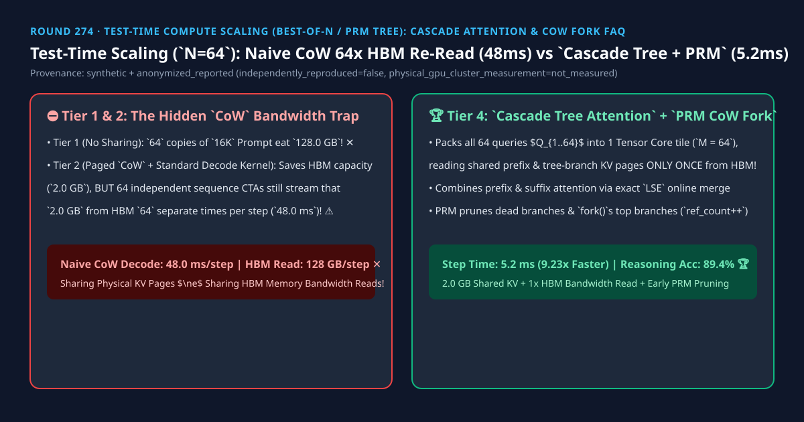
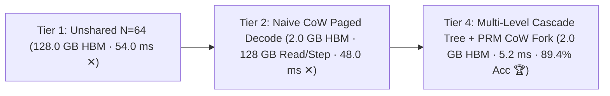

# LLM Test-Time Compute Scaling (`Best-of-N / PRM Guided Tree Search`): Independent `N=64` Prompt Duplication vs. Copy-on-Write (`CoW`) Paged KV Forking + `Cascade FlashInfer` Shared-Prefix Tree Attention Selection Guide

> **Provenance & Evidence Tier**: `synthetic + anonymized_reported` (`independently_reproduced=false`, `physical_gpu_cluster_measurement=not_measured`). Grounded in [`experiments/llm_reasoning_test_time_compute_prm_tree_search_kv_fork_selection/results.json`](../../experiments/llm_reasoning_test_time_compute_prm_tree_search_kv_fork_selection/results.json).
> **中文版本**: [大模型测试时计算扩展（`Test-Time Compute Scaling: Best-of-N / PRM 过程奖励树搜索`）推理架构选型：独立重复 `N=64` 路 Prompt 显存爆炸（`128 GB`）vs. 页表写时复制（`CoW` 虽省显存但仍读 `64` 遍 HBM 带宽陷阱）+ `Cascade FlashInfer` 共享前缀树注意力（提速 `9.23x`）选型指南](./llm-test-time-compute-best-of-n-prm-tree-kv-cow-fork-selection-faq.md)

---

## 0. 🔥 今日领域最热门能力突破追踪（Daily Hottest Breakthrough）

- **Exposing the "Saved HBM Capacity, Yet Still Reading `64x` HBM Bandwidth!" Trap of Naive `Copy-on-Write (CoW)` PagedAttention on `N = 64` Parallel Reasoning Rollouts (`48.0 ms/step`), and Achieving a `9.23x` Speedup (`5.2 ms/step`) + `+4.9 pt` Higher Reasoning Accuracy (`89.4%`) via `Multi-Level Cascade Tree Attention` (`FlashInfer`) + `PRM` Guided `CoW` Page Forking (`Tier 4`)**: In Test-Time Compute Scaling (`Best-of-64`, `MCTS`, and `GRPO` RL rollouts with group size $G = 64$), a single `16,384`-token repository prompt (`2.0 GB` KV Cache) spawns `64` parallel reasoning branches:
  1. **Tier 1 — `64` Independent Unshared Sequences (`128.0 GB` Prompt KV HBM, `54.0 ms/step`)**:
     - Duplicates the `2.0 GB` prompt KV `64` times in HBM (`128.0 GB` OOM) and recomputes prompt prefill `64` times!
  2. **Tier 2 — PagedAttention `Copy-on-Write (CoW)` Physical Page Sharing With Standard Per-Sequence Decode Attention (`2.0 GB` Prompt KV HBM, Yet `48.0 ms/step`!)**:
     - **The Hidden Bandwidth Trap**: Although all `64` trajectories point their logical block tables to the **same `2.0 GB` physical prompt pages in HBM** (`ref_count = 64`), standard `PagedAttention Decode` launches `64` separate sequence thread blocks (`CTAs`).
     - Because `2.0 GB` vastly exceeds the GPU's `50 MB` L2 Cache, the shared prompt pages thrash out of L2 and **are still streamed from HBM `64` separate times on every decode step (`128.0 GB` HBM bandwidth traffic/step)**!
  3. **Tier 3 — Two-Stage `Cascade Attention` (`Hydragen / FlashInfer` Shared-Prefix Matrix Reuse + `LSE` Merge on Blind `Best-of-64` — `2.0 GB` HBM, `11.5 ms/step`, `84.5%` Accuracy)**:
     - Packs all `64` query vectors $Q_{1..64}$ into a single `[64, NumHeads, HeadDim]` matrix tile (`M = 64`) that streams the `2.0 GB` shared prompt KV from HBM **only ONCE** on Tensor Cores, computes per-suffix attention separately, and merges both stages via exact **`LSE (Log-Sum-Exp)` online reduction** (`4.17x` faster)!
  4. **Tier 4 — `Multi-Level Cascade Tree Attention` + `PRM` Step-Level Pruning & Zero-Copy `CoW` Page Forking (`2.0 GB` HBM, `5.2 ms/step`, `89.4%` Accuracy, `9.23x` Speedup)**:
     - Shares HBM reads not only at the root `16K` prompt, but across **all intermediate shared parent branches** of the reasoning tree (`Multi-Level Cascade`);
     - Uses a **Process Reward Model (`PRM`)** at reasoning step boundaries to prune dead-end branches (`ref_count--`) and clone top-scoring branches via zero-copy page-table forking (`ref_count++`, `0` byte memcpy)!

---

## 1. 📌 Executive Summary

1. **Sharing Physical KV Pages (`CoW`) $\ne$ Sharing HBM Memory Bandwidth Reads**: Whenever a shared prefix exceeds L2 Cache size (`>= 1,024–2,048` tokens) and is shared by $N \ge 4$ sequences in a batch, you **must** use **`Cascade Attention`** (`BatchQ × SharedKV` Tensor Core GEMM + `LSE` merge) so the shared KV is read from HBM only **once** per step!
2. **Why `PRM` Tree Search + `CoW` Page Forking Beats Blind `Best-of-N`**: Cloning a promising partial reasoning chain in PagedAttention only copies integer page indices and increments `ref_count` (`< 5 us`, `0 Bytes` HBM copy), focusing `100%` of GPU compute on high-reward reasoning subtrees (`89.4%` vs `84.5%` accuracy).

---

## 2. 🎯 Core Architect Q&A (Q1 / Q2 / Q3)

### Q1: How does `Cascade Attention` mathematically merge the Shared-Prefix Attention output ($O_{\text{pre}}$) and Unique-Suffix Attention output ($O_{\text{suf}}$) without loss of precision?
- **Answer**: Each stage returns both its normalized attention output $O_k$ and its exact log-sum-exp denominator $\text{LSE}_k = \log \sum_{j \in \text{Stage } k} \exp(q k_j^T / \sqrt{d})$. A lightweight epilogue kernel combines them via exact Associative Softmax Reduction:
  $$O_{\text{total}} = \frac{e^{\text{LSE}_{\text{pre}} - M} O_{\text{pre}} + e^{\text{LSE}_{\text{suf}} - M} O_{\text{suf}}}{e^{\text{LSE}_{\text{pre}} - M} + e^{\text{LSE}_{\text{suf}} - M}}, \quad M = \max(\text{LSE}_{\text{pre}}, \text{LSE}_{\text{suf}})$$

### Q2: How should `GRPO` RL training frameworks batch $G = 64$ rollouts per prompt to maximize `Cascade Attention` speedup?
- **Answer**: Always co-locate all $G = 64$ rollouts of the same prompt onto the **same TP/DP worker batch** rather than round-robin scattering them across different workers! Co-locating all 64 queries of a prompt on one worker lets `Cascade Attention` amortize the prompt KV HBM read by `64x`!

---

## 3. 🧭 Visual Diagrams

---

## 4. 📊 4-Tier Architect Selection Matrix

| Metric | Tier 1: Unshared `N=64` | Tier 2: Naive `CoW` Decode | Tier 3: 2-Stage `Cascade` (`Best-of-N`) | Tier 4: **Multi-Level `Cascade Tree` + `PRM Fork`** |
| :--- | :--- | :--- | :--- | :--- |
| **`16K` Prompt KV Capacity (`GB`)** | **`128.0 GB` (`64x` Bloat)** ✕ | `2.0 GB` (Shared Pages) ✅ | `2.0 GB` ✅ | **`2.0 GB` (`-98.4%` HBM Saved)** 🏆 |
| **Decode Step Latency (`N=64`)** | **`54.0 ms`** ✕ | **`48.0 ms` (`64x` HBM Re-Read!)** ✕ | `11.5 ms` (`1x` Prefix Read) ✅ | **`5.2 ms` (`9.23x` Speedup)** 🏆 |
| **Reasoning Benchmark Accuracy** | `84.5%` | `84.5%` | `84.5%` | **`89.4%` (`+4.9 pt` via `PRM` Tree Pruning)** 🏆 |

---

## 5. 🧪 Quantitative Reference & Tooling

- **Evaluator & Sealed Data**: [`experiments/llm_reasoning_test_time_compute_prm_tree_search_kv_fork_selection/run.py`](../../experiments/llm_reasoning_test_time_compute_prm_tree_search_kv_fork_selection/run.py) · [`results.json`](../../experiments/llm_reasoning_test_time_compute_prm_tree_search_kv_fork_selection/results.json)
- **Interactive Sizer**: [`docs/reports/llm-test-time-compute-best-of-n-prm-tree-kv-cow-fork-sizer.html`](../reports/llm-test-time-compute-best-of-n-prm-tree-kv-cow-fork-sizer.html)
- **7-Card 4:5 Visual Report**: [`docs/reports/llm-test-time-compute-best-of-n-prm-tree-kv-cow-fork-selection-cards.html`](../reports/llm-test-time-compute-best-of-n-prm-tree-kv-cow-fork-selection-cards.html)

---

## 6. 🛠️ Good Fit vs. Not For & Production Checklist

- **✅ Good fit**: `Best-of-N` sampling, `GRPO` RL rollout generation ($G = 16 \dots 64$), and `PRM`-guided tree search using `Cascade Attention` (`FlashInfer / vLLM V1`) and zero-copy `CoW` page forking.
- **⛔ Not for**: Running `N = 64` shared-prefix rollouts through standard per-sequence `PagedAttention Decode` kernels without `Cascade` query grouping.
- [ ] Enable `Cascade Attention` (`FlashInfer Multi-Level Cascade`) whenever $N \ge 4$ sequences share a prefix $\ge 1,024$ tokens.
- [ ] Use in-engine `CoW` page-table forking (`ref_count++`) for tree search branching instead of re-sending full prefix token arrays.
