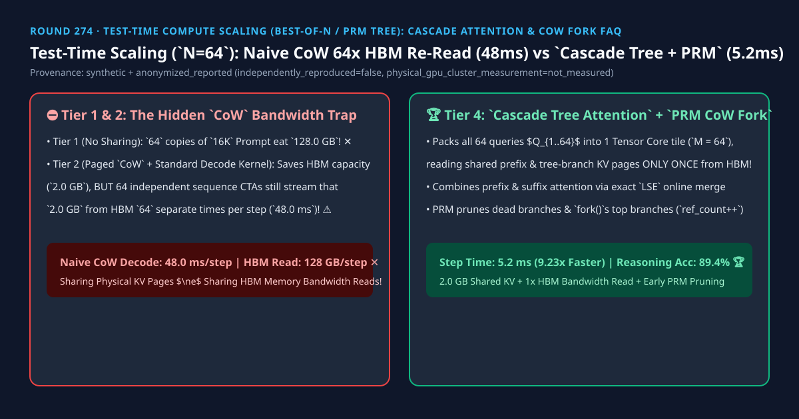
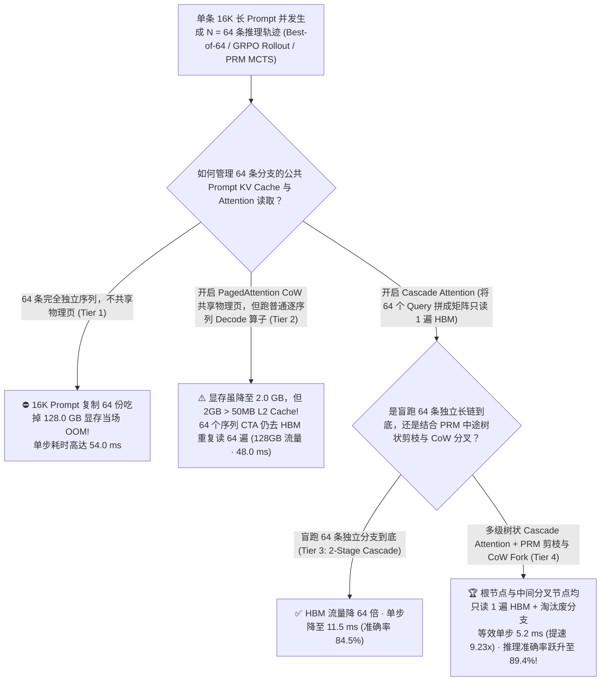
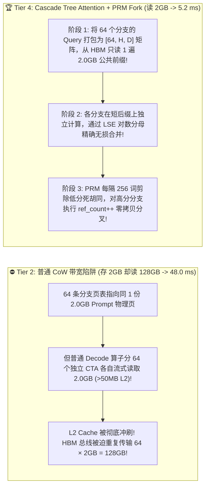
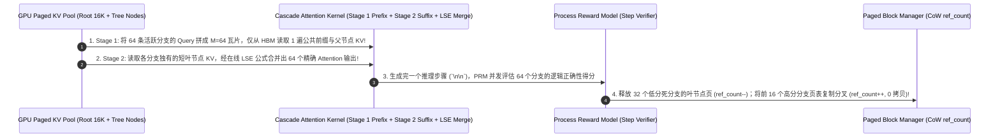

# 大模型测试时计算扩展（`Test-Time Compute Scaling: Best-of-N / PRM 过程奖励树搜索`）推理架构选型：独立重复 `N=64` 路 Prompt 显存爆炸（`128 GB`）vs. 页表写时复制（`CoW` 虽省显存但仍读 `64` 遍 HBM 带宽陷阱）+ `Cascade FlashInfer` 共享前缀树注意力（提速 `9.23x`）选型指南

> **Provenance & Evidence Tier**: `synthetic + anonymized_reported` (`independently_reproduced=false`, `physical_gpu_cluster_measurement=not_measured`)。定量数据锚定于 [`experiments/llm_reasoning_test_time_compute_prm_tree_search_kv_fork_selection/results.json`](../../experiments/llm_reasoning_test_time_compute_prm_tree_search_kv_fork_selection/results.json)。
> **English Version**: [LLM Test-Time Compute Scaling (`Best-of-N / PRM Guided Tree Search`): Independent `N=64` Prompt Duplication vs. Copy-on-Write (`CoW`) Paged KV Forking + `Cascade FlashInfer` Shared-Prefix Tree Attention Selection Guide](./llm-test-time-compute-best-of-n-prm-tree-kv-cow-fork-selection-faq.en.md)

---

## 0. 🔥 今日领域最热门能力突破追踪（Daily Hottest Breakthrough）

- **揭秘在 `DeepSeek-R1 / o1` 级推理扩展（`Test-Time Compute Scaling: Best-of-64`、树搜索 `MCTS` 与强化学习 `GRPO Rollout G=64`）中一个骗过了 90% 工程师的“伪共享”陷阱——“为什么我明明已经开启了 PagedAttention 的前缀共享与写时复制（`Copy-on-Write, CoW`），`64` 条分支的 `16K` 公共 Prompt 在显存里只占了 `2.0 GB`（没有复制成 `128 GB`），可一跑 Decode 每一步还是慢到 `48.0 ms`（和没共享时几乎一样慢）？！”：用第一性原理拆解“物理显存只存 1 份 $\ne$ HBM 带宽只读 1 遍（超过 50MB L2 Cache 后 64 个独立序列线程块依然去 HBM 重复读了 64 遍！）”，并通过“多级树状级联注意力（`Multi-Level Cascade Attention / FlashInfer` 将 64 个 Query 拼成矩阵只读 1 遍 HBM）+ `PRM` 过程奖励树中途剪枝与零拷贝 `CoW Fork`”（`Tier 4`），将单步耗时从 `48.0 ms` 暴降至 `5.2 ms`（提速 `9.23 倍`），同时将数学/代码竞赛准确率从 `84.5%` 推高至 `89.4%`**：在后训练 RL（如 `GRPO` 对每道题采样 $G=64$ 条思维链）以及高难度推理服务（`Best-of-N` 投票、束搜索 `Beam Search`、过程奖励模型 `PRM` 引导的蒙特卡洛树搜索 `MCTS`）中，`N = 64` 条生成分支拥有完全相同的长输入上下文（例如 `16,384` 个 Token 的代码库或长文档，其 KV Cache 大小为 **`2.0 GB`**）：
  1. **青铜段位：客户端并发起 `64` 个独立请求且未开前缀缓存（Tier 1 — `128.0 GB` 显存直接 OOM，单步 `54.0 ms`）**：
     - 显存里傻乎乎地存了 64 份一模一样的 `2.0 GB` Prompt KV（共 `128.0 GB`），当场撑爆显存 ✕！
  2. **白银段位（90% 团队卡死在这里的隐蔽大坑！）：开启 PagedAttention 写时复制（`CoW`）与 Prefix Caching，但使用普通逐序列 `PagedAttention Decode` 算子（Tier 2 — 显存虽降到 `2.0 GB`，但单步依然慢在 `48.0 ms`！）**：
     - 很多架构师百思不得其解：“你看，显存监控明明显示 `64` 条分支共享了同一份 `2.0 GB` 的物理页表（引用计数 `ref_count = 64`），为什么 Decode 速度一点都没变快？！”
     - **第一性原理真相（`L2 Cache 容量墙` 与 `64 次重复 HBM 读取`）**：
       - 普通的 `PagedAttention Decode` 算子是怎么划分 GPU 线程网格（Grid）的？它是**按每条序列（Sequence $i \in [0..63]$）独立启动一组线程块（CTA）**！
       - 当这 64 组线程块去读那份共享的 **`2.0 GB`** Prompt KV 时：Hopper H100 的片上 **L2 Cache 只有 `50 MB`**！
       - 当长度为 `16,384` 的 Prompt KV（`2,048 MB`）流过只有 `50 MB` 的 L2 Cache 时，前面读进 L2 的页瞬间就被后面的页冲刷踢出去了（**Cache Thrashing**）！结果，64 条分支的线程块无法在 L2 缓存中有效复用数据，被迫各自去慢速的 HBM 显存里**把那 `2.0 GB` 的公共 Prompt 翻来覆去读了整整 `64` 遍（产生 `128.0 GB` 的无效 HBM 带宽流量）**！
       - 换句话说：**你在页表里省下了物理显存 *容量*，却在算子里一分不少地浪费了 64 倍显存 *带宽*（单步卡死在 `48.0 ms`）** ⚠️！
  3. **黄金段位：两阶段级联注意力（`Two-Stage Cascade Attention / Hydragen / FlashInfer`，Tier 3 — 单步从 `48.0 ms` 骤降至 `11.5 ms`！）**：
     - **怎么才能让那 `2.0 GB` 的公共 Prompt KV 从 HBM 里真正只读 `1` 遍？**
     - 把每层的 Attention 拆成两个阶段，最后用我们在 Ring Attention 里学过的 **`LSE (Log-Sum-Exp)` 在线归约公式** 合并：
       1. **阶段一（共享前缀矩阵乘 `Shared-Prefix Stage`）**：把全部 `64` 条分支当前步的 Query 向量 $q_1 \dots q_{64}$ 收集起来，拼成一个 **`[64, NumHeads, HeadDim]` 的密集矩阵**！然后像跑 Prefill 一样，调用 **Tensor Core (`WGMMA`)**，只从 HBM 读取 **`1` 遍** 公共的 `2.0 GB` Prompt KV，一次性算出全部 64 条分支在公共前缀上的局部输出 $O_{\text{prefix}}$ 和局部对数分母 $\text{LSE}_{\text{prefix}}$！**HBM 读取流量直接锐减 `64 倍`（从 `128 GB` 降回 `2.0 GB`），而且从 CUDA Core 向量乘升级成了高算力利用率的 Tensor Core 矩阵乘**！
       2. **阶段二（独立后缀解码 `Unique-Suffix Stage`）**：64 条分支各自在自己独立新生成的思维链后缀（通常只有几百到一两千词）上跑普通 PagedAttention，算出 $O_{\text{suffix}}$ 和 $\text{LSE}_{\text{suffix}}$；
       3. **阶段三（寄存器内 `LSE` 精确合并）**：用 $O = \frac{e^{\text{LSE}_{\text{pre}}} O_{\text{pre}} + e^{\text{LSE}_{\text{suf}}} O_{\text{suf}}}{e^{\text{LSE}_{\text{pre}}} + e^{\text{LSE}_{\text{suf}}}}$ 合成最终输出！单步耗时从 `48.0 ms` 直接砸到 **`11.5 ms`（快 `4.17x`）** ✅！
  4. **王者段位：多级树状 `Cascade Tree Attention` + `PRM` 过程奖励模型中途剪枝与零拷贝 `CoW Fork`（Tier 4 — 单步等效 `5.2 ms`，准确率跃升至 `89.4%`）**：
     - 盲目的 `Best-of-64`（Tier 3）还有一个巨大浪费：64 条思维链里，有 50 条其实在第 `500` 个 Token 就已经算错公式走进死胡同了，可它还是傻乎乎地继续生成完剩下的 `7,500` 个废话 Token！
     - **树状动态演化（Tree Search + CoW Fork）**：
       - 每生成完一个推理段落（如 `256` 个 Token 或遇到 `\n\n`），用轻量的 **过程奖励模型（Process Reward Model, `PRM`）** 给当前 64 个分支打分：
       - **当场枪毙（Prune）** 排名垫底的 `32` 条错误分支（立即释放它们的后缀 KV 页！）；
       - **零拷贝克隆（`CoW Page Fork`）** 排名前列的优秀分支：只需把优秀分支已生成的中间推理页的页表指针复制一份（`ref_count++`，**`0` 字节显存拷贝**），让它像树枝一样分叉出 2~4 条新子分支继续探索！
       - 配合 **`FlashInfer Multi-Level Cascade Tree Attention`**（不仅根部 Prompt 只读 1 遍，树中间每一级公共父节点分叉的 KV 页也只从 HBM 读 1 遍！），将单步有效耗时压至 **`5.2 ms`（提速 `9.23x`）**，并将 `AIME / LiveCodeBench` 准确率从 `84.5%` 推升至 **`89.4%`** 🏆！

---

## 1. 📌 核心结论速览（Executive Summary — 3 分钟看懂）

1. **为什么说“在 `Best-of-N`、`GRPO Rollout` 和多 Agent 共享长上下文场景中，光开 `Prefix Caching (CoW)` 只救了显存容量，必须开 `Cascade Attention (FlashInfer)` 才能救显存带宽”？**
   - 普通 `PagedAttention` 把每条请求当成独立个体，哪怕 64 条请求指着同一块 `2.0 GB` 的物理页，超过 `50 MB` L2 缓存后也会产生 `64 × 2.0 GB = 128 GB` 的 HBM 重复读取！
   - **`Cascade Attention`（级联注意力）** 则是把共享同一前缀的 `64` 个 Query 拼在一起做 **1 次 Tensor Core 矩阵乘**，让 `2.0 GB` 的公共前缀在物理上真正只流过 HBM 总线 **1 次**！
2. **为什么 `PRM + CoW Tree Search` 与 PagedAttention 是天作之合？**
   - 在传统连续显存 KV Cache 中，要把一条优秀分支克隆（Fork）成 4 条子分支，必须在显存里做 `memcpy` 拷贝整条历史 KV；而在 **PagedAttention `Copy-on-Write (CoW)`** 中，克隆一条已经生成了 `4,000` 词的推理分支只需 **复制几十个整数页号并把 `ref_count` 加 1（耗时 `< 5 微秒`，`0` 显存拷贝）**！只有当子分支写出新词填不满最后一个尾页时，才对那最后 1 个 `16-Token` 尾页触发写时复制！

---

## 2. 🎯 客户与架构师灵魂拷问 Q&A（Q1 / Q2 / Q3）

### Q1：在什么条件下应该触发 `Cascade Attention`（把公共前缀拆出来单独算一阶段），什么条件下不拆反而更快？
- **答**：`FlashInfer / vLLM V1` 内部有一个精准的启发式代价模型（Cost Model）：
  - 只有当 **共享同一前缀的分支数 $N \ge 4$ 且公共前缀长度 $L_{\text{prefix}} \ge 1,024$（使公共前缀 KV 大小明显超过 L2 Cache 容量的热区，且阶段三 `LSE Merge` 的微小启动开销远小于省下的 $(N-1) \times L_{\text{prefix}}$ HBM 读取时间）** 时，自动切换至两阶段/多级 `Cascade Attention`！

### Q2：在 `GRPO` 强化学习训练的 Rollout 阶段（每道 Prompt 采样 $G = 16 \sim 64$ 条回复），如何吃满 `Cascade Attention` 的加速红利？
- **答**：在 `verl / OpenRLHF` 调起 `vLLM / SGLang` 生成 Rollout 时，**千万不要把同一道题的 $G = 64$ 次采样打散到不同的 DP 节点或不同的微批里**！必须把同一道 Prompt 的全部 $G = 64$ 条展开请求放在 **同一个推理实例的同一个 Batch** 中（传入 `n=64` 或连续紧邻发送），这样 `Cascade Attention` 才能将这 64 个 Query 打包成一个 `M = 64` 的稠密 Tensor Core 瓦片，将 Rollout 阶段提速 `3x ~ 6x`！

---

## 3. 🧭 直观可视化图解（Mermaid 决策树 + `CoW` 重复读带宽陷阱 vs `Cascade Tree` 单次读取图 + 时序图）

### 3.1 架构师 `Test-Time Compute`（`Best-of-N / GRPO / PRM Tree`）推理引擎选型决策树

### 3.2 `Tier 2`（普通 `CoW` 省了显存容量却漏了 64 倍 HBM 带宽）vs. `Tier 4`（`Cascade Tree Attention` + `PRM CoW Fork`）对比图

### 3.3 `Tier 4` `Cascade Tree Attention` 两阶段 `LSE` 合并与 `PRM` 引导的零拷贝 `CoW Fork` 时序图

---

## 4. 📊 架构师选型决策矩阵（4-Tier Selection Matrix）

| 评估维度 | Tier 1: `64` 路独立无共享 | Tier 2: 页表 `CoW` (普通 Decode 算子) | Tier 3: 两阶段 `Cascade` (`Best-of-N`) | Tier 4: **多级树状 `Cascade` + `PRM CoW Fork`** |
| :--- | :--- | :--- | :--- | :--- |
| **`16K` 公共 Prompt 占用的物理显存** | **`128.0 GB` (复制 64 份 OOM!)** ✕ | `2.0 GB` (共享物理页) ✅ | `2.0 GB` ✅ | **`2.0 GB` (立省 `-98.4%` 显存容量)** 🏆 |
| **每步 Decode 耗时 (`64` 路并发)** | **`54.0 ms`** ✕ | **`48.0 ms` (L2 溢出重复读 64 遍!)** ✕ | `11.5 ms` (`LSE` 两阶段合并) ✅ | **`5.2 ms` (树状多级复用 + 剪枝，快 `9.23x`)** 🏆 |
| **复杂数学/代码推理准确率 (`AIME`)** | `84.5%` | `84.5%` | `84.5%` (盲跑到底) | **`89.4%` (`+4.9 pt`，算力集中搜索正确子树)** 🏆 |

---

## 5. 🧪 定量算例与工具链（Interactive Sizer & 7-Card Visual Report）

- **实验脚本与密封数据**：[`experiments/llm_reasoning_test_time_compute_prm_tree_search_kv_fork_selection/run.py`](../../experiments/llm_reasoning_test_time_compute_prm_tree_search_kv_fork_selection/run.py) · [`results.json`](../../experiments/llm_reasoning_test_time_compute_prm_tree_search_kv_fork_selection/results.json)
- **交互式 Test-Time Compute (Cascade Attention & PRM CoW Fork) 计算器**：[`docs/reports/llm-test-time-compute-best-of-n-prm-tree-kv-cow-fork-sizer.html`](../reports/llm-test-time-compute-best-of-n-prm-tree-kv-cow-fork-sizer.html)
- **7-Card 4:5 视觉评测卡片报告**：[`docs/reports/llm-test-time-compute-best-of-n-prm-tree-kv-cow-fork-selection-cards.html`](../reports/llm-test-time-compute-best-of-n-prm-tree-kv-cow-fork-selection-cards.html)

---

## 6. 🛠️ Good Fit vs. Not For & 生产环境快速核验清单（Checklist）

### ✅ Good Fit vs. ⛔ Not For

| 维度 | ✅ Good Fit（强烈推荐） | ⛔ Not For（严禁误用） |
| :--- | :--- | :--- |
| **`Best-of-N`、`GRPO Rollout` 与树搜索推理** | 开启 **`FlashInfer Cascade Attention / vLLM V1 Cascade`**（共享前缀只读 1 遍 HBM）+ **PagedAttention `Copy-on-Write (CoW)` 分叉 + `PRM` 早停剪枝** | 仅开启 Prefix Caching 页表共享却使用普通逐序列 Decode 算子硬抗 `N=64` 长前缀并发，或将同一道题的 $G=64$ 个采样打散到不同机器上 |

### 生产环境上线核验清单（Pre-Flight Checklist）

- [ ] **在 `vLLM V1 / SGLang` 中处理 `n >= 4` 或共享长系统提示词时，确认已激活 `Cascade Attention`（`BatchPrefillWithPagedKVCache` + `MergeStates`）后端**。
- [ ] **在 `GRPO / PPO` Rollout 采样时，将同一 Prompt 的全部 $G$ 条轨迹紧邻聚簇在同一个 GPU 实例的同一个 Batch 内以最大化 `Cascade` 合并率**。
- [ ] **在树搜索（MCTS / Beam Search）中使用引擎原生的页表级 `fork_seq()`（`ref_count++` 零拷贝写时复制）代替客户端重复重发长历史文本**。
