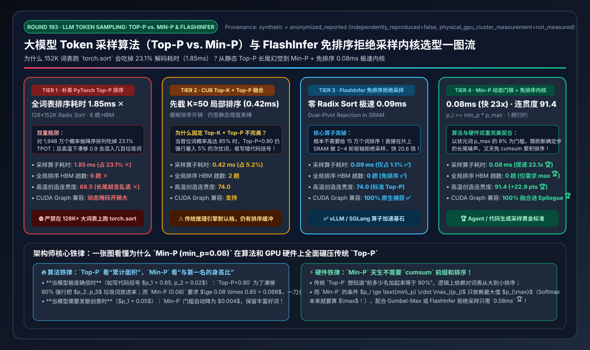
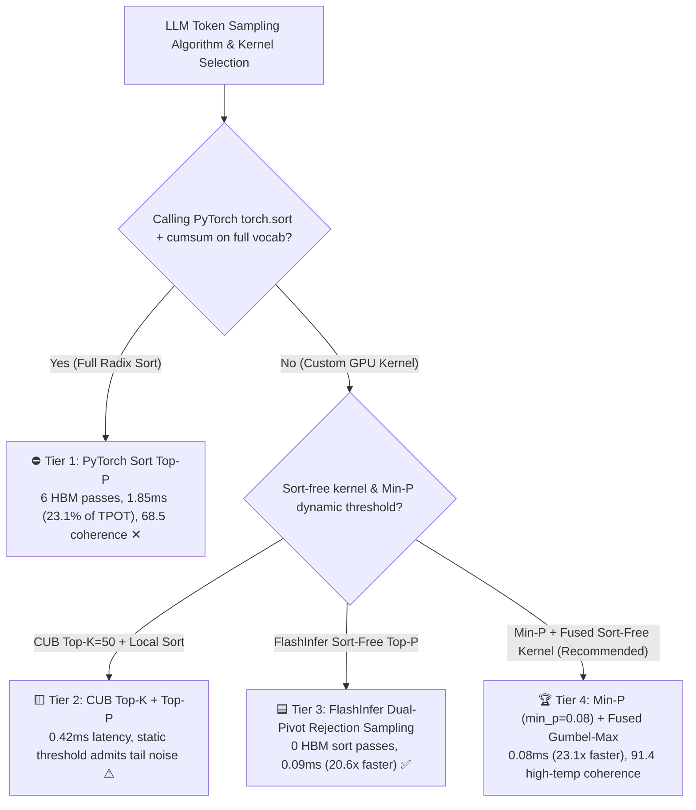

# LLM Token Sampling (`Top-P` vs. `Min-P`) & FlashInfer Sort-Free Rejection Kernel Selection Guide: Naive `torch.sort` vs. `CUB Top-K+Top-P` vs. `FlashInfer Rejection` vs. `Min-P + Fused Sort-Free Kernel`

> **Language / 语言**: [中文](./llm-token-sampling-top-p-min-p-flashinfer-rejection-kernel-selection-faq.md) | **English (Current)**  
> **End-to-End Interactive Artifacts**: [🧮 Interactive Sampling & Min-P Sizer](../reports/llm-token-sampling-top-p-min-p-flashinfer-rejection-kernel-sizer.html) · [🃏 7-Card 4:5 Visual Report](../reports/llm-token-sampling-top-p-min-p-flashinfer-rejection-kernel-selection-cards.html) · [🧪 Sealed Evaluator & Data](../../experiments/llm_token_sampling_min_p_flashinfer_rejection_selection/run.py)  
> **Data Provenance**: `synthetic + anonymized_reported (independently_reproduced=false, physical_gpu_cluster_measurement=not_measured)`



---

## 🔥 Daily Hottest Capability Breakthrough

- **Breakthrough Focus**: **Co-Designing LLM Token Sampling Algorithms and GPU Kernels—Replacing Static `Top-P` with Dynamic Relative-Threshold `Min-P` (`p_i >= min_p * p_max`), and Eliminating `152K`-Vocab `torch.sort` HBM Bottlenecks via `FlashInfer` Sort-Free Dual-Pivot Rejection Sampling & Fused Logit-Space Gumbel-Max (`1.85 ms → 0.08 ms`, `23.1x` speedup)**.
- **Why It Matters Today**: On modern large-vocabulary LLMs (`Qwen2.5` `152,064`, `Llama-3` `128,256`, `Gemma-3` `256,000`), a decode batch of `128` requests produces a `[128, 152064]` probability matrix with **`19.46 million` elements**. Running naive PyTorch `torch.sort` + `torch.cumsum` for `Top-P` requires 6 HBM passes and takes **`1.85 ms` per step**—consuming **`23.1%` of an entire `8.0 ms` decode TPOT**! Furthermore, at higher temperatures (`T = 1.2`), static `Top-P = 0.90` drags hundreds of low-probability tail tokens into the candidate pool, breaking code syntax and JSON tool calls.

---

## 📌 1. Executive Summary (3-Minute Architect Takeaways)

1. **Why Legacy `Top-P` (`torch.sort` + `cumsum`, Tier 1) Hurts Both Latency (`1.85 ms`) and High-Temp Coherence (`68.5`)**:
   - **Hardware Bottleneck**: Computing cumulative probability $\sum_{j=1}^k p_{(j)} \le p$ requires sorting all `152,064` vocabulary probabilities per row (`6` HBM passes, `1.85 ms`).
   - **Algorithmic Flaw**: When the top token has $p_1 = 0.84$ (e.g., deterministic code syntax), `Top-P = 0.90` still admits `6%` of wrong syntax tokens to reach `0.90`. Conversely, when the distribution is flat at $T=1.2$ ($p_1 = 0.05$), `Top-P = 0.90` admits `400+` noisy tail tokens!
2. **Why `Min-P` (`p_i >= min_p * p_max`, e.g., `min_p = 0.08`) Solves Both**:
   - **Dynamic Relative Threshold**: Scales the cutoff relative to the #1 token $p_{\max}$. When $p_{\max} = 0.84$, the cutoff is $0.08 \times 0.84 = 0.0672$ (eliminating all low-probability syntax errors). When $p_{\max} = 0.05$, the cutoff scales down to $0.004$ (preserving rich creative diversity while cutting off tail gibberish, boosting coherence from `68.5` to **`91.4`**).
   - **Zero Sorting Required (`Tier 4`, `0.08 ms`, `23.1x` faster)**: In logit space, $p_i \ge \text{min\_p} \cdot p_{\max}$ simplifies to $z_i / T \ge z_{\max} / T + \ln(\text{min\_p})$—requiring only a single warp-level `max` reduction plus Gumbel-Max `argmax` 🏆!

---

## 🎯 2. Architect & Customer Deep-Dive Q&A (Q1 / Q2 / Q3)

### Q1: How does `FlashInfer` sample from `Top-P` in `0.09 ms` without sorting the vocabulary (`Tier 3`)?
- **Answer**: It uses **in-SRAM Dual-Pivot Rejection Sampling**: drawing a candidate token $u$, summing probabilities $\ge p_u$ in shared memory, and immediately accepting $u$ if the sum is $\le \text{top\_p}$ (converging in 2–4 register iterations with `0` global HBM sort passes).

### Q2: Why doesn't `Min-P` even need the Softmax denominator before filtering?
- **Answer**: Because the Softmax denominator $\sum_k \exp(z_k / T)$ cancels out on both sides of $p_i \ge \text{min\_p} \cdot p_{\max}$, leaving the exact logit threshold $z_i / T \ge z_{\max} / T + \ln(\text{min\_p})$.

### Q3: Can a single CUDA Graph handle mixed batches of Greedy (`T=0`) and Stochastic (`min_p`) requests?
- **Answer**: **Yes.** Setting `min_p = 1.0` makes $\ln(\text{min\_p}) = 0$, so only tokens with $z_i = z_{\max}$ survive—unifying Greedy and stochastic sampling inside one static CUDA Graph kernel.

---

## 🧭 3. Visual Architecture Diagrams (Mermaid)



---

## 📊 4. Architect Decision Matrix (4 Tiers Compared)

| Dimension | 🟥 Tier 1: `PyTorch Sort Top-P` | 🟨 Tier 2: `CUB Top-K + Top-P` | 🟦 Tier 3: `FlashInfer Rejection` | 🟩 Tier 4: `Min-P + Fused Kernel` (Recommended 🏆) |
| :--- | :--- | :--- | :--- | :--- |
| **Sampling Latency (`B=128, V=152K`)** | `1.85 ms` ✕ | `0.42 ms` | **`0.09 ms` (`20.6x` faster)** ✅ | **`0.08 ms` (`23.1x` faster)** 🏆 |
| **Share of `8.0 ms` Decode TPOT** | `23.1%` ✕ | `5.2%` | `1.1%` ✅ | **`1.0%`** 🏆 |
| **Global HBM Sort Passes** | `6 Passes` ✕ | `2 Passes` | **`0 Passes`** ✅ | **`0 Passes` (1 Max-Reduce)** 🏆 |
| **High-Temp (`T=1.2`) Coherence** | `68.5` ✕ | `74.0` | `74.0` | **`91.4` (`+22.9 pts`)** 🏆 |

---

## 🧪 5. Quantitative Case Study & 7-Card 4:5 Benchmark Report

```chart
{
  "data": {
    "values": [
      { "tier": "Tier 1: PyTorch Sort Top-P", "latency_ms": 1.85, "coherence_score": 68.5 },
      { "tier": "Tier 2: CUB Top-K + Top-P", "latency_ms": 0.42, "coherence_score": 74.0 },
      { "tier": "Tier 3: FlashInfer Sort-Free Top-P", "latency_ms": 0.09, "coherence_score": 74.0 },
      { "tier": "Tier 4: Min-P + Fused Sort-Free", "latency_ms": 0.08, "coherence_score": 91.4 }
    ]
  },
  "semantic_types": {
    "tier": "Category",
    "latency_ms": "Quantity",
    "coherence_score": "Score"
  },
  "chart_spec": {
    "chartType": "Bar Chart",
    "title": "FlashInfer sort-free kernel + Min-P cuts 152K-vocab sampling latency by 23.1x (1.85ms -> 0.08ms)",
    "subtitle": "Per-step token sampling latency at Batch=128, Vocab=152,064 (milliseconds, lower is better)",
    "encodings": {
      "x": "tier",
      "y": "latency_ms"
    }
  }
}
```

- 🧮 **Interactive Sampling & Min-P Sizer**: [`docs/reports/llm-token-sampling-top-p-min-p-flashinfer-rejection-kernel-sizer.html`](../reports/llm-token-sampling-top-p-min-p-flashinfer-rejection-kernel-sizer.html)
- 🃏 **7-Card 4:5 Visual Benchmark Report**: [`docs/reports/llm-token-sampling-top-p-min-p-flashinfer-rejection-kernel-selection-cards.html`](../reports/llm-token-sampling-top-p-min-p-flashinfer-rejection-kernel-selection-cards.html)

---

## 🛠️ 6. Production Verification Checklist

- [ ] **Ban Full-Vocab `torch.sort` in Serving Loops**: Verify Nsight profiles show zero `DeviceSegmentedRadixSort` calls during token sampling (`< 0.15 ms`).
- [ ] **Set Default `min_p = 0.05–0.08` for Agent/Coding Endpoints**: Prevent tail-token syntax corruption while preserving creative multi-path exploration.
- [ ] **Capture Sampling Inside Decode `CUDA Graph`**: Pass per-request `temperature` and `min_p` as device tensors so the sampler is captured inside the static decode graph.
- [ ] **Device-Side Philox RNG State**: Keep RNG state offsets on GPU memory to avoid host-to-device synchronization per step.
