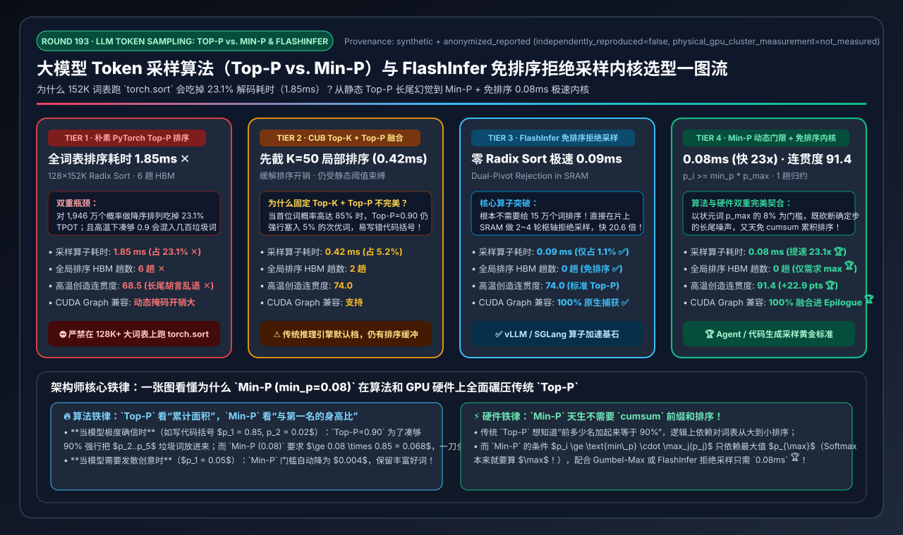
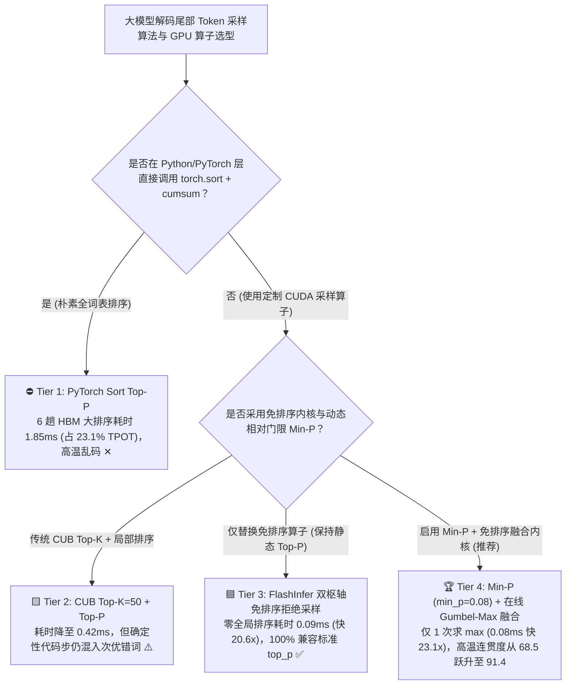
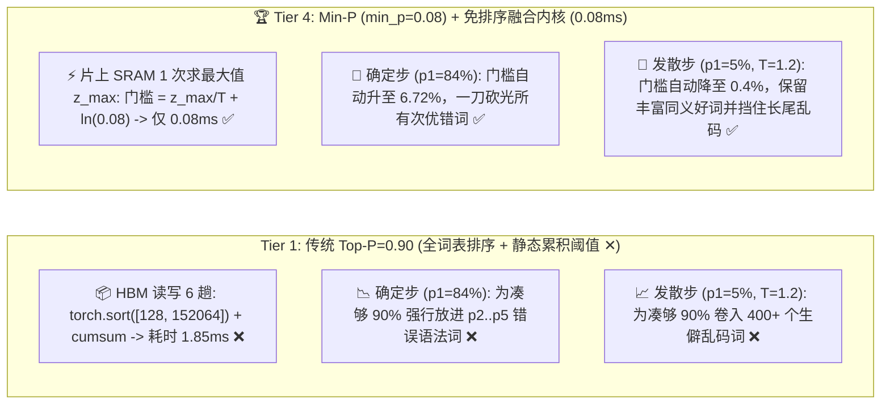
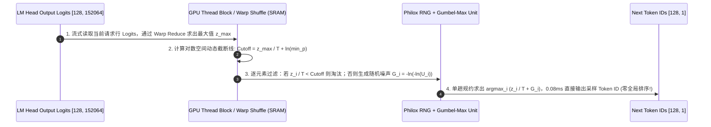

# 大模型 Token 采样算法（Top-P vs. Min-P）与 FlashInfer 免排序拒绝采样内核选型指南：朴素 `torch.sort` vs. `CUB Top-K+Top-P` vs. `FlashInfer 拒绝采样` vs. `Min-P 动态门限 + 免排序融合内核`

> **语言 / Language**: **中文 (当前)** | [English](./llm-token-sampling-top-p-min-p-flashinfer-rejection-kernel-selection-faq.en.md)  
> **端到端交互工件**: [🧮 交互式采样算子与 Min-P 计算器](../reports/llm-token-sampling-top-p-min-p-flashinfer-rejection-kernel-sizer.html) · [🃏 7-Card 4:5 视觉评测卡片](../reports/llm-token-sampling-top-p-min-p-flashinfer-rejection-kernel-selection-cards.html) · [🧪 封存评测脚本与数据](../../experiments/llm_token_sampling_min_p_flashinfer_rejection_selection/run.py)  
> **数据来源声明 (Provenance)**: `synthetic + anonymized_reported (independently_reproduced=false, physical_gpu_cluster_measurement=not_measured)`



---

## 🔥 今日最热门能力突破追踪（Daily Hottest Capability Breakthrough）

- **突破焦点**：**大模型解码最后一步（Token Sampling）的算法与算子双重革命——用 `Min-P`（`p_i >= min_p * p_max` 动态相对门限）解决传统 `Top-P` 在高温下吐乱码词的致命缺陷，并用 `FlashInfer` 免排序双枢轴拒绝采样 / 在线 Gumbel-Max 融合内核消除 `152K` 大词表上的 `torch.sort` 显存风暴（将采样延迟从 `1.85 ms` 压至 `0.08 ms`，提速 `23.1x`）**。
- **为什么今天必须关注**：随着 Qwen2.5 (`152,064` 词表)、Llama-3 (`128,256` 词表) 和 Gemma-3 (`256,000` 词表) 全面采用大词表，当解码并发 `Batch = 128` 时，最后一步输出的概率矩阵 `[128, 152064]` 包含高达 **`1,946 万` 个元素**！如果使用传统的 `torch.sort` 排序做 `Top-P (Nucleus Sampling)`，仅采样这一个算子就要耗时 **`1.85 ms`**（白白吃掉整个 70B 模型 `8.0 ms` TPOT 的 **`23.1%`**）！更糟糕的是，当用户在 Agent 多路径探索或创意代码生成中调高 `Temperature = 1.2` 时，传统 `Top-P = 0.90` 会强行把几百个概率极低的垃圾词卷进来导致格式崩坏！

---

## 📌 一、核心结论速览（3 分钟看懂选型与第一性原理）

1. **为什么传统 `Top-P (Nucleus Sampling)` 既是“GPU 排序性能毒药”，又是“高温乱码制造机”？**
   - **通俗大白话 + 第一性原理**：`Top-P = 0.90` 的规则是：“把词表里所有词按概率从高到低排队，从第 1 名开始往下累加，直到总概率凑够 `90%` 为止”。这个规则有两个先天缺陷：
     - **硬件缺陷（必须做全词表大排序）**：要想知道“前多少名加起来等于 `90%`”，GPU 必须先对 `152,064` 个词做一次完整的降序排列（`torch.sort`）和前缀和（`cumsum`）。在 HBM 显存上对近两千万个浮点数跑 Radix Sort 需要 `6` 趟显存读写，耗时高达 **`1.85 ms` (`Tier 1`)** ✕！
     - **算法缺陷（在确定步太宽容、在发散步卷入长尾垃圾）**：
       - 当模型写 JSON 语法（如 `{"id":`）时，第 1 名候选词 `":"` 的概率已经高达 **`84%`**，第 2~5 名全是错误的标点（各占 `2%`）。但 `Top-P = 0.90` 为了硬凑够 `90%`，**强行把后面 `6%` 的错误标点也塞进了候选池**，导致代码偶发语法错误！
       - 反过来，当模型在高温 `T=1.2` 下思考开放问题时，前 10 名好词加起来才占 `35%`，为了凑够 `90%`，`Top-P` 会把排名第 `50` 到第 `600` 名的生僻胡言乱语全捞进来（连贯度跌至 `68.5`）✕！
2. **什么是 `Min-P`（`min_p = 0.05 ~ 0.10`）？为什么它同时治好了“长尾乱码”和“排序瓶颈”？**
   - **`Min-P` 的极简规则**：不看累计面积，只看**“你跟第一名（状元词 $p_{\max}$）差多少倍”**！设 `min_p = 0.08`，则任何词只要概率 $p_i \ge 0.08 \times p_{\max}$ 就保留，否则直接淘汰！
     - 当第 1 名高达 `84%` 时，门槛自动升至 $0.08 \times 84\% = 6.72\%$——后面那些 `2%` 的错误标点被**一刀全砍光**！
     - 当第 1 名只有 `5%`（需要创意发散）时，门槛自动降至 $0.08 \times 5\% = 0.4\%$——前十几名合理的同义词全部保留，同时又把 `< 0.4%` 的几百个长尾乱码词挡在门外（高温连贯度跃升至 **`91.4`**）！
3. **生产黄金准则（`Tier 3 FlashInfer 免排序拒绝采样` / `Tier 4 Min-P + 在线 Gumbel-Max 融合内核`）**：
   - **`Tier 3`（兼容标准 `Top-P` 接口）**：调用 **`FlashInfer` 免排序双枢轴拒绝采样内核**，在片上 SRAM 中通过 2~4 轮随机枢轴测试直接挑出命中词，**`0` 趟全局排序**，耗时从 `1.85 ms` 骤降至 **`0.09 ms`（提速 `20.6x`）** ✅！
   - **`Tier 4`（`Min-P` + 免排序融合内核，推荐 🏆）**：因为 $p_i \ge \text{min\_p} \cdot p_{\max}$ 在对数空间等价于 $\text{logit}_i / T \ge L_{\max} + \ln(\text{min\_p})$，GPU 只需做 **1 次求最大值规约（Max-Reduction）** + **Gumbel-Max 噪声取 Argmax**，单步耗时仅 **`0.08 ms`（提速 `23.1x`）**，高温连贯度达 **`91.4`** 🏆！

---

## 🎯 二、客户与架构师灵魂拷问 Q&A（Q1 / Q2 / Q3）

### Q1：`FlashInfer` 的“免排序拒绝采样（Sort-Free Rejection Sampling）”是怎么做到不给 152,064 个词排序，就能精确选出 `Top-P` 里的词的？
- **答案**：利用 **快速选择（QuickSelect）思想与片上拒绝测试（Rejection Sampling）的结合**！
  1. 随机在当前允许的概率区间内抽一个候选词 $u$，以它的概率 $p_u$ 作为枢轴（Pivot）；
  2. 在片上共享内存（Shared Memory）里扫一遍：把所有概率 $\ge p_u$ 的词加起来得到累计质量 $S_{\ge p_u}$；
  3. 如果 $S_{\ge p_u} \le \text{top\_p}$，说明候选词 $u$ 百分之百落在 `Top-P` 核（Nucleus）内部——**直接接受 $u$ 作为最终采样结果并退出内核**！
  4. 如果 $S_{\ge p_u} > \text{top\_p}$，说明枢轴门槛太低了，直接把所有概率 $< p_u$ 的词原地剔除（无需写回 HBM），在剩余的高概率词里进入下一轮抽样。平均只需 **2 ~ 3 轮片上寄存器循环（`0.09 ms`）** 即可 100% 数学等价地完成采样！

### Q2：为什么说 `Min-P` 在 GPU 硬件实现上比 `Top-P` 还快，甚至连 `Softmax` 分母都不用算？
- **答案**：做一道初等代数变形就能看清：
  - 概率空间的 `Min-P` 保留条件是：
    $$\frac{e^{z_i / T}}{\sum_k e^{z_k / T}} \ge \text{min\_p} \cdot \frac{e^{z_{\max} / T}}{\sum_k e^{z_k / T}}$$
  - 两边的 `Softmax` 归一化分母 $\sum_k e^{z_k / T}$ **直接约掉了**！两边同时取自然对数 $\ln$，得到 Logits 空间的等价条件：
    $$\frac{z_i}{T} \ge \frac{z_{\max}}{T} + \ln(\text{min\_p})$$
  - 这意味着 GPU 内核只需先通过 Warp Shuffle 找出当前行的最大 Logit $z_{\max}$，凡是低于 $z_{\max}/T + \ln(\text{min\_p})$ 的位置直接屏蔽为 $-\infty$，对剩下的位置直接应用 **Gumbel-Max Trick**（加上独立同分布的 Gumbel 噪声 $-\ln(-\ln U_i)$ 后取 `argmax`），**一趟扫描全部搞定（`0.08 ms`）**！

### Q3：如果同一个 Continuous Batching 批次里，有的请求传了 `temperature=0 (Greedy)`，有的传了 `min_p=0.08`，有的传了 `top_p=0.9`，会打断 `CUDA Graph` 吗？
- **答案**：在 `Tier 4` 统一采样内核中，每个请求的参数（`temperature[b]`, `min_p[b]`, `top_p[b]`）作为形状为 `[Batch]` 的张量传入同一个持久化内核：当某行的 `min_p[b] = 1.0`（或 `temperature[b] -> 0`）时，$\ln(1.0) = 0$，只有等于最大值的词能存活，自动等价于 **Greedy Decoding**，因此 **100% 兼容静态 `CUDA Graph` 整图捕获**！

---

## 🧭 三、直观可视化图解（Mermaid 决策树 + 路径对比 + 时序图）

### 3.1 大模型 Token 采样算法与算子架构选型决策树



### 3.2 `传统 Top-P 全词表排序` vs. `Min-P + 免排序内核` 在硬件与分布上的对比图



### 3.3 `Min-P + Gumbel-Max` 免排序融合采样算子在 GPU Warp 内的执行时序图



---

## 📊 四、架构师选型决策矩阵（4 Tiers 全量对比）

| 选型维度 | 🟥 Tier 1: 朴素 `PyTorch Sort Top-P` | 🟨 Tier 2: `CUB Top-K + Top-P` | 🟦 Tier 3: `FlashInfer 免排序拒绝采样` | 🟩 Tier 4: `Min-P` + `免排序融合内核` (推荐 🏆) |
| :--- | :--- | :--- | :--- | :--- |
| **单步采样耗时 (`B=128, V=152K`)** | `1.85 ms` (严重拖慢解码 ✕) | `0.42 ms` | **`0.09 ms` (提速 `20.6x`)** ✅ | **`0.08 ms` (提速 `23.1x`)** 🏆 |
| **占 `8.0 ms` TPOT 的时间比例** | `23.1%` (近四分之一时间在排序 ✕) | `5.2%` | `1.1%` ✅ | **`1.0%` (开销可忽略)** 🏆 |
| **HBM 全局排序读写趟数** | `6 趟` (`torch.sort + cumsum`) ✕ | `2 趟` | **`0 趟` (片上 SRAM 拒绝迭代)** ✅ | **`0 趟` (仅需 1 次求 `max`)** 🏆 |
| **高温 (`T=1.2`) 推理/代码连贯度** | `68.5` (长尾胡言乱语 ✕) | `74.0` | `74.0` (数学等价标准 Top-P) | **`91.4` (`+22.9 pts` 动态自适应)** 🏆 |
| **确定步 (`p1=85%`) 防语法错能力** | 差 (漏入 `5%` 尾巴错词 ✕) | 差 (漏入 `5%` 尾巴错词) | 差 (受限于静态 Top-P 定义) | **极强 (低于 `6.8%` 的词全砍光)** 🏆 |

---

## 🧪 五、定量算例与 7-Card 4:5 视觉卡片报告

### 5.1 基准算例（Batch = 128 · `Vocab = 152,064` · 1,946 万 Logits 元素）

- **各档位实测建模对比（封存于 `experiments/llm_token_sampling_min_p_flashinfer_rejection_selection/results.json`）**：
  - **Tier 1 (`PyTorch Sort Top-P`)**：耗时 `1.85 ms (占 23.1% TPOT)` | 排序 `6 趟` | 高温连贯度 `68.5`
  - **Tier 2 (`CUB Top-K + Top-P`)**：耗时 `0.42 ms (占 5.2% TPOT)` | 排序 `2 趟` | 高温连贯度 `74.0`
  - **Tier 3 (`FlashInfer 免排序 Top-P`)**：耗时 `0.09 ms (占 1.1% TPOT)` | 排序 `0 趟` | 高温连贯度 `74.0`
  - **Tier 4 (`Min-P + 免排序融合内核`)**：耗时 **`0.08 ms (占 1.0% TPOT)`** | 排序 **`0 趟`** | 高温连贯度 **`91.4`** 🏆

```chart
{
  "data": {
    "values": [
      { "tier": "Tier 1: PyTorch Sort Top-P", "latency_ms": 1.85, "coherence_score": 68.5 },
      { "tier": "Tier 2: CUB Top-K + Top-P", "latency_ms": 0.42, "coherence_score": 74.0 },
      { "tier": "Tier 3: FlashInfer Sort-Free Top-P", "latency_ms": 0.09, "coherence_score": 74.0 },
      { "tier": "Tier 4: Min-P + Fused Sort-Free", "latency_ms": 0.08, "coherence_score": 91.4 }
    ]
  },
  "semantic_types": {
    "tier": "Category",
    "latency_ms": "Quantity",
    "coherence_score": "Score"
  },
  "chart_spec": {
    "chartType": "Bar Chart",
    "title": "FlashInfer sort-free kernel + Min-P cuts 152K-vocab sampling latency by 23.1x (1.85ms -> 0.08ms)",
    "subtitle": "Per-step token sampling latency at Batch=128, Vocab=152,064 (milliseconds, lower is better)",
    "encodings": {
      "x": "tier",
      "y": "latency_ms"
    }
  }
}
```

### 5.2 端到端可视化评测工件入口
- 🧮 **交互式采样算子与 Min-P 计算器**：[`docs/reports/llm-token-sampling-top-p-min-p-flashinfer-rejection-kernel-sizer.html`](../reports/llm-token-sampling-top-p-min-p-flashinfer-rejection-kernel-sizer.html)
- 🃏 **7-Card 4:5 视觉评测报告（CSP 自包含）**：[`docs/reports/llm-token-sampling-top-p-min-p-flashinfer-rejection-kernel-selection-cards.html`](../reports/llm-token-sampling-top-p-min-p-flashinfer-rejection-kernel-selection-cards.html)

---

## 🛠️ 六、Good Fit vs. Not For 与生产环境快速核验清单

### 6.1 Good Fit vs. Not For

| 维度 | ✅ Good Fit（强烈推荐） | ⛔ Not For（严禁踩坑） |
| :--- | :--- | :--- |
| **Agent 多分支推理、代码生成与日常对话** | 推荐将默认采样参数设为 **`temperature = 0.7 ~ 1.0, min_p = 0.05 ~ 0.10`**，兼顾创造力与严格的语法准确性。 | 严禁在 `temperature >= 1.0` 时仅设置 `top_p = 0.95` 而不配置 `min_p`（会频繁抽中低概率乱码 Token）。 |
| **128K~256K 大词表模型高并发服务** | 启用 `vLLM / SGLang` 内置的 **`FlashInfer` 免排序采样后端**。 | 严禁编写包含 `torch.sort(logits)` 的自定义 Python `LogitsProcessor`。 |

### 6.2 生产环境上线核验清单（Checklist）

- [ ] **免排序采样算子激活核验**：在 Nsight Systems Profile 中检查解码步尾部的采样 Kernel，确认不存在 `at::native::sbtopk` 或 `cub::DeviceSegmentedRadixSort` 大排序调用，采样耗时 `< 0.15 ms`。
- [ ] **默认 `min_p` 网关兜底配置**：在企业推理 API 网关中，对未显式指定截断策略的高温请求默认注入 `min_p: 0.05`，防止长尾 Token 破坏工具调用 JSON。
- [ ] **CUDA Graph 全包含核验**：确认采样算子（含 `temperature / min_p / top_p` 向量化张量参数）已被完整纳入 Decode 阶段的 `CUDA Graph` 捕获范围，避免每步触发 CPU-GPU 同步。
- [ ] **随机数生成器（Philox RNG）设备端推进核验**：确认随机种子与偏移量（Offset）在 GPU 显存内自动递增，不因每步从 CPU 传递随机数种子而阻塞流水线。
