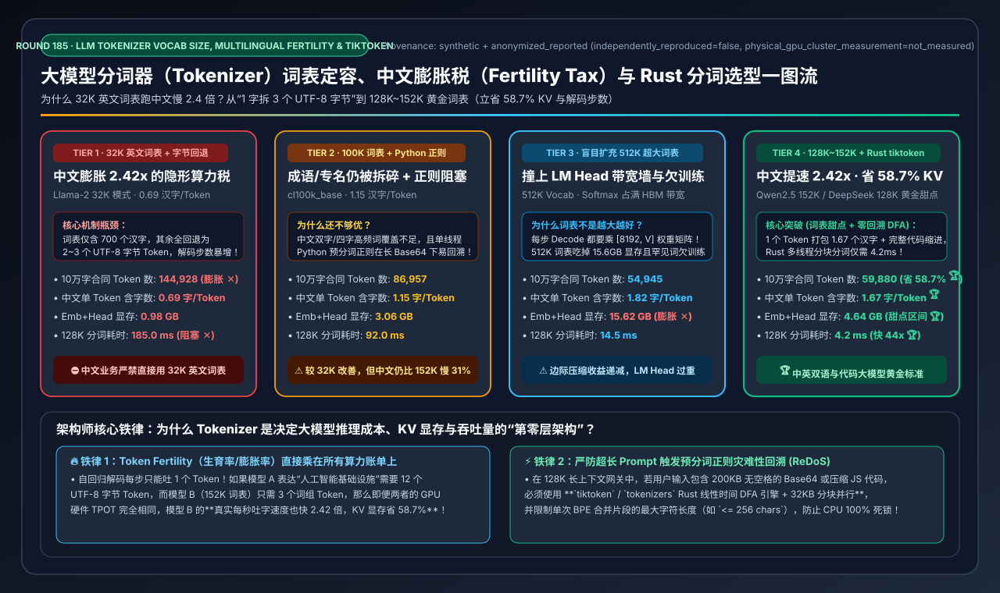
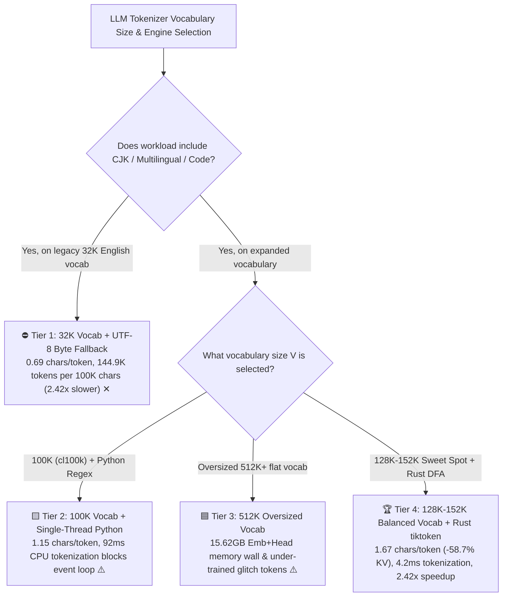

# LLM Tokenizer Vocabulary Sizing, Multilingual Fertility Tax & Rust Pre-Tokenization Selection Guide: `32K` Byte-Fallback vs. `100K` Python Regex vs. `512K` Oversized Vocab vs. `128K–152K` Sweet-Spot + `tiktoken`

> **Language / 语言**: [中文](./llm-tokenizer-bpe-vocab-size-multilingual-fertility-tiktoken-selection-faq.md) | **English (Current)**  
> **End-to-End Interactive Artifacts**: [🧮 Interactive Vocab & Fertility Sizer](../reports/llm-tokenizer-bpe-vocab-size-multilingual-fertility-tiktoken-sizer.html) · [🃏 7-Card 4:5 Visual Report](../reports/llm-tokenizer-bpe-vocab-size-multilingual-fertility-tiktoken-selection-cards.html) · [🧪 Sealed Evaluator & Data](../../experiments/llm_tokenizer_bpe_vocab_multilingual_fertility_selection/run.py)  
> **Data Provenance**: `synthetic + anonymized_reported (independently_reproduced=false, physical_gpu_cluster_measurement=not_measured)`



---

## 🔥 Daily Hottest Capability Breakthrough

- **Breakthrough Focus**: **Quantitative Auditing of LLM Tokenizer "Fertility Tax" (`Tokens-per-Character`), the `128K–152K` Multilingual & Code Vocabulary Sweet Spot (Qwen2.5 `151,936` / DeepSeek-V3 `128,000`), and Rust `tiktoken` Non-Backtracking DFA Parallel Pre-Tokenization**.
- **Why It Matters Today**: Enterprise teams often benchmark LLM serving engines purely by `Tokens/sec` while overlooking **"Layer 0" of LLM infrastructure—the Tokenizer**. An early `32K` English-centric vocabulary splits a single Chinese character into `2–3` UTF-8 byte tokens (`0.69 chars/token`), inflating a 100,000-character Chinese contract into **`144,928` tokens** (exceeding a 128K context window!). By contrast, a well-balanced **`128K–152K` vocabulary** encodes multi-character words and code indentation into **`59,880` tokens (`1.67 chars/token`)**—slashing KV Cache memory and decode steps by **`58.7%`** and accelerating real character generation speed by **`2.42x`**!

---

## 📌 1. Executive Summary (3-Minute Architect Takeaways)

1. **What Is the "Token Fertility Tax" and Why Do `32K` Vocabularies Run `2.42x` Slower on CJK Workloads?**
   - Autoregressive decoding emits strictly **`1` token per forward pass** through all 80 Transformer layers. Because a `32,000`-token English-centric BPE vocabulary includes only ~700 Chinese characters, every other character triggers **UTF-8 Byte Fallback**—splitting a 3-byte Chinese character (`0xE6, 0x99, 0xBA`) into **`2 to 3` separate byte tokens**. The GPU must execute 3 full decode steps and allocate 3 KV Cache slots just to emit a single character!
2. **Why Not Expand the Vocabulary to `512K` or `1M`? (The `LM Head` Bandwidth Wall)**:
   - Every decode step multiplies the hidden state $h \in \mathbb{R}^{d_{\text{model}}}$ by the `LM Head` matrix $[d_{\text{model}}, V]$ and computes `Softmax(V)`.
   - Expanding from `32K` to the **`128K–152K` sweet spot** improves CJK/code compression by **`2.42x`** while keeping `Embedding + Untied LM Head` FP16 weights at a modest **`4.64 GB`** (`d_model=8192`).
   - Expanding further to **`512K` (`Tier 3`)** yields diminishing compression returns (`1.82 chars/token`) while bloating `Embedding + LM Head` to **`15.62 GB`**, creating a memory-bandwidth bottleneck during every decode step and leaving rare tail tokens under-trained ("glitch tokens").
3. **Production Gold Standard (`Tier 4`: `128K–152K` Balanced Vocabulary + Rust `tiktoken` DFA Chunked Pre-Tokenization)**:
   - Compresses a 100K-character Chinese document to **`59,880 tokens` (`-58.7%` KV memory)**, achieves **`2.42x`** real character generation speedup, and cuts 128K CPU pre-tokenization latency from `185.0 ms` to **`4.2 ms` (`44x` faster)** 🏆!

---

## 🎯 2. Architect & Customer Deep-Dive Q&A (Q1 / Q2 / Q3)

### Q1: Why is comparing `Tokens / sec` across different model families misleading?
- **Answer**: Because end users read **characters/words per second**, not raw BPE tokens. A model running at `45 Tokens/s` with `1.67 chars/token` delivers **`75.2 chars/s`**, whereas a model running at `50 Tokens/s` with `0.69 chars/token` delivers only **`34.5 chars/s`**. Always normalize serving benchmarks to **Characters/sec (`Chars/s`)** or **UTF-8 Bytes/sec (`Bytes/s`)**.

### Q2: How can a 128K prompt trigger a multi-second CPU hang in the API gateway (`ReDoS`)?
- **Answer**: Naive Python pre-tokenization regexes with lookaheads or unbounded piece lengths suffer catastrophic backtracking or $O(L^2)$ BPE merge stalls when fed `200 KB` of whitespace-free Base64 or minified JS. Use **Rust `tiktoken` linear-time DFA regexes + 256-byte piece length caps + `rayon` 32KB parallel chunking**.

### Q3: Why do streaming responses occasionally flash `` (`U+FFFD`) replacement characters?
- **Answer**: When a multi-byte UTF-8 character or emoji is split across multiple byte-fallback tokens, decoding the first byte token immediately produces an invalid UTF-8 sequence. Serving gateways must maintain a per-stream **incomplete UTF-8 byte buffer** and flush only on valid code-point boundaries.

---

## 🧭 3. Visual Architecture Diagrams (Mermaid)



---

## 📊 4. Architect Decision Matrix (4 Tiers Compared)

| Dimension | 🟥 Tier 1: `32K` Legacy Vocab | 🟨 Tier 2: `100K` + Python Regex | 🟦 Tier 3: `512K` Oversized Vocab | 🟩 Tier 4: `128K–152K` + `Rust tiktoken` (Recommended 🏆) |
| :--- | :--- | :--- | :--- | :--- |
| **Vocabulary Size (`V`)** | `32,000` | `100,256` | `512,000` | **`128,000 – 151,936`** 🏆 |
| **CJK Compression (`Chars/Token`)** | `0.69 chars/tok` ✕ | `1.15 chars/tok` | `1.82 chars/tok` | **`1.67 chars/tok`** 🏆 |
| **Tokens for 100K CJK Chars** | `144,928 Tokens` ✕ | `86,957 Tokens` | `54,945 Tokens` | **`59,880 Tokens (-58.7%)`** 🏆 |
| **70B `Emb + LM Head` Memory** | `0.98 GB` | `3.06 GB` | `15.62 GB` ✕ | **`4.64 GB` (Sweet Spot)** 🏆 |
| **128K CPU Tokenize Latency** | `185.0 ms` ✕ | `92.0 ms` ⚠️ | `14.5 ms` | **`4.2 ms` (`44x` faster)** 🏆 |
| **Effective CJK Decode Speedup** | `1.00x (Baseline)` | `1.67x` | `1.95x` | **`2.42x`** 🏆 |

---

## 🧪 5. Quantitative Case Study & 7-Card 4:5 Benchmark Report

```chart
{
  "data": {
    "values": [
      { "tier": "Tier 1: 32K English Vocab", "tokens_100k_cjk": 144928, "speedup": 1.0 },
      { "tier": "Tier 2: 100K Vocab (cl100k)", "tokens_100k_cjk": 86957, "speedup": 1.67 },
      { "tier": "Tier 3: 512K Oversized Vocab", "tokens_100k_cjk": 54945, "speedup": 1.95 },
      { "tier": "Tier 4: 152K Sweet-Spot + Rust", "tokens_100k_cjk": 59880, "speedup": 2.42 }
    ]
  },
  "semantic_types": {
    "tier": "Category",
    "tokens_100k_cjk": "Count",
    "speedup": "Quantity"
  },
  "chart_spec": {
    "chartType": "Bar Chart",
    "title": "152K multilingual vocabulary cuts 100K-char Chinese token count by 58.7% (144.9K -> 59.9K)",
    "subtitle": "Total tokens required to encode a 100,000-character Chinese contract (lower is better)",
    "encodings": {
      "x": "tier",
      "y": "tokens_100k_cjk"
    }
  }
}
```

- 🧮 **Interactive Vocab & Fertility Sizer**: [`docs/reports/llm-tokenizer-bpe-vocab-size-multilingual-fertility-tiktoken-sizer.html`](../reports/llm-tokenizer-bpe-vocab-size-multilingual-fertility-tiktoken-sizer.html)
- 🃏 **7-Card 4:5 Visual Benchmark Report**: [`docs/reports/llm-tokenizer-bpe-vocab-size-multilingual-fertility-tiktoken-selection-cards.html`](../reports/llm-tokenizer-bpe-vocab-size-multilingual-fertility-tiktoken-selection-cards.html)

---

## 🛠️ 6. Production Verification Checklist

- [ ] **Domain Corpus Fertility Audit**: Benchmark tokenizer compression on 100 real domain documents and verify `>= 1.50 CJK chars/token` (or `>= 3.8 UTF-8 bytes/token`).
- [ ] **Pad Vocabulary Size to Multiples of 128 per TP Rank**: Ensure `vocab_size` is padded (e.g., `151,936 -> 152,064`) so `vocab_size / TP` aligns with Tensor Core tile boundaries (`128`).
- [ ] **256KB Whitespace-Free Base64 Stress Test**: Verify that 256KB of continuous non-whitespace input tokenizes in `< 15 ms` without regex backtracking stalls.
- [ ] **Stateful UTF-8 Streaming Detokenizer**: Confirm the SSE gateway buffers incomplete multi-byte UTF-8 sequences rather than emitting `U+FFFD ()`.
