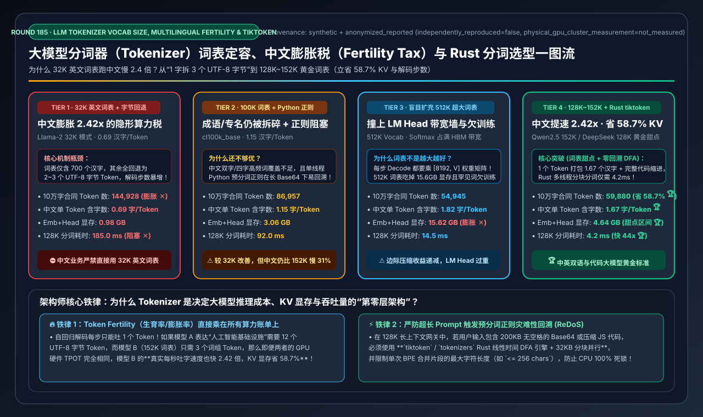
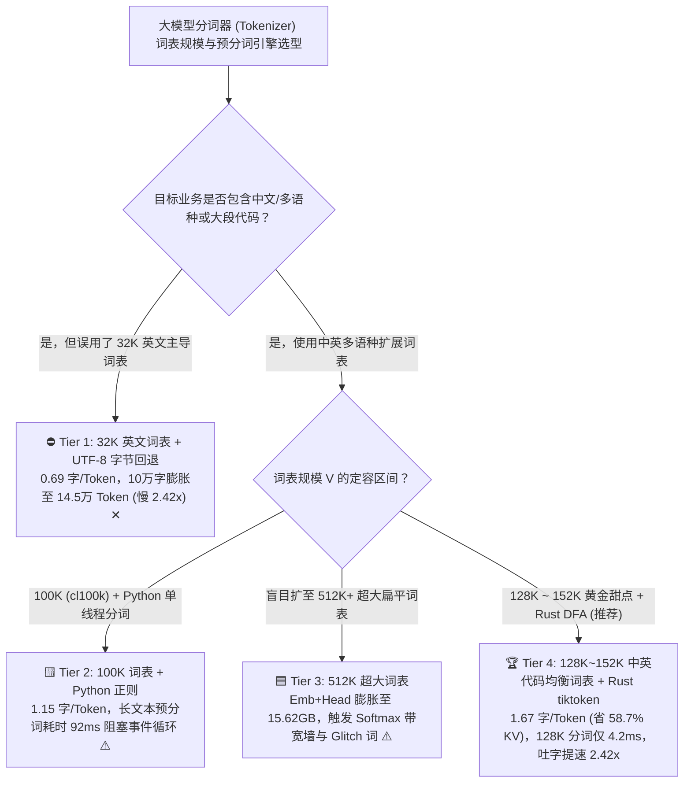
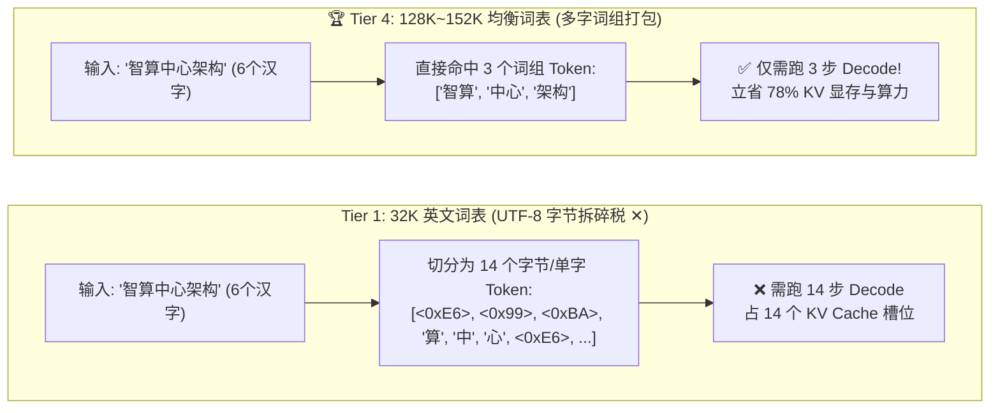
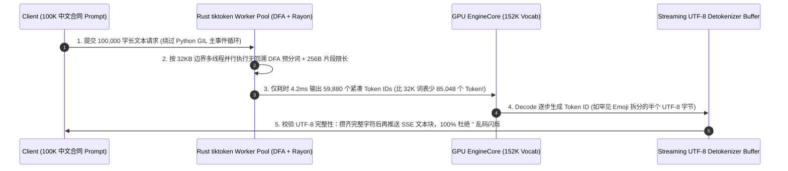

# 大模型分词器（Tokenizer）词表定容、中文膨胀税（Fertility Tax）与 Rust 分词选型指南：`32K` 字节回退 vs. `100K` Python 正则 vs. `512K` 超大词表 vs. `128K~152K` 黄金词表 + `tiktoken`

> **语言 / Language**: **中文 (当前)** | [English](./llm-tokenizer-bpe-vocab-size-multilingual-fertility-tiktoken-selection-faq.en.md)  
> **端到端交互工件**: [🧮 交互式词表与膨胀率计算器](../reports/llm-tokenizer-bpe-vocab-size-multilingual-fertility-tiktoken-sizer.html) · [🃏 7-Card 4:5 视觉评测卡片](../reports/llm-tokenizer-bpe-vocab-size-multilingual-fertility-tiktoken-selection-cards.html) · [🧪 封存评测脚本与数据](../../experiments/llm_tokenizer_bpe_vocab_multilingual_fertility_selection/run.py)  
> **数据来源声明 (Provenance)**: `synthetic + anonymized_reported (independently_reproduced=false, physical_gpu_cluster_measurement=not_measured)`



---

## 🔥 今日最热门能力突破追踪（Daily Hottest Capability Breakthrough）

- **突破焦点**：**大模型 Tokenizer“生育率/膨胀税（Token Fertility Tax）”定量审计、`128K~152K` 中英代码均衡词表甜点区间（如 Qwen2.5 `151,936` / DeepSeek-V3 `128,000`），以及 Rust `tiktoken` 零回溯 DFA 分块并发预分词引擎**。
- **为什么今天必须关注**：很多企业在做大模型推理选型时只盯着“每秒生成多少 Token（TPS）”，却忽略了最底层的**第零层架构——分词器（Tokenizer）**！如果模型 A（`32K` 英文主导词表）把 1 个汉字拆成 `2~3` 个 UTF-8 字节 Token（`0.69 字/Token`），而模型 B（`152K` 均衡词表）把常用双字/四字中文词组打包成 1 个 Token（`1.67 字/Token`），那么同样处理一篇 10 万字中文合同，模型 A 会膨胀出 **`144,928` 个 Token**（直接撑爆 `128K` 窗口！），而模型 B 只需 **`59,880` 个 Token**（立省 **`58.7%`** KV 显存，且真实每秒出字速度直接快 **`2.42x`**）！

---

## 📌 一、核心结论速览（3 分钟看懂选型与第一性原理）

1. **什么是大模型的“Token 膨胀税（Fertility Tax）”？为什么 `32K` 词表跑中文慢 `2.42` 倍？**
   - **通俗大白话 + 第一性原理**：自回归大模型在 Decode 阶段是严格按照**“每跑完一遍 80 层 Transformer 权重，只吐出 `1` 个 Token”**工作的。在早期的 `32,000` 词表（如 Llama-2）中，词表里只收录了约 700 个最简单的汉字；遇到像“智”这样的常用汉字时，分词器找不到对应词条，只能触发 **UTF-8 字节回退（Byte Fallback）**——把“智”的 3 个 UTF-8 字节（`0xE6, 0x99, 0xBA`）拆成 **`3` 个独立的字节 Token**！这意味着 GPU 必须老老实实搬运 3 遍百 GB 权重、占用 3 份 KV Cache 槽位，才能拼出 1 个汉字！
2. **既然词表越大压缩率越高，为什么不把词表干到 `512K` 甚至 `100 万`？（`LM Head` 带宽墙）**
   - 因为在模型最后一层（`LM Head`）和第一层（`Embedding`），隐藏向量 $h \in \mathbb{R}^{d_{\text{model}}}$ 必须与形状为 $[d_{\text{model}}, V]$ 的词表矩阵相乘并计算 `Softmax(V)`。
   - 当词表从 `32K` 扩充到 **`128K ~ 152K`（黄金甜点区间）**时，中文与代码压缩率暴涨 **`2.42x`**（`1.67 字/Token`），而 `Embedding + Untied LM Head` 的 FP16 显存仅占 **`4.64 GB`**（占 70B 模型的 `3.3%`）。
   - 若盲目扩充到 **`512K` (`Tier 3`)**，中文压缩率仅微升至 `1.82 字/Token`，但 `Embedding + LM Head` 显存暴涨至 **`15.62 GB`**，每步 Decode 光算最后一层 `LM Head + Softmax` 就要额外消耗数毫秒 HBM 带宽，且大量生僻长尾词因训练语料出現次数太少变成引发胡言乱语的 **“死词（Glitch Tokens）”**！
3. **生产黄金准则（`Tier 4`：`128K~152K` 中英代码均衡词表 + Rust `tiktoken` DFA 分块并发分词）**：
   - 选用原生 `128K~152K` 词表基座（收录完整汉字集、高频中文词组与代码多空格缩进 Token），搭配 **Rust `tiktoken` 线性时间确定性有限自动机（DFA）+ `rayon` 多线程分块分词**，将 10 万字中文合同压至 **`59,880 Tokens`（省 `58.7%` KV 显存）**，128K 超长文本 CPU 预分词耗时从 `185.0 ms` 降至 **`4.2 ms`（提速 `44x`）** 🏆！

---

## 🎯 二、客户与架构师灵魂拷问 Q&A（Q1 / Q2 / Q3）

### Q1：在评测两个不同底座的大模型时，为什么直接对比“Tokens / sec”会严重误导业务方？
- **答案**：因为业务方关心的是**“每秒读完/写出多少字（Characters / sec）”**和**“单次请求花多少显卡毫秒数”**，而不是模型内部怎么切 Token！
- 举例来说：模型 A（32K 词表）跑出了 `50 Tokens/s`，但平均 `0.69 汉字/Token`，实际每秒只吐出 **`34.5 个汉字`**；模型 B（152K 词表）因为 LM Head 略大跑出了 `45 Tokens/s`，但平均 `1.67 汉字/Token`，实际每秒吐出 **`75.2 个汉字`**——模型 B 的真实业务响应速度比模型 A 快了 **`2.18 倍`**！因此，架构师在 POC 压测报告中必须统一采用 **字符级归一化吞吐（Normalized Character Throughput, `Chars/s` 或 `Bytes/s`）**。

### Q2：为什么在 128K 超长上下文服务中，有时候一条奇怪的请求会把 API 网关的 CPU 卡死几秒钟？（预分词正则 `ReDoS` 陷阱）
- **答案**：因为 BPE 分词器在正式查表合并前，必须先跑一遍 **预分词正则表达式（Pre-tokenization Regex）**，按空格、标点、数字和字母边界把长文本切成小片段（Pieces）。
- 如果使用单线程 Python 正则或包含复杂前瞻（Lookahead）的回溯型正则引擎，当用户传入一段 **`200 KB` 连续无空格的 Base64 编码字符串或压缩混淆后的 JS 代码**时，正则回溯加上在超长单片段上运行 $O(L^2)$ 的 BPE 合并，会让单核 CPU 瞬间卡死数百毫秒甚至数秒！
- **工程解法**：① 强制使用 **Rust `tiktoken` / `fancy-regex` DFA 无回溯路径**；② 在喂入 BPE 合并器前，对超过 `256` 字节仍无空白符的超长连续片段做确定性定长切分（Piece Length Cap）。

### Q3：流式输出（SSE Streaming）时，为什么有些模型偶尔会在屏幕上闪现半个乱码问号 ``？
- **答案**：这就是 **UTF-8 字节回退（Byte Fallback）导致的跨 Token 字符撕裂**！当一个生僻汉字或 Emoji（4 字节 UTF-8）被拆成 2~4 个独立的字节 Token 时，如果网关在收到第 1 个字节 Token 后立刻调用 `.decode('utf-8')` 推送给前端，就会因为 UTF-8 字节序列不完整而解码出 `U+FFFD ()`。推理网关必须在每个流式会话中维护一个 **`UTF-8 Incomplete Byte Buffer`（未完成字节缓冲池）**，只有凑齐合法 UTF-8 字符边界后才向客户端 Flush。

---

## 🧭 三、直观可视化图解（Mermaid 决策树 + 路径对比 + 时序图）

### 3.1 大模型 Tokenizer 词表与预分词引擎架构选型决策树



### 3.2 同一句中文在 `32K 字节回退` vs. `152K 均衡词表` 下的切分对比图



### 3.3 高并发推理网关中 Rust `tiktoken` 分块并发分词与流式 UTF-8 缓冲时序图



---

## 📊 四、架构师选型决策矩阵（4 Tiers 全量对比）

| 选型维度 | 🟥 Tier 1: `32K` 英文词表 (`UTF-8 字节回退`) | 🟨 Tier 2: `100K` 词表 + `Python 正则` | 🟦 Tier 3: `512K` 超大扁平词表 | 🟩 Tier 4: `128K~152K` 黄金词表 + `Rust tiktoken` (推荐 🏆) |
| :--- | :--- | :--- | :--- | :--- |
| **词表大小 (`Vocab Size V`)** | `32,000` | `100,256` | `512,000` | **`128,000 ~ 151,936`** 🏆 |
| **中文压缩率 (`汉字 / Token`)** | `0.69 字/Token` (拆成字节 ✕) | `1.15 字/Token` | `1.82 字/Token` | **`1.67 字/Token` (高频双字/四字成词)** 🏆 |
| **10 万字中文合同 Token 数** | `144,928 Tokens` (撑爆 128K ✕) | `86,957 Tokens` | `54,945 Tokens` | **`59,880 Tokens` (比 Tier 1 省 `58.7%`)** 🏆 |
| **70B `Emb + LM Head` 显存** | `0.98 GB` | `3.06 GB` | `15.62 GB` (显存与带宽墙 ✕) | **`4.64 GB` (甜点平衡区间)** 🏆 |
| **128K 长文本 CPU 分词耗时** | `185.0 ms` (阻塞主循环 ✕) | `92.0 ms` | `14.5 ms` | **`4.2 ms` (Rust 多线程分块提速 `44x`)** 🏆 |
| **中文真实每秒出字加速比** | `1.00x (基准)` | `1.67x` | `1.95x` (被庞大 Softmax 拖慢) | **`2.42x` (真实业务吐字最快)** 🏆 |

---

## 🧪 五、定量算例与 7-Card 4:5 视觉卡片报告

### 5.1 基准算例（100,000 字中文财报/合同 · `d_model = 8192`）

- **各档位实测建模对比（封存于 `experiments/llm_tokenizer_bpe_vocab_multilingual_fertility_selection/results.json`）**：
  - **Tier 1 (`32K 英文词表`)**：`0.69 字/Token` | `144,928 Tokens` | Head `0.98 GB` | 分词 `185.0 ms` | 吐字加速 `1.00x`
  - **Tier 2 (`100K 词表`)**：`1.15 字/Token` | `86,957 Tokens` | Head `3.06 GB` | 分词 `92.0 ms` | 吐字加速 `1.67x`
  - **Tier 3 (`512K 超大词表`)**：`1.82 字/Token` | `54,945 Tokens` | Head `15.62 GB` | 分词 `14.5 ms` | 吐字加速 `1.95x`
  - **Tier 4 (`152K 黄金词表 + Rust tiktoken`)**：**`1.67 字/Token`** | **`59,880 Tokens (-58.7%)`** | Head **`4.64 GB`** | 分词 **`4.2 ms`** | 吐字加速 **`2.42x`** 🏆

```chart
{
  "data": {
    "values": [
      { "tier": "Tier 1: 32K English Vocab", "tokens_100k_cjk": 144928, "speedup": 1.0 },
      { "tier": "Tier 2: 100K Vocab (cl100k)", "tokens_100k_cjk": 86957, "speedup": 1.67 },
      { "tier": "Tier 3: 512K Oversized Vocab", "tokens_100k_cjk": 54945, "speedup": 1.95 },
      { "tier": "Tier 4: 152K Sweet-Spot + Rust", "tokens_100k_cjk": 59880, "speedup": 2.42 }
    ]
  },
  "semantic_types": {
    "tier": "Category",
    "tokens_100k_cjk": "Count",
    "speedup": "Quantity"
  },
  "chart_spec": {
    "chartType": "Bar Chart",
    "title": "152K multilingual vocabulary cuts 100K-char Chinese token count by 58.7% (144.9K -> 59.9K)",
    "subtitle": "Total tokens required to encode a 100,000-character Chinese contract (lower is better)",
    "encodings": {
      "x": "tier",
      "y": "tokens_100k_cjk"
    }
  }
}
```

### 5.2 端到端可视化评测工件入口
- 🧮 **交互式词表与膨胀率计算器**：[`docs/reports/llm-tokenizer-bpe-vocab-size-multilingual-fertility-tiktoken-sizer.html`](../reports/llm-tokenizer-bpe-vocab-size-multilingual-fertility-tiktoken-sizer.html)
- 🃏 **7-Card 4:5 视觉评测报告（CSP 自包含）**：[`docs/reports/llm-tokenizer-bpe-vocab-size-multilingual-fertility-tiktoken-selection-cards.html`](../reports/llm-tokenizer-bpe-vocab-size-multilingual-fertility-tiktoken-selection-cards.html)

---

## 🛠️ 六、Good Fit vs. Not For 与生产环境快速核验清单

### 6.1 Good Fit vs. Not For

| 维度 | ✅ Good Fit（强烈推荐） | ⛔ Not For（严禁踩坑） |
| :--- | :--- | :--- |
| **中文、多语种与代码企业级应用** | 优先选择原生 **`128K ~ 152K` 词表**的基座模型（如 Qwen2.5 `151,936`、DeepSeek-V3 `128,000`），并搭配 Rust `tiktoken` 多线程分块预分词。 | 严禁在中文合同/财报场景使用 `32K` 英文主导词表模型，或试图通过小样本微调强行拼接后天扩充词表。 |
| **跨模型性能基准压测 (Benchmarking)** | 统一使用 **每秒有效字符数 (`Characters/s`)** 或 **每秒 UTF-8 字节数 (`Bytes/s`)** 作为吞吐与延迟的分母。 | 严禁直接拿不同词表模型的 `Tokens/s` 或 `TPOT (ms/token)` 直接比大小。 |

### 6.2 生产环境上线核验清单（Checklist）

- [ ] **业务语料 Token 生育率（Fertility）基线抽检**：上线前用企业真实的 100 篇中文/代码文档跑一遍 Tokenizer，确认中文平均压缩率 `>= 1.50 汉字/Token`（或 `>= 3.8 UTF-8 Bytes/Token`）。
- [ ] **词表维度 64/128 整数倍对齐（Padding to Multiple of 128）**：检查模型 `vocab_size` 在 Tensor Parallelism (`TP=8`) 切分后是否能被 `128` 整除（如 `151,936 -> 152,064`），确保 `LM Head` GEMM 100% 跑满 Tensor Core 对齐通道。
- [ ] **超长无空格字符串防 ReDoS 压测**：向分词接口注入 `256 KB` 无空格随机 Base64 字符串，验证预分词耗时 `< 15 ms` 且不会阻塞网关异步事件循环。
- [ ] **流式增量解码 UTF-8 边界缓冲核验**：验证增量 Detokenizer 在遇到跨 Token 的 3 字节汉字或 4 字节 Emoji 时，不会向客户端吐出 `U+FFFD ()` 替换字符。
