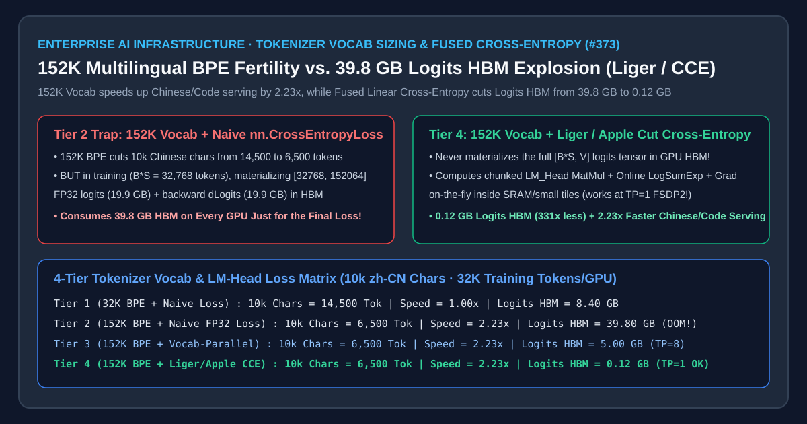

# LLM Tokenizer Vocabulary Sizing (`32K vs. 152K/256K`) & Fused Cross-Entropy (`Liger FLCE / Apple CCE`) Guide: Token Fertility & Eliminating the 39.8 GB Logits HBM Explosion

> **Language**: [中文](./llm-tokenizer-vocab-sizing-fertility-liger-cut-cross-entropy-lm-head-selection-faq.md) | **English (Current)**  
> **Audience**: Cloud & AI Infrastructure Solution Architects and LLM Training/Inference Engineers  
> **Provenance**: `synthetic + anonymized_reported` (`independently_reproduced=false`, `physical_gpu_cluster_measurement=not_measured`)

---

## 1. 📌 Executive Summary

> **Bottom Line**: **Tokenizer vocabulary size ($V$) governs both multilingual inference TCO and training memory limits: upgrading from a legacy `32K` English-centric BPE (`Tier 1`, `Llama-2`) to a `128K–152K` multilingual BPE (`Llama-3 / Qwen2.5`) compresses `10,000` Chinese/Code characters from `14,500 tokens` down to `6,500 tokens`—delivering a `2.23x` effective character generation speedup and cutting KV Cache memory by `55.2%` at identical token/s throughput! However, during long-context training ($B \times S = 32,768$ tokens/GPU), naively materializing the `[32768, 152064]` `FP32` logits tensor and its backward gradient (`Tier 2`) consumes `39.80 GB` of HBM per GPU (`67.11 GB` at $V=256,000$!). Production training pipelines pair `128K–152K` 128-aligned vocabularies with `Fused Linear Cut Cross-Entropy` (`Liger FusedLinearCrossEntropy` / `Apple CCE`, `Tier 4`): computing chunked `LM_Head MatMul + Online LogSumExp + Gradients` in-place without ever materializing the full `[B*S, V]` logits matrix in HBM—slashing LM-Head peak memory `331x` (`39.80 GB -> 0.12 GB`) even under `TP=1 (FSDP2)`.**

- **Interactive Tokenizer Vocab & Fused Cross-Entropy Sizer**: [Open Interactive Sizer (`llm-tokenizer-vocab-sizing-fertility-liger-cut-cross-entropy-lm-head-sizer.html`)](../reports/llm-tokenizer-vocab-sizing-fertility-liger-cut-cross-entropy-lm-head-sizer.html)
- **7-Card 4:5 Visual Report**: [Open 7-Card Report (`llm-tokenizer-vocab-sizing-fertility-liger-cut-cross-entropy-lm-head-selection-cards.html`)](../reports/llm-tokenizer-vocab-sizing-fertility-liger-cut-cross-entropy-lm-head-selection-cards.html)

---

## 2. 📊 4-Tier Tokenizer Vocab & LM-Head Loss Matrix (`10k zh-CN Chars` · `32K Training Tokens/GPU`)

| Metric | Tier 1: Legacy `32K BPE` + Standard `CrossEntropy` | Tier 2: `152K BPE` + Naive Materialized `FP32 CrossEntropy` | Tier 3: `152K BPE` + `Megatron Vocab-Parallel CE` (`TP=8`) | Tier 4 (Recommended): `152K BPE` + `Liger FLCE / Apple CCE` Fused Loss |
| :--- | :--- | :--- | :--- | :--- |
| **Tokens per `10k` Chinese Chars** | `14,500 Tokens` ✕ | **`6,500 Tokens` ✓ (`-55.2%`)** | **`6,500 Tokens` ✓** | **`6,500 Tokens` ✓ (`-55.2%` KV Cache)** |
| **Effective Bilingual/Code Speedup** | `1.00x` | **`2.23x` ✓** | **`2.23x` ✓** | **`2.23x` ✓** |
| **LM-Head Logits Peak HBM / GPU** | `8.40 GB` | `39.80 GB` ✕ (Causes OOM!) | `5.00 GB` (Requires `TP=8`) | **`0.12 GB` ✓ (`331x` reduction!)** |
| **Supports `TP=1` Pure `FSDP2`** | Marginal | No ✕ (OOM) | No ✕ (Requires TP) | **Yes ✓ (Ideal for FSDP2 SFT/RL)** |

---

## 3. 🛠️ Production Readiness Checklist

- [ ] **Always Pad Custom Embedding & `LM_Head` Vocabulary Dimensions to a Multiple of `128` (e.g., `152,064`)** so TensorCore GEMM tiles remain 16-byte/128-element aligned.
- [ ] **Replace `model.lm_head` + `nn.CrossEntropyLoss` with `LigerFusedLinearCrossEntropyLoss` or `Apple Cut Cross-Entropy (CCE)`** in all `128K+` vocab training jobs to reclaim `30–60 GB` of HBM per GPU.
