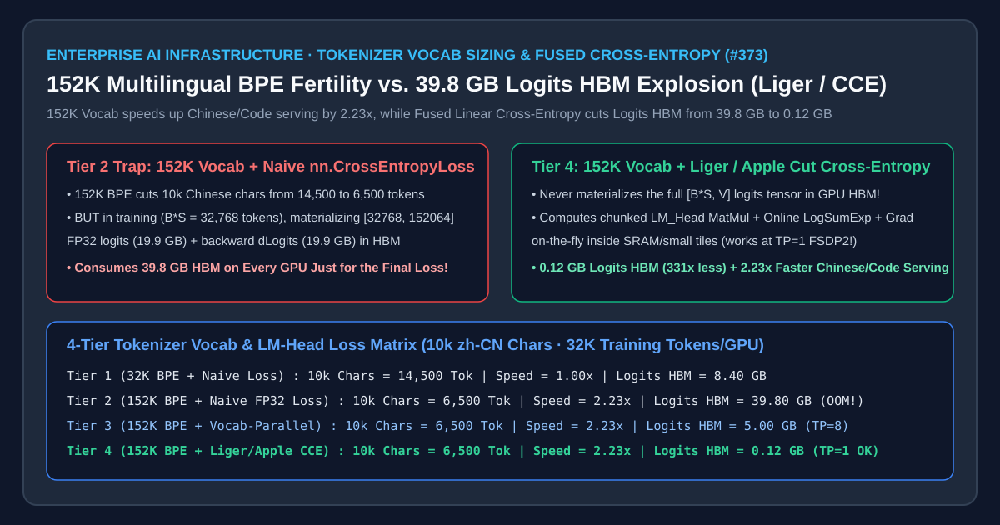

# 大模型分词器词表（Tokenizer Vocab: `32K vs. 152K/256K`）与融合交叉熵（`Liger FusedLinearCrossEntropy / Apple CCE`）选型：中英代码压缩率（Fertility）与消除 39.8GB Logits 显存爆炸指南

> **语言 / Language**: **中文 (当前)** | [English](./llm-tokenizer-vocab-sizing-fertility-liger-cut-cross-entropy-lm-head-selection-faq.en.md)  
> **定位**：面向 Cloud & AI Infrastructure Solution Architect 与训练/推理容量规划师的分词器词表规模选型（`32K Llama-2` vs. `128K Llama-3` vs. `152K Qwen2.5` vs. `256K Gemma`）、中英文/代码 Token 膨胀率（Token Fertility）对 KV Cache 与 E2EL 的倍增效应，以及通过 `Liger FusedLinearCrossEntropy / Apple Cut Cross-Entropy (CCE)` 消除训练阶段最后一层 `39.8 GB` Logits 显存爆炸的第一性原理白皮书  
> **合规与来源声明**：`synthetic + anonymized_reported`（`independently_reproduced=false`，`physical_gpu_cluster_measurement=not_measured`；完全面向通用企业级双语大模型底座选型与长文本训练显存治理设计）

---

## 1. 📌 核心选型结论速览（Executive Summary）

> **一句话结论**：**分词器词表大小（Vocabulary Size $V$）是连接训练显存与推理 TCO 的隐形杠杆——在中英文混合与代码场景下，早期 `32K` 词表（Tier 1，`Llama-2` 风格）处理 `10,000` 个汉字竟会碎裂成 **`14,500 个 Token`**（平均 1 个汉字拆成 1.45 个 UTF-8 Byte Token），而现代 `128K~152K` 多语言 BPE 词表（`Llama-3 / Qwen2.5`）将其直接压缩至 **`6,500 个 Token`**！这意味着在完全相同的每秒吐 Token 速率（TPS）下，**选 `152K` 词表模型的中文/代码实际吐字速度直接快了 `2.23 倍`、同篇文档占用的 KV Cache 显存直接暴降 `55.2%`**！然而，`152K~256K` 超大词表在长序列微调与预训练（单卡每步 $B \times S = 32,768$ Token）中会引爆一个致命炸弹：如果在最后一层 `LM Head` 显式物化（Materialize）出 `[32768, 152064]` 的 `FP32 Logits` 及其反向梯度张量（Tier 2），仅最后这一个 Loss 算子就会瞬间吃掉 **`39.80 GB` HBM（占满半张 80GB H100！）**！生产环境黄金准则是采用“`128K–152K` 多语言词表（向上对齐至 `128` 的整数倍）+ 不物化 Logits 的分块融合线性交叉熵（`Liger FusedLinearCrossEntropy` / `Apple Cut Cross-Entropy (CCE)`，Tier 4）”：在共享内存（SRAM）/小分块内边算 `LM_Head MatMul` 边完成在线 `LogSumExp` 与梯度累加，**绝不在 HBM 中生成完整的 `[B*S, V]` 矩阵**——将最后一层峰值显存从 `39.80 GB` 暴砍 **`331 倍` 至 `0.12 GB`**（哪怕在 `TP=1` 的纯 `FSDP2` 下也零压力），同时白拿 **`2.23 倍` 的双语推理加速**！**

- **交互式词表压缩率与融合交叉熵显存计算器**：[打开交互式计算器 (`llm-tokenizer-vocab-sizing-fertility-liger-cut-cross-entropy-lm-head-sizer.html`)](../reports/llm-tokenizer-vocab-sizing-fertility-liger-cut-cross-entropy-lm-head-sizer.html)
- **7-Card 4:5 视觉评测报告**：[打开 7-Card 报告 (`llm-tokenizer-vocab-sizing-fertility-liger-cut-cross-entropy-lm-head-selection-cards.html`)](../reports/llm-tokenizer-vocab-sizing-fertility-liger-cut-cross-entropy-lm-head-selection-cards.html)

---

## 2. 🎯 客户与架构师灵魂拷问 Q&A（Deep-Dive Architecture FAQ）

### Q1：为什么大词表（`152K / 256K`）在长序列训练中不用 `Liger FLCE / Apple CCE` 就会瞬间爆掉 `39.8 GB` 显存？手算公式是什么？
- **最后一层 `LM Head + Cross-Entropy` 的显存爆炸手算**：
  - 假设单张 GPU 每步处理的 Token 总数为 $N_{\text{tok}} = B \times S = 32,768$（例如 `Batch=1, Seq=32K`），词表大小 $V = 152,064$（`Qwen2.5-72B`）。
  - 在标准 PyTorch 实现中（`logits = lm_head(hidden_states).float(); loss = F.cross_entropy(logits, labels)`）：
    1. 前向生成的 `FP32 Logits` 矩阵维度为 $[32768, 152064]$，占用显存：$32,768 \times 152,064 \times 4\text{ Bytes} = \mathbf{19.93\text{ GB}}$；
    2. 反向传播计算 Softmax 梯度时，同时分配一个同尺寸的 `dLogits` 梯度张量，再吃掉 **$\mathbf{19.93\text{ GB}}$**！
    3. **合计峰值：$19.93 + 19.93 = \mathbf{39.86\text{ GB}}$**！（如果换成 `Gemma` 的 $V = 256,000$，更是高达 **`67.11 GB`**，单卡 80GB 当场 OOM！）
- **`Liger FusedLinearCrossEntropy` 与 `Apple Cut Cross-Entropy (CCE)` 的破局原理**：
  - 交叉熵损失 $\mathcal{L}_t = \log \sum_{v=1}^V e^{h_t^T w_v} - h_t^T w_{y_t}$ 本质上只需要每个 Token 的标量 `LogSumExp (LSE)`！
  - `Liger FLCE` 将序列切分为极小的 Token 块（如每次仅取 `2,048` 个 Token），在临时小 Buffer 中算出局部 Logits、原地算出梯度 $\nabla \text{logits}$ 并立即乘回 $W_{\text{head}}$ 累加出 $\nabla h$ 和 $\nabla W_{\text{head}}$，随后立刻复用该小 Buffer——**全过程永远不在 HBM 中实例化完整的 `[32768, 152064]` 大矩阵，峰值显存仅需 `0.12 GB`（立省 `39.68 GB`！）**！

---

## 3. 🧭 直观可视化图解（Mermaid 传统物化 39.8GB Logits vs. `Liger / Apple CCE` 零物化融合算子对比图）

```mermaid
flowchart TB
    subgraph Bad["❌ Tier 2 传统路径：显式物化 [32768, 152064] FP32 Logits (瞬间吃掉 39.8 GB HBM!)"]
        direction LR
        H1["隐状态 H [32K, 8192] (0.5GB)"] --> M1["lm_head 矩阵乘 + 转 FP32"]
        M1 --> L1["完整 FP32 Logits [32K, 152K] (19.93 GB HBM!)"]
        L1 --> G1["F.cross_entropy 反向 dLogits (又占 19.93 GB HBM!)"]
    end

    subgraph Good["✅ Tier 4 推荐路径：Liger FusedLinearCrossEntropy / Apple CCE (峰值仅 0.12 GB!)"]
        direction LR
        H2["隐状态 H [32K, 8192] (0.5GB)"] --> C2["按 1024 Token 分块流式送入融合算子"]
        C2 --> S2["片上/小块内原地计算: h_i @ W^T -> Online LSE -> 原地反传累加 dH 与 dW!"]
        S2 --> Out2["直接输出标量 Loss 与梯度 (永不在 HBM 物化完整 Logits 矩阵!)"]
    end
```

---

## 4. 📊 架构师四级分词器词表与交叉熵架构选型矩阵（`1万汉字` 推理 + `32K Token/卡` 训练）

| 评估维度 | Tier 1：传统 `32K` 英文词表 (`Llama-2`) + 标准交叉熵 | Tier 2：`152K` 多语言词表 + 传统显式物化 FP32 交叉熵 | Tier 3：`152K` 词表 + `Megatron Vocab-Parallel CE` (`TP=8`) | Tier 4（推荐）：`152K` 多语言词表 + `Liger FLCE / Apple CCE` 融合算子 |
| :--- | :--- | :--- | :--- | :--- |
| **`10,000` 个汉字切分出的 Token 数** | `14,500 Tokens` ✕（严重碎裂） | **`6,500 Tokens` ✓（省 `55.2%`）** | **`6,500 Tokens` ✓** | **`6,500 Tokens` ✓（省 `55.2%` KV 显存）** |
| **同 TPS 下中文/代码实际吐字提速** | `1.00x`（基线） | **`2.23x` ✓** | **`2.23x` ✓** | **`2.23x` ✓（用户体感快一倍多）** |
| **训练最后一层 Logits 峰值显存** | `8.40 GB / 卡` | `39.80 GB / 卡` ✕（直接 OOM） | `5.00 GB / 卡`（强依赖 `TP=8`） | **`0.12 GB / 卡` ✓（立减 `331 倍`！）** |
| **是否支持 `TP=1` 纯 `FSDP2` 长序列** | 勉强支持 | 不支持 ✕（必爆显存） | 不支持 ✕（要求开启张量并行） | **原生完美支持 ✓（SFT/RL 标配）** |

---

## 5. 🛠️ 架构评审与生产落地 Checklist

- [ ] **扩充或微调自定义词表时，`vocab_size` 必须向上 Padding 对齐到 `128`（或 `256`）的整数倍**（如 `152,064 = 1188 * 128`）：如果词表是 `151,643` 这种奇数，GPU Tensor Core 在跑 `Embedding` 与 `LM Head` 矩阵乘时会退化为未对齐内存访问，白白损失 `15%~25%` 算子吞吐。
- [ ] **在所有 `Llama-3 / Qwen2.5 / Gemma` 的 SFT 与 RL 训练脚本中一行代码开启 `Liger-Kernel`（`apply_liger_kernel_to_qwen2(fused_linear_cross_entropy=True)`）**：立刻在每张 GPU 上白捡 `20~40 GB` 显存余量。
