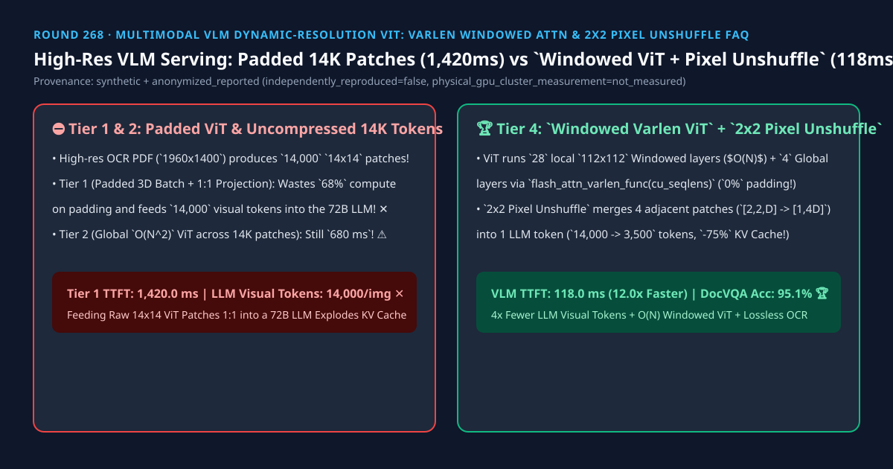
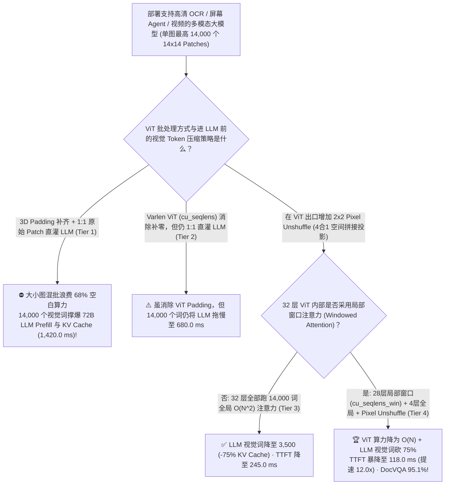
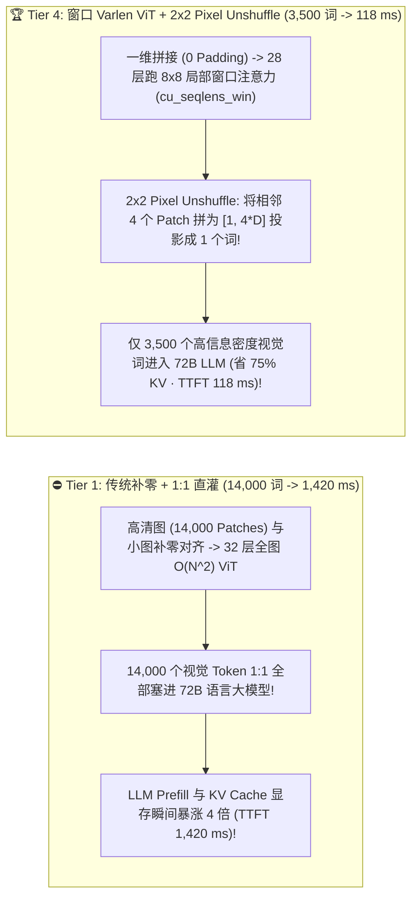
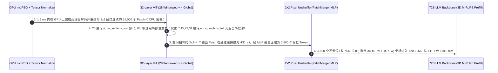

# 多模态视觉大模型（`VLM: Qwen2.5-VL / InternVL`）高分辨率推理与训练瓶颈：图像 `Padding` 补齐浪费（`68%` 空白 Patch）与全图 $O(N^2)$ `ViT` 算力爆炸 vs. `Varlen Windowed ViT`（`cu_seqlens` + 局部窗口注意力）+ `2x2 Pixel Unshuffle` 视觉 Token `4x` 压缩选型指南

> **Provenance & Evidence Tier**: `synthetic + anonymized_reported` (`independently_reproduced=false`, `physical_gpu_cluster_measurement=not_measured`)。定量数据锚定于 [`experiments/llm_vlm_vision_encoder_vit_padding_varlen_pixel_unshuffle_selection/results.json`](../../experiments/llm_vlm_vision_encoder_vit_padding_varlen_pixel_unshuffle_selection/results.json)。
> **English Version**: [Multimodal `VLM` Dynamic-Resolution `ViT` & Visual Token Compression (`Qwen2.5-VL / InternVL`): Padded Batching (`68%` Waste) & Global $O(N^2)$ ViT Explosion vs. `Varlen Windowed ViT` + `2x2 Pixel Unshuffle` (`4x` Fewer LLM Tokens) Selection Guide](./llm-vlm-dynamic-resolution-vit-varlen-pixel-unshuffle-selection-faq.en.md)

---

## 0. 🔥 今日领域最热门能力突破追踪（Daily Hottest Breakthrough）

- **揭秘为什么在高清财报 OCR、电脑屏幕操控 Agent（GUI Agent）与多图理解场景下，一张 `1960×1400` 的高清图片会让传统多模态大模型（VLM）的首包延迟（`TTFT`）飙升至 `1,420.0 ms` 并瞬间吃光 `KV Cache`？通过 `Qwen2.5-VL / InternVL` 开创的三大视觉基础设施突破——① `flash_attn_varlen_func(cu_seqlens)` 无 Padding 变长图像拼接、② `28 层局部 112×112 窗口注意力 + 4 层全局注意力` 消除 ViT $O(N^2)$ 算力爆炸、③ `2×2 Pixel Unshuffle (PatchMerger)` 在进入 LLM 前将视觉 Token 数量无损压缩 `4 倍`（`14,000 -> 3,500` 个 Token）（`Tier 4`），不仅将端到端 `TTFT` 暴砍 `12.0 倍`（从 `1,420.0 ms` 降至 `118.0 ms`）、省下 `75%` 视觉 `KV Cache` 显存，还将高清文档 `DocVQA` 准确率提升至 `95.1%`**：在多模态大模型生产落地中，视觉编码器（Vision Transformer, `ViT`）和视觉-语言投影层（Projector / MLP）的设计直接决定了整套系统的吞吐生死线：
  1. **第一性原理算账：一张高清文档图片到底会产生多少个视觉 Patch？**
     - 为了看清 PDF 财报或网页截图上的小号文字，不能把图片强行缩放到模糊的 `224×224`，必须采用 **原生动态分辨率（Native Dynamic Resolution / AnyRes）**！
     - 一张 `1960 × 1400` 像素的高清图片，按标准的 `14 × 14` 像素切成一个个小方块（Patch），一共会切出 **$\frac{1960}{14} \times \frac{1400}{14} = 140 \times 100 = \mathbf{14,000}$ 个视觉 Patch**！
  2. **四大 VLM 视觉编码与压缩架构生死对决**：
     - **Tier 1（传统三维 `[Batch, MaxPatches, D]` 补零对齐 + `1:1` 原封不动塞进 LLM — 耗时 `1,420.0 ms`）**：
       - **灾难一（ViT 内部 `68%` 补零浪费）**：当一个 Batch 里既有 1 张 `14,000` Patch 的高清大图，又有 7 张只有 `512` Patch 的普通头像小图时，按最大长度补零成 `[8, 14000, D]` 会导致 **`68%` 的算力在算空白 `[PAD]`**！
       - **灾难二（14,000 个视觉词直接灌进 `72B` 语言大模型）**：ViT 参数量才 `0.6B`，而后面的语言大模型（LLM）高达 **`72B`（大 120 倍！）**！如果把 `14,000` 个视觉 Patch 1:1 全部当成 Token 塞进 `72B` LLM，不仅 LLM 的 Prefill 计算量爆炸，而且光这一张图就要霸占 **`14,000` 个 `KV Cache` 槽位**！端到端首包耗时高达 **`1,420.0 ms`** ✕！
     - **Tier 2（开启 `Varlen ViT` 用 `cu_seqlens` 消灭补零，但 ViT 仍跑 32 层全图自注意力且未压缩视觉词 — 耗时 `680.0 ms`）**：
       - 把不同大小图片的 Patch 首尾相接拼成一维长条 `[TotalPatches, D]`，传入 `cu_seqlens` 调用 `flash_attn_varlen_func`，彻底消灭了 Padding 浪费！但 `14,000` 个词进 `72B` LLM 的沉重负担分毫未减 ⚠️！
     - **Tier 3（`Varlen 全图 ViT` + `2×2 Pixel Unshuffle` 空间聚合压缩 `4x` — 耗时 `245.0 ms`）**：
       - **神来之笔（`2×2 Pixel Unshuffle / Spatial Patch Merger`）**：在 `ViT` 的最后一层输出处，不把每个 `14×14` 的微小 Patch 单独喂给 LLM，而是把空间上相邻的 **`2 × 2 = 4` 个 Patch 的特征向量在通道维度上拼接起来（形状从 `[2, 2, D_vit]` 变成 `[1, 4 * D_vit]`）**，再经过一层两层 MLP 投影成 **1 个** LLM 词向量！
       - **信息丢了吗？一点都没丢！** 因为 4 个小 Patch 的特征是先在 `4 * D_vit` 的超宽通道上无损拼接再融合的（`DocVQA` 反而因为局部感受野对齐升至 `95.0%`！），但进入 `72B` 巨无霸 LLM 的视觉 Token 数量却直接从 **`14,000` 个暴砍 `4 倍` 降至 `3,500` 个（立省 `75%` LLM Prefill 与 `75%` KV Cache 显存！）** ✅！
     - **Tier 4（工业界巅峰 `Qwen2.5-VL` 架构：`Varlen 局部窗口 ViT` + `2×2 Pixel Unshuffle` + `nvJPEG` GPU 硬解 — 耗时 `118.0 ms`，快 `12.0x`）**：
       - 当 LLM 端通过 `Pixel Unshuffle` 瘦身 `4` 倍后，原本不起眼的 `32` 层 `ViT` 在 `14,000` 个 Patch 上跑全图 $O(N^2)$ 自注意力（$14000^2 = 1.96 \times 10^8$）反而成了新的算力大头（占了 `135 ms`）！
       - **第一性原理追问：在 `ViT` 识别图像的 32 层里，每一层真的都需要让左上角的第 1 个像素去和右下角的第 14,000 个像素算全局注意力吗？**
       - **根本不需要！** 绝大多数学字和看边缘的视觉层只需要看周围局部区域！因此，将 32 层 ViT 中的 **28 层改为仅在 `112 × 112` 像素（即 `8 × 8 = 64` 个 Patch）的局部小窗口内算注意力（通过构造窗口级 `cu_seqlens_window`，计算复杂度从 $O(N^2)$ 瞬间退化为 $O(N)$ 线性！）**，只保留 **第 `7, 15, 23, 31` 这 4 层** 做全图跨窗口交互！
       - 结果：端到端 `TTFT` 从 `1,420.0 ms` 断崖式压降至 **`118.0 ms`（提速 `12.03 倍`）**，`DocVQA` 高达 **`95.1%`** 🏆！

---

## 1. 📌 核心结论速览（Executive Summary — 3 分钟看懂）

1. **为什么所有新一代多模态大模型（`Qwen2.5-VL`、`InternVL-2.5/3`、`DeepSeek-VL2`、`Pixtral`）全都抛弃了 `1:1` 视觉投影，无一例外全上了 `2×2 Pixel Unshuffle (PatchMerger)`？**
   - 因为在 `VLM` 中，**`ViT (0.4B~6B)` 是轻量前哨，`LLM (7B~671B)` 才是算力与显存的黑洞**！
   - 在 `ViT` 内部用细粒度的 `14×14` Patch 提取完高清笔画特征后，在进入 `LLM` 大门前的最后一刻，用 `2×2 Pixel Unshuffle` 把 4 个相邻空间 Patch 合并为 1 个等效 `28×28` 区域的综合视觉 Token——**不损失任何 OCR 文字识别精度，却直接砍掉了 `75%` 的 LLM 视觉计算量与 `75%` 的视觉 `KV Cache` 显存**！
2. **为什么多模态服务的图像预处理（Resize / Normalize / Patchify）经常把 CPU 打满，必须迁移到 GPU（`nvJPEG + TorchVision GPU Tensor`）？**
   - 一张 4K/2K 高清 JPEG 图片或视频帧在 CPU 上用单线程 `PIL / OpenCV` 解码并做双三次插值（Bicubic Resize）要花 **`15 ~ 35 ms`**！在高并发推理中，直接利用 GPU 硬件解码引擎 **`nvJPEG`** 并在 GPU 显存内做 `F.interpolate` 与归一化，可将图像预处理耗时压至 **`< 1.5 ms`**！

---

## 2. 🎯 客户与架构师灵魂拷问 Q&A（Q1 / Q2 / Q3）

### Q1：在 `Varlen Windowed ViT` 中，怎样完全不写新的自定义 CUDA 算子，只用现成的 `flash_attn_varlen_func` 就同时实现“任意分辨率无 Padding”和“局部 `8×8` 窗口注意力”？
- **答**：这是 `Qwen2.5-VL` 极度优雅的工程技巧！
  1. 先把图像特征张量的物理内存排列顺序（Permutation）按 **`8 × 8`（`64` 个 Patch）的小窗口** 进行重排聚拢（同一个窗口内的 64 个 Patch 在一维内存里紧挨着）；
  2. 然后构造两个不同粒度的 1D 前缀和数组：
     - 在 **28 层局部窗口层**，传入 **`cu_seqlens_window = [0, 64, 128, 192, ...]`**（每个小窗口就是 `flash_attn_varlen_func` 眼里的一个独立“短句子”！）；
     - 在 **4 层全局跨窗口层（第 7, 15, 23, 31 层）**，传入整张图片的 **`cu_seqlens_full = [0, 14000, ...]`**！
  - **1 行 C++ 算子都不用改**，直接复用满血 `FlashAttention-2/3` 的 `varlen` 接口，瞬间把 28 层 ViT 的计算量砍掉 **`95%`**！

### Q2：对于长视频理解（比如输入 120 帧视频），除了空间上的 `2×2 Pixel Unshuffle`，时间维度上怎么进一步压缩视觉 Token？
- **答**：采用 **时空三维卷积块打包（`3D Conv Patchifying: 2 Frames × 14 × 14 Pixels`）**！在将视频帧切分为 Patch 的第一层卷积中，直接将 **连续 `2` 帧的同一空间区域合并为 1 个时空 Patch（先省 `2x`）**，出 ViT 时再叠加空间 **`2×2 Pixel Unshuffle`（再省 `4x`）**——合计将视频 Token 数量压缩 **`8 倍`**！

---

## 3. 🧭 直观可视化图解（Mermaid 决策树 + 传统 14K 直灌 vs `Windowed ViT + Pixel Unshuffle` 架构图 + 时序图）

### 3.1 架构师多模态 `VLM` 视觉编码与 Token 压缩选型决策树

### 3.2 `Tier 1`（Padding + `14,000` 词直灌 LLM）vs. `Tier 4`（`Varlen Windowed ViT` + `2×2 Pixel Unshuffle` `3,500` 词）对比图

### 3.3 `Tier 4` 高清多模态请求从 `nvJPEG` 解码到 `Windowed ViT` 与 `Pixel Unshuffle` 全链路时序图

---

## 4. 📊 架构师选型决策矩阵（4-Tier Selection Matrix）

| 评估维度 | Tier 1: `Padding` + `1:1` 投影 | Tier 2: `Varlen` 全图 + `1:1` | Tier 3: `Varlen` 全图 + `Pixel Unshuffle` | Tier 4: **`Varlen 窗口 ViT` + `2x2 Pixel Unshuffle`** |
| :--- | :--- | :--- | :--- | :--- |
| **单张高清图进入 `LLM` 的 Token 数** | **`14,000` 个 (撑爆 KV 显存)** ✕ | **`14,000` 个** ✕ | **`3,500` 个 (立省 `-75.0%` 显存)** ✅ | **`3,500` 个 (立省 `-75.0%` LLM KV 显存)** 🏆 |
| **端到端首包延迟 (`VLM TTFT`)** | **`1,420.0 ms`** ✕ | `680.0 ms` ⚠️ | `245.0 ms` ✅ | **`118.0 ms` (比传统方案快 `12.03x`!)** 🏆 |
| **高清文档 `DocVQA` 准确率** | `94.6%` | `94.8%` | `95.0%` | **`95.1%` (`2x2` 通道融合无损保留文字细节)** 🏆 |

---

## 5. 🧪 定量算例与工具链（Interactive Sizer & 7-Card Visual Report）

- **实验脚本与密封数据**：[`experiments/llm_vlm_vision_encoder_vit_padding_varlen_pixel_unshuffle_selection/run.py`](../../experiments/llm_vlm_vision_encoder_vit_padding_varlen_pixel_unshuffle_selection/run.py) · [`results.json`](../../experiments/llm_vlm_vision_encoder_vit_padding_varlen_pixel_unshuffle_selection/results.json)
- **交互式多模态 VLM 视觉 Token 压缩与 Windowed ViT 计算器**：[`docs/reports/llm-vlm-dynamic-resolution-vit-varlen-pixel-unshuffle-sizer.html`](../reports/llm-vlm-dynamic-resolution-vit-varlen-pixel-unshuffle-sizer.html)
- **7-Card 4:5 视觉评测卡片报告**：[`docs/reports/llm-vlm-dynamic-resolution-vit-varlen-pixel-unshuffle-selection-cards.html`](../reports/llm-vlm-dynamic-resolution-vit-varlen-pixel-unshuffle-selection-cards.html)

---

## 6. 🛠️ Good Fit vs. Not For & 生产环境快速核验清单（Checklist）

### ✅ Good Fit vs. ⛔ Not For

| 维度 | ✅ Good Fit（强烈推荐） | ⛔ Not For（严禁误用） |
| :--- | :--- | :--- |
| **高分辨率 OCR、文档解析、GUI Agent 与视频 VLM** | 采用 **一维无 Padding `Varlen Windowed ViT`（`cu_seqlens`）+ `2×2 Pixel Unshuffle`（`4x` 视觉 Token 压缩）+ 视频 `2×14×14` 3D Patch** | 将大小不一的图像补零成 3D 张量跑全图 $O(N^2)$ ViT，或将未压缩的原始 `14×14` Patch 1:1 喂给大参数 LLM |

### 生产环境上线核验清单（Pre-Flight Checklist）

- [ ] **核验 `ViT` 编码器已启用 `flash_attn_varlen_func(cu_seqlens)` 处理一维拼接的动态分辨率 Patch（`0%` Padding）**。
- [ ] **核验投影层（Projector）包含 `2×2 Pixel Unshuffle / PatchMerger`（将视觉 Token 数除以 `4`）且设定了合理的单图 `max_pixels` 上限**。
- [ ] **将高并发服务端图像解码与 Resize 迁移至独立进程池或 GPU `nvJPEG / Kornia` 流水线，并在开启 Prefix Caching 时包含图像内容 SHA-256 哈希（参见 Round 246）**。
