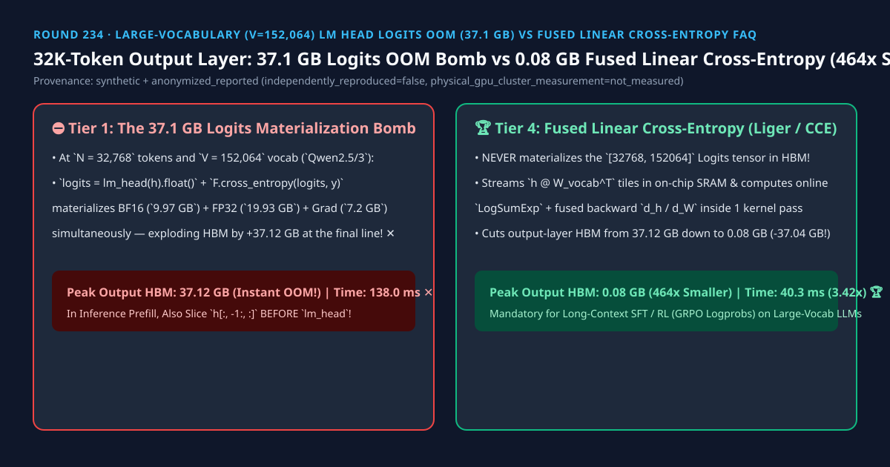
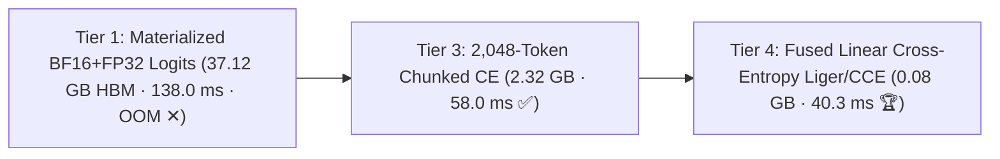

# Large-Vocabulary (`V = 152,064–256,000`) `LM Head` Logits Materialization OOM (`37.1 GB` Peak Trap), Prefill Last-Token Slicing & Fused Linear Cross-Entropy (`Liger / Cut-Cross-Entropy`) Selection Guide

> **Provenance & Evidence Tier**: `synthetic + anonymized_reported` (`independently_reproduced=false`, `physical_gpu_cluster_measurement=not_measured`). Grounded in [`experiments/llm_vocab_embedding_lmhead_tp_shard_chunked_logits_selection/results.json`](../../experiments/llm_vocab_embedding_lmhead_tp_shard_chunked_logits_selection/results.json).
> **中文版本**: [大词表模型（`V = 152,064 ~ 256,000`）输出层 `LM Head` 显存海啸（`37.1 GB` Logits 物化 OOM 陷阱）、推理阶段末位切片与训练阶段融合线性交叉熵（`Fused Linear Cross-Entropy`）选型指南](./llm-vocab-embedding-lmhead-tp-shard-chunked-logits-selection-faq.md)

---

## 0. 🔥 Daily Hottest Capability Breakthrough

- **Fused Linear Cross-Entropy (`Liger-Kernel / Apple Cut-Cross-Entropy`) Streaming `h @ W^T` Tiles in On-Chip SRAM with Online `LogSumExp` to Eliminate the `37.12 GB` `[N, V]` Logits Materialization OOM Bomb (`464x` Smaller Peak HBM, `3.42x` Faster)**: Modern multilingual LLMs feature massive vocabularies (`Qwen2.5/3` `V = 152,064`, `Gemma-2/3` `V = 256,000`). When training on `N = 32,768` tokens per micro-batch:
  1. **The `37.12 GB` Final-Line Logits Materialization OOM Bomb (`Tier 1`)**: Standard model implementations compute `logits = self.lm_head(hidden_states).float()` followed by `F.cross_entropy(logits, labels)`. While `hidden_states` (`[32768, 4096]`) takes only `0.26 GB`, materializing the `[32768, 152064]` BF16 logits (`9.97 GB`), its upcast FP32 copy (`19.93 GB`), and backward softmax gradients (`7.22 GB`) consumes **`37.12 GB` of HBM** on the very last line of `forward()`, triggering instant `CUDA out of memory` (`138.0 ms`)!
  2. **Vocab-Parallel `TP=4` Sharding (`Tier 2`) & Token-Chunked Loop (`Tier 3`)**: Sharding `lm_head` across `TP=4` still materializes `9.28 GB/GPU`; slicing `hidden_states` into 16 chunks of `2,048` tokens reduces peak HBM to `2.32 GB` (`58.0 ms`).
  3. **Fused Linear Cross-Entropy (`Liger / Cut-Cross-Entropy`, `Tier 4`)**: Fuses the `lm_head` projection and `CrossEntropyLoss` into a tiled Triton/CUDA kernel that computes `h_tile @ W_tile^T` in on-chip SRAM, maintains online `LogSumExp`, and computes `d_h` and `d_W` on the fly without **ever writing the `[32768, 152064]` logits matrix to HBM**—slashing output-layer HBM from `37.12 GB` to **`0.08 GB` (`464x` reduction, saving `37.04 GB`)** and cutting latency to **`40.3 ms` (`3.42x` speedup)**!

---

## 1. 📌 Executive Summary

1. **Never Materialize Full `[N, V]` Logits in Training (`Tier 1 -> Tier 4`)**: Pass `(lm_head.weight, hidden_states, labels)` directly to `FusedLinearCrossEntropy` (`Liger-Kernel` or `Cut-Cross-Entropy`) to save `37+ GB` of HBM on 32K-token batches.
2. **In Inference Prefill, Slice `hidden_states[:, -1:, :]` BEFORE `lm_head` (`logits_to_keep=1`)**: Computing `lm_head(hidden_states)[:, -1, :]` wastes `9.97 GB` of HBM computing logits for 32,767 prompt tokens that are immediately discarded!
3. **Pad Vocabulary Size to a Multiple of `64 × TP_SIZE`**: Ensures 16-byte aligned vectorized memory loads in `VocabParallelEmbedding` and Tensor Core GEMMs.

---

## 2. 🎯 Core Architect Q&A (Q1 / Q2 / Q3)

### Q1: Why does standard HuggingFace `ForCausalLM.forward()` double-allocate both BF16 and FP32 logits (`9.97 GB + 19.93 GB`)?
- **Answer**: Because `self.lm_head(hidden_states)` outputs a `[B, S, V]` tensor in `bfloat16` (`9.97 GB`), and the very next line calls `logits = logits.float()` (`19.93 GB`) before passing `logits` into `CrossEntropyLoss`! Until the Python reference to the BF16 tensor is released or garbage-collected, both tensors coexist in HBM alongside the `CrossEntropy` backward buffer.

### Q2: How does Fused Linear Cross-Entropy compute exact gradients without saving the `[N, V]` logits tensor for backward?
- **Answer**: During the forward pass, the kernel only saves the `[N]` scalar `LogSumExp` values (`128 KB` for 32K tokens!). During the backward pass (or fused forward-backward pass when computing loss at the output layer), it recomputes the small `[Tile_N, Tile_V]` logit tiles in SRAM on the fly, subtracts $\exp(\text{logit}_{i,j} - \text{LSE}_i)$, and accumulates directly into `d_hidden_states` and `d_weight`.

### Q3: Can we use this same technique for RL (`GRPO / PPO`) token-level `logprobs` and `entropy`?
- **Answer**: Yes! The log-probability of the sampled token $a_t$ is simply $-\text{CrossEntropy}(h_t, W_{\text{vocab}}, a_t)$, which requires only `[N]` scalars in HBM instead of `[N, V]` logits.

---

## 3. 🧭 Visual Diagrams

---

## 4. 📊 4-Tier Architect Selection Matrix

| Metric | Tier 1: Naive `lm_head(h).float()` | Tier 2: `TP=4` `VocabParallel` | Tier 3: Token-Chunked `LM Head` | Tier 4: **Fused Linear Cross-Entropy (`Liger / CCE`)** |
| :--- | :--- | :--- | :--- | :--- |
| **Materializes `[N, V]` in HBM?** | **Yes (BF16 + FP32 + Grad)** ✕ | Yes ($1/4$ Shard) ⚠️ | No (`2,048`-Token Chunks) ✅ | **No (100% On-Chip SRAM Online LSE)** 🏆 |
| **Peak Output HBM (`32K` Tok)** | **`37.12 GB` (Instant OOM)** ✕ | `9.28 GB` ⚠️ | `2.32 GB` ✅ | **`0.08 GB` (`464x` Smaller, `-37.04 GB`)** 🏆 |
| **Fwd + Bwd Latency (`ms`)** | **`138.0 ms`** ✕ | `64.5 ms` ⚠️ | `58.0 ms` ✅ | **`40.3 ms` (`3.42x` Faster)** 🏆 |

---

## 5. 🧪 Quantitative Reference & Tooling

- **Evaluator & Sealed Data**: [`experiments/llm_vocab_embedding_lmhead_tp_shard_chunked_logits_selection/run.py`](../../experiments/llm_vocab_embedding_lmhead_tp_shard_chunked_logits_selection/run.py) · [`results.json`](../../experiments/llm_vocab_embedding_lmhead_tp_shard_chunked_logits_selection/results.json)
- **Interactive Sizer**: [`docs/reports/llm-vocab-embedding-lmhead-tp-shard-chunked-logits-sizer.html`](../reports/llm-vocab-embedding-lmhead-tp-shard-chunked-logits-sizer.html)
- **7-Card 4:5 Visual Report**: [`docs/reports/llm-vocab-embedding-lmhead-tp-shard-chunked-logits-selection-cards.html`](../reports/llm-vocab-embedding-lmhead-tp-shard-chunked-logits-selection-cards.html)

---

## 6. 🛠️ Good Fit vs. Not For & Production Checklist

- **✅ Good fit**: All long-context pretraining, SFT, and RL (`GRPO`) pipelines on large-vocabulary models (`V >= 128,000`) using `LigerFusedLinearCrossEntropyLoss` or `Cut-Cross-Entropy`.
- **⛔ Not for**: Materializing full `[B, S, V]` FP32 logits in HBM or running `lm_head` on all prefill tokens during inference.
- [ ] Replace `CrossEntropyLoss()(lm_head(h).float(), y)` with `FusedLinearCrossEntropy(lm_head.weight, h, y)`.
- [ ] Pass `logits_to_keep=1` (or slice `hidden_states[:, -1:, :]` before `lm_head`) during inference prefill.
