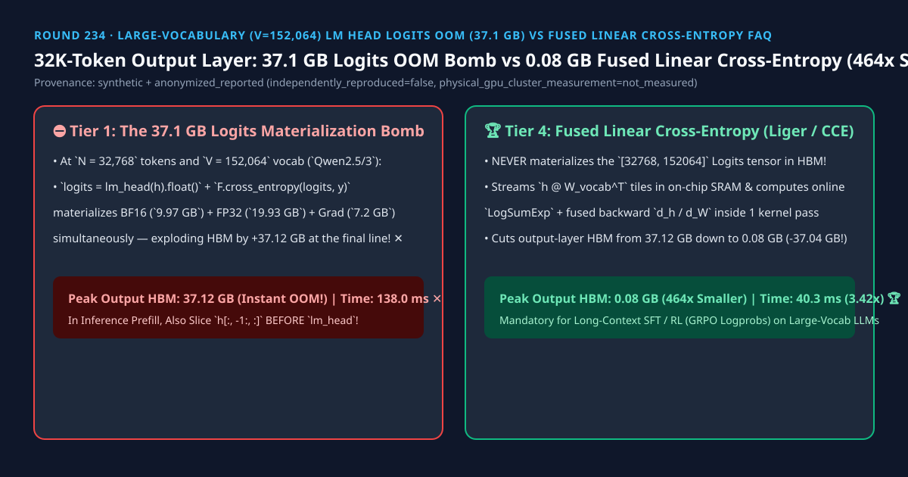
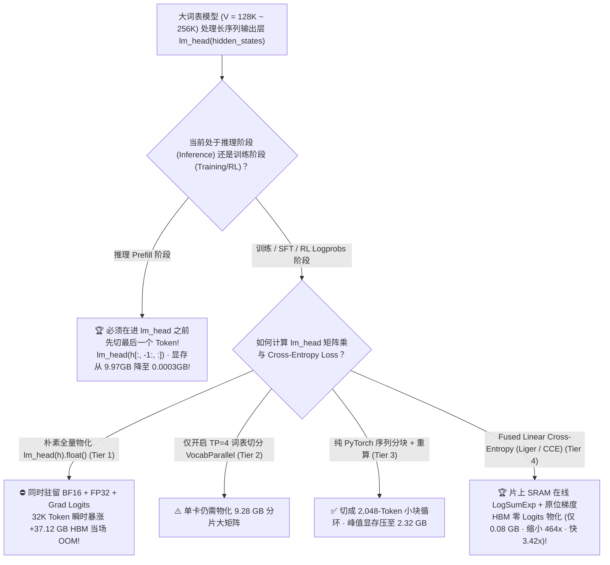
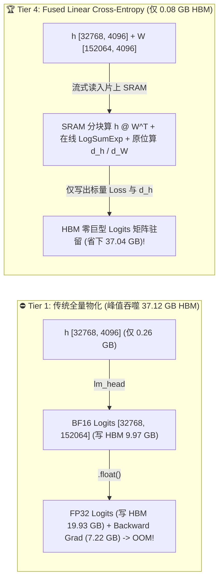
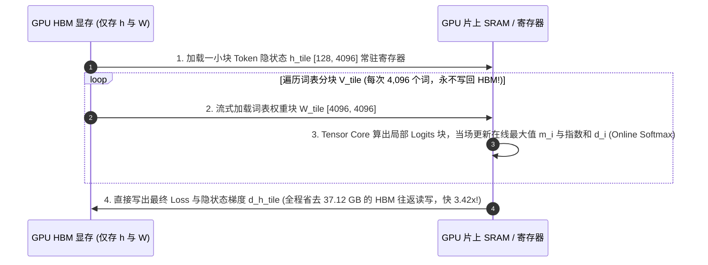

# 大词表模型（`V = 152,064 ~ 256,000`）输出层 `LM Head` 显存海啸（`37.1 GB` Logits 物化 OOM 陷阱）、推理阶段末位切片与训练阶段融合线性交叉熵（`Fused Linear Cross-Entropy`）选型指南

> **Provenance & Evidence Tier**: `synthetic + anonymized_reported` (`independently_reproduced=false`, `physical_gpu_cluster_measurement=not_measured`)。定量数据锚定于 [`experiments/llm_vocab_embedding_lmhead_tp_shard_chunked_logits_selection/results.json`](../../experiments/llm_vocab_embedding_lmhead_tp_shard_chunked_logits_selection/results.json)。
> **English Version**: [Large-Vocabulary (`V = 152,064–256,000`) `LM Head` Logits Materialization OOM (`37.1 GB` Peak Trap), Prefill Last-Token Slicing & Fused Linear Cross-Entropy (`Liger / Cut-Cross-Entropy`) Selection Guide](./llm-vocab-embedding-lmhead-tp-shard-chunked-logits-selection-faq.en.md)

---

## 0. 🔥 今日领域最热门能力突破追踪（Daily Hottest Breakthrough）

- **通过融合线性交叉熵（`Fused Linear Cross-Entropy`，如 `Liger-Kernel / Apple Cut-Cross-Entropy`）在片上 SRAM 直接完成分块矩阵乘与在线 `LogSumExp`，彻底消灭大词表模型（`V = 152,064`）在 `32K` 上下文下高达 `37.12 GB` 的 `[N, V]` Logits 显存物化炸弹，将输出层峰值显存压缩 `464` 倍至 `0.08 GB` 并提速 `3.42` 倍**：为什么在微调（SFT）或 RL（GRPO）训练 `Qwen2.5/3`（词表 `V = 152,064`）或 `Gemma-2/3`（词表 `V = 256,000`）时，前面整整 80 层 Transformer 的前向传播都顺顺利利跑完了，偏偏在最后一行算 `loss = CrossEntropyLoss()(lm_head(h).float(), labels)` 时瞬间爆出 **`CUDA out of memory: tried to allocate 19.93 GiB`**？
  1. **最后一秒引爆的 `37.12 GB` Logits 物化核弹（Tier 1）**：
     - 在 80 层 Transformer 内部，隐状态维度 $D$ 只有 `4,096` 或 `5,120`（当序列总 Token 数 $N = 32,768$ 时，一层隐状态只占 $32768 \times 4096 \times 2\text{B} = \mathbf{0.26\text{ GB}}$）。
     - 可是一旦进入最后一层 `lm_head`（将维度从 $D=4,096$ 投射到词表大小 $V=152,064$），输出的 `logits` 矩阵形状瞬间膨胀 `37` 倍变成 **`[32768, 152064]`**！
     - 更致命的是，HuggingFace 默认代码为了数值精度，会写一句 `logits = logits.float()`！这就导致显存里同时躺着：**① `9.97 GB` 的 BF16 Logits + ② `19.93 GB` 的 FP32 Logits + ③ `7.22 GB` 的 Softmax/反向梯度缓冲 = 整整 `37.12 GB` 显存**！仅仅为了算出一个标量 `loss`，竟然在最后一秒钟吃掉了半张 80GB H100 的显存（耗时 `138.0 ms`）！
  2. **训练侧终极解法（`Fused Linear Cross-Entropy`，Tier 4）**：既然我们最终只要算每个 Token 的交叉熵损失 $\mathcal{L}_i = \log \sum_j e^{h_i \cdot W_j} - h_i \cdot W_{y_i}$，**为什么非要把那张 `37.12 GB` 的中间大表写到慢速 HBM 显存里去呢？** 采用 **`LigerFusedLinearCrossEntropyLoss` 或 `Apple Cut-Cross-Entropy (CCE)`**，将 `lm_head` 线性层与 `CrossEntropy` 合二为一——在 GPU 片上 SRAM 里分块计算 $h \times W^T$、当场做在线 `LogSumExp` 并原地算出梯度，**全程 0 字节完整 Logits 落入 HBM**，输出层峰值显存从 `37.12 GB` 骤降至 **`0.08 GB`（缩小 `464` 倍，净省 `37.04 GB` HBM！）**，耗时压至 **`40.3 ms`（提速 `3.42` 倍）**！

---

## 1. 📌 核心结论速览（Executive Summary — 3 分钟看懂）

1. **为什么说 `logits = lm_head(hidden_states)` 是大模型训练与推理里最大的“显存败家子”？**
   - **通俗大白话 + 第一性原理**：
     - **在训练（SFT / RL GRPO）时**：你的目标是算出每个位置预测正确词的得分与总得分的差值（Cross-Entropy Loss）。传统写法（Tier 1）相当于先把 `32,768` 个词对全词典 `152,064` 个候选词的 **50 亿个打分（`37.12 GB`）** 全部打印在纸上铺满整个体育场（HBM 显存），然后再派人去体育场里找每行的最大值求和。而 **融合线性交叉熵（Tier 4）** 则是在脑子里（片上高速 SRAM）边算打分边拿一个小本本记下当前最高分和累加和（仅占几 MB），算完直接得出答案，体育场一寸土地都不用占！
     - **在推理 Prefill（首字生成）时**：当用户输入一段 `32,768` 个词的 Prompt 时，我们**只需要预测第 `32,769` 个词是什么**，前面 `32,767` 个位置的预测概率根本没人要！但很多粗心的推理代码写了 `logits = lm_head(hidden_states)[:, -1, :]`——先花 `9.97 GB` 显存把 32,768 个位置的词表全部算出来，再把前 32,767 行扔进垃圾桶！**只要把切片提到 `lm_head` 前面：`logits = lm_head(hidden_states[:, -1:, :])`**，计算量和显存当场缩小 **32,768 倍（从 `9.97 GB` 降到 `0.3 MB`）**！

---

## 2. 🎯 客户与架构师灵魂拷问 Q&A（Q1 / Q2 / Q3）

### Q1：在 RLHF / GRPO（如 `verl`）强化学习训练中，我们需要算每个已生成 Token 的 `logprobs` 和熵（Entropy），也能用不物化 Logits 的融合内核吗？
- **答**：**完全可以，而且是长思维链（Long-CoT）RL 训练不爆显存的救命稻草！**
  - 在 GRPO 训练 `24K ~ 32K` 长推理模型时，Actor 模型和 Reference 模型都需要计算选中 Token 的对数概率 $\log p(y_t | x_{<t})$。这在数学上等价于在标签 $y_t$ 上的负交叉熵 $-\text{CE}(h_t, W, y_t)$！
  - 使用融合内核（或分块 `Chunked Logprobs` 内核，Tier 3/4），无需物化 `[B, 32768, 152064]` 的巨型 Logits 张量，就能直接输出 `[B, 32768]` 的 `selected_logprobs` 与 `entropy`！

### Q2：如果我们的训练框架暂时不好改底层 Triton 算子（不能立刻上 Tier 4），有没有只需改 5 行纯 PyTorch 代码就能省掉 34 GB 显存的方法？
- **答**：有！就是 **`Tier 3`（序列维度分块 `Token-Chunked LM Head + CrossEntropy`）**：
  - 不要把 `[32768, 4096]` 的 `hidden_states` 一股脑塞进 `lm_head`！
  - 用 `torch.chunk(hidden_states.view(-1, D), chunks=16, dim=0)` 切成 16 块（每块仅 `2,048` 个 Token），在循环里对每一块开启 `torch.utils.checkpoint.checkpoint(chunk_lmhead_ce, h_chunk, y_chunk)`。这样同一时刻显存里最多只存在 1 块的 Logits，峰值显存立刻从 `37.12 GB` 暴降 16 倍至 **`2.32 GB`**！

### Q3：使用 `VocabParallelEmbedding`（按词表维度切分 Embedding 与 LM Head）时，为什么要把词表大小向上对齐到 `64` 或 `128` 的整数倍？
- **答**：有些开源模型的原始 Tokenizer 词表大小是个奇数或质数（例如 `151,643`），如果除以 `TP=8` 根本除不尽，或者切出来的分片维度不能被 `16 / 64` 整除，会导致 GPU Tensor Core 无法启用高效的 `16-byte` 向量化对齐加载（退化为慢速非对齐内核，慢 `30%+`）！因此生产级词表必须 Padding 到 **`64 × TP_SIZE` 的整数倍**（如 Qwen 预留 Padding 到 `152,064`），且 Padding 出来的虚词条权重要初始化为极小负值（或零）以防干扰 Softmax。

---

## 3. 🧭 直观可视化图解（Mermaid 决策树 + 37GB 物化炸弹 vs 融合内核图 + 时序图）

### 3.1 架构师大词表模型 `LM Head + CrossEntropy` 显存与吞吐优化选型决策树

### 3.2 `Tier 1`（`37.12 GB` HBM 全量物化）vs. `Tier 4`（`Liger / CCE` 片上 SRAM 零物化融合内核）

### 3.3 `Tier 4` 融合线性交叉熵（`Fused Linear Cross-Entropy`）片上瓦片流式归约时序图

---

## 4. 📊 架构师选型决策矩阵（4-Tier Selection Matrix）

| 评估维度 | Tier 1: 朴素全量物化 `lm_head(h).float()` | Tier 2: `TP=4` 词表切分 (`VocabParallel`) | Tier 3: 序列维度分块 (`Token-Chunked`) | Tier 4: **融合线性交叉熵 (`Liger / CCE`)** |
| :--- | :--- | :--- | :--- | :--- |
| **是否向 HBM 物化 `[N, V]` 大表** | **是（全量物化 BF16 + FP32）** ✕ | 是（物化 $1/4$ 分片大表） ⚠️ | 否（每次仅物化 `2,048` 行） ✅ | **否（片上 SRAM 流式归约，0 物化）** 🏆 |
| **输出层峰值显存占用 (`32K` Tok)** | **`37.12 GB` (瞬间引爆 OOM)** ✕ | `9.28 GB` ⚠️ | `2.32 GB` ✅ | **`0.08 GB` (缩小 `464x`，净省 `37.04 GB`)** 🏆 |
| **前向 + 反向总耗时 (`ms`)** | **`138.0 ms`** ✕ | `64.5 ms` ⚠️ | `58.0 ms` ✅ | **`40.3 ms` (提速 `3.42x`)** 🏆 |

---

## 5. 🧪 定量算例与工具链（Interactive Sizer & 7-Card Visual Report）

- **实验脚本与密封数据**：[`experiments/llm_vocab_embedding_lmhead_tp_shard_chunked_logits_selection/run.py`](../../experiments/llm_vocab_embedding_lmhead_tp_shard_chunked_logits_selection/run.py) · [`results.json`](../../experiments/llm_vocab_embedding_lmhead_tp_shard_chunked_logits_selection/results.json)
- **交互式大词表 LM Head 显存与融合交叉熵计算器**：[`docs/reports/llm-vocab-embedding-lmhead-tp-shard-chunked-logits-sizer.html`](../reports/llm-vocab-embedding-lmhead-tp-shard-chunked-logits-sizer.html)
- **7-Card 4:5 视觉评测卡片报告**：[`docs/reports/llm-vocab-embedding-lmhead-tp-shard-chunked-logits-selection-cards.html`](../reports/llm-vocab-embedding-lmhead-tp-shard-chunked-logits-selection-cards.html)

---

## 6. 🛠️ Good Fit vs. Not For & 生产环境快速核验清单（Checklist）

### ✅ Good Fit vs. ⛔ Not For

| 维度 | ✅ Good Fit（强烈推荐） | ⛔ Not For（严禁误用） |
| :--- | :--- | :--- |
| **长序列 SFT / 预训练 / RL** | 使用 **`LigerFusedLinearCrossEntropyLoss` 或 `Cut-Cross-Entropy (CCE)`** 直接传入 `(lm_head.weight, hidden_states, labels)`，跳过 `logits` 物化 | 在 `Qwen / Gemma / Llama-3` 等 128K+ 词表模型上先调 `logits = lm_head(h).float()` 再算 `CrossEntropyLoss` |
| **在线推理 Prefill 阶段** | 在调用 `lm_head` 之前只切取每个序列的最后一个有效位置：`lm_head(hidden_states[last_token_indices])` | 对整个 Prefill 序列跑完 `lm_head(hidden_states)` 后再取 `logits[:, -1, :]` |

### 生产环境上线核验清单（Pre-Flight Checklist）

- [ ] **核验训练脚本已将 `lm_head + CrossEntropyLoss` 替换为 `FusedLinearCrossEntropy`（或 `Token-Chunked CE`）**：彻底消除前向传播末尾的显存尖峰。
- [ ] **核验推理引擎/评测脚本在无需 Prompt Logprobs 时已开启 `logits_to_keep = 1`（前置末位切片）**：杜绝 Prefill 阶段无意义的百兆/十吉字节 Logits 计算。
- [ ] **核验自定义词表扩充后总大小已向上 Padding 对齐至 `64 × TP_SIZE` 的整数倍**：保障 Tensor Core 满速对齐访存。
