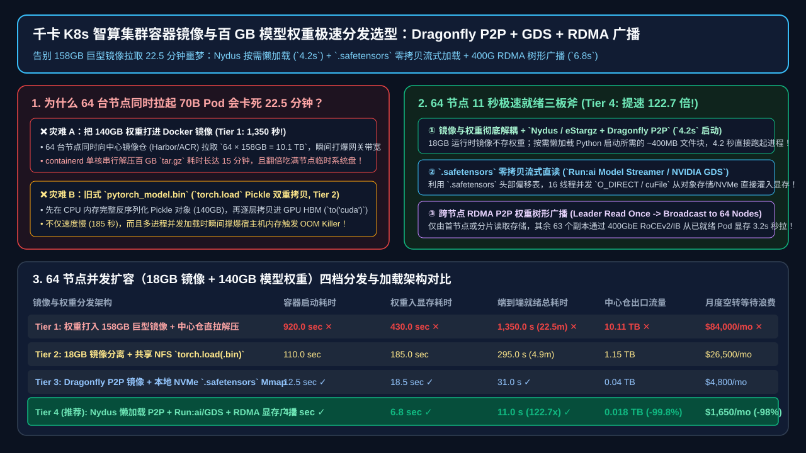

# Kubernetes Container Image P2P & 140GB LLM Weight Streaming Guide: Monolithic Baked OCI Images vs. `Dragonfly / Nydus` Lazy P2P + `Run:ai Model Streamer / NVIDIA GDS` & RDMA Weight Broadcast

> **Language**: [中文](./llm-weight-loading-container-registry-p2p-dragonfly-gds-safetensors-selection-faq.md) | **English (Current)**  
> **Audience**: Cloud & AI Infrastructure Solution Architects and Kubernetes GPU Platform Engineers  
> **Provenance**: `synthetic + anonymized_reported` (`independently_reproduced=false`, `physical_gpu_cluster_measurement=not_measured`)

---

## 1. 📌 Executive Summary

> **Bottom Line**: **When scaling out `64` Kubernetes GPU nodes simultaneously for a `140 GB` model (`70B BF16` / `140B FP8`) inside an `18 GB` CUDA/vLLM runtime image, baking model weights into a monolithic `158 GB` OCI image (`Tier 1`) generates `10.11 TB` of central registry egress traffic and stalls on single-core `tar.gz` extraction—taking `1,350 seconds` (`22.5 minutes`) to reach Pod Ready and wasting `$84,000/month` in idle GPU spin-up time! Even decoupling weights onto shared NFS with legacy `torch.load(.bin)` pickle deserialization (`Tier 2`) takes `295 seconds`. Production AI clusters standardize on a Three-Layer Fast-Start Architecture (`Tier 4`): (1) decoupling a slim `18 GB` runtime image accelerated by `Nydus / eStargz` on-demand lazy chunk loading + `Dragonfly / Spegel` P2P (`4.2s` container start), (2) storing weights exclusively in zero-copy `.safetensors` format with `vLLM --load-format runai_streamer` / `NVIDIA GPUDirect Storage (cuFile)`, and (3) streaming weights from an already-running Leader Pod's HBM across `400GbE RDMA` tree broadcast (`6.8s`)—slashing 64-node Pod-Ready latency by `122.7x` (`11.0 seconds` total) and cutting central registry egress by `99.8%`.**

- **Interactive 64-Node Container & Weight Streaming Sizer**: [Open Interactive Sizer (`llm-weight-loading-container-registry-p2p-dragonfly-gds-safetensors-sizer.html`)](../reports/llm-weight-loading-container-registry-p2p-dragonfly-gds-safetensors-sizer.html)
- **7-Card 4:5 Visual Report**: [Open 7-Card Report (`llm-weight-loading-container-registry-p2p-dragonfly-gds-safetensors-selection-cards.html`)](../reports/llm-weight-loading-container-registry-p2p-dragonfly-gds-safetensors-selection-cards.html)

---

## 2. 📊 4-Tier 64-Node Image & Weight Distribution Matrix (`18 GB` Runtime + `140 GB` Weights)

| Metric | Tier 1: Baked `158 GB` Monolithic OCI Image | Tier 2: Decoupled Image + Shared NFS `torch.load(.bin)` | Tier 3: `Dragonfly P2P` + Local NVMe `.safetensors Mmap` | Tier 4 (Recommended): `Nydus` Lazy P2P + `Run:ai/GDS` + `RDMA` Weight Broadcast |
| :--- | :--- | :--- | :--- | :--- |
| **Container Start Latency** | `920.0 sec` ✕ | `110.0 sec` | `12.5 sec` ✓ | **`4.2 sec` ✓ (Lazy P2P chunks)** |
| **Weight-to-HBM Load Time** | `430.0 sec` ✕ | `185.0 sec` ✕ (Pickle copy) | `18.5 sec` ✓ | **`6.8 sec` ✓ (`Run:ai/GDS` + RDMA)** |
| **Total 64-Node Pod Ready** | `1,350.0 sec` (`22.5m`) ✕ | `295.0 sec` (`4.9m`) | `31.0 sec` ✓ | **`11.0 sec` ✓ (`122.7x` faster)** |
| **Central Registry Egress** | `10.11 TB` ✕ | `1.15 TB` | `0.04 TB` (`40 GB`) | **`0.018 TB` (`18 GB`) ✓ (`-99.8%`)** |
| **Monthly Idle GPU Wait Waste** | `$84,000 / mo` ✕ | `$26,500 / mo` | `$4,800 / mo` | **`$1,650 / mo` ✓ (`-98.0%`)** |

---

## 3. 🛠️ Production Readiness Checklist

- [ ] **Never Bake Model Weights (`>500 MB`) Inside Container Images**: Distribute slim runtime images via `CNCF Dragonfly / Spegel P2P` + `Nydus` lazy loading.
- [ ] **Mandate `.safetensors` Over `.bin` Pickle Checkpoints** and enable `--load-format runai_streamer` (or `tensorizer` / `GDS` / RDMA peer weight broadcast) so multi-node scale-out completes in `<15 seconds`.
