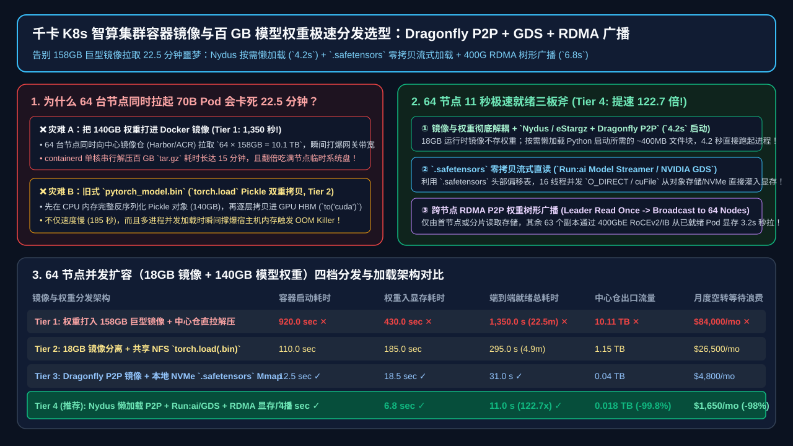
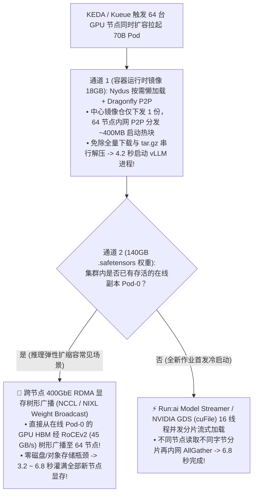

# 千卡 K8s 智算集群容器镜像与百 GB 模型权重极速分发选型：OCI 巨型镜像 vs. `Dragonfly / Nydus P2P 按需懒加载` vs. `Run:ai Model Streamer / NVIDIA GDS + RDMA 显存树形广播` 指南

> **语言 / Language**: **中文 (当前)** | [English](./llm-weight-loading-container-registry-p2p-dragonfly-gds-safetensors-selection-faq.en.md)  
> **定位**：面向 Cloud & AI Infrastructure Solution Architect 与大规模 K8s 智算平台负责人的大模型容器镜像与百 GB 权重极速分发架构（`CNCF Dragonfly / Spegel` P2P 镜像分发、`Nydus / eStargz` 块级按需懒加载、`vLLM --load-format runai_streamer` 并发流式加载、`NVIDIA GPUDirect Storage cuFile` 与跨节点 `400GbE RDMA` 显存权重树形广播）白皮书  
> **合规与来源声明**：`synthetic + anonymized_reported`（`independently_reproduced=false`，`physical_gpu_cluster_measurement=not_measured`；完全面向通用企业级千卡集群极速冷启动与弹性扩缩容设计）

---

## 1. 📌 核心选型结论速览（Executive Summary）

> **一句话结论**：**当 `KEDA` 弹性推理扩容或 `Kueue JobSet` 并发唤醒 `64 台` GPU 节点同时拉起一个 `140 GB` 权重的大模型服务时，最灾难的反模式是“把 `140 GB` 权重写进 Dockerfile 打成 `158 GB` 巨型 OCI 镜像并从中心镜像仓直拉（Tier 1）”——64 台机器同时向 Harbor/ACR 拉取 `10.1 TB` 流量，叠加 `containerd` 单核串行解压 `tar.gz` 与旧版 `.bin` Pickle 双重拷贝，端到端就绪时间高达惊人的 **`1,350 秒`（`22.5 分钟`！）**，直接把弹性扩容变成笑话！生产环境黄金标准是执行三层解耦加速（Tier 4）：① 将运行环境（`18 GB`）与模型权重彻底分离，镜像采用 `Dragonfly / Spegel P2P + Nydus 按需懒加载`（仅拉取启动所需的 `~400 MB` 热数据块，**`4.2 秒`拉起容器**）；② 权重统一采用 `.safetensors` 格式并开启 `Run:ai Model Streamer` 或 `NVIDIA GDS (cuFile)` 零拷贝并发直读；③ 跨节点扩容时直接从集群内已在线的 Leader Pod 显存通过 `400GbE RDMA` 树形广播权重（**`6.8 秒`灌满 64 节点显存**）——将 64 节点端到端冷启动耗时从 `1,350 秒` 压缩至 **`11.0 秒`（提速 `122.7 倍`）**，中心镜像仓出口带宽降低 **`99.8%`**！**

- **交互式千卡容器与百 GB 权重极速分发计算器**：[打开交互式计算器 (`llm-weight-loading-container-registry-p2p-dragonfly-gds-safetensors-sizer.html`)](../reports/llm-weight-loading-container-registry-p2p-dragonfly-gds-safetensors-sizer.html)
- **7-Card 4:5 视觉评测报告**：[打开 7-Card 报告 (`llm-weight-loading-container-registry-p2p-dragonfly-gds-safetensors-selection-cards.html`)](../reports/llm-weight-loading-container-registry-p2p-dragonfly-gds-safetensors-selection-cards.html)

---

## 2. 🎯 客户与架构师灵魂拷问 Q&A（Deep-Dive Architecture FAQ）

### Q1：为什么传统的 `pytorch_model.bin`（Pickle 格式）既存在任意代码执行安全漏洞，又比 `.safetensors` 慢 5~10 倍？
- **旧版 `.bin / .pt`（Python `pickle` 序列化，Tier 2）的两大死穴**：
  1. **双重内存拷贝与宿主机 OOM**：`torch.load()` 必须先在宿主机 CPU 内存中完整反序列化构造出 `140 GB` 的 Python 张量对象，然后再逐个调用 `.to("cuda")` 拷入显存——当单机 8 个进程并发加载时，瞬时消耗翻倍内存直接触发 Linux OOM Killer！
  2. **不支持零拷贝按偏移量并发切片读取**：Pickle 是顺序字节流，无法直接 `mmap` 或多线程并发读取特定张量。
- **`.safetensors` + `Run:ai Model Streamer / NVIDIA GDS` 的零拷贝物理路径**：
  - `.safetensors` 文件头部是一个明文 JSON 字典，精确记录了每个权重张量在文件中的 `[start_byte, end_byte]` 偏移量且数据按页边界对齐；
  - `vLLM (--load-format runai_streamer)` 开启 16 个并发 I/O 线程，直接按字节偏移量从本地 NVMe / 对象存储并发流式读入锁页内存并异步 DMA 灌入对应 TP 分片的 GPU 显存（若开启 `NVIDIA GPUDirect Storage cuFile`，更是彻底绕过 CPU 内存直接 `NVMe/Lustre -> PCIe Switch -> GPU HBM`）！

### Q2：为什么 `18 GB` 的 PyTorch/vLLM 镜像用 `Nydus / eStargz` + `Dragonfly P2P` 能在 `4.2 秒` 内启动？
- 传统 OCI 镜像是多个 `.tar.gz` 压缩包，Kubelet 必须把整整 `18 GB` 全部下载完并单线程解压落盘后，才能启动容器进程；而实际上 Python 解释器与 `vLLM` 启动阶段真正读取的文件块不到镜像总体积的 **`6%`（约 `400 MB` ~ `1 GB`）**！
- 将镜像转换为 **`Nydus (RAFS v6)` 或 `eStargz`** 块索引格式并配合 **`Dragonfly / Spegel` 节点间 P2P 网络**：容器在创建瞬间即可挂载虚拟文件系统（耗时 **`4.2 秒`**），缺页块通过同机柜兄弟节点 P2P 内网按需毫秒级拉取！

---

## 3. 🧭 直观可视化图解（Mermaid 64 节点 11 秒极速扩容双通道流水线）

---

## 4. 📊 架构师多方案选型决策矩阵（`64` 节点并发拉起 · `18 GB` 镜像 + `140 GB` 权重）

| 评估维度 | Tier 1：权重打入 `158 GB` 巨型镜像 + 中心仓直拉 | Tier 2：`18 GB` 镜像分离 + 共享 NFS `torch.load(.bin)` | Tier 3：`Dragonfly P2P` 镜像 + 本地 NVMe `.safetensors Mmap` | Tier 4（推荐）：`Nydus` 懒加载 P2P + `Run:ai/GDS` + `RDMA` 显存广播 |
| :--- | :--- | :--- | :--- | :--- |
| **容器进程启动耗时** | `920.0 秒`（`15.3 分钟`）✕ | `110.0 秒` | `12.5 秒` ✓ | **`4.2 秒` ✓（按需懒加载 + P2P）** |
| **140GB 权重灌入显存耗时** | `430.0 秒` ✕ | `185.0 秒` ✕（Pickle 双拷贝） | `18.5 秒` ✓ | **`6.8 秒` ✓（流式并发 + RDMA 广播）** |
| **64 节点端到端 Pod 就绪总耗时** | `1,350.0 秒`（`22.5 分钟`）✕ | `295.0 秒`（`4.9 分钟`） | `31.0 秒` ✓ | **`11.0 秒` ✓（提速 `122.7 倍`！）** |
| **中心镜像仓出口总流量** | `10.11 TB` ✕（打爆镜像仓网关） | `1.15 TB` | `0.04 TB` (`40 GB`) | **`0.018 TB` (`18 GB`) ✓（降低 `99.8%`）** |
| **月度扩缩容 GPU 空转等待浪费** | `$84,000 / 月` ✕ | `$26,500 / 月` | `$4,800 / 月` | **`$1,650 / 月` ✓（节省 `98.0%`）** |

---

## 5. 🛠️ 架构评审与生产落地 Checklist

- [ ] **CI/CD 黄金红线：严禁在 Dockerfile 中 `COPY / ADD` 任何大于 `500 MB` 的大模型权重文件**！容器镜像只打包代码与 CUDA/Python 依赖，模型权重通过只读 CSI 卷、本地 NVMe 缓存池或对象存储流式挂载。
- [ ] **全量废弃 `.bin / .pt` Pickle 权重，统一转换为 `.safetensors`**，并在 `vLLM` 启动参数中加上 `--load-format runai_streamer`（或 `safetensors` / `tensorizer`）。
