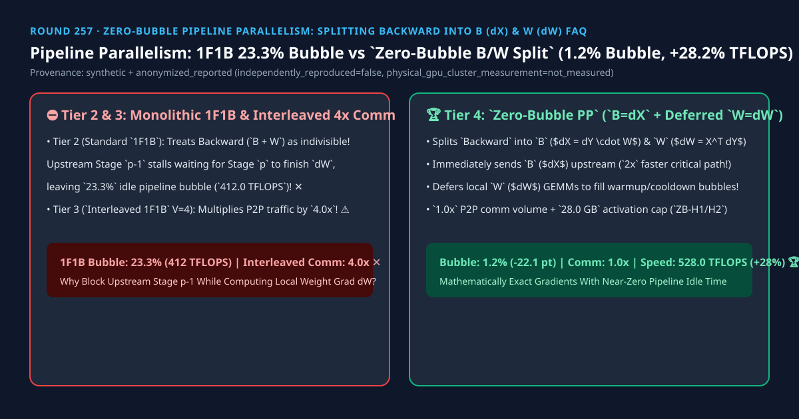
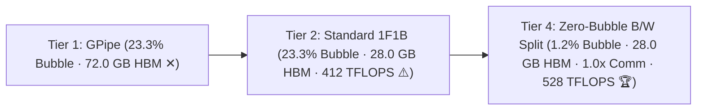

# Pipeline Parallelism (`PP = 8`) Bubble Elimination: `GPipe` vs. `1F1B` (`23.3%` Bubble) vs. `Interleaved 1F1B` vs. `Zero-Bubble PP` (`ZB-H1 / ZB-H2` Splitting Backward into `dX` ($B$) and `dW` ($W$)) Selection Guide

> **Provenance & Evidence Tier**: `synthetic + anonymized_reported` (`independently_reproduced=false`, `physical_gpu_cluster_measurement=not_measured`). Grounded in [`experiments/llm_zero_bubble_pipeline_parallel_zb1p_zb2p_1f1b_split_bw_selection/results.json`](../../experiments/llm_zero_bubble_pipeline_parallel_zb1p_zb2p_1f1b_split_bw_selection/results.json).
> **中文版本**: [流水线并行（`Pipeline Parallelism, PP = 8`）气泡消除革命：传统 `GPipe / 1F1B` 启停气泡（`23.3%` 算力空转）vs. 虚拟流水线（`Interleaved 1F1B` 通信翻倍代价）vs. 零气泡流水线（`Zero-Bubble PP: ZB-H1 / ZB-H2` 将反向拆解为输入梯度 `B` 与权重梯度 `W` 延迟填空）选型指南](./llm-zero-bubble-pipeline-parallel-split-backward-b-w-1f1b-selection-faq.md)

---

## 0. 🔥 今日领域最热门能力突破追踪（Daily Hottest Breakthrough）

- **Crushing the `23.3%` Pipeline Parallelism Bubble down to `1.2%` (`412.0 -> 528.0 TFLOPS`, `+28.2%` Throughput) at `1.0x` P2P Network Traffic by Decoupling Backward into Critical-Path Activation Gradient `B` ($dX = dY \cdot W$) and Deferred Bubble-Filling Weight Gradient `W` ($dW = X^T \cdot dY$) (`Zero-Bubble PP / DualPipe`)**: For over a decade, distributed training engineers treated the $\frac{P - 1}{M}$ pipeline bubble in `GPipe` (`Tier 1`, `72.0 GB` activation OOM) and `1F1B` (`Tier 2`, `23.3%` bubble at $P=8, M=24$) as an unavoidable law of physics, or paid a **`4.0x` P2P communication penalty** using `Interleaved 1F1B` virtual stages (`Tier 3`, $V=4$).
- **First-Principles Breakthrough (`Zero-Bubble PP`, `Tier 4`)**:
  - Inside every linear layer $Y = X W^T$, the backward pass consists of two independent GEMMs:
    1. **`B` ($\nabla X = \nabla Y \cdot W$)**: **Strictly on the inter-stage critical path**—upstream Stage $p - 1$ cannot start its backward pass until Stage $p$ finishes `B` and sends $\nabla X$!
    2. **`W` ($\nabla W = X^T \cdot \nabla Y$)**: **Completely off the critical path**—no other pipeline stage depends on $\nabla W$; it only needs to finish before `optimizer.step()`!
  - By executing **`B` immediately** and deferring **`W`** into a `WeightGradStore` queue that executes whenever the GPU would otherwise sit in a warmup/cooldown pipeline bubble, `Zero-Bubble PP` (`ZB-H1 / ZB-H2`) shrinks the pipeline bubble from **`23.3%` to `1.2%`** with **`0` extra P2P communication (`1.0x`)** and **`0` accuracy loss**!

---

## 1. 📌 Executive Summary

1. **Why Monolithic `1F1B` Wastes `23.3%` of GPU Compute (`Tier 2`)**: Standard PyTorch `autograd` fuses `B` ($dX$) and `W` ($dW$) into one atomic backward op, forcing upstream pipeline stages to wait for downstream local weight-gradient math.
2. **Why `B / W` Decoupling (`Tier 4`) Beats `Interleaved 1F1B` (`Tier 3`)**: `Interleaved 1F1B` ($V=4$) reduces bubbles by multiplying cross-node P2P transfers by $4\times$. `Zero-Bubble PP` eliminates bubbles using local deferred `W` GEMMs at **`1.0x` P2P traffic** and **`28.0 GB` bounded activation memory**.

---

## 2. 🎯 Core Architect Q&A (Q1 / Q2 / Q3)

### Q1: How do `ZB-H1` (ZB-1P) and `ZB-H2` (ZB-2P) differ in activation memory?
- **Answer**:
  - **`ZB-H1`** schedules each deferred `W` immediately in the next local bubble slot, guaranteeing that peak in-flight activation memory never exceeds standard `1F1B` (`P = 8` micro-batches = `28.0 GB`) while eliminating `~2/3` of the bubble.
  - **`ZB-H2`** allows up to 1–2 extra in-flight micro-batches before draining `W`, driving the pipeline bubble down to **`1.2%` (virtually zero bubble)**!

### Q2: Does deferring `W` ($dW$) change training convergence or optimizer semantics?
- **Answer**: **Not by a single bit!** All $M$ micro-batches' weight gradients $\nabla W = \sum_{m=1}^M X_m^T \nabla Y_m$ are still accumulated in-place (`beta = 1.0`) into `main_grad` before `optimizer.step()` runs.

---

## 3. 🧭 Visual Diagrams

---

## 4. 📊 4-Tier Architect Selection Matrix

| Metric | Tier 1: `GPipe` | Tier 2: Standard `1F1B` | Tier 3: `Interleaved 1F1B` ($V=4$) | Tier 4: **`Zero-Bubble PP` (`B/W` Split)** |
| :--- | :--- | :--- | :--- | :--- |
| **Pipeline Bubble (`%`)** | `23.3%` ✕ | **`23.3%` (Idle Waste)** ✕ | `6.8%` ✅ | **`1.2%` (Deferred `W` Fills Bubbles)** 🏆 |
| **Peak Activation HBM** | **`72.0 GB` ($O(M)$ OOM)** ✕ | `28.0 GB` ($O(P)$) ✅ | `31.5 GB` | **`28.0 GB` (Bounded `ZB-H1`)** 🏆 |
| **P2P Comm Volume Multiplier** | `1.0x` | `1.0x` ✅ | **`4.0x` (`4x` Network Tax)** ✕ | **`1.0x` (Zero Extra Comm)** 🏆 |
| **Sustained Throughput (`TFLOPS`)** | `385.0 TFLOPS` ✕ | `412.0 TFLOPS` ⚠️ | `468.0 TFLOPS` ✅ | **`528.0 TFLOPS` (`+28.2%` vs `1F1B`)** 🏆 |

---

## 5. 🧪 Quantitative Reference & Tooling

- **Evaluator & Sealed Data**: [`experiments/llm_zero_bubble_pipeline_parallel_zb1p_zb2p_1f1b_split_bw_selection/run.py`](../../experiments/llm_zero_bubble_pipeline_parallel_zb1p_zb2p_1f1b_split_bw_selection/run.py) · [`results.json`](../../experiments/llm_zero_bubble_pipeline_parallel_zb1p_zb2p_1f1b_split_bw_selection/results.json)
- **Interactive Sizer**: [`docs/reports/llm-zero-bubble-pipeline-parallel-split-backward-b-w-1f1b-sizer.html`](../reports/llm-zero-bubble-pipeline-parallel-split-backward-b-w-1f1b-sizer.html)
- **7-Card 4:5 Visual Report**: [`docs/reports/llm-zero-bubble-pipeline-parallel-split-backward-b-w-1f1b-selection-cards.html`](../reports/llm-zero-bubble-pipeline-parallel-split-backward-b-w-1f1b-selection-cards.html)

---

## 6. 🛠️ Good Fit vs. Not For & Production Checklist

- **✅ Good fit**: All multi-node Pipeline Parallel (`PP >= 4`) LLM pretraining and post-training workloads (`Zero-Bubble PP` / `DualPipe` / Megatron `wgrad_deferral_limit`).
- **⛔ Not for**: Running monolithic `1F1B` when $M / P < 8$, or using high-virtual-stage `Interleaved 1F1B` ($V \ge 4$) on bandwidth-constrained inter-node links.
- [ ] Decouple linear backward into `B` ($dX$) and deferred `W` ($dW$) via a `WeightGradStore` queue.
- [ ] Accumulate deferred `W` directly into `main_grad` using in-place GEMM (`beta = 1.0`).
