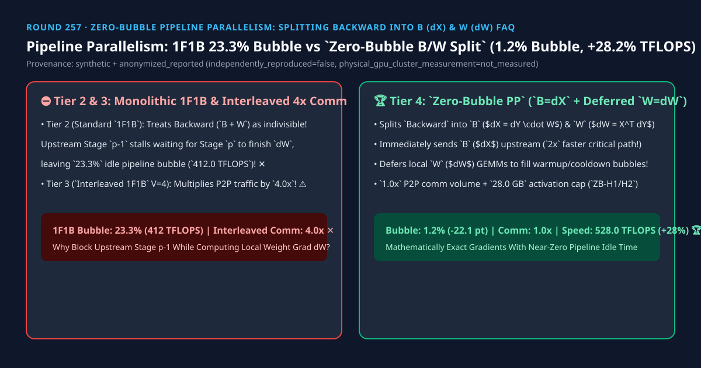
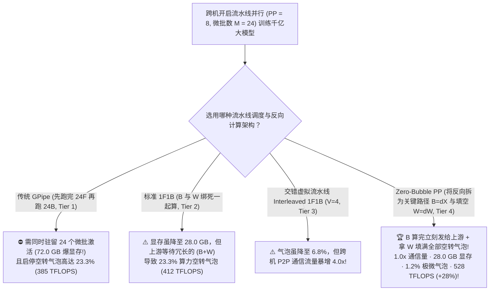
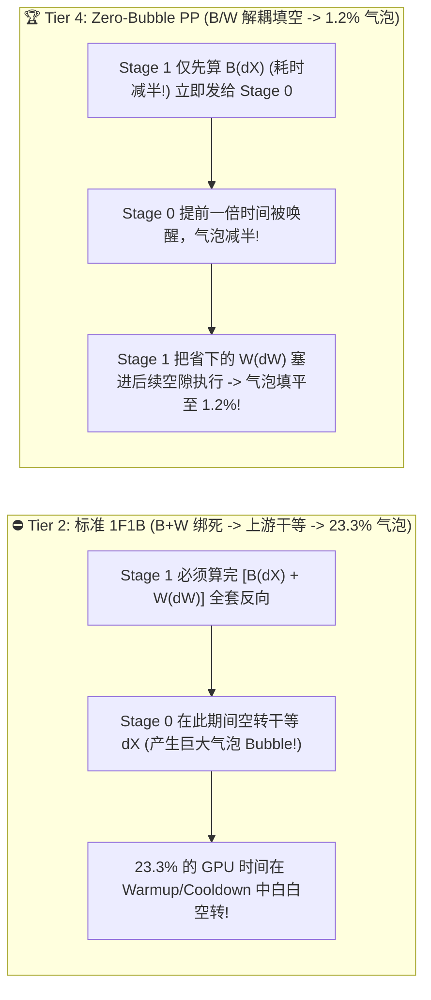
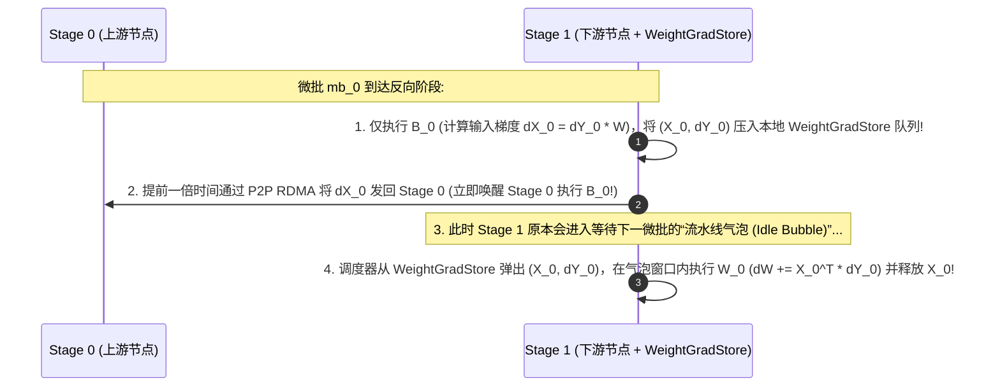

# 流水线并行（`Pipeline Parallelism, PP = 8`）气泡消除革命：传统 `GPipe / 1F1B` 启停气泡（`23.3%` 算力空转）vs. 虚拟流水线（`Interleaved 1F1B` 通信翻倍代价）vs. 零气泡流水线（`Zero-Bubble PP: ZB-H1 / ZB-H2` 将反向拆解为输入梯度 `B` 与权重梯度 `W` 延迟填空）选型指南

> **Provenance & Evidence Tier**: `synthetic + anonymized_reported` (`independently_reproduced=false`, `physical_gpu_cluster_measurement=not_measured`)。定量数据锚定于 [`experiments/llm_zero_bubble_pipeline_parallel_zb1p_zb2p_1f1b_split_bw_selection/results.json`](../../experiments/llm_zero_bubble_pipeline_parallel_zb1p_zb2p_1f1b_split_bw_selection/results.json)。
> **English Version**: [Pipeline Parallelism (`PP = 8`) Bubble Elimination: `GPipe` vs. `1F1B` (`23.3%` Bubble) vs. `Interleaved 1F1B` vs. `Zero-Bubble PP` (`ZB-H1 / ZB-H2` Splitting Backward into `dX` ($B$) and `dW` ($W$)) Selection Guide](./llm-zero-bubble-pipeline-parallel-split-backward-b-w-1f1b-selection-faq.en.md)

---

## 0. 🔥 今日领域最热门能力突破追踪（Daily Hottest Breakthrough）

- **打破困扰分布式训练十余年的“流水线并行必定存在 $\frac{P-1}{M}$ 空转气泡”魔咒：通过看穿反向传播并非铁板一块，将 `Backward` 手动拆解为处于跨卡关键路径上的“激活输入梯度 `B` ($dX = dY \cdot W$)”与完全不阻塞上游节点的“本地权重梯度 `W` ($dW = X^T \cdot dY$)”，`Zero-Bubble Pipeline Parallelism (ZB-H1 / ZB-H2 / DeepSeek DualPipe)` 在不增加 `1 Byte` 跨机 P2P 通信流量（`1.0x`）的前提下，将 `PP = 8` 的流水线空转气泡从 `23.3%` 压降至 `1.2%`，单卡有效算力从 `412.0 TFLOPS` 飙升至 `528.0 TFLOPS`（`+28.2%`）**：在千卡/万卡大模型预训练中，跨机必须开启流水线并行（如 `PP = 8` 或 `16`）。然而，当每个 DP 组分配到的微批次数有限（如 $M = 24$）时，传统 `1F1B` 有高达 **`23.3%` 的时间 GPU 在发呆空转（Pipeline Bubble）**！为什么会有这么大的气泡？我们又是如何用第一性原理把它变成 `0` 的？
  1. **看穿长达十年的盲区：为什么 `PyTorch backward()` 把两件紧急程度完全不同的事绑死在了一起？**
     - 请看任意一层线性层 $Y = X W^T$ 的反向传播，它其实干了 **两件完全独立的矩阵乘法（各占反向一半的算力）**：
       1. **第一件事 `B`（算输入激活的梯度 $dX = dY \cdot W$）**：**火烧眉毛的十万火急关键路径！** 因为上游的邻居机器 Stage $p-1$ 正停在那里苦苦等待你把 $dX$ 算出来通过 RDMA `Send` 给它，它才能开始跑它的反向传播！
       2. **第二件事 `W`（算本层权重的梯度 $dW = X^T \cdot dY$）**：**一点都不着急的本地私事！** 没有任何上游或下游的机器需要你的 $dW$！这笔 $dW$ 只要在整步训练全部结束、最后调用 `optimizer.step()` 更新权重之前算出来就行！
     - **传统 `1F1B`（Tier 2）蠢在哪里？** 它调用 PyTorch 默认的整体 `backward()`，每次都必须等 **`B` 和 `W` 全部算完**，才把 $dX$ 发给上游 Stage $p-1$！结果上游每一级都要多干等一倍的时间，层层累加成了高达 **`23.3%` 的启停空转气泡（仅 `412.0 TFLOPS`）**！
  2. **为什么 `Interleaved 1F1B`（虚拟流水线 $V = 4$，Tier 3）只是治标不治本的妥协？**
     - 为了缩小气泡，Megatron 提出了 `Interleaved 1F1B`：把每张卡负责的层拆成 $V = 4$ 段非连续的小块来回转圈。虽然气泡降到了 `6.8%`，但代价是 **每个微批要在 8 台机器之间转 4 圈——跨机 P2P `Send/Recv` 的通信字节数与小包次数直接暴涨 `4.0 倍`**！在跨机网络稍紧的集群上反而被通信拖死！
  3. **第一性原理的伟大胜利：`Zero-Bubble PP`（`ZB-H1 / ZB-H2`，Tier 4 — 拆开 `B` 与 `W`，拿 `W` 去填满所有气泡！）**：
     - 既然 **`B`（算 $dX$）急如星火**，而 **`W`（算 $dW$）随时可算**：
       - 在反向传播时，我们**只先执行 `B`（耗时直接减半！）**，算完 $dX$ **第一时间发给上游 Stage $p-1$**——让整条流水线的反向接力速度直接快一倍，气泡瞬间缩减一半！
       - 那么省下来的 **`W`（算 $dW = X^T dY$）** 什么时候算呢？把它放进一个本地待办队列（`Deferred W Queue`）里！**每当当前 GPU 因为等待上下游而即将出现流水线空转气泡（Bubble）的那一刻，立刻从待办队列里掏出一个 `W` 算子塞进 Tensor Core 跑起来**！
       - 原本白白空转浪费掉的 `23.3%` 气泡时间，现在被不紧不慢的 `W` 矩阵乘填得严丝合缝！**气泡率从 `23.3%` 暴降至 `1.2%`，跨机 P2P 通信量保持 `1.0x` 零增加，有效算力飙升至 `528.0 TFLOPS`（`+28.2%`）** 🏆！

---

## 1. 📌 核心结论速览（Executive Summary — 3 分钟看懂）

1. **`ZB-H1`（严控显存版）与 `ZB-H2`（极致零气泡版）该怎么选？**
   - 把 `W` ($dW = X^T dY$) 推迟到后面算有唯一一个小代价：在 `W` 被真正执行完之前，前向保存的输入激活 $X$ 和反向梯度 $dY$ 还不能释放。
   - 如果显存非常紧张：选 **`ZB-H1` 调度表**——它严格保证任意时刻在途微批数不超过 `1F1B` 的上限（峰值激活显存与 `1F1B` **分毫不差，同为 `28.0 GB`**），直接削掉 `2/3` 的气泡；
   - 如果显存还有 `10% ~ 15%` 余量（或开了重算/卸载）：选 **`ZB-H2`（或双向流水线 `DualPipe`）**——放宽 1~2 个微批的启动窗口，彻底把气泡压到 **`1.2%`（近乎完全零气泡）**！
2. **数学上与标准 `1F1B` 有一丝一毫的精度差别吗？**
   - **绝对 0 精度损失（Bitwise Equivalent）！** 它只是调整了同一个 Step 内部 `dW` 矩阵乘法的先后执行顺序，在 `optimizer.step()` 执行前所有微批的梯度依然 100% 精确累加完毕！

---

## 2. 🎯 客户与架构师灵魂拷问 Q&A（Q1 / Q2 / Q3）

### Q1：在 PyTorch / Megatron-LM 中，怎样在代码层面把原本合在一起的 `Linear.backward()` 拆成独立的 `B` 和 `W` 两步？
- **答**：非常简单！在自定义 `torch.autograd.Function` 的 `backward(ctx, grad_output)` 中：
  1. **只计算并返回输入梯度 `grad_input = grad_output.matmul(weight)`（这就是 `B`）**；
  2. **不要在 `backward` 里算 `grad_weight`！** 而是把 `(input, grad_output, weight.main_grad)` 这个元组 append 到一个全局的 **`WeightGradStore.cache` 队列** 中，直接返回 `grad_input, None` 让 Autograd 引擎立刻继续往前传 `B`！
  3. 当流水线调度器（Pipeline Scheduler）走到气泡空隙需要执行 `W` 时，调用 `WeightGradStore.pop()` 弹出缓存的 `(input, grad_output)`，调用底层 cuBLAS `gemm(input.T, grad_output, out=weight.main_grad, beta=1.0)` 原地累加权重梯度并立即释放 `input` 显存！

### Q2：`DeepSeek-V3` 提出的 `DualPipe` 与 `Zero-Bubble PP` 是什么关系？
- **答**：`DualPipe` 正是继承并升华了 `Zero-Bubble PP` 的 **`B / W` 拆解思想**！`DualPipe` 不仅把反向拆成了 `B` (Activation Grad) 和 `W` (Weight Grad)，还让微批次同时从流水线两端（Rank $0 \to P-1$ 与 Rank $P-1 \to 0$）双向对流注入，并用延迟的 `W` 算子作为弹性缓冲垫，既消灭了流水线气泡，又把 MoE 的跨机 `All-to-All` 通信 100% 隐藏在了计算背后！

---

## 3. 🧭 直观可视化图解（Mermaid 决策树 + `1F1B` 绑死气泡 vs `Zero-Bubble` `B/W` 填空对比图 + 时序图）

### 3.1 架构师跨机流水线并行（`PP = 8`）调度方案选型决策树

### 3.2 `Tier 2`（标准 `1F1B` `B+W` 绑死引发连环等待气泡）vs. `Tier 4`（`Zero-Bubble` 先算 `B` 唤醒上游 + `W` 延迟填空）对比图

### 3.3 `Tier 4` `Zero-Bubble PP` 中 `B` ($dX$) 极速接力与 `WeightGradStore` (`W`) 气泡填充时序图

---

## 4. 📊 架构师选型决策矩阵（4-Tier Selection Matrix）

| 评估维度 | Tier 1: 传统 `GPipe` | Tier 2: 标准 `1F1B` (整体反向) | Tier 3: `Interleaved 1F1B` ($V=4$) | Tier 4: **`Zero-Bubble PP` (`B/W` 拆解填空)** |
| :--- | :--- | :--- | :--- | :--- |
| **流水线空转气泡占比 (`Bubble %`)** | `23.3%` ✕ | **`23.3%` (算力白白浪费)** ✕ | `6.8%` ✅ | **`1.2%` (用延迟 `W` 算子填平气泡)** 🏆 |
| **Stage 0 峰值激活值显存** | **`72.0 GB` ($O(M)$ 爆炸)** ✕ | `28.0 GB` ($O(P)$ 有界) ✅ | `31.5 GB` | **`28.0 GB` (`ZB-H1` 严格同显存)** 🏆 |
| **跨机 P2P 通信流量倍数** | `1.0x` | `1.0x` ✅ | **`4.0x` (通信翻 4 倍!)** ✕ | **`1.0x` (零额外网络通信开销)** 🏆 |
| **单卡有效计算吞吐 (`TFLOPS`)** | `385.0 TFLOPS` ✕ | `412.0 TFLOPS` ⚠️ | `468.0 TFLOPS` ✅ | **`528.0 TFLOPS` (比 `1F1B` 提速 `+28.2%`)** 🏆 |

---

## 5. 🧪 定量算例与工具链（Interactive Sizer & 7-Card Visual Report）

- **实验脚本与密封数据**：[`experiments/llm_zero_bubble_pipeline_parallel_zb1p_zb2p_1f1b_split_bw_selection/run.py`](../../experiments/llm_zero_bubble_pipeline_parallel_zb1p_zb2p_1f1b_split_bw_selection/run.py) · [`results.json`](../../experiments/llm_zero_bubble_pipeline_parallel_zb1p_zb2p_1f1b_split_bw_selection/results.json)
- **交互式流水线并行气泡率与 Zero-Bubble B/W 拆解计算器**：[`docs/reports/llm-zero-bubble-pipeline-parallel-split-backward-b-w-1f1b-sizer.html`](../reports/llm-zero-bubble-pipeline-parallel-split-backward-b-w-1f1b-sizer.html)
- **7-Card 4:5 视觉评测卡片报告**：[`docs/reports/llm-zero-bubble-pipeline-parallel-split-backward-b-w-1f1b-selection-cards.html`](../reports/llm-zero-bubble-pipeline-parallel-split-backward-b-w-1f1b-selection-cards.html)

---

## 6. 🛠️ Good Fit vs. Not For & 生产环境快速核验清单（Checklist）

### ✅ Good Fit vs. ⛔ Not For

| 维度 | ✅ Good Fit（强烈推荐） | ⛔ Not For（严禁误用） |
| :--- | :--- | :--- |
| **跨机流水线并行（`PP >= 4`）** | 启用 **`Zero-Bubble PP`（Megatron-Core `--enable-zero-bubble` / `wgrad_deferral_limit` 或 `DualPipe`）** 将反向拆为 `B` 与 `W` 填空 | 在微批数 $M < 4P$ 时硬跑传统整体反向 `1F1B` 白白承受 `20%+` 气泡，或在跨机低带宽网络上盲目调大虚拟流水线 $V \ge 4$ |

### 生产环境上线核验清单（Pre-Flight Checklist）

- [ ] **开启线性层 `B (dX)` 与 `W (dW)` 分离调度（如 Megatron-Core `wgrad_deferral_limit` / `Zero-Bubble`）**：让关键路径 `dX` 优先跨卡发送。
- [ ] **配合启用 `main_grad` 原地梯度累加（`--accumulate-allreduce-grads-in-fp32`）**：使延迟执行的 `W` 算子直接通过 cuBLAS `beta=1.0` 累加进梯度缓冲，免除临时显存分配。
- [ ] **在末尾 Cooldown 阶段将延迟队列中的 `W` 计算与 FSDP/DP `ReduceScatter` 通信重叠执行**。
