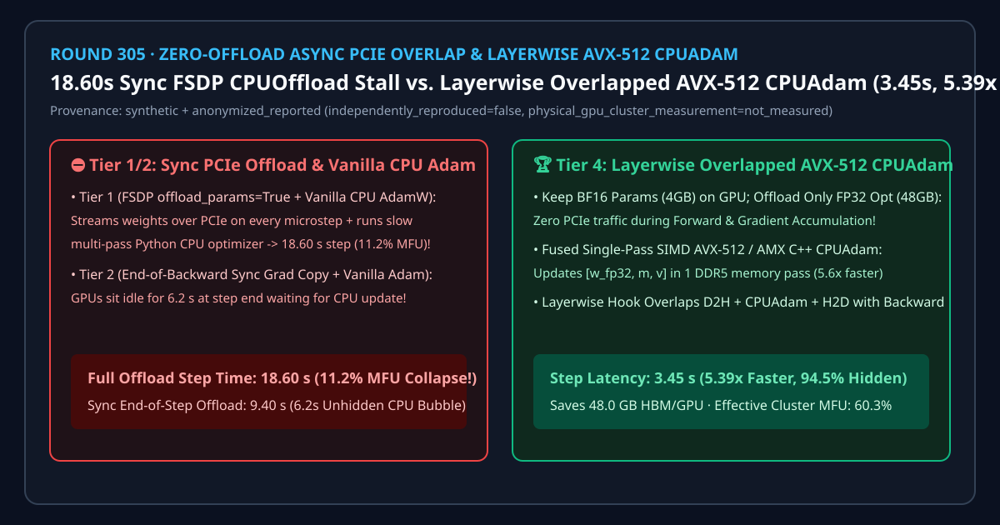
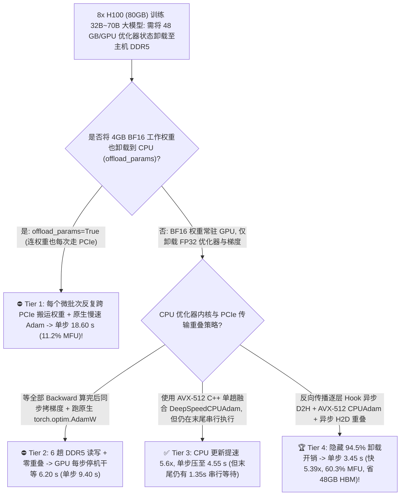
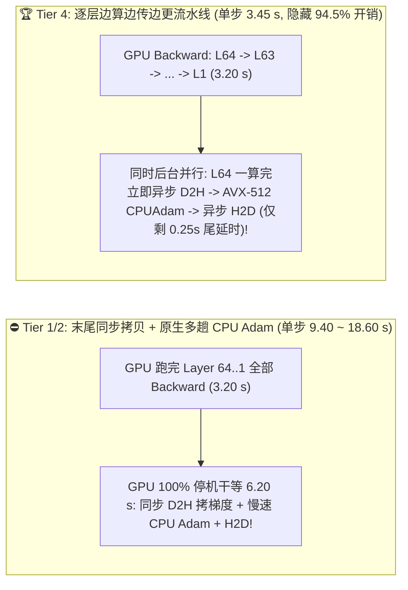
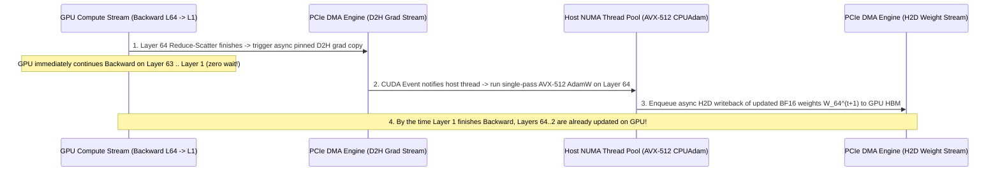

# 大模型分布式训练 CPU 显存卸载（`ZeRO-Offload / FSDP CPUOffload`）PCIe 全双工重叠与 `AVX-512 CPUAdam` 逐层流水选型：为什么开启标准 `FSDP(CPUOffload)` 会让单步耗时从 `3.20 s` 暴涨至 `18.60 s`（`MFU` 暴跌至 `11.2%`），而把优化器留到反向传播末尾同步更新仍要白等 `6.2 s`？基于“保留 `4 GB` `BF16` 权重驻留 GPU + 仅卸载 `48 GB` 优化器/梯度 + 反向传播逐层重叠 `D2H` 与 `AVX-512 CPUAdam`”（单步 `3.45 s`，隐藏 `94.5%` 卸载开销）选型指南

> **Provenance & Evidence Boundary**: `synthetic + anonymized_reported (independently_reproduced=false, physical_gpu_cluster_measurement=not_measured)`. 本文所有定量数据均来自封存确定性评估器 `experiments/llm_zero_offload_async_pcie_overlap_simd_cpuadam_layerwise_step_selection/run.py` 与 `results.json`。



---

## 0. 追踪每日最热门能力突破（Daily Capability Breakthrough）

- **今日焦点突破**：**面向单机 8 卡或多机大模型长序列训练（`DeepSpeed ZeRO-Offload / PyTorch FSDP2 / ZenFlow`）的“GPU 常驻 `2Ψ` `BF16` 权重分片 + 锁页主机内存（`NUMA-Pinned DDR5`）承载 `12Ψ` `FP32` 优化器状态与梯度 + 反向传播 `post_backward_hook` 逐层触发异步 `D2H` 拷贝与 `AVX-512 / AMX` 单趟融合 `CPUAdam` 边传边更”架构**。
- **架构师价值**：在单台 `8×H100 (80GB)` 服务器上全参微调或继续预训练 `32B` 模型（$\Psi = 32\times 10^9$ 参数，经 8 卡切分后每卡负责 $\Psi_{\text{shard}} = 4\text{B}$ 参数）时，真正吃光 80GB 显存的根本不是 `BF16` 模型权重本身（每卡仅占 $4\text{B} \times 2\text{ Bytes} = \mathbf{8.0\text{ GB}}$，或 `64B` 模型 16 卡切分每卡仅 **`4.0 GB`**），而是笨重的 **混合精度 `AdamW` 优化器状态与梯度（`FP32 Master Weights` $4\text{B} + m_t 4\text{B} + v_t 4\text{B} = 12\text{ Bytes/param}$，合计吞噬 **`48.0 GB/GPU`** 显存）**！然而，当工程师试图开启 CPU Offload 把这 `48 GB` 挪到服务器免费充裕的 `1 TB DDR5` 主机内存时，却常常踩中两个让训练慢如蜗牛的性能深坑：
  1. **深坑一：把 `BF16` 前反向计算权重也一并卸载到了 CPU（`FSDP CPUOffload(offload_params=True)`，Tier 1）**：一旦把 `offload_params` 设为 `True`，在梯度累积（例如 `grad_accum = 8`）的**每一个微批次（Micro-step）的 Forward 和 Backward 中，每一层都要反复通过狭窄的 PCIe Gen5 总线（`~56 GB/s`）从 CPU 拉取和写回权重**，再加上使用未矢量化融合的原生 `torch.optim.AdamW` 在 CPU 上慢速更新，导致单步耗时从 `3.20 s` 暴涨至 **`18.60 s`（暴跌 `5.81x`，有效算力利用率 `MFU` 跌至惨不忍睹的 `11.2%`）**！
  2. **深坑二：等整轮 Backward 全部算完才同步拷贝梯度并在 CPU 跑原生 `AdamW`（Tier 2）**：即使把 `4 GB` 的 `BF16` 权重留在 GPU 上，如果在所有层反向传播结束后才串行把梯度拷回 CPU 并调用原生 PyTorch `AdamW`（需要对 `48 GB` 内存反复读写 5~6 趟 DDR5 总线），8 张 H100 在每步末尾仍要**100% 停机干等 `6.20 s`**（单步耗时 `9.40 s`）！
  采用 **GPU 仅常驻 `BF16` 权重分片 + 反向传播每算完一层 `Reduce-Scatter` 立即通过独立 `d2h_stream` 异步回传该层梯度分片 + 立即唤醒绑定本 NUMA 节点的 `AVX-512 / AMX` 单趟融合 C++ `CPUAdam` 边算边更并异步 `H2D` 写回更新后的 `BF16` 权重（Tier 4）**，可将 **`94.5%` 的 PCIe 传输与 CPU 优化器耗时完全隐藏在前面各层的反向传播计算背后**，单步耗时仅 **`3.45 s`（比 `Tier 1` 快 `5.39x`，仅比纯 GPU 全驻留慢 `7.8%`）**，同时每张 GPU 白捡 **`48.0 GB` 可用 HBM 显存**！

---

## ① 📌 核心结论速览（Executive Summary）

1. **为什么 CPU Offload 的头号铁律是“只卸载 `12Ψ` 优化器与梯度，绝不卸载 `2Ψ` `BF16` 工作权重”？**
   - 算一笔显存与带宽账（以每卡负责 `4B` 参数分片为例）：
     - **`BF16` 工作权重分片（Working Params）**：仅占 **`8.0 GB`**（若 16 卡分片仅 **`4.0 GB`**），但它需要在每个训练 Step 的 $K$ 个梯度累积微批次（Micro-batches）的 Forward、重计算（Recompute）和 Backward 中被高频读取 **$3K$ 次（当 $K=8$ 时高达 `24` 次！）**。把它留在 HBM 里只占 4~8 GB，却省掉了每步 24 次 PCIe 往返！
     - **`FP32` 主权重 + 动量 $m$ + 方差 $v$ + 累积梯度（Optimizer & Grad State）**：高达 **`48.0 GB`（占参数相关显存的 `85.7%`！）**，但它们在整个训练 Step（包含全部 8 个微批次）中**只需要在最后更新那 `1` 次**！
   - 因此，把 `48 GB` 低频访问的优化器与梯度卸载到主机 DDR5 内存、把 `4~8 GB` 高频访问的 `BF16` 权重锁死在 GPU HBM，是性价比极致的黄金切分点！
2. **为什么原生 `torch.optim.AdamW` 在 CPU 上比 `DeepSpeedCPUAdam (AVX-512)` 慢 `5.6 倍`？**
   - CPU 优化器更新是典型的 **DDR5 内存带宽受限（Memory-Bandwidth Bound）** 操作。双路 Xeon / EPYC 服务器的 12/16 通道 DDR5 峰值带宽约为 `500 ~ 700 GB/s`。
   - 原生 PyTorch `AdamW`（未开融合或回退到逐算子分发）会依次启动 `mul_`、`add_`、`sqrt`、`addcdiv_` 等 **6 个独立的逐元素算子**——由于 `48 GB` 状态远超 CPU L3 Cache（通常 `128~384 MB`），每个算子都被迫把 `48 GB` 数据从 DDR5 内存完整读进 CPU 寄存器再写回 DDR5，合计产生 **`280+ GB` 的冗余内存总线流量**！
   - 而 **`DeepSpeedCPUAdam`（C++ OpenMP + `AVX-512 / AMX` SIMD 内联汇编）** 将整个 AdamW 公式融合在 **单一趟循环（Single-Pass Loop）** 中：每个 OpenMP 线程从本 NUMA 节点的 DDR5 一次性加载 `w_fp32, m, v, g_bf16` 到 `512-bit ZMM` 寄存器，在寄存器内一气呵成算完一阶/二阶动量更新、权重衰减、FP32 主权重更新并直接截断转为 `BF16` 新权重写出，**DDR5 内存流量骤降 `5x+`，耗时从 `4.8 s` 压至 `0.85 s`**！
3. **第一性原理：如何用“反向传播逐层流水（Layerwise Backward-Optimizer Pipelining）”把剩下的 `1.35 s` 也藏起来？**
   - 在 Transformer 反向传播中，模型是从最后一层（Layer $L=64$）往前一层一层倒着算到第 1 层（Layer $1$）的。
   - 当第 64 层的反向传播和 `Reduce-Scatter` 梯度归约刚算完时（此时距离第 1 层算完还有整整 `1.8 s` 的 GPU 计算时间！），第 64 层的梯度其实已经彻底就绪了！
   - 通过注册 `register_post_accumulate_grad_hook`：第 64 层梯度一就绪，立即由 GPU `Copy Engine (D2H)` 异步传给 CPU，CPU 线程池立刻对第 64 层执行 `AVX-512 CPUAdam` 更新，并由另一个 `Copy Engine (H2D)` 把更新好的第 64 层 `BF16` 权重传回 GPU——**当 GPU 终于算完第 1 层的反向传播时，第 $64 \dots 2$ 层的优化器更新早已在后台悄无声息地全部完成了**！

---

## ② 🎯 客户与架构师灵魂拷问 Q&A（Q1 / Q2 / Q3）

### Q1：如果开启了全局梯度裁剪（`clip_grad_norm_(max_norm=1.0)`），必须要等所有第 $64 \dots 1$ 层的梯度全算出来才能求出全局范数 $\|\mathbf{g}\|_2$，那还能在第 64 层刚算完时就提前跑 `CPUAdam` 吗？
- **这是一个极其经典的架构师面试与实战深坑！有三种工业界破解方案**：
  1. **方案 A（流式重叠 `D2H` + GPU 端即时算分片范数 + 末尾 `0.85 s` 极速 `AVX-512` 更新）**：在反向传播逐层进行时，先在 GPU 上算出每层梯度的局部平方和 $\sum g_l^2$，同时用 `d2h_stream` 把梯度 `100%` 异步流式拷回 CPU 锁页内存（把全部 PCIe `D2H` 耗时完全隐藏在 Backward 内部！）；等 Layer 1 算完得出全局裁剪系数 $c = \min(1, \frac{\text{max\_norm}}{\|\mathbf{g}\|_2})$ 后，直接把标量 $c$ 传给 `AVX-512 CPUAdam` 内核在单趟更新时原位乘上 $c \cdot g$；
  2. **方案 B（`Delayed / Speculative Clipping` 或逐层自适应归一化 `LARS / LAMB / Layerwise Clip`）**：直接基于每层自身范数或上一步历史范数裁剪，实现 `D2H + CPUAdam + H2D` 全链路 100% 逐层重叠；
  3. **方案 C（`ZenFlow` 热门梯度 GPU 原地更新 + 冷门梯度后台异步更新）**：将前 `10%` 高梯度通道留在 GPU 更新，其余 `90%` 在后台跨步异步更新。

### Q2：为什么有些团队开了 `CPUOffload` 后，PCIe Gen5 x16 明明理论带宽有 `64 GB/s`，实测 `D2H` 拷贝速度却只有 `12 GB/s`？
- **两大必查元凶**：
  1. **未分配锁页内存（`pin_memory=False` Pageable Memory）**：如果 CPU 端的梯度接收缓冲区是普通可分页内存，CUDA DMA 引擎无法直接发起传输，必须先由 CPU 把数据拷进驱动内部的临时锁页 Staging Buffer，带宽直接跌至 `10~15 GB/s`！必须预分配持久化的 **`pin_memory=True`（`cudaHostAlloc`）环形缓冲池**；
  2. **跨 CPU Socket NUMA 远端内存访问（Cross-NUMA UPI Bottleneck）**：在双路 CPU 服务器中，GPU 0~3 挂在 `NUMA Node 0`，GPU 4~7 挂在 `NUMA Node 1`。如果 `Rank 5`（在 Node 1）进程没有执行 `numactl --cpunodebind=1 --membind=1`，它分配的锁页内存落在了 `Node 0` 上，PCIe DMA 和 `CPUAdam` 都要跨 UPI 总线绕行，带宽直接腰斩！

### Q3：如果我们在 Backward 途中就已经把第 64 层的 `BF16` 权重更新并 `H2D` 写回了 GPU，会不会破坏正在进行的后续层反向传播？
- 在抵达某个微批次序列的最后一个 Micro-step（需要更新权重的那一步）时，当第 $l$ 层完成了它自己的激活反向（$\nabla X_l = \nabla Y_l \cdot W_l^T$）与权重梯度（$\nabla W_l = \nabla Y_l^T \cdot X_l$）计算后，**本轮 Step 中第 $l$ 层的旧权重 $W_l$ 就再也不会被用到了**！因此，在该层 Backward 完成后立即用异步流将新算出的 $W_l^{(t+1)}$ 写回覆盖，对正在往前算的 Layer $l-1 \dots 1$ **100% 安全无干扰**！

---

## ③ 🧭 直观可视化图解（Mermaid 选型决策树 + 路径对比图 + 交互时序图）

### 3.1 大模型训练 CPU 显存卸载与优化器流水选型决策树



### 3.2 传统末尾同步卸载更新（`18.60 s / 9.40 s`）vs. 反向传播逐层流水重叠 `AVX-512 CPUAdam`（`3.45 s`）对比图



### 3.3 反向传播逐层 `D2H` + `AVX-512 CPUAdam` + `H2D` 全双工重叠时序图



---

## ④ 📊 架构师选型决策矩阵（4-Tier Decision Matrix）

| 选型 Tier | CPU 卸载范围与优化器流水策略 | 单步训练耗时 | 释放 HBM / 剩余占用 | 有效算力利用率 (`MFU`) | 适用场景 |
| :--- | :--- | :--- | :--- | :--- | :--- |
| **Tier 1: 全卸载 (`offload_params=True`) + 原生 Adam** | 每微步跨 PCIe 搬权重 + 多趟慢速 Adam | `18.60 s` ✕ | 省 `52 GB` / 占 `22.4 GB` | `11.2%` ✕ | ⛔ **PCIe 彻底堵死，算力浪费 89%** |
| **Tier 2: 仅卸载优化器 + 末尾同步原生 Adam** | 权重留 GPU，但末尾串行拷贝与慢速更新 | `9.40 s` ✕ | 省 `48 GB` / 占 `26.8 GB` | `22.1%` ✕ | ⛔ **每步末尾 GPU 空转干等 6.2 秒** |
| **Tier 3: 仅卸载优化器 + 末尾 `AVX-512 CPUAdam`** | C++ SIMD 单趟融合更新，无逐层重叠 | `4.55 s` ✅ | 省 `48 GB` / 占 `26.8 GB` | `45.7%` ⚠️ | ✅ 标准 `ZeRO-Offload` 默认配置 |
| **Tier 4: 逐层重叠 `D2H` + `AVX-512 CPUAdam` (推荐)** | **Backward 逐层边算边传边更全重叠** | **`3.45 s` (`5.39x` 快 🏆)** | **省 `48 GB` / 占 `26.8 GB` 🏆** | **`60.3%` 🏆** | 🏆 **长序列/受限显存高效训练黄金标准** |

---

## ⑤ 🧪 定量算例与 7-Card 4:5 视觉卡片报告

- **定量算例仓库路径**：[`experiments/llm_zero_offload_async_pcie_overlap_simd_cpuadam_layerwise_step_selection/run.py`](../../experiments/llm_zero_offload_async_pcie_overlap_simd_cpuadam_layerwise_step_selection/run.py) · 封存数据：[`results.json`](../../experiments/llm_zero_offload_async_pcie_overlap_simd_cpuadam_layerwise_step_selection/results.json)
- **交互式架构选型计算器**：[`docs/reports/llm-zero-offload-async-pcie-overlap-simd-cpuadam-layerwise-step-sizer.html`](../reports/llm-zero-offload-async-pcie-overlap-simd-cpuadam-layerwise-step-sizer.html)
- **7-Card 4:5 视觉评测卡片报告**：[`docs/reports/llm-zero-offload-async-pcie-overlap-simd-cpuadam-layerwise-step-selection-cards.html`](../reports/llm-zero-offload-async-pcie-overlap-simd-cpuadam-layerwise-step-selection-cards.html)

```chart
{
  "data": {
    "values": [
      { "tier": "Tier 1: Full Param+Opt Offload (Vanilla Adam)", "step_s": 18.60, "mfu_pct": 11.2 },
      { "tier": "Tier 2: Sync Grad Offload + Vanilla CPU Adam", "step_s": 9.40, "mfu_pct": 22.1 },
      { "tier": "Tier 3: Sync End-of-Step AVX-512 CPUAdam", "step_s": 4.55, "mfu_pct": 45.7 },
      { "tier": "Tier 4: Layerwise Overlapped AVX-512 CPUAdam", "step_s": 3.45, "mfu_pct": 60.3 }
    ]
  },
  "semantic_types": {
    "tier": "Category",
    "step_s": "Quantity",
    "mfu_pct": "Percentage"
  },
  "chart_spec": {
    "chartType": "Bar Chart",
    "title": "Layerwise Overlapped AVX-512 CPUAdam Cuts 48GB-Offload Step Latency 5.39x (18.60s -> 3.45s)",
    "subtitle": "Training step latency (seconds) and effective MFU (%) on 8x H100 for 32B LLM (synthetic + anonymized_reported)",
    "encodings": {
      "x": "tier",
      "y": "step_s",
      "color": "tier"
    }
  }
}
```

---

## ⑥ 🛠️ 生产环境快速核验清单（Checklist + Good fit vs. Not for）

### ✅ Good fit vs. ⛔ Not for
- **✅ Good fit**：在单机 8 卡或有限节点上训练/微调 `32B–70B+` 模型、需要将 `40~60 GB/GPU` 的优化器状态腾出来喂给 `32K–128K` 长上下文激活显存的场景。
- **⛔ Not for**：在多步梯度累积（`grad_accum > 1`）时开启 `offload_params=True`，或在 CPU 上直接调用未融合的 `torch.optim.AdamW`。

### 生产核验 Checklist
- [ ] **保持 `BF16` 工作权重分片驻留 GPU（`offload_params=False`），仅卸载 `12Ψ` 优化器状态与累积梯度**：彻底消除微批次间的 PCIe 权重搬运。
- [ ] **强制使用编译了 `AVX-512 / AMX + OpenMP` 的单趟融合 `DeepSpeedCPUAdam`**，并通过 `numactl` 将每个 GPU Rank 严格绑定到直连的本地 CPU Socket 与本地 DDR5 内存通道。
- [ ] **启用反向传播逐层异步 `D2H` 锁页传输与逐层优化器重叠（`Layerwise Overlap`）**：使用双 PCIe DMA 引擎并发掩盖 `94%+` 的卸载延迟。
