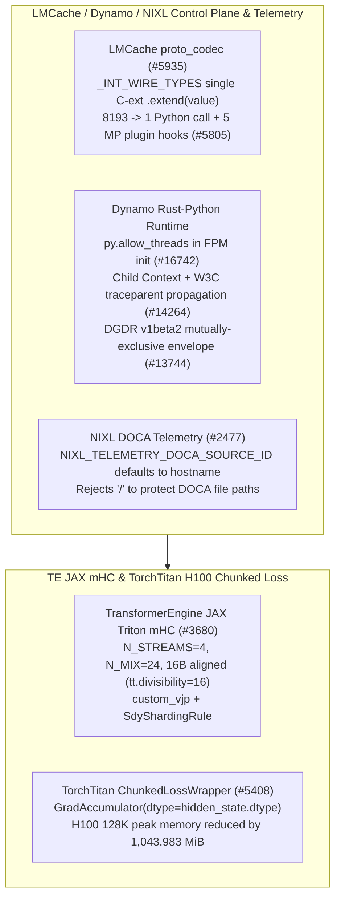

# LMCache Bulk Integer Proto Codec & MP Hooks, Dynamo GIL-Free FPM Init & Cross-Router Trace, NIXL DOCA Identity, and TE JAX mHC / TorchTitan Native-Dtype Chunked Loss

> **Category**: KV Cache, Communication & Distributed Training (`kv-cache-and-training`) · **Phase**: Phase 48 (`priority: 57`) · **Date**: 2026-10-22  
> **First-Hand Upstream Sources**:
> - [`LMCache/LMCache@caba6c35a9`](https://github.com/LMCache/LMCache/commit/caba6c35a9f0a2450fee01ba3c1eeac594b434e3) — `perf: Bulk-extend repeated integer fields in gRPC proto_codec (#5935)`
> - [`LMCache/LMCache@151c6c4f41`](https://github.com/LMCache/LMCache/commit/151c6c4f415ca3040c3370c673bb2b3a0ba4646b) — `feat(mp): add extension hooks for multiprocess plugin integration (#5805)`
> - [`ai-dynamo/dynamo@4d31cd2f18`](https://github.com/ai-dynamo/dynamo/commit/4d31cd2f18804311bd129e9b8dc580b3d4136388) — `fix(bindings/python): release GIL during FPM relay/publisher initialization (#16742)`
> - [`ai-dynamo/dynamo@ebfcce7891`](https://github.com/ai-dynamo/dynamo/commit/ebfcce7891a760950ca7f88b700d584d59010fba) — `fix: preserve request context and trace spans across python routers (#14264)`
> - [`ai-dynamo/dynamo@7929f5370e`](https://github.com/ai-dynamo/dynamo/commit/7929f5370eef7f15095b16f0dd41012b920c334c) — `feat(dgdr): add v1beta2 API with carrier-free lossless conversion (#13744)`
> - [`ai-dynamo/nixl@7f9d5b530a`](https://github.com/ai-dynamo/nixl/commit/7f9d5b530ad8ed01113a4662a2beb2fdb610d89f) — `telemetry: make the DOCA source id and tag configurable (#2477)`
> - [`NVIDIA/TransformerEngine@53d1a3c71a`](https://github.com/NVIDIA/TransformerEngine/commit/53d1a3c71a8f54cbfcdbc5e9f548eba040e42523) — `Integrating TE Triton mHC kernels into JAX (#3680)`
> - [`pytorch/torchtitan@619cd4cef2`](https://github.com/pytorch/torchtitan/commit/619cd4cef2ef3ff7e9667d1571cf81c51c8580e7) — `perf: keep chunked loss gradient buffers in their native dtype (#5408)`

---

## 1. Background and Cross-Stack Bottlenecks

1. **LMCache gRPC Repeated-Integer Codec Overhead & Multiprocess Plugin Extensibility (`#5935`, `#5805`)**: Encoding `repeated int32/int64/uint32/uint64` fields in LMCache's gRPC `proto_codec.py` previously executed a per-element Python closure (`[int(x) for x in value]`), causing `8,193` Python calls per 8,192-block RPC.
2. **Dynamo Python GIL Deadlock (`#16742`), Cross-Router Context/Trace Loss (`#14264`), DGDR `v1beta2` Conversion (`#13744`), and NIXL DOCA Source Collision (`#2477`)**: Blocking inside `FpmEventRelay::new` / `FpmDirectPublisher::new` while holding the Python GIL risked deadlocking background Tokio tasks; Python routers dropped parent cancellation tokens (`Context`) and W3C `traceparent` spans; and NIXL hardcoded `source_id="nixl"` across all host processes pushing IPC telemetry to DOCA Telemetry Service (DTS).
3. **TransformerEngine JAX Triton mHC Kernels (`#3680`) & TorchTitan Chunked-Loss Peak HBM Bloat (`#5408`)**: Manifold Hyper-Connection (mHC) lacked JAX Triton custom primitives with `custom_vjp` and Shardy partitioning; meanwhile, TorchTitan's `ChunkedLossWrapper` accumulated chunk gradients in `torch.float32` and allocated a redundant full-buffer cast back to `hidden_state.dtype` (`bf16`).

---

## 2. Architecture and Measured H100 Gains

### 2.1 LMCache Bulk Protobuf Integer Codec & 5 Multiprocess Plugin Hooks

- **Single C-Extension `.extend(value)` (`LMCache/LMCache@caba6c35a9`)**: Dispatches `_INT_WIRE_TYPES` directly to `getattr(message, field_name).extend(value)`, collapsing `8,193` Python calls per 8,192-block RPC down to `1`.
- **5 MP Plugin Hooks (`LMCache/LMCache@151c6c4f41`)**: Exposes `transfer_object_group`, `_create_cache_context`, `_make_temp_buffer`, `_create_transfer_context`, and `create_lmcache_mp_worker_adapter`.

### 2.2 Dynamo GIL-Free FPM Init, Router Trace/Context Propagation, DGDR `v1beta2` & NIXL DOCA Source ID

- **GIL-Free FPM Constructors (`ai-dynamo/dynamo@4d31cd2f18`)**: Wraps `FpmEventRelay::new` and `FpmDirectPublisher::new` in `py.allow_threads`.
- **Cross-Router Cancellation & W3C Trace Spans (`ai-dynamo/dynamo@ebfcce7891`)**: Links child `Context` cancellation (`is_stopped` / `is_killed`) and propagates W3C `traceparent` headers across Python routers.
- **Carrier-Free DGDR `v1beta2` Conversion (`ai-dynamo/dynamo@7929f5370e`)**: Enforces mutual exclusion between `spec.v1beta1` and `spec.v1beta2` and prioritizes live `v1alpha1` edits over stale annotations.
- **NIXL Configurable DOCA Source Identity (`ai-dynamo/nixl@7f9d5b530a`)**: Reads `NIXL_TELEMETRY_DOCA_SOURCE_ID` (defaulting to `hostname`) and `NIXL_TELEMETRY_DOCA_SOURCE_TAG` (`"nixl"`), rejecting values containing `'/'`.

### 2.3 TransformerEngine JAX Triton mHC & TorchTitan Native-Dtype Chunked-Loss Benchmarks

- **TE JAX Triton mHC (`NVIDIA/TransformerEngine@53d1a3c71a`)**: Integrates 10 forward/backward Triton mHC kernels (`N_STREAMS=4, N_MIX=24, H_PADDED_DIM=32`) with `jax.custom_vjp`, `SdyShardingRule`, 16-byte pointer alignment (`tt.divisibility=16`), and `TRITON_EXTENSION_GLOBAL_SCRATCH_MIN_JAX_VERSION = "0.11.1"`.
- **TorchTitan Native-Dtype Chunked Loss (`pytorch/torchtitan@619cd4cef2`)**: Keeps `GradAccumulator` buffers in `hidden_state.dtype` (`bf16`) on **NVIDIA H100 80GB HBM3** (`d_model=4096`):

| H100 Workload (`d_model=4096`, BF16) | Tokens / Chunks | Baseline Peak (MiB) | Patched Peak (MiB) | Peak Memory Saved (MiB) | Baseline Call (ms) | Patched Call (ms) |
|---|---:|---:|---:|---:|---:|---:|
| `Linear`, eager CE (16K, `V=128,256`) | `16,384` / `8` | `5394.127` | `5266.127` | **`128.000`** | `106.849` | `106.524` |
| `Linear`, compiled CE (16K, `V=128,256`) | `16,384` / `8` | `3392.144` | `3264.144` | **`128.000`** | `78.625` | `77.781` |
| `HiMidLoLinear`, compiled CE (16K, `V=151,936`) | `16,384` / `8` | `7510.127` | `7382.127` | **`128.000`** | `202.609` | `201.783` |
| `Linear`, compiled CE (128K, `V=128,256`) | `131,072` / `64` | `6101.002` | `5057.019` | **`1043.983`** | `653.783` | `649.521` |

---

## 3. Deterministic Standard-Library Reproduction

- Command: `python experiments/lmcache-grpc-bulk-int-codec-hooks-dynamo-fpm-gil-trace-dgdr-nixl-te-jax-mhc-torchtitan/run.py --check`
- Artifact: `experiments/lmcache-grpc-bulk-int-codec-hooks-dynamo-fpm-gil-trace-dgdr-nixl-te-jax-mhc-torchtitan/summary.json`
- Unit tests: `tests/test_phase48_experiments.py`
