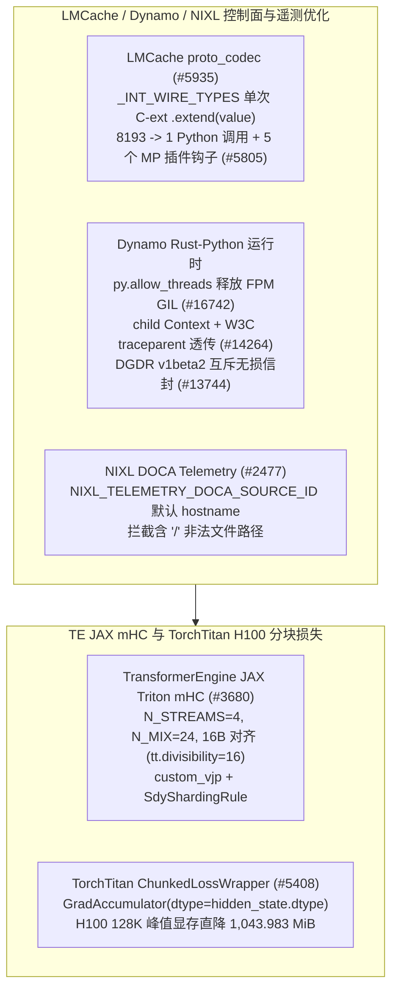

# LMCache 批量整型 Proto 编解码与多进程钩子、Dynamo 无 GIL 初始化与跨路由追踪、NIXL DOCA 源标识及 TE JAX mHC / TorchTitan 原生精度分块损失

> **分类**：KV Cache、通信与分布式训练 (`kv-cache-and-training`) · **阶段**：Phase 48 (`priority: 57`) · **日期**：2026-10-22  
> **上游一手来源**：
> - [`LMCache/LMCache@caba6c35a9`](https://github.com/LMCache/LMCache/commit/caba6c35a9f0a2450fee01ba3c1eeac594b434e3) — `perf: Bulk-extend repeated integer fields in gRPC proto_codec (#5935)`
> - [`LMCache/LMCache@151c6c4f41`](https://github.com/LMCache/LMCache/commit/151c6c4f415ca3040c3370c673bb2b3a0ba4646b) — `feat(mp): add extension hooks for multiprocess plugin integration (#5805)`
> - [`ai-dynamo/dynamo@4d31cd2f18`](https://github.com/ai-dynamo/dynamo/commit/4d31cd2f18804311bd129e9b8dc580b3d4136388) — `fix(bindings/python): release GIL during FPM relay/publisher initialization (#16742)`
> - [`ai-dynamo/dynamo@ebfcce7891`](https://github.com/ai-dynamo/dynamo/commit/ebfcce7891a760950ca7f88b700d584d59010fba) — `fix: preserve request context and trace spans across python routers (#14264)`
> - [`ai-dynamo/dynamo@7929f5370e`](https://github.com/ai-dynamo/dynamo/commit/7929f5370eef7f15095b16f0dd41012b920c334c) — `feat(dgdr): add v1beta2 API with carrier-free lossless conversion (#13744)`
> - [`ai-dynamo/nixl@7f9d5b530a`](https://github.com/ai-dynamo/nixl/commit/7f9d5b530ad8ed01113a4662a2beb2fdb610d89f) — `telemetry: make the DOCA source id and tag configurable (#2477)`
> - [`NVIDIA/TransformerEngine@53d1a3c71a`](https://github.com/NVIDIA/TransformerEngine/commit/53d1a3c71a8f54cbfcdbc5e9f548eba040e42523) — `Integrating TE Triton mHC kernels into JAX (#3680)`
> - [`pytorch/torchtitan@619cd4cef2`](https://github.com/pytorch/torchtitan/commit/619cd4cef2ef3ff7e9667d1571cf81c51c8580e7) — `perf: keep chunked loss gradient buffers in their native dtype (#5408)`

---

## 1. 背景与跨层基础设施瓶颈

在多进程 KV 缓存服务、Rust-Python 混合推理编排以及超长上下文分布式训练中，控制面开销与显存峰值往往决定了系统上限：

1. **LMCache gRPC 控制面序列化瓶颈与多进程插件扩展 (`#5935`, `#5805`)**：LMCache 多进程（MP）模式的 gRPC `proto_codec.py` 在编码 `repeated int32/int64/uint32/uint64` 字段（如数千个 KV 块哈希或句柄）时，原先对每个元素调用 Python 闭包 `[int(x) for x in value]`，导致单次 8,192 块 RPC 触发 `8,193` 次 Python 函数调用；同时外部插件缺乏在不侵入核心类的前提下定制传输上下文与临时缓冲区的标准扩展点。
2. **Dynamo Python 绑定 GIL 死锁 (`#16742`)、跨路由器追踪断链 (`#14264`)、DGDR `v1beta2` 演进 (`#13744`) 与 NIXL DOCA 多进程冲突 (`#2477`)**：`FpmEventRelay::new` 与 `FpmDirectPublisher::new` 在持有 Python GIL 时同步阻塞等待 Tokio 运行时任务，若后台协程回调 Python 则立即死锁；Python 自定义路由器转发请求时丢失了父请求的 `Context` 取消令牌与 W3C `traceparent` 链路；而同一宿主机上的多个 NIXL 进程向 DOCA Telemetry Service (DTS) 推送 IPC 指标时因硬编码 `source_id="nixl"` 发生源标识覆盖。
3. **TransformerEngine JAX Triton mHC 算子 (`#3680`) 与 TorchTitan 分块交叉熵显存膨胀 (`#5408`)**：流形超连接（manifold Hyper-Connection, mHC）此前仅在 PyTorch 侧提供 Triton 内核；而 TorchTitan 的 `ChunkedLossWrapper` 将 `GradAccumulator` 固定初始化为 `torch.float32`，不仅将 `[T, D]` 梯度组装缓冲放大一倍，还在回传给 Decoder 前额外分配一份全量 `to(hidden_state.dtype)` 临时张量。

---

## 2. 核心架构与实测收益解析

### 2.1 LMCache 批量 Protobuf 整型扩展与 5 大多进程插件钩子

- **单次 C 扩展 `.extend(value)` (`LMCache/LMCache@caba6c35a9`)**：在 `proto_codec.py` 中定义 `_INT_WIRE_TYPES = frozenset({FieldDescriptor.TYPE_INT32, TYPE_INT64, TYPE_UINT32, TYPE_UINT64})`，直接调用 Protobuf C 扩展容器的 `getattr(message, field_name).extend(value)`，将类型校验与内存追加一次性下沉至 C 层，消除 `N` 次 Python 闭包分配。
- **5 个多进程插件扩展点 (`LMCache/LMCache@151c6c4f41`)**：新增 `transfer_object_group`、`_create_cache_context`、`_make_temp_buffer`、`_create_transfer_context` 与 `create_lmcache_mp_worker_adapter`，支持外部插件零侵入接管多进程 KV 传输通道。

### 2.2 Dynamo FPM 无 GIL 初始化、跨路由器 Context/Trace 透传、DGDR `v1beta2` 与 NIXL DOCA 源标识

- **释放 FPM 初始化 GIL (`ai-dynamo/dynamo@4d31cd2f18`)**：在 `FpmEventRelay::new` 与 `FpmDirectPublisher::new` 外围包裹 `py.allow_threads(|| ...)`，防止 ZMQ/Tokio 线程与 Python 主解释器锁死锁。
- **跨 Python 路由器取消与追踪透传 (`ai-dynamo/dynamo@ebfcce7891`)**：Python 绑定暴露 `Context` 的子上下文派生与 `TraceContext` W3C 标头提取，使下游 Worker 能即时感知上游客户端断连（`is_stopped` / `is_killed`）并延续同一分布式 Trace 树。
- **DGDR `v1beta2` 无载体无损转换 (`ai-dynamo/dynamo@7929f5370e`)**：在 `DynamoGraphDeploymentRequest` 中实现 `v1alpha1`、`v1beta1` 与 `v1beta2` 的双向无损转换，强制 `spec.v1beta1` 与 `spec.v1beta2` 互斥，且实时 `v1alpha1` 字段修改优先于陈旧注解。
- **NIXL 可配置 DOCA `source_id` / `source_tag` (`ai-dynamo/nixl@7f9d5b530a`)**：新增 `NIXL_TELEMETRY_DOCA_SOURCE_ID`（默认主机名 `hostname`）与 `NIXL_TELEMETRY_DOCA_SOURCE_TAG`（默认 `"nixl"`），并在初始化时拒绝包含 `'/'` 的值（防止破坏 DOCA 数据文件路径 `{{year}}/{{month}}{{day}}/{{source}}/{{tag}}{{id}}.bin`）。

### 2.3 TransformerEngine JAX Triton mHC 与 TorchTitan 原生精度分块损失

- **TE JAX Triton mHC 算子 (`NVIDIA/TransformerEngine@53d1a3c71a`)**：将流形超连接（`N_STREAMS=4, N_MIX=24, H_PADDED_DIM=32`）的 10 个前反向 Triton 内核（`projection`、`scale`、`sinkhorn`、`aggregate`、`expand_combine`）通过 `jax.custom_vjp` 与 `SdyShardingRule` 集成至 JAX，默认启用 `NVTE_JAX_TRITON_ASSUME_ALIGNED=1`（`16` 字节对齐，`tt.divisibility=16`）并设置设备侧 TMA 全局暂存区最低版本 `TRITON_EXTENSION_GLOBAL_SCRATCH_MIN_JAX_VERSION = "0.11.1"`。
- **TorchTitan 原生精度分块损失 (`pytorch/torchtitan@619cd4cef2`)**：将 `ChunkedLossWrapper` 中的 `GradAccumulator(..., dtype=torch.float32)` 改为 `dtype=hidden_state.dtype` 并移除尾部的 `.to(hidden_state.dtype)` 拷贝。在单卡 **NVIDIA H100 80GB HBM3** (`d_model=4096`, BF16) 上的实测对比如下：

| H100 实测工作负载 (`d_model=4096`, BF16) | Token 数 / 分块数 | 基线峰值显存 (MiB) | 优化后峰值显存 (MiB) | 峰值显存节省 (MiB) | 基线耗时 (ms) | 优化后耗时 (ms) |
|---|---:|---:|---:|---:|---:|---:|
| `Linear`, eager CE (16K, `V=128,256`) | `16,384` / `8` | `5394.127` | `5266.127` | **`128.000`** | `106.849` | `106.524` |
| `Linear`, compiled CE (16K, `V=128,256`) | `16,384` / `8` | `3392.144` | `3264.144` | **`128.000`** | `78.625` | `77.781` |
| `HiMidLoLinear`, compiled CE (16K, `V=151,936`) | `16,384` / `8` | `7510.127` | `7382.127` | **`128.000`** | `202.609` | `201.783` |
| `Linear`, compiled CE (128K, `V=128,256`) | `131,072` / `64` | `6101.002` | `5057.019` | **`1043.983`** | `653.783` | `649.521` |

---

## 3. 标准库确定性复现实验验证

- 运行命令：`python experiments/lmcache-grpc-bulk-int-codec-hooks-dynamo-fpm-gil-trace-dgdr-nixl-te-jax-mhc-torchtitan/run.py --check`
- 产出契约：`experiments/lmcache-grpc-bulk-int-codec-hooks-dynamo-fpm-gil-trace-dgdr-nixl-te-jax-mhc-torchtitan/summary.json`
- 关联单测：`tests/test_phase48_experiments.py`
