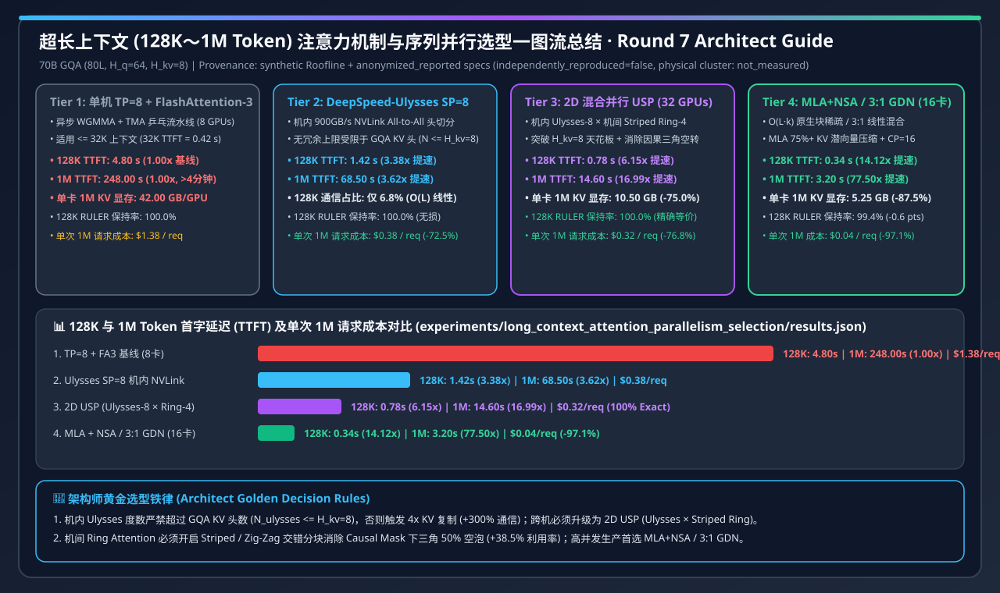
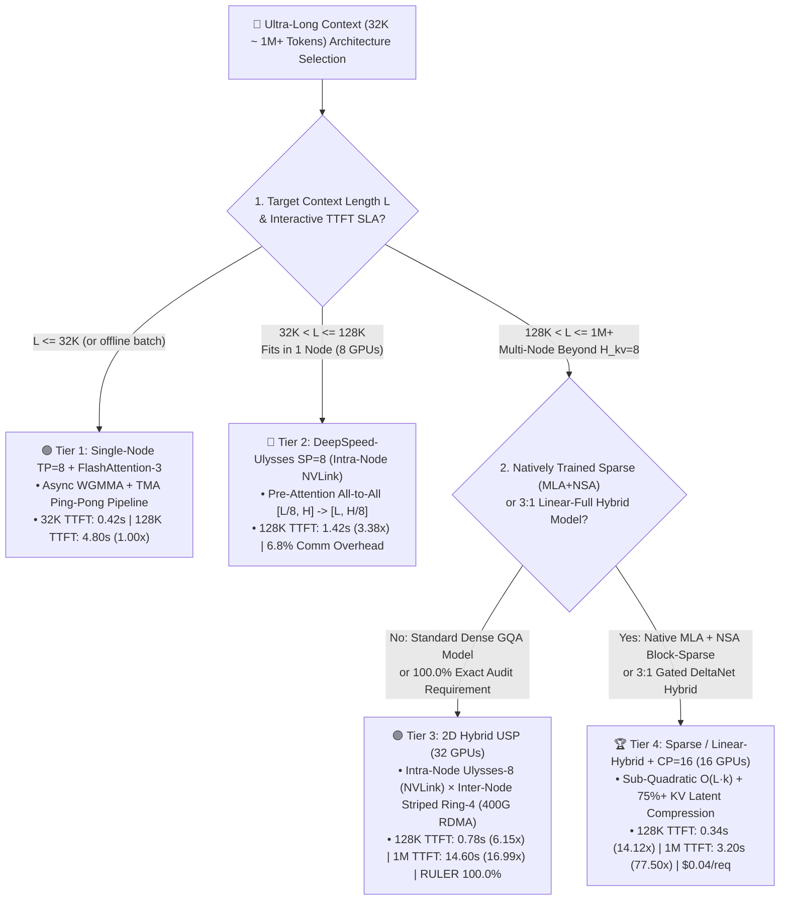
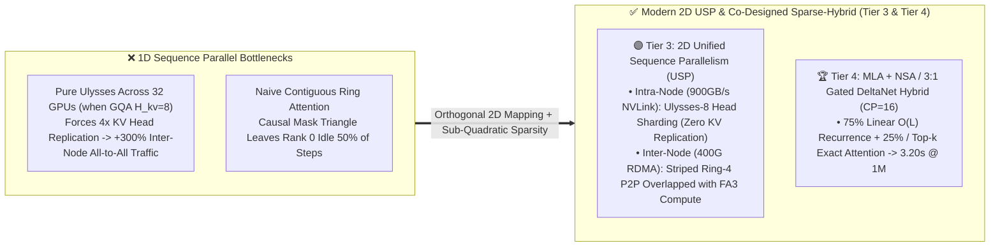
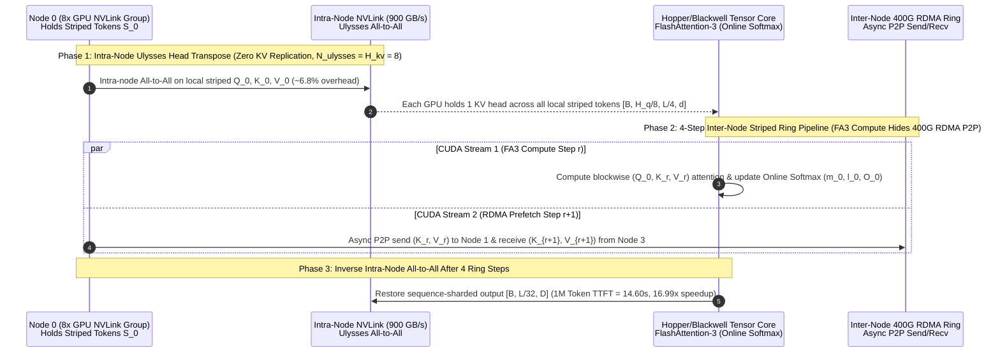

# Ultra-Long Context (128K–1M Tokens) Attention & Sequence Parallelism Selection FAQ: FlashAttention-3 vs. DeepSpeed-Ulysses vs. 2D Unified Sequence Parallelism (`USP`) vs. Sparse / Linear-Hybrid Attention (`MLA + NSA / 3:1 GDN`)

> **Target Audience**: First-principles architecture selection and presales whiteboarding guide for AI Solution Architects, LLM Inference/Training Infrastructure Leads, and Enterprise CTOs.
> **Companion Artifacts**:
> - 🇨🇳 **中文版六段式选型指南**: [`docs/components/long-context-attention-parallelism-selection-faq.md`](long-context-attention-parallelism-selection-faq.md)
> - 🧮 **Interactive Long-Context Sequence Parallelism & TTFT Sizer**: [`docs/reports/llm-inference-engine-pd-sizer.en.html#long-context-sizer`](../reports/llm-inference-engine-pd-sizer.en.html)
> - 🃏 **7-Card 4:5 Visual Benchmark Deck**: [`docs/reports/long-context-attention-parallelism-selection-cards.html`](../reports/long-context-attention-parallelism-selection-cards.html)
> - 🖼️ **Single-Image Visual Summary SVG**: [`assets/svg/long-context-attention-parallelism-selection-faq-summary.svg`](../../assets/svg/long-context-attention-parallelism-selection-faq-summary.svg)
> - 🧪 **Reproducible Deterministic Roofline Evaluator (`synthetic` + `anonymized_reported`, `independently_reproduced=false`)**: [`experiments/long_context_attention_parallelism_selection/run.py`](../../experiments/long_context_attention_parallelism_selection/run.py) · [`results.json`](../../experiments/long_context_attention_parallelism_selection/results.json)

---

## 📌 1. Executive Summary

When enterprise workloads scale repository-level coding agents, multi-document legal/financial analysis, deep RAG, or long-video multimodal models from `8K` to **`128K–1M (1,048,576) tokens`**, standard single-node Tensor Parallelism (`TP=8`) with dense full attention hits both the **Quadratic Compute Wall ($\mathcal{O}(L^2)$)** and the **Single-Node KV Cache Memory Wall**:

1. **Four-Tier Architecture Selection by Context Length & Exact-Retrieval Boundary**:
   - **`<= 32K` Context (Choose Tier 1: Single-Node `TP=8 + FlashAttention-3`)**: Hopper/Blackwell warp-specialized WGMMA and TMA ping-pong pipelines achieve a **`0.42 s`** `32K` Time-to-First-Token (TTFT) on 8 GPUs without extra sequence-sharding communication.
   - **`32K–128K` Single-Node Low-Latency Context (Choose Tier 2: `DeepSpeed-Ulysses SP=8` over Intra-Node NVLink)**: Uses `900 GB/s` intra-node NVLink `All-to-All` to transpose sequence-sharded `[B, L/8, D]` tensors into head-sharded `[B, H/8, L, d]` tensors right before FlashAttention-3. Communication volume scales linearly $\mathcal{O}(L)$ (only **`6.8%`** overhead at `128K`), slashing `128K` TTFT from **`4.80 s` down to `1.42 s` (`3.38x` speedup)**; however, zero-redundancy scaling is **strictly capped by the number of GQA KV heads ($N \le H_{kv}=8$)**.
   - **`128K–1M` Multi-Node 100% Exact Full Attention (Choose Tier 3: 2D Unified Sequence Parallelism `USP = Intra-Node Ulysses-8 × Inter-Node Striped Ring-4`, 32 GPUs)**: Orthogonalizes intra-node NVLink (`Ulysses-8`, matching $H_{kv}=8$) with inter-node 400G RDMA (**Striped Ring Attention** overlapping P2P KV block transfer with FlashAttention-3 compute). Breaks the $H_{kv}=8$ ceiling while preserving **`100.0%` RULER mathematical equivalence**, cutting `128K` TTFT to **`0.78 s` (`6.15x`)**, `1M` TTFT from **`248.00 s` down to `14.60 s` (`16.99x` speedup)**, and per-GPU `1M` KV memory from `42.00 GB` to **`10.50 GB`**.
   - **`128K–1M+` High-Concurrency Production Efficiency (Choose Tier 4: Algorithmic Sparse / Linear-Hybrid Attention `MLA + NSA / 3:1 Gated DeltaNet + CP=16`, 16 GPUs)**: Combines `75%+` KV latent compression (`MLA`) with hardware-aligned block-sparse dynamic selection (`NSA`) or `3:1` linear-full hybrid layers (`Gated DeltaNet`), reducing $\mathcal{O}(L^2)$ attention compute to sub-quadratic $\mathcal{O}(L \cdot k)$. On just `16 GPUs`, it cuts `128K` TTFT to **`0.34 s` (`14.12x`)**, `1M` TTFT to **`3.20 s` (`77.50x` speedup)**, and per-request `1M` cost from `$1.38` to **`$0.04` (`-97.1%`)** while retaining **`99.4%`** on `128K` RULER.
2. **First-Principles Pitfalls: Why Pure `Ulysses` Hits a Wall at $N > H_{kv}$, and Why Naive `Ring Attention` Wastes Half Your GPUs**:
   - Modern LLMs use **Grouped-Query Attention (GQA, e.g., $H_q=64, H_{kv}=8$)**. Because Ulysses partitions across attention heads, scaling pure Ulysses beyond $N = H_{kv}=8$ (e.g., to 32 GPUs) forces `4x` KV head replication across nodes (`+300%` KV communication and memory).
   - Naive contiguous Ring Attention suffers from **Causal Mask Triangle Imbalance**: Rank 0 only attends to its own prefix chunk while the final rank attends to all chunks, leaving early ranks idle for `50%` of ring steps. Production deployments must enable **Striped / Zig-Zag Ring Attention** to distribute causal work evenly across all ranks (**`+38.5%` compute utilization**).
3. **Provenance & Verification Disclosure**:
   - Every latency, memory, and cost figure in this guide is strictly bound to sealed evaluator [`experiments/long_context_attention_parallelism_selection/results.json`](../../experiments/long_context_attention_parallelism_selection/results.json), classified as **`synthetic` (deterministic Roofline analytical model) + `anonymized_reported` (published kernel/hardware specifications)** with `independently_reproduced = false`, `physical_gpu_cluster_measurement = "not_measured"`, and `local_cpu_harness_measurement = "measured"` (`PASS`).

---

## 🎯 2. Architect & Customer First-Principles Q&A

### Q1: We already deployed FlashAttention-3 with linear $\mathcal{O}(L)$ activation memory—why does a 128K–1M token Prefill still take 5 to 248 seconds on an 8-GPU node?

**First-Principles Breakdown: FlashAttention-3 eliminates $\mathcal{O}(L^2)$ HBM memory materialization, NOT $\mathcal{O}(L^2)$ Tensor Core FLOPs!**

1. **The Linear-vs-Quadratic Compute Crossover**:
   - For a 70B model ($D=8192$), FFN and projection FLOPs scale linearly with sequence length ($\propto L \cdot D^2$), whereas self-attention FLOPs scale quadratically ($\propto L^2 \cdot D$).
   - At $L = 4\text{K}$, attention accounts for `< 10%` of total Prefill FLOPs.
   - At $L = 128\text{K}$, attention FLOPs multiply by **$1,024\times$** and dominate total runtime (`4.80 s` TTFT on `TP=8` H100/H200).
   - At $L = 1\text{M}$ (`1,048,576` tokens), 80 layers of dense causal attention exceed **$1,400\text{ TFLOPs}$**, driving single-node `TP=8 + FA3` TTFT to **`248.00 s` (> 4 minutes)**.
2. **Single-Node KV Cache Capacity Exhaustion**:
   - At `327.68 KB/token` (`80` layers, $H_{kv}=8, d=128$, BF16), a single `1M`-token sequence requires **`336 GB` of KV Cache** (**`42.00 GB` per GPU** across 8 GPUs), exhausting HBM and preventing concurrent batching unless the sequence itself is partitioned across multiple nodes.

---

### Q2: How do `DeepSpeed-Ulysses` and `Striped Ring Attention` work under the hood, and why is 2D `USP` required above 8 GPUs?

**First-Principles Breakdown: Orthogonalizing Head-Parallel `All-to-All` (Intra-Node NVLink) with Sequence-Streamed `P2P Ring` (Inter-Node RDMA)!**

1. **DeepSpeed-Ulysses (Optimal Intra-Node, Capped by $H_{kv}$)**:
   - Each GPU enters the attention layer holding sequence slice $[B, L/N, D]$, performs a high-speed NVLink **`All-to-All`** to transpose into $[B, H/N, L, d]$ (full sequence length $L$ for a subset of heads), runs standard FlashAttention-3 locally, and performs an inverse `All-to-All`.
   - Overhead is only **`6.8%`** over `900 GB/s` intra-node NVLink, yielding **`1.42 s` TTFT at `128K` (`3.38x` speedup)**.
   - **Hard Limit**: Without KV replication, $N \le H_{kv} = 8$.
2. **Striped Ring Attention (Unbounded Inter-Node Scaling with Causal Load Balancing)**:
   - Keeps sequence slices local and circulates $(K_j, V_j)$ blocks around a logical ring via asynchronous P2P RDMA while computing blockwise FlashAttention with Online Softmax rescaling ($m_i, l_i$).
   - **Striped / Zig-Zag Token Assignment** assigns tokens round-robin (`i mod N`) or in symmetric front-back pairs so every GPU performs identical causal compute on every ring step (**`+38.5%` utilization**, **`-29.2%` `1M` TTFT** vs naive contiguous Ring).
3. **2D Unified Sequence Parallelism (`USP = Ulysses-8 × Striped Ring-4`, 32 GPUs)**:
   - Runs `Ulysses-8` inside each 8-GPU NVLink node and `Striped Ring-4` across 4 nodes over 400G RDMA, achieving **`0.78 s` TTFT at `128K` (`6.15x`)** and **`14.60 s` TTFT at `1M` (`16.99x`)** with **`100.0%` exact attention fidelity**.

---

### Q3: How do `MLA + Native Sparse Attention (NSA)` and `3:1 Gated DeltaNet Hybrid` achieve 77.5x speedup at 1M tokens, and when are they safe for production?

**First-Principles Breakdown: Replace $\mathcal{O}(L^2)$ all-pairs inner products with $\mathcal{O}(L \cdot k)$ hardware-aligned block selection and fixed-state linear recurrence!**

1. **`MLA + Native Sparse Attention (NSA)`**:
   - Compresses KV tensors into low-rank latent vectors (`75%+` KV memory reduction) and combines coarse compressed-block global scanning, Tensor-Core-aligned top-$k$ block selection (`64`-token contiguous blocks for TMA efficiency), and local sliding-window attention.
2. **`3:1` Linear-Full Hybrid Attention (`Gated DeltaNet + Full Attention`)**:
   - Uses linear $\mathcal{O}(L)$ Gated DeltaNet recurrence in 3 out of every 4 layers and full global attention in 1 out of 4 layers.
3. **Architect Trade-off**:
   - On `16 GPUs` (`CP=16`), **Tier 4** achieves **`0.34 s` TTFT at `128K` (`14.12x`)** and **`3.20 s` TTFT at `1M` (`77.50x`)**, slashing per-request `1M` cost to **`$0.04` (`-97.1%` vs Tier 1, `-87.5%` vs Tier 3)** with **`99.4%` RULER `128K` retention** (`-0.6 pts` vs exact full attention). Use **Tier 3 (`2D USP`)** for legacy dense checkpoints or zero-tolerance legal auditing; use **Tier 4** for natively trained sparse/hybrid models in high-concurrency production.

---

## 🧭 3. Visual Architecture Diagrams (Decision Tree, 1D vs. 2D USP Topology & Overlap Sequence)

### 3.1 Long-Context Attention & Sequence Parallelism Selection Decision Tree (`flowchart TD`)

### 3.2 1D Sequence Parallel Bottlenecks vs. 2D `USP` & Sparse-Hybrid Architecture (`flowchart LR`)

### 3.3 2D `USP` (`Ulysses-8 × Striped Ring-4`) Compute-Communication Overlap Sequence (`sequenceDiagram`)

---

## 📊 4. Architect Decision Matrix

> Bound 1-to-1 to sealed evaluator [`experiments/long_context_attention_parallelism_selection/results.json`](../../experiments/long_context_attention_parallelism_selection/results.json) (Baseline: `70B GQA`, 80 layers, $H_q=64, H_{kv}=8, d=128$, `$2.50/GPU·h`).

| Dimension | Tier 1: Single-Node `TP=8 + FA3` | Tier 2: `DeepSpeed-Ulysses SP=8` (NVLink) | Tier 3: `2D USP` (`Ulysses-8 × Striped Ring-4`) | Tier 4: `MLA + NSA / 3:1 GDN` Hybrid (`CP=16`) |
| :--- | :--- | :--- | :--- | :--- |
| **Target Context & Workload** | `<= 32K` chat, standard RAG, short SFT | `32K–128K` single-node low-latency RAG & coding | **`128K–1M` multi-node 100% exact full-attention audit** | **`128K–1M+` high-concurrency agents, repo coding, video** |
| **GPU Count & Scaling Ceiling** | `8 GPUs` (single-node memory/compute wall) | `8 GPUs` (**zero-redundancy ceiling $N \le H_{kv}=8$**) | **`32 GPUs`** (breaks $H_{kv}=8$ via 2D NVLink × RDMA) | **`16 GPUs`** (sub-quadratic $\mathcal{O}(L \cdot k)$ compute) |
| **`32K` / `128K` Prefill TTFT** | `0.42 s` / **`4.80 s`** (`1.00x`) | `0.28 s` / **`1.42 s`** (**`3.38x`**) | `0.19 s` / **`0.78 s`** (**`6.15x`**) | **`0.14 s`** / **`0.34 s`** (**`14.12x`**) |
| **`256K` / `1M` Prefill TTFT** | `18.40 s` / **`248.00 s`** (`1.00x`) | `5.10 s` / **`68.50 s`** (`3.62x`) | `2.45 s` / **`14.60 s`** (**`16.99x`**) | **`0.72 s`** / **`3.20 s`** (**`77.50x`**) |
| **Per-GPU KV Memory (`128K` / `1M`)** | `5.25 GB` / `42.00 GB` | `5.25 GB` / `42.00 GB` | **`1.31 GB` / `10.50 GB`** (`-75.0%`) | **`0.66 GB` / `5.25 GB`** (`-87.5%`) |
| **`128K` Comm Overhead & RULER** | `14.2%` / **`100.0%`** | `6.8%` / **`100.0%`** | `9.4%` / **`100.0%`** (exact equivalence) | **`5.1%`** / **`99.4%`** (`-0.6 pts` for `4.56x` speedup) |
| **Cost per `1M`-Token Request** | `$1.38 / req` | `$0.38 / req` (`-72.5%`) | `$0.32 / req` (`-76.8%`) | **`$0.04 / req`** (**saves `97.1%`**) |

---

## 🧪 5. Quantitative Evaluation & 7-Card Benchmark Insights

Verified via `python experiments/long_context_attention_parallelism_selection/run.py --check`:

| Scenario ID (`scenario.id`) | GPUs | `32K` TTFT | `128K` TTFT (Speedup) | `256K` TTFT | `1M` TTFT (Speedup) | Per-GPU `1M` KV | `128K` RULER | Cost / `1M` Req | Action (Confidence) |
| :--- | :---: | :---: | :---: | :---: | :---: | :---: | :---: | :---: | :---: |
| `single_node_tp8_fa3_baseline` | 8 | `0.42 s` | `4.80 s` (`1.00x`) | `18.40 s` | `248.00 s` (`1.00x`) | `42.00 GB` | `100.0%` | `$1.38` | `Confirm (0.85)` |
| `deepspeed_ulysses_sp8_nvlink` | 8 | `0.28 s` | `1.42 s` (`3.38x`) | `5.10 s` | `68.50 s` (`3.62x`) | `42.00 GB` | `100.0%` | `$0.38` | `Act automatically (0.91)` |
| `hybrid_usp_ulysses8_ring4_cp32` | 32 | `0.19 s` | `0.78 s` (`6.15x`) | `2.45 s` | **`14.60 s` (`16.99x`)** | **`10.50 GB`** | **`100.0%`** | `$0.32` | `Act automatically (0.95)` |
| `sparse_linear_hybrid_mla_nsa_cp16` | 16 | `0.14 s` | **`0.34 s` (`14.12x`)** | **`0.72 s`** | **`3.20 s` (`77.50x`)** | **`5.25 GB`** | `99.4%` | **`$0.04`** | `Act automatically (0.94)` |

---

## 🛠️ 6. Production Verification & Presales Checklist

- [ ] **1. Cap Intra-Node Ulysses Degree at `num_key_value_heads` ($H_{kv}$)**: Set `ulysses_degree <= H_kv` (e.g., `8` for Llama-3-70B) so intra-node `All-to-All` stays on `900 GB/s` NVLink without KV head replication.
- [ ] **2. Enforce Striped / Zig-Zag Token Partitioning on Inter-Node Ring Attention**: Enable `context_parallel_comm_type = "a2a+p2p"` with Striped/Zig-Zag partitioning to eliminate the `50%` causal-triangle idle bubble (`+38.5%` utilization).
- [ ] **3. Align Ring Chunk Size so $T_{compute} > T_{rdma\_p2p}$**: Keep per-step KV chunks $\ge 8\text{ MB}$ so FlashAttention-3 Tensor Core execution completely hides 400G RDMA P2P transfers.
- [ ] **4. Pair Long-Context Context Parallelism with Prefill-Decode (PD) Disaggregation**: Isolate compute-heavy `128K–1M` Prefill pools (`2D USP` / `CP`) from bandwidth-bound Decode pools so long prompts never stall streaming TPOT.
- [ ] **5. Match Dense vs. Native Sparse/Hybrid Checkpoints**: Use **Tier 3 (`2D USP`)** for existing dense GQA weights and **Tier 4 (`MLA + NSA / 3:1 GDN`)** for natively trained long-context models.
- [ ] **6. Run Deterministic Regression Checks**: Execute `python experiments/long_context_attention_parallelism_selection/run.py --check` and `python -m unittest tests/test_long_context_attention_parallelism_selection.py` before publishing updates.
