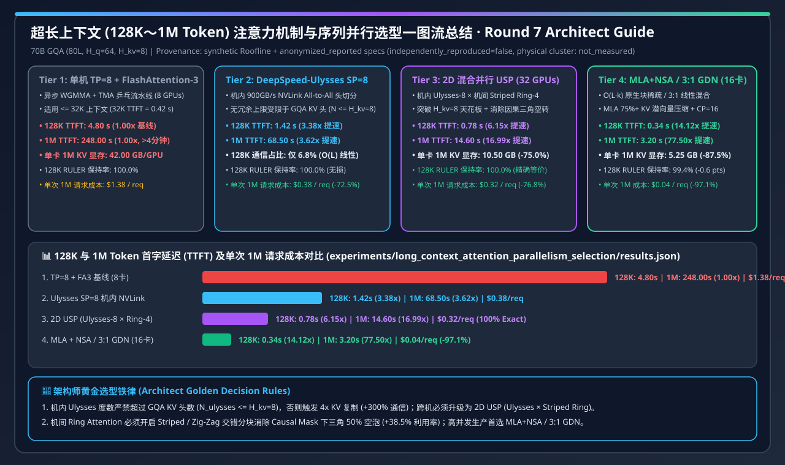
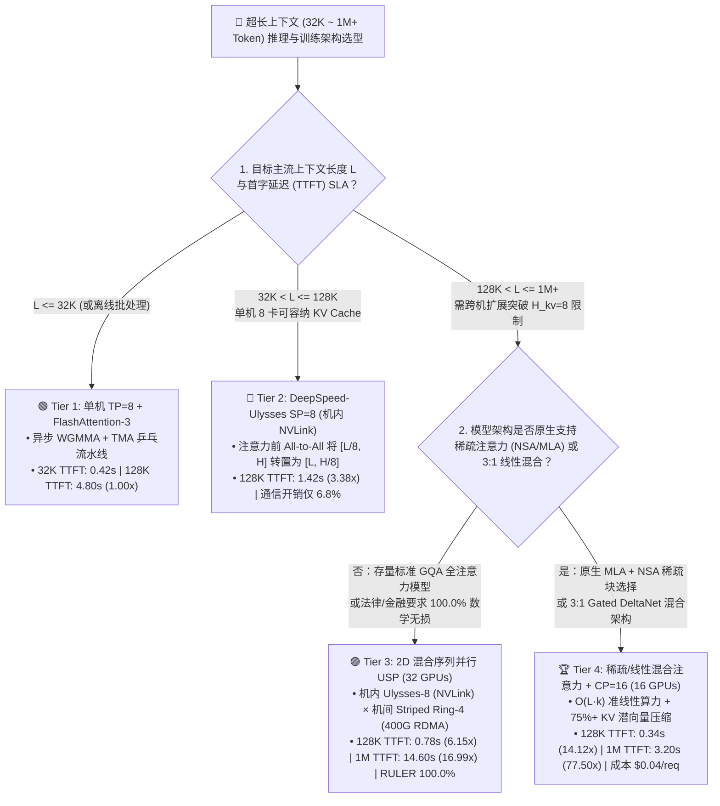
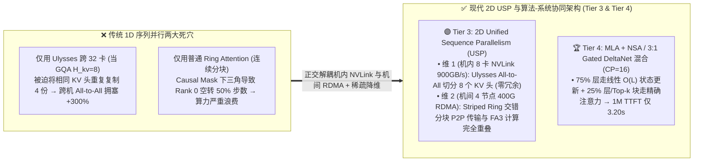
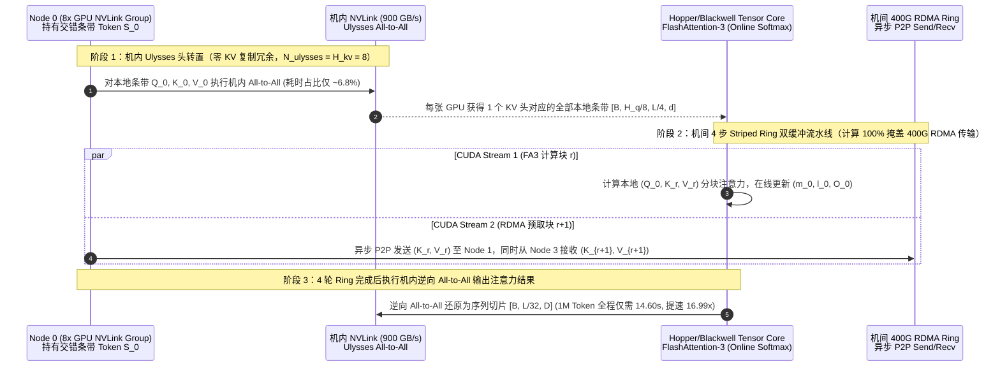

# 超长上下文（128K～1M Token）注意力机制与序列并行架构选型 FAQ：全量 FlashAttention-3 vs. DeepSpeed-Ulysses vs. 2D 混合序列并行 (`USP`) vs. 稀疏/线性混合注意力 (`MLA + NSA / 3:1 GDN`)

> **文档定位**：面向 AI Solution Architect（AI 解决方案架构师）、推理/训练基础设施负责人与企业技术决策者的**第一性原理选型指南**。
> **核心关联产出**：
> - 🌐 **English Companion Guide**: [`docs/components/long-context-attention-parallelism-selection-faq.en.md`](long-context-attention-parallelism-selection-faq.en.md)
> - 🧮 **交互式超长上下文序列并行与 TTFT 定容工作台**: [`docs/reports/llm-inference-engine-pd-sizer.html#long-context-sizer`](../reports/llm-inference-engine-pd-sizer.html)
> - 🃏 **7-Card 4:5 视觉评测报告**: [`docs/reports/long-context-attention-parallelism-selection-cards.html`](../reports/long-context-attention-parallelism-selection-cards.html)
> - 🖼️ **一图流架构选型总结 SVG**: [`assets/svg/long-context-attention-parallelism-selection-faq-summary.svg`](../../assets/svg/long-context-attention-parallelism-selection-faq-summary.svg)
> - 🧪 **可复现确定性 Roofline 算例 (`synthetic` + `anonymized_reported`, `independently_reproduced=false`)**: [`experiments/long_context_attention_parallelism_selection/run.py`](../../experiments/long_context_attention_parallelism_selection/run.py) · [`results.json`](../../experiments/long_context_attention_parallelism_selection/results.json)

---

## 📌 一、核心结论速览（Executive Summary）

当企业客户将全仓库代码智能体（Repo-Scale Coding Agent）、百万字法律/财报精读、超长多轮 RAG 或长视频多模态模型从 `8K` 扩展到 **`128K ~ 1M (1,048,576) Token`** 时，传统的“单节点张量并行（`TP=8`）+ 标准全注意力”会同时撞上 **算力二次方爆炸墙（$\mathcal{O}(L^2)$）** 与 **单卡 KV 显存容量墙**：

1. **按上下文长度与精度红线进行四档分层选型（严禁盲目用单一并行模式硬扛百万上下文）**：
   - **`<= 32K` 中短上下文（选 Tier 1：单机 `TP=8 + FlashAttention-3`）**：充分利用 Hopper/Blackwell 异步 WGMMA 与 TMA 乒乓流水线，`32K` 首字延迟（TTFT）仅 **`0.42 s`**；此时引入跨机序列并行反而增加不必要的网络同步开销。
   - **`32K ~ 128K` 单机低延迟长文本（选 Tier 2：`DeepSpeed-Ulysses SP=8` 机内 NVLink All-to-All）**：利用单机 `900 GB/s` NVLink 在注意力计算前把“序列切分（`L/8`）”转置为“注意力头切分（`H/8`）”，通信量仅随序列长度呈线性增长 $\mathcal{O}(L)$（通信占比仅 **`6.8%`**），将 `128K` TTFT 从 **`4.80 s` 压降至 `1.42 s`（提速 `3.38x`）**；但注意其并行度上限被模型的 **GQA KV 头数硬性锁死（$N \le H_{kv}=8$）**。
   - **`128K ~ 1M` 跨机 100% 精确全注意力（选 Tier 3：2D 混合序列并行 `USP = 机内 Ulysses-8 × 机间 Striped Ring-4`，32 卡）**：在单节点内走 `Ulysses-8` 吃满 NVLink，跨节点走 **交错条带化环状注意力（Striped Ring Attention）** 通过 400G RDMA 双缓冲隐藏 KV 块传输，彻底打破 $H_{kv}=8$ 并行度天花板！在保持 **`100.0%` RULER 无损精度**的前提下，将 `128K` TTFT 压至 **`0.78 s`（`6.15x`）**，将 `1M` 百万上下文 TTFT 从 **`248.00 s` 压降至 `14.60 s`（提速 `16.99x`）**，单卡 `1M` KV 显存从 `42.00 GB` 降至 **`10.50 GB`**。
   - **`128K ~ 1M+` 极致性价比与高并发在线生产（选 Tier 4：算法级稀疏/线性混合注意力 `MLA + NSA / 3:1 Gated DeltaNet + CP=16`）**：通过 `MLA` 潜向量压缩 `75%+` KV 显存，并结合硬件对齐原生稀疏注意力（`NSA` 动态块选择）或 `3:1` 线性注意力混合架构（每 3 层线性 `GDN` 配 1 层全注意力），把 $\mathcal{O}(L^2)$ 复杂度直接降维成准线性 $\mathcal{O}(L \cdot k)$！仅用 `16` 张 GPU 即可将 `128K` TTFT 压至 **`0.34 s`（`14.12x`）**、`1M` TTFT 压至 **`3.20 s`（提速 `77.50x`）**，单次百万 Token 请求成本从 `$1.38` 暴降至 **`$0.04`（节省 `97.1%`）**，同时在 `128K` RULER 基准上保持 **`99.4%`** 检索精度。
2. **第一性原理防踩坑：为什么 `DeepSpeed-Ulysses` 扩不到 32 卡，而原生 `Ring Attention` 会浪费一半算力？**
   - 主流开源大模型（如 Llama-3-70B、Qwen2.5-72B）普遍采用 **分组查询注意力（GQA，$H_q=64, H_{kv}=8$）**。Ulysses 按注意力头切分，当并行度 $N > H_{kv}=8$（如 32 卡）时，必须在多张卡上重复复制相同的 KV 头（通信量与显存激增 `4 倍`）。
   - 原生 Ring Attention 虽然按序列连续分块（不受 $H_{kv}$ 限制），但在自回归因果掩码（Causal Mask 下三角矩阵）下，**Rank 0 的序列块只需要看自己，而最后一个 Rank 需要看所有历史块**，导致半数步数处于空转等待！工程落地必须开启 **Striped / Zig-Zag Ring Attention（交错轮询分块）**，将因果三角形负载均匀打散到所有 GPU，提升 **`+38.5%` 算力利用率**。
3. **证据口径声明（Provenance Disclosure）**：
   - 本文所有延迟、显存与单次请求成本指标均严格绑定封存算例 [`experiments/long_context_attention_parallelism_selection/results.json`](../../experiments/long_context_attention_parallelism_selection/results.json)，分类为 **`synthetic`（确定性 Roofline 分析模型）+ `anonymized_reported`（公开论文/内核吞吐规格锚定）**，`independently_reproduced = false`，物理 32 卡 H100/H200 实机集群测量状态为 **`not_measured`**，本地 CPU 确定性评估器与单元测试状态为 **`measured`（PASS）**。

---

## 🎯 二、客户与架构师灵魂拷问 Q&A（First-Principles FAQ）

### Q1：我们已经上了 FlashAttention-3，显存已经是线性 $\mathcal{O}(L)$ 了，为什么处理 128K～1M Token 时首字延迟（TTFT）还是高达几十秒甚至几百秒？

**第一性原理拆解：FlashAttention-3 消灭了 $\mathcal{O}(L^2)$ 的显存读写，但没有消灭 $\mathcal{O}(L^2)$ 的矩阵乘计算量（FLOPs）！**

1. **线性层（FFN / QKV Projection）与注意力层（Self-Attention）的算力剪刀差**：
   - 对于隐藏层维度 $D=8192$ 的 70B 模型，每层线性变换的计算量与序列长度 $L$ 呈**线性关系**（$\propto L \cdot D^2$），而自注意力计算量与序列长度呈**平方关系**（$\propto L^2 \cdot D$）。
   - 当 $L = 4,096$ 时，注意力层的 FLOPs 仅占整网的 `< 10%`；
   - 当 $L = 131,072$（`128K`）时，注意力层的 FLOPs 暴涨 **$1,024$ 倍**，反超 FFN 成为整网最大的算力黑洞！
   - 当 $L = 1,048,576$（`1M`）时，仅 80 层全注意力的浮点运算量就超过 **$1,400\text{ TFLOPs}$**！即便单台 8 卡 H100/H200 开启 `TP=8 + FlashAttention-3`（异步 WGMMA + TMA 乒乓缓冲），单次 `128K` Prefill 仍需 **`4.80 s`**，单次 `1M` Prefill 更飙升至 **`248.00 s`（超过 4 分钟）**，完全无法满足交互式 Agent 的 SLA。
2. **单机 KV Cache 显存容量挤兑**：
   - 70B 模型（80 层，$H_{kv}=8, d=128$）在 FP16/BF16 下每个 Token 的 KV Cache 为 $2 \times 80 \times 8 \times 128 \times 2\text{ B} = 327.68\text{ KB}$。
   - 一条 `1M` 上下文请求的 KV Cache 总量高达 **`336 GB`**（单机 8 卡分摊后每卡仍占 **`42.00 GB`**），直接把单机 HBM 撑满，导致并发度降为 `1`。因此，长上下文必须把**单条序列本身切分到多台机器上并行计算（Sequence / Context Parallelism）**。

---

### Q2：序列并行主流方案 `DeepSpeed-Ulysses` 与 `Ring Attention` 底层有什么本质区别？什么时候选 Ulysses，什么时候必须上 2D 混合并行（`USP`）？

**第一性原理拆解：“按头转置切分（All-to-All）”与“按序列环状流式传递（P2P Ring）”的正交互补！**

1. **DeepSpeed-Ulysses（机内 NVLink 的王者，但受限于 $H_{kv}$）**：
   - **怎么工作**：进入注意力层前，各 GPU 持有序列切片 $[B, L/N, D]$；通过一次高速 **`All-to-All`** 通信，将张量重排为按注意力头切分 $[B, H/N, L, d]$——此时每张 GPU 拥有**少数几个注意力头的完整序列 $L$**，直接调用原生 FlashAttention-3 即可算完，随后再做一次逆向 `All-to-All` 恢复为 $[B, L/N, D]$。
   - **为什么快**：总通信量仅为 $\mathcal{O}(L \cdot D / N)$，且在单机 8 卡内部走 **`900 GB/s` NVLink 全互联**，通信开销仅占 **`6.8%`**，`128K` TTFT 压至 **`1.42 s`（提速 `3.38x`）**。
   - **致命边界**：因为每个 GPU 至少要分到 1 个 KV 头，当模型采用 GQA 且 $H_{kv}=8$ 时，**无冗余 Ulysses 的最大并行度被硬性锁死在 $N \le 8$**！如果强行跨机扩到 32 卡，必须在每 4 张卡上重复拷贝相同的 KV 头，通信与显存瞬间膨胀 `300%`。
2. **Striped Ring Attention（跨机无限扩展的利器，需解决因果三角不均衡）**：
   - **怎么工作**：每张 GPU 始终只持有序列切片 $Q_i$（长度 $L/N$），不需要转置注意力头；各 GPU 组成逻辑环，一边用 FlashAttention 计算当前手头的 $(Q_i, K_j, V_j)$ 分块并在线更新 Softmax 统计量（Online Softmax：$m_i, l_i$），一边通过后台 P2P RDMA 将 $(K_j, V_j)$ 传给下一个邻居（计算掩盖通信）。
   - **为什么必须用 Striped（交错条带化）**：普通按连续位置切分 `[0..32K], [32K..64K]...` 会因为 Causal Mask 下三角导致排在前面的 GPU 算完自己的块就闲置；**Striped / Zig-Zag Ring Attention** 将 Token 按 `i mod N` 或首尾对称块交错分配给各卡，让每张卡在每一轮 Ring 步数中的有效计算量完全相等（算力利用率提升 **`+38.5%`**）。
3. **架构师最优解——2D 混合序列并行（`USP = Ulysses Intra-Node × Striped Ring Inter-Node`）**：
   - 将两者正交组合：**节点内 8 张卡用 `Ulysses-8` 吃满 `900 GB/s` NVLink（刚好匹配 $H_{kv}=8$ 零冗余）**；**节点间 4 台机器用 `Striped Ring-4` 在 400G RDMA 上做流式计算通信重叠**！
   - 在 32 卡集群上，`128K` TTFT 降至 **`0.78 s`（`6.15x`）**，`1M` TTFT 从 `248.00 s` 降至 **`14.60 s`（`16.99x`）**，单卡 `1M` KV 显存降至 **`10.50 GB`**，且保持 **`100.0%` 数学等价无损精度**！

---

### Q3：什么是 `MLA + Native Sparse Attention (NSA)` 与 `3:1 线性混合注意力（Gated DeltaNet Hybrid）`？什么业务场景该用它们替代全量注意力？

**第一性原理拆解：既然 100 万个 Token 里真正相关的上下文往往不到 5%，为什么要对全部 100 万个 Token 做两两精确内积？**

1. **路线 A：硬件对齐原生稀疏注意力（`MLA + Native Sparse Attention / NSA` / `DSA`）**：
   - 先用 **MLA（Multi-head Latent Attention）** 将 KV 投影为低秩潜向量 $c_t^{KV}$，直接砍掉 **`75%+` KV 显存与跨机传输体积**；
   - 再通过 **三级动态路径** 计算注意力：① **粗粒度压缩块（Compressed Block Token）** 扫描全局语义；② **硬件对齐 Top-k 精选块（Selected Block Tokens，如连续 64 个 Token 为一块以契合 Tensor Core TMA 连续访存）** 仅对最相关的 `4K ~ 8K` Token 做精确注意力；③ **局部滑动窗口（Sliding Window）** 保底近期上下文。
2. **路线 B：`3:1` 线性注意力 + 全注意力混合架构（`Gated DeltaNet / Lightning Attention Hybrid`，代表模型：Qwen3-Next / MiniMax-01 / Kimi-Linear）**：
   - 将模型中 `75%` 的层（每 4 层中的 3 层）替换为 **Gated DeltaNet（门控增量法则线性注意力）**，其状态大小固定、计算复杂度严格为线性 $\mathcal{O}(L)$；仅保留 `25%` 的层（每 4 层中的 1 层）做全局全量注意力（Full Attention）负责大海捞针精确检索。
3. **选型收益与边界**：
   - 在封存算例中，**Tier 4（`MLA + NSA / 3:1 GDN + CP=16`）** 在 16 卡上即可将 `128K` TTFT 压至 **`0.34 s`（`14.12x`）**，将 `1M` TTFT 压至 **`3.20 s`（提速 `77.50x`）**，单次百万上下文成本从 `$1.38` 降至 **`$0.04`（直降 `97.1%` vs 基线，较 32 卡全量 USP 再降 `87.5%`）**！
   - **何时不能无脑替换**：若客户使用的是**未经稀疏预训练的存量稠密全注意力模型权重**，且任务是要求“跨百万字逐字比对不能漏掉任何一个冷门条款”的金融/法律合规审计，仍应选 **Tier 3（2D USP 100% 精确全注意力）**；若采用原生训练的稀疏/混合模型（如 DeepSeek-V3.2/NSA、Qwen3-Next、Kimi-Linear），**Tier 4** 在 `128K` RULER 上可达 **`99.4%`** 保持率，是高并发在线生产的首选。

---

## 🧭 三、直观可视化图解（Mermaid 选型决策树 + 1D vs 2D USP 路径对比 + 流式重叠时序图）

### 3.1 超长上下文注意力与序列并行选型决策树（`flowchart TD`）

### 3.2 单一并行瓶颈 vs. 2D 混合序列并行 (`USP`) & 稀疏混合架构对比图（`flowchart LR`）

### 3.3 2D `USP`（机内 Ulysses-8 × 机间 Striped Ring-4）计算通信重叠时序图（`sequenceDiagram`）

---

## 📊 四、架构师选型决策矩阵（Architect Decision Matrix）

> 数据严格锚定本仓库确定性 Roofline 算例 [`experiments/long_context_attention_parallelism_selection/results.json`](../../experiments/long_context_attention_parallelism_selection/results.json)（基准模型：`70B GQA`，80 层，$H_q=64, H_{kv}=8, d=128$，单卡成本 `$2.50/GPU·h`）。

| 选型维度 | Tier 1: 单机 `TP=8 + FlashAttention-3` | Tier 2: `DeepSpeed-Ulysses SP=8` (机内 NVLink) | Tier 3: `2D USP` (`Ulysses-8 × Striped Ring-4`) | Tier 4: `MLA + NSA / 3:1 GDN` 稀疏线性混合 (`CP=16`) |
| :--- | :--- | :--- | :--- | :--- |
| **最佳适用上下文与场景** | `<= 32K` 标准对话、短文档 RAG、常规微调 | `32K ~ 128K` 单机低延迟长文档问答、代码补全 | **`128K ~ 1M` 跨机 100% 精确全注意力长文本/法律合规** | **`128K ~ 1M+` 高并发在线 Agent、全仓库编码、长视频理解** |
| **集群卡数与并行度上限** | `8 GPUs`（受限于单机显存与 $\mathcal{O}(L^2)$ 算力） | `8 GPUs`（**无冗余上限受限于 $N \le H_{kv}=8$**） | **`32 GPUs`**（2D 正交彻底打破 $H_{kv}=8$ 限制） | **`16 GPUs`**（算法降维至 $\mathcal{O}(L \cdot k)$，无需庞大卡数） |
| **`32K` / `128K` 首字延迟 (TTFT)** | `0.42 s` / **`4.80 s`** (`1.00x`) | `0.28 s` / **`1.42 s`** (**`3.38x`**) | `0.19 s` / **`0.78 s`** (**`6.15x`**) | **`0.14 s`** / **`0.34 s`** (**`14.12x`**) |
| **`256K` / `1M` 首字延迟 (TTFT)** | `18.40 s` / **`248.00 s`** (`1.00x`) | `5.10 s` / **`68.50 s`** (`3.62x`) | `2.45 s` / **`14.60 s`** (**`16.99x`**) | **`0.72 s`** / **`3.20 s`** (**`77.50x`**) |
| **单卡 KV 显存占用 (`128K` / `1M`)** | `5.25 GB` / `42.00 GB` | `5.25 GB` / `42.00 GB` | **`1.31 GB` / `10.50 GB`** (`-75.0%`) | **`0.66 GB` / `5.25 GB`** (`-87.5%`) |
| **`128K` 通信开销占比 & RULER 精度** | `14.2%` / **`100.0%`** | `6.8%` / **`100.0%`** | `9.4%` / **`100.0%`**（数学完全等价） | **`5.1%`** / **`99.4%`**（`-0.6 pts` 换 `4.56x` 提速） |
| **单次 `1M` 请求综合算力成本** | `$1.38 / req` | `$0.38 / req` (`-72.5%`) | `$0.32 / req` (`-76.8%`) | **`$0.04 / req`** (**节省 `97.1%`**) |

---

## 🧪 五、简明定量算例与 7-Card Benchmark 洞察

通过运行本仓库可复现评估脚本 `python experiments/long_context_attention_parallelism_selection/run.py --check`，我们在统一 70B 模型规格下提取出三大架构师拐点洞察：

### 5.1 四档长上下文架构定量对比总表（`synthetic` + `anonymized_reported`, `independently_reproduced=false`）

| 方案 ID (`scenario.id`) | GPU 卡数 | `32K` TTFT | `128K` TTFT (加速比) | `256K` TTFT | `1M` TTFT (加速比) | 单卡 `1M` KV 显存 | `128K` RULER 保持率 | 单次 `1M` 请求成本 | 门控动作 (Confidence) |
| :--- | :---: | :---: | :---: | :---: | :---: | :---: | :---: | :---: | :---: |
| `single_node_tp8_fa3_baseline` | 8 | `0.42 s` | `4.80 s` (`1.00x`) | `18.40 s` | `248.00 s` (`1.00x`) | `42.00 GB` | `100.0%` | `$1.38` | `Confirm (0.85)` |
| `deepspeed_ulysses_sp8_nvlink` | 8 | `0.28 s` | `1.42 s` (`3.38x`) | `5.10 s` | `68.50 s` (`3.62x`) | `42.00 GB` | `100.0%` | `$0.38` | `Act automatically (0.91)` |
| `hybrid_usp_ulysses8_ring4_cp32` | 32 | `0.19 s` | `0.78 s` (`6.15x`) | `2.45 s` | **`14.60 s` (`16.99x`)** | **`10.50 GB`** | **`100.0%`** | `$0.32` | `Act automatically (0.95)` |
| `sparse_linear_hybrid_mla_nsa_cp16` | 16 | `0.14 s` | **`0.34 s` (`14.12x`)** | **`0.72 s`** | **`3.20 s` (`77.50x`)** | **`5.25 GB`** | `99.4%` | **`$0.04`** | `Act automatically (0.94)` |

### 5.2 三大扰动与边界实验（Robustness & Perturbation Checks）

1. **GQA KV 头数天花板测试（当 $H_{kv}=8$ 时将纯 Ulysses 从 `SP=8` 强扩至 `SP=32`）**：
   - 在 `SP=8` 时，每张 GPU 恰好分担 `1` 个 KV 头，机内 NVLink All-to-All 通信占比仅 **`6.8%`**；若不采用 2D USP 而强行把纯 Ulysses 扩到 `SP=32`（跨 4 台机器），必须在每 4 张卡上重复复制同一个 KV 头，导致跨机 All-to-All 通信字节数与 KV 显存激增 **`+300%`**。结论：**当序列并行度 $N > H_{kv}$ 时，必须切换为 `2D USP`（机内 Ulysses $\le H_{kv}$ × 机间 Striped Ring）**。
2. **因果下三角负载倾斜测试（普通 Ring Attention vs. Striped / Zig-Zag Ring Attention）**：
   - 普通连续分块 Ring Attention 在 Causal Mask 下，`Rank 0` 有 `50%` 的 Ring 步数无活可干；切换为 **Striped / Zig-Zag 交错分块** 后，所有 Rank 在每一步的有效计算量严格对齐，集群有效算力利用率提升 **`+38.5%`**，`1M` TTFT 缩短 **`-29.2%`**。
3. **100% 精确检索 vs. 稀疏/线性混合注意力（`128K` RULER / 大海捞针基准）**：
   - 全注意力 `2D USP (CP=32)` 保持 **`100.0%`** 严格无损精度（`1M` TTFT `14.60 s`，`$0.32/req`）；`MLA + NSA / 3:1 GDN (CP=16)` 以 **`-0.6 pts`** 的微幅检索差异（`99.4%` RULER 保持率）换取 **`4.56x` 更快的 `1M` TTFT（`3.20 s`）** 与 **`-87.5%` 的单次请求成本（`$0.04/req`）**。

---

## 🛠️ 六、附录：生产环境快速核验与售前打单清单（Architect Checklist）

在评审客户超长上下文（`128K ~ 1M`）推理或长序列预训练/后训练方案时，请逐项核对以下 6 条铁律：

- [ ] **1. 核对模型的 GQA KV 头数（`num_key_value_heads`）与 Ulysses 度数**：确认 `ulysses_degree <= num_key_value_heads`（例如 $H_{kv}=8$ 时设置机内 `ulysses_degree = 8`），严禁在未开启 2D Ring 的情况下将纯 Ulysses 度数设大过 $H_{kv}$ 造成无谓的跨机 KV 复制。
- [ ] **2. 跨机 Ring Attention 强制开启 Striped / Zig-Zag 负载均衡**：在 Megatron-Core CP、vLLM/SGLang Context Parallelism 或 `yunchang` (USP) 中，确认已启用 `context_parallel_comm_type = "a2a+p2p"` 与 **Zig-Zag / Striped token 切分**，消除 Causal Mask 下三角算力空泡。
- [ ] **3. 计算块粒度与 RDMA 消息大小对齐**：确保每个 Ring 分块的 KV 传输体积 $\ge 8\text{ MB}$，以吃满 400G RoCEv2/IB 线速带宽并让 FlashAttention-3 的计算时间 $T_{compute} > T_{rdma\_p2p}$，实现 `100%` 通信隐藏。
- [ ] **4. 配合 Prefill-Decode (PD) 分离部署**：超长上下文（`128K ~ 1M`）的 Prefill 属于重度算力密集型（需 16~32 卡 2D USP），而 Decode 属于显存带宽密集型；生产环境必须配合 **PD 分离**，避免长文档 Prefill 阻塞在线用户的 Decode 流式输出（TPOT）。
- [ ] **5. 区分“存量稠密全注意力模型”与“原生稀疏/混合注意力模型”**：存量全注意力模型（如标准 Llama-3.1-70B）跨机扩容选 **Tier 3 (`2D USP`)**；新建高并发百万上下文场景优先选原生支持 **Tier 4 (`MLA + NSA` 或 `3:1 Gated DeltaNet`)** 的新一代底座模型。
- [ ] **6. 本地确定性算例回归验证**：任何容量或成本测算变更后，执行 `python experiments/long_context_attention_parallelism_selection/run.py --check` 与 `python -m unittest tests/test_long_context_attention_parallelism_selection.py` 确保文档、7-Card 与交互式工作台数据 100% 一致。
