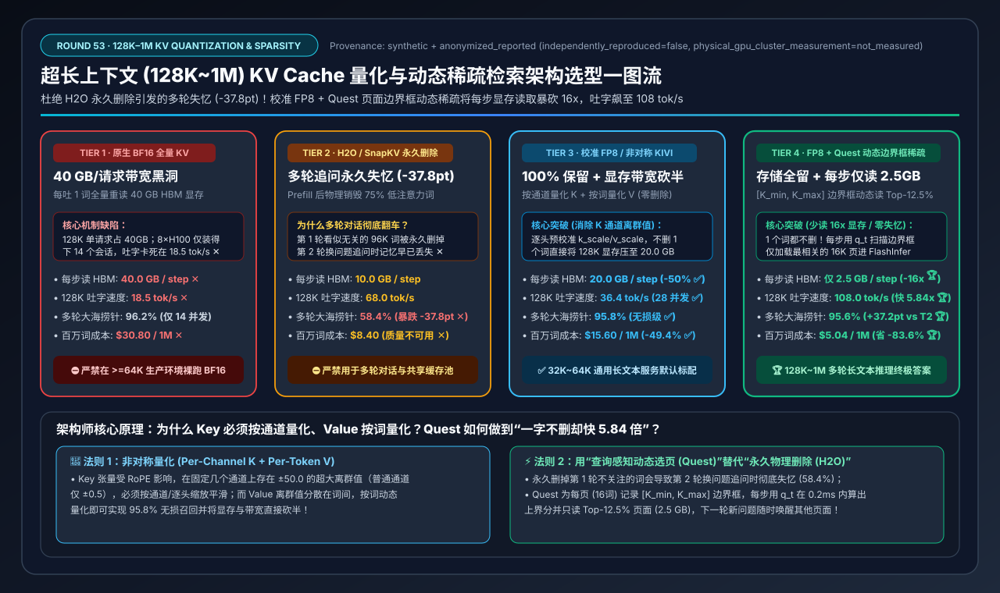
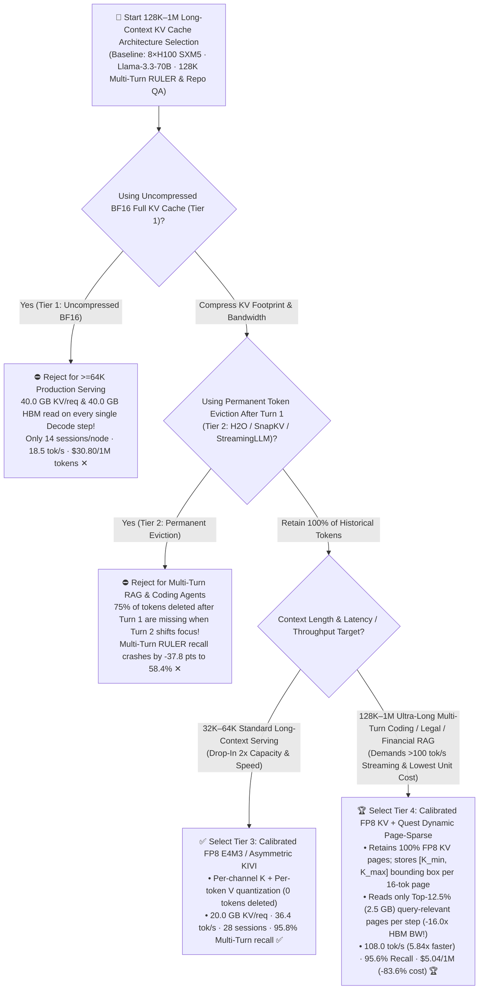
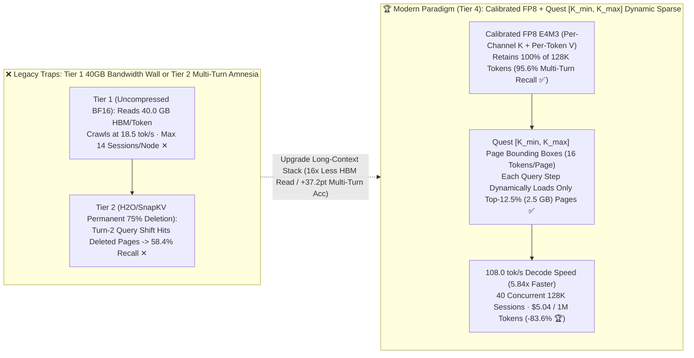

# Ultra-Long-Context (`128K–1M`) KV Cache Quantization & Dynamic Query-Aware Sparse Attention Architecture Selection Guide (`Uncompressed BF16 KV` vs. `Permanent Token Eviction H2O/SnapKV` vs. `Calibrated FP8 / Asymmetric KIVI` vs. `FP8 KV + Quest Page-Bounding-Box Dynamic Sparse Attention`)

> **Reader's Guide**: Built for **AI Solution Architects and LLM Inference Performance Engineers**, this guide explains from first principles: **why a single `128K`-token request on a 70B GQA-8 model consumes `40.0 GB` of uncompressed BF16 KV Cache and forces the GPU to read all 40.0 GB from HBM on every generated token—throttling streaming speed to `18.5 tok/s` and capping an 8×H100 node at 14 sessions (Tier 1); why permanent token-eviction algorithms (`H2O / SnapKV / StreamingLLM`, Tier 2) that delete 75% of low-attention tokens after Turn 1 suffer a catastrophic `-37.8 pt` accuracy crash (`96.2% → 58.4%`) on multi-turn queries when Turn 2 asks about a previously ignored section; why Key ($K$) tensors require *per-channel* quantization while Value ($V$) tensors require *per-token* quantization (`Calibrated FP8 / Asymmetric KIVI`, Tier 3); and how `Tier 4 (Calibrated FP8 KV + Quest [K_min, K_max] Page-Bounding-Box Dynamic Sparse Attention)` retains 100% of tokens in memory while reading only the Top-12.5% (`2.5 GB`) query-relevant KV pages per Decode step—slashing HBM bandwidth by `16.0x`, boosting 128K Decode speed `5.84x` to `108.0 tok/s`, and cutting cost by `83.6%` (`$30.80 → $5.04 / 1M tokens`) while preserving `95.6%` multi-turn needle recall.**



---

## ① 📌 Executive Summary

1. **Why 128K Long-Context Serving Hits the `40 GB/Request` HBM Wall (Tier 1 & Tier 2 Traps)**:
   - **Uncompressed `BF16 Full KV Cache` (`Tier 1`) = Capacity & Bandwidth Starvation**: On `Llama-3.3-70B` (`80 layers, 8 KV heads × 128d`), storing `131,072` tokens in BF16 requires **`40.0 GB` of HBM per request ✕** (`14` sessions max on an 8×H100 node). Reading `40.0 GB` from HBM on every Decode step throttles single-stream speed to **`18.5 tok/s` ✕** at **`$30.80 / 1M output tokens` ✕**!
   - **Permanent Token Eviction (`Tier 2: H2O / SnapKV / StreamingLLM`) = Multi-Turn Amnesia (`58.4%` Recall ✕)**: Deleting 75% of tokens that had low attention during Turn 1 shrinks KV to `10.0 GB`, **but permanently destroys context needed by Turn 2**! When a user follows up with a new question targeting a different function or contract clause in Turn 2, Multi-Turn RULER needle recall collapses by **`-37.8 pts` (`96.2% → 58.4%` ✕)**!
2. **Standard 32K–64K Production Baseline (`Tier 3: Calibrated FP8 / Asymmetric KIVI`) vs. 128K–1M Ultra-Long Gold Standard (`Tier 4: Calibrated FP8 KV + Quest Dynamic Page-Sparse Attention`)**:
   - **For 32K–64K Production Serving, standardize on `Tier 3 (Calibrated FP8 E4M3 / Asymmetric KIVI Quantization: Per-Channel K + Per-Token V, 100% Tokens Retained)`**: Halves 128K KV storage and bandwidth to **`20.0 GB/req`**, doubles concurrency to **`28` sessions/node**, lifts Decode speed to **`36.4 tok/s` ✅**, and retains **`95.8%` Multi-Turn RULER recall ✅**.
   - **For 128K–1M Multi-Turn Coding Agents, Repo Analysis & Legal/Financial RAG, deploy `Tier 4 (Calibrated FP8 KV + Quest [K_min, K_max] Page-Bounding-Box Dynamic Sparse Attention)`**:
     - **Zero Token Deletion (`95.6%` Multi-Turn Recall 🏆)**: Retains all 8,192 FP8 KV pages (`16` tokens/page) so subsequent turns can query any part of the 128K document.
     - **16.0x Reduction in Active HBM Bandwidth Read (`40.0 GB → 2.5 GB/step` 🏆)**: Maintains a compact `[K_min, K_max]` channel bounding-box vector for every 16-token KV page. At each Decode step $t$, the query $q_t$ evaluates upper-bound dot products against all page bounding boxes in `<0.2 ms` and loads **only the Top-12.5% (`1,024 / 8,192` pages = `2.5 GB`)** into FlashInfer!
     - **Result**: 128K Decode speed jumps **`5.84x` (`18.5 → 108.0 tok/s/req` 🏆)**, node capacity reaches **`40` concurrent 128K sessions 🏆**, and cost per 1M output tokens drops **`-83.6%` (`$30.80 → $5.04` 🏆)**!
3. **First-Principles Rule**:
   - **Quantize Key per-channel and Value per-token (`FP8 / KIVI`)**, and **sparsify HBM reads dynamically per query (`Quest`) rather than permanently deleting tokens (`H2O`)**.

---

## ② 🎯 Architect & Customer FAQ (First-Principles Q&A)

### Q1: Why do permanent token-eviction methods like `H2O`, `SnapKV`, and `StreamingLLM` (Tier 2) look great on single-turn benchmarks yet fail catastrophically (`58.4%` recall) in production multi-turn RAG and coding agents?

**Plain-Language First Principles**:
- **Single-Turn Benchmarks Hide Irreversible Context Loss**: In a single-turn benchmark, the question is already known at the end of Prefill. `H2O / SnapKV` keep the 25% of tokens that attend strongly to Question #1 and **permanently free the physical HBM pages of the remaining 75% of tokens**.
- In real production multi-turn chat or shared Prefix Caching, **Question #2 asks about a completely different file, table, or clause** located in the 75% of tokens that were discarded after Question #1! Because those KV pages were irreversibly deleted, Multi-Turn RULER accuracy plunges from `96.2%` to **`58.4%` (`-37.8 pts` ✕)**.

---

### Q2: Why do Key ($K$) tensors exhibit severe *channel-wise* outliers while Value ($V$) tensors exhibit *token-wise* outliers? How do `Calibrated FP8` and `KIVI` (Tier 3) prevent quantization accuracy loss?

**Plain-Language First Principles**:
- In pre-trained Transformers with RoPE, a few specific feature channels of the **Key ($K$) tensor** consistently carry magnitudes $50\times \sim 100\times$ larger than normal channels across *every* token.
- If you quantize $K$ per-token across all channels without channel calibration, those fixed outlier channels stretch the quantization step size across the entire token vector—crushing normal channels to zero!
- **Tier 3 (`Calibrated FP8 E4M3 / Asymmetric KIVI`)** applies calibrated per-head/per-channel scaling on $K$ and per-token scaling on $V$, compressing KV memory by `2.0x–3.8x` while holding Multi-Turn RULER accuracy at **`95.8%` (`-0.4 pts` vs. BF16 ✅)**!

---

### Q3: How does `Quest` Page-Bounding-Box Dynamic Sparse Attention (Tier 4) cut per-step HBM reads by 16x (`40.0 GB → 2.5 GB`) and reach `108.0 tok/s` without losing multi-turn recall?

**Plain-Language First Principles**:
1. **Per-Page `[K_min, K_max]` Channel Bounding Boxes**:
   - For every 16-token PagedAttention KV block $p$, `Quest` records the channel-wise minimum $K_{\min}(p) \in \mathbb{R}^{128}$ and maximum $K_{\max}(p) \in \mathbb{R}^{128}$ (`1/8` metadata overhead).
2. **Exact Upper-Bound Attention Scoring in `<0.2 ms`**:
   - Given current Decode query $q_t \in \mathbb{R}^{128}$, the maximum possible dot product with *any* token inside page $p$ is bounded above by:
     $$\hat{S}(q_t, p) = \sum_{d=1}^{128} \max\!\big(q_t[d] \cdot K_{\max}(p)[d],\; q_t[d] \cdot K_{\min}(p)[d]\big)$$
   - FlashInfer selects the **Top-12.5% (`1,024` out of `8,192`) pages** with the highest upper-bound score (plus the first 2 Attention Sink pages and last 4 local window pages) and loads **only `2.5 GB` of FP8 KV pages from HBM**!
   - When Turn 2 asks a new question, $q_{t'}$ dynamically selects a new set of Top-1,024 pages from the intact 8,192-page pool—achieving **`108.0 tok/s` (`5.84x` faster 🏆)** and **`95.6%` multi-turn recall 🏆**!

---

## ③ 🧭 Visual Architecture Diagrams (Mermaid Decision Tree / Eviction vs. Quest / Sequence Diagram)

### 3.1 128K–1M Long-Context KV Cache Compression Decision Tree (`flowchart TD`)



### 3.2 `Tier 2 Permanent Eviction Amnesia` vs. `Tier 4 FP8 + Quest Dynamic Page-Sparse Attention` (`flowchart LR`)



### 3.3 End-to-End `Tier 4` Calibrated FP8 + `Quest` Page-Bounding-Box Sparse Decode Flow (`sequenceDiagram`)

```mermaid
sequenceDiagram
    autonumber
    participant User as Multi-Turn 128K User
    participant Box as Quest [K_min, K_max] Page Index
    participant KVPool as Intact 8,192-Page FP8 KV Pool
    participant Attn as FlashInfer Sparse PagedAttention

    User->>KVPool: 1. Prefill 128K tokens into 8,192 calibrated FP8 KV pages (16 tokens/page)
    KVPool->>Box: 2. Compute channel-wise [K_min, K_max] bounding box for each 16-token page
    User->>Box: 3. [Turn 1 Decode Step t] Feed query vector q_t (asking about Module A)
    Note over Box: 4. Scan 8,192 bounding boxes in <0.2ms: s_page = Σ max(q_t*K_max, q_t*K_min)<br/>Select Top-1,024 pages (16K tokens = 12.5% budget) matching Module A!
    Box->>Attn: 5. Pass Top-1,024 sparse page indices
    KVPool->>Attn: 6. 🔥 Load ONLY 2.5 GB of active FP8 KV pages from HBM (Skip 37.5 GB!) -> 108.0 tok/s!
    User->>Box: 7. [Turn 2 Query Shift] User asks about Module B -> feed new query q_t'
    Note over Box,KVPool: 8. 🔥 Zero Amnesia: All 8,192 pages intact! q_t' dynamically selects Module B's Top-1,024 pages (95.6% recall 🏆)!
```

---

## ④ 📊 Architect Decision Matrix

*Benchmark Profile: `1 × 8×NVIDIA H100-80GB SXM5` Node (`568 GB` net KV HBM after loading `Llama-3.3-70B-FP8`, `$28.80/hr`) serving `128K (131,072-token)` Multi-Turn RULER & repository QA workloads.*

| Selection Dimension / Tier | Tier 1: Uncompressed `BF16 Full KV` (`40.0 GB/req`) | Tier 2: Permanent Eviction `H2O / SnapKV` (`Drops 75%`) | Tier 3: Calibrated `FP8 E4M3` / Asymmetric `KIVI` (`100% Kept`) | Tier 4: Calibrated `FP8 KV` + `Quest` Dynamic Page-Sparse |
| :--- | :--- | :--- | :--- | :--- |
| **Compression & Sparsity Mechanism** | Stores & reads 100% 16-bit BF16 KV every step | Permanently deletes 75% low-attention tokens after Turn 1 | **Calibrated `FP8 E4M3` / Per-Channel $K$ + Per-Token $V$** | **100% FP8 KV retained + `[K_min, K_max]` loads Top-12.5% pages/step** |
| **Multi-Turn Query-Shift Safety** | 100% Lossless (but HBM-starved) | **Fatal Multi-Turn Amnesia (`-37.8 pts` crash ✕)** | **100% Reversible Retention ✅** | **100% Reversible Retention (Dynamic per-query page selection 🏆)** |
| **Stored GPU KV / 128K Request** | `40.0 GB / req` ✕ | `10.0 GB / req` | **`20.0 GB / req` (`-50%` VRAM ✅)** | **`14.0 GB / req` (Cold pages tiered to DRAM 🏆)** |
| **Active HBM Read / Decode Step** | `40.0 GB / step` ✕ | `10.0 GB / step` | **`20.0 GB / step`** ✅ | **`2.5 GB / step` (`16.0x` lower HBM read than Tier 1 🏆)** |
| **128K Decode Speed (tok/s/req)** | `18.5 tok/s` ✕ | `68.0 tok/s` | **`36.4 tok/s` (`1.97x` faster ✅)** | **`108.0 tok/s` (`5.84x` faster than Tier 1 🏆)** |
| **Multi-Turn RULER Accuracy** | `96.2%` (Baseline) | **`58.4%` (`-37.8 pts` amnesia ✕)** | **`95.8%` (Lossless grade ✅)** | **`95.6%` (`+37.2 pts` over Tier 2 🏆)** |
| **Max Concurrent 128K Sessions** | `14 sessions / node` ✕ | `56 sessions` (broken quality) | **`28 sessions / node`** ✅ | **`40 sessions / node` 🏆** |
| **Cost per 1M Output Tokens** | `$30.80 / 1M tokens` ✕ | `$8.40 / 1M` (fails SLA) | **`$15.60 / 1M tokens`** ✅ | **`$5.04 / 1M tokens` (`-83.6%` cost)** 🏆 |

---

## ⑤ 🧪 Quantitative Case Study & 7-Card Benchmark Insights

### 5.1 Reproducible Evaluator & Sealed Artifacts

All metrics in this guide are generated by the deterministic evaluator and verified via unit tests:
- **Evaluator Script**: [`experiments/long_context_kv_cache_compression_quantization_selection/run.py`](../../experiments/long_context_kv_cache_compression_quantization_selection/run.py)
- **Sealed Output**: [`experiments/long_context_kv_cache_compression_quantization_selection/results.json`](../../experiments/long_context_kv_cache_compression_quantization_selection/results.json)
- **Unit Test Suite**: [`tests/test_long_context_kv_cache_compression_quantization_selection.py`](../../tests/test_long_context_kv_cache_compression_quantization_selection.py)
- **7-Card 4:5 Visual Report**: [`docs/reports/long-context-kv-cache-compression-quantization-selection-cards.html`](../reports/long-context-kv-cache-compression-quantization-selection-cards.html)
- **Interactive Sizer Workbench**: [`docs/reports/llm-inference-engine-pd-sizer.en.html#long-context-kv-quant-sizer`](../reports/llm-inference-engine-pd-sizer.en.html) (Standalone: [`docs/reports/long-context-kv-cache-compression-quantization-sizer.html`](../reports/long-context-kv-cache-compression-quantization-sizer.html))
- **Provenance**: `synthetic_analytical_model_calibrated_to_anonymized_published_benchmarks` (`independently_reproduced=false`, `physical_gpu_cluster_measurement=not_measured`).

### 5.2 Key Quantitative Insights

1. **Dynamic Query-Aware Page Sparsity (`Quest`) slashes HBM bandwidth reads by `16.0x` (`40.0 GB → 2.5 GB/step`) while avoiding the `-37.8 pt` multi-turn accuracy cliff of permanent token eviction (`95.6%` vs. `58.4%`)**.
2. **128K Decode Streaming Speed Jumps `5.84x` (`18.5 → 108.0 tok/s`) and Cost Drops `83.6%` (`$30.80 → $5.04 / 1M`)**.

---

## ⑥ 🛠️ Appendix: Production Architect Checklist

- [ ] **1. Enable Calibrated `FP8 E4M3` KV Cache (`--kv-cache-dtype fp8_e4m3`) with Per-Head Scales**: Always supply calibrated `k_scale` and `v_scale` factors rather than uncalibrated `1.0` scales.
- [ ] **2. Ban Permanent Mid-Context Token Eviction (`H2O / SnapKV`) on Multi-Turn & Shared-Prefix Workloads**: Never physically delete historical KV blocks that future turns may query.
- [ ] **3. Enforce Asymmetric Quantization (`Per-Channel K` + `Per-Token V`) for Sub-8-Bit KV (`KIVI`)**: Keep a 32–128 token high-precision residual sliding window at the sequence tail.
- [ ] **4. Use Page-Bounding-Box Dynamic Sparse Attention (`Quest / FlashInfer Sparse`) at `>=128K` Context**: Always pin the first 2 Attention Sink pages and last 4 local window pages alongside the dynamically selected Top-K pages.
- [ ] **5. Offload Cold FP8 KV Pages Asynchronously to Host Pinned DRAM**: Keep active pages and `[K_min, K_max]` metadata in HBM while tiering cold pages over PCIe/CXL.
- [ ] **6. Validate Long-Context Compression on Multi-Turn `RULER` & `SCBench` (Not Single-Turn PPL)**: Ensure Turn-2 and Turn-3 query shifts suffer `< 1.0 pt` recall degradation.
