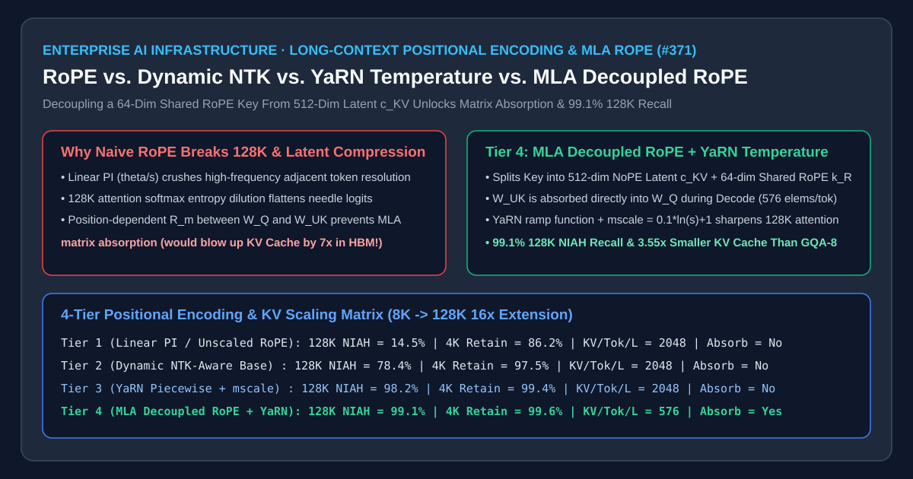

# Long-Context Positional Encoding & KV Compression Guide: `RoPE` vs. `Dynamic NTK` vs. `YaRN (Temperature Scaling)` vs. `MLA Decoupled RoPE`

> **Language**: [中文](./long-context-positional-encoding-rope-yarn-ntk-mla-decoupled-rope-selection-faq.md) | **English (Current)**  
> **Audience**: Cloud & AI Infrastructure Solution Architects and Long-Context Inference Engineers  
> **Provenance**: `synthetic + anonymized_reported` (`independently_reproduced=false`, `physical_gpu_cluster_measurement=not_measured`)

---

## 1. 📌 Executive Summary

> **Bottom Line**: **Extending an `8K` model `16x` to `128K` context via naive `Linear Position Interpolation (PI)` (`Tier 1`, $\theta' = \theta/s$) crushes high-frequency adjacent token distinctions, collapsing `128K` Needle-In-A-Haystack (`NIAH`) recall to `14.5%` and degrading short `4K` accuracy to `86.2%`. Furthermore, in `Multi-head Latent Attention (MLA)` models (`DeepSeek-V3/R1`), applying position-dependent `RoPE` directly to compressed latent KV vectors blocks the absorption of $W^{UK}$ into $W^Q$ during decode (which would blow up HBM KV Cache by `7x`). Production architectures pair `YaRN Piecewise Wavelength Scaling + Attention Logit Temperature` ($\sqrt{1/t} = 0.1\ln(s)+1$, `Tier 3`) with `MLA Decoupled Shared RoPE` (`512-dim NoPE Latent` $c_t^{KV}$ + `64-dim Broadcasted RoPE Key` $k_t^R$, `Tier 4`): preserving full $W^{UK}$ matrix absorption (`576 elements/token/layer` — `3.55x` smaller than `GQA-8`), achieving `99.1%` 128K NIAH recall, and retaining `99.6%` short-4K accuracy.**

- **Interactive Positional Encoding & MLA RoPE Sizer**: [Open Interactive Sizer (`long-context-positional-encoding-rope-yarn-ntk-mla-decoupled-rope-sizer.html`)](../reports/long-context-positional-encoding-rope-yarn-ntk-mla-decoupled-rope-sizer.html)
- **7-Card 4:5 Visual Report**: [Open 7-Card Report (`long-context-positional-encoding-rope-yarn-ntk-mla-decoupled-rope-selection-cards.html`)](../reports/long-context-positional-encoding-rope-yarn-ntk-mla-decoupled-rope-selection-cards.html)

---

## 2. 📊 4-Tier Positional Encoding & KV Scaling Matrix (`8K -> 128K` `16x` Extension)

| Metric | Tier 1: Linear Position Interpolation (`PI`) | Tier 2: Dynamic `NTK-Aware` Base Scaling | Tier 3: `YaRN / Piecewise RoPE` + Temperature `mscale` (`GQA-8`) | Tier 4 (Recommended): `MLA Decoupled RoPE (512d+64d)` + `YaRN` |
| :--- | :--- | :--- | :--- | :--- |
| **`128K` NIAH Retrieval Recall** | `14.5%` ✕ (High-freq crushed) | `78.4%` | **`98.2%` ✓** | **`99.1%` ✓** |
| **Short `4K` Accuracy Retention** | `86.2%` ✕ | `97.5%` | **`99.4%` ✓ (Unscaled high-freq)** | **`99.6%` ✓** |
| **KV Cache Elements / Token / Layer** | `2,048` (`GQA-8`) | `2,048` (`GQA-8`) | `2,048` (`GQA-8`) | **`576` ✓ (`512 + 64`, `3.55x` smaller)** |
| **Enables MLA $W^{UK}$ Matrix Absorption** | No ✕ ($R_{t-m}$ blocks associative law) | No ✕ | No ✕ | **Yes ✓ (NoPE trunk + 64d RoPE sidecar)** |

---

## 3. 🛠️ Production Readiness Checklist

- [ ] **Configure `mscale` Attention Temperature Scaling ($\sqrt{1/t} = 0.1\ln(s)+1$) Alongside `YaRN` Wavelength Interpolation** so `128K` softmax denominators do not dilute needle logits.
- [ ] **Keep `512-dim` Latent $c_t^{KV}$ and `64-dim` RoPE $k_t^R$ Aligned in Contiguous `576-element` Paged KV Blocks** when deploying `FlashMLA` or `FlashInfer` for `DeepSeek-V3/R1`.
